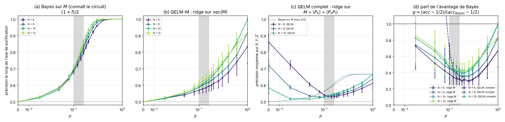
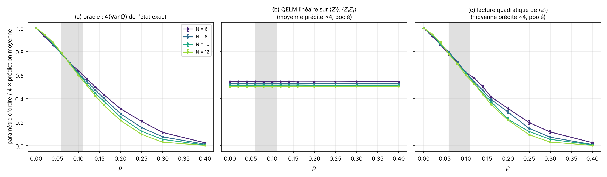
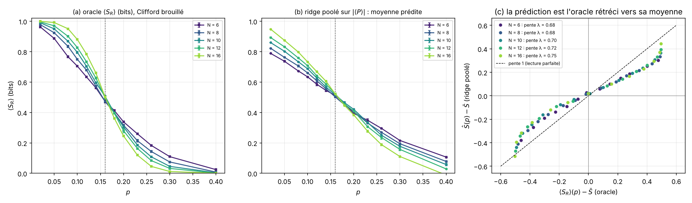
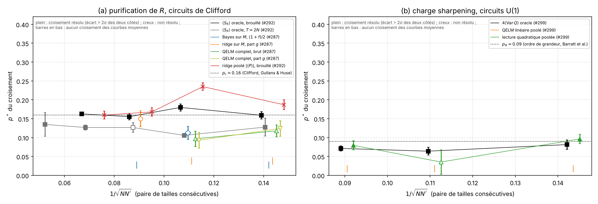
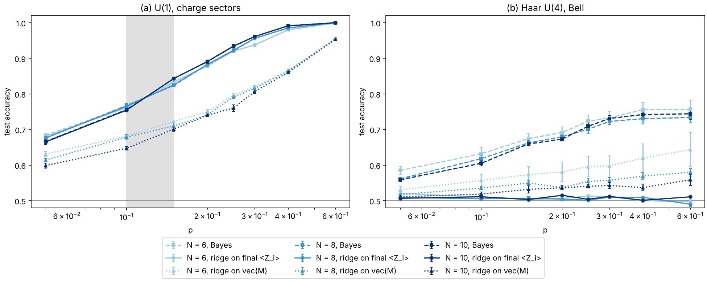
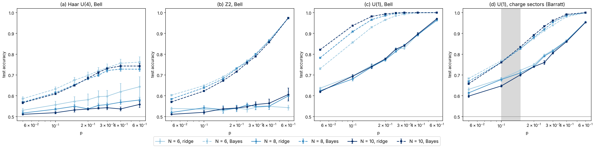

# Le QELM voit-il la MIPT ? Ce qui est prouvé, ce qui est mesuré, ce qui reste à faire

*Note du 5 novembre 2026, issue #303. Elle rassemble les résultats de #278, #280,
#286, #289, #290, #291 (ouverte), #294 (fermée sans fusion), #295, #298, #300 et #302 (ouverte),
et de quelques runs du dossier du projet. Elle ne lance aucune simulation : les
figures 1 à 4 sont recalculées à partir des résumés existants par
[`experiments/qelm_verdict/plot_verdict.py`](../../experiments/qelm_verdict/README.md).*

**Le QELM étudié.** Un ridge sur trois blocs de features : le registre de mesures
`vec(M)`, et les valeurs moyennes `<P_k>` et `<P_k P_l>` (`P = X, Y, Z`) de l'état
final de la trajectoire. On ne cherche pas une sonde qui marche à tout prix. La
question est de savoir si **cette** lecture peut montrer la transition, et de le
démontrer dans un sens comme dans l'autre.

## Réponse courte

1. **Le QELM ne voit pas la MIPT d'intrication (purification de `R`) dans les
   circuits sans loi de conservation, Haar ou Clifford.** Pour une partie, c'est un
   théorème :
   - le ridge sur `M` ne dépend que des corrélations à un et deux points des
     résultats de mesure (T1) ;
   - dans un circuit Haar, la covariance de chaque résultat tardif avec le label
     est bornée par `p D_t`, et `D_t` décroît exponentiellement (T4) ;
   - en Clifford, le signe d'un `R` purifié est une parité des résultats, et une
     lecture linéaire ne lit que les parités de poids au plus 1 (T5) ;
   - les signes de `<P_k>` et `<P_k P_l>` sont indépendants de `S_R`, donc
     `R² = 0` exactement (T3).

   Pour le reste, c'est une mesure : aucun croisement résolu en `N` de la
   précision du QELM (figures 1 et 4).
2. **Les croisements qu'on peut voir dans des courbes de QELM ne sont pas des
   preuves.** Il y a trois pièges, et chacun est démontré sur nos données :
   - le **rétrécissement** : une lecture poolée qui apprend `p` recopie le
     croisement de l'oracle (figure 3) ;
   - l'**héritage** : la précision vaut `1/2 + f · (acc_pur − 1/2)`, et elle hérite
     donc du croisement de la fraction purifiée `f`, qui est une quantité
     d'oracle (T6) ;
   - le **brouillage** : à petit `p`, la lecture de l'état meurt plus tôt quand `N`
     grandit, ce qui force un croisement qui dérive vers 0 (figure 1c, #285, #302).
3. **Le QELM voit une transition quand ses features contiennent déjà le
   posterior, à l'ordre que la lecture sait représenter.** C'est le contrôle
   positif, dans les circuits U(1) à deux secteurs de charge :
   - `sum_i <Z_i>` est affine en le posterior, donc le ridge sur `<Z_i>` **est**
     Bayes et croise comme lui (figure 5) ;
   - `Var(Q) = w (1 − w)` est quadratique en le posterior, donc la lecture linéaire
     est plate (théorème) et la lecture quadratique est exacte (figure 2).

   Mais c'est le **charge sharpening**, pas la MIPT d'intrication. Et les features
   exactes d'une trajectoire supposent un simulateur qui connaît le circuit,
   c'est-à-dire le décodeur de Bayes lui-même.
4. **Ce qui reste ouvert, et le calcul qui le tranche.** En Clifford, le ridge
   récupère une part `g ≈ 0.3–0.4` de l'avantage de Bayes près de `p_c`, et cette
   part **ne diminue pas** de `N = 6` à 12 (figure 1d). Si `g` reste fini quand `N`
   grandit, le QELM *hérite* de la transition, affaiblie par un facteur lisse, sans
   la *voir* par lui-même. Les données actuelles (6 circuits par taille) ne
   résolvent même pas le croisement de l'oracle sur ce jeu de données. Le calcul
   proposé à la section 6 (Clifford, `N = 16` à 48, 50 circuits) tranche la
   question.

## 1. Ce que « voir la transition » veut dire

Une observable ne *définit* pas la MIPT, elle la *sonde* (note
[`etat-des-lieux-sondes-mipt.md`](etat-des-lieux-sondes-mipt.md)). On dira que le
QELM voit la transition si un score `S_N(p)` du QELM (précision, `R²`, prédiction
moyenne) passe **les cinq tests** suivants. Les trois derniers manquaient dans
les études précédentes.

| Test | Pourquoi |
| --- | --- |
| **(a) Croisement résolu.** Pour deux tailles consécutives, l'écart `S_N − S_N'` est significatif (`|z| > 2`) d'un côté puis de l'autre. | Sans cela, un croisement des courbes moyennes est du bruit. |
| **(b) Dérive vers `p_c`.** `p*(N, N')` converge, en `1/N`, vers la valeur de l'oracle. | Un croisement qui dérive vers 0 ou vers 1 est un crossover. |
| **(c) L'oracle passe (a) et (b) sur les mêmes données.** Mêmes circuits, mêmes trajectoires, mêmes `N`. | Si l'oracle ne résout pas la transition, un échec du QELM ne prouve rien, et un succès non plus. |
| **(d) Pas de contrôle trivial qui fasse aussi bien.** `p_mean` (on lui donne `p`), `n_meas` (il compte les mesures), une variable `p N^a T^b`. | Un lecteur qui apprend `p` recopie n'importe quelle courbe moyenne de l'oracle (figure 3). |
| **(e) La part de l'oracle `g = (S − S_hasard)/(S_Bayes − S_hasard)` reste finie à `p_c` quand `N` grandit.** | `S − S_hasard = g · (S_Bayes − S_hasard)` est une identité. Un croisement de `S` vient soit de l'oracle (héritage), soit de `g`. Le QELM ajoute quelque chose seulement si `g` a lui-même une signature. Il n'hérite de la transition que si `lim g > 0`. |

Un effondrement `S((p − p_c) N^{1/ν})` complète (a) et (b), mais il ne remplace pas
(c), (d) et (e). Avec 3 à 5 tailles de `N = 6` à 16, un collapse à deux
paramètres libres réussit presque toujours. On ne s'en sert donc que pour comparer
`ν` à celui de l'oracle.

## 2. Carte des arguments

### Prouvé (théorèmes)

| | Énoncé | Portée | Source |
| --- | --- | --- | --- |
| **T1** | Le ridge (en population) ne dépend de la loi de `(x, Y)` que par `E[x]`, `E[xY]` et `E[x xᵀ]`. Son `R²` vaut `cᵀ Σ⁻¹ c / Var Y` (pour `α → 0`, avec `c = Cov(x, Y)`). Il égale Bayes si et seulement si `E[Y | x]` est affine en `x`. Pour `x = vec(M)`, ce sont des corrélations à **un et deux points** des résultats de mesure. | Tout circuit, tout `p` | Standard (moindres carrés). Rappelé ici. |
| **T2** | La prédiction moyenne d'une lecture **linéaire poolée** à `p` donné vaut `β + w · E_p[x]`. Pour les features d'état, `E_p[<O>] = Tr(O ρ̄_p)`, où `ρ̄_p` est l'état moyenné sur les trajectoires, c'est-à-dire la sortie du canal déphasé `D_p` (lemme 1 de #291). | Tout circuit | #291 (lemme 1), #299 |
| **T2'** | Circuits U(1) aléatoires : la moyenne sur les portes de la diagonale est le processus d'exclusion, et `D_p` ne change pas la diagonale. Donc `E_p[<Z_i>]` et `E_p[<Z_i Z_j>]` **ne dépendent pas de `p`**, et toute lecture linéaire poolée est plate (figure 2b). | U(1), moyenne sur les portes | #299 |
| **T3** | Clifford : `S_R` et tous les `|
|` ne dépendent que des portes et des sites mesurés, et les signes sont des résultats uniformes. Le ridge sur les `<P_k>`, `<P_k P_l>` signés a donc `R² = 0` exactement pour `S_R` (et pour la pureté). | Clifford | #295 (test `test_signs_are_outcomes_but_abs_and_entropy_are_not`) |
| **T4** | **Couches précoces.** Aucun décodeur des tours `k..T` seuls ne dépasse `(1 + D_k)/2`, et `D_k` décroît (Th. 1). Pour toute lecture linéaire, `|E[m_{t,i} Y]| ≤ p D_t` (Cor. 1). En moyenne de Haar, `E[D_t] ≤ 2^{(N−1)/2} g(p)^{(t−1)/2}` avec `g(p) = (1 + 2(1−p)²)/3` (Th. 3). Avec une charge U(1) conservée, `sum_i E[m_{t,i} Y] = −p ΔQ` à chaque tour, et `D_t = 1` pour deux secteurs (Prop. 4). | Th. 1 et Prop. 4 : tout circuit fixe ; Th. 3 : moyenne de Haar | #291, `documentation/notes/early-layers-proof.md` sur la branche de #291 (**PR ouverte, non fusionnée**) |
| **T5** | Clifford : quand `R` est pur selon `P`, `<P_R> = c · s_{j1} ⋯ s_{jk}`. Une parité de `k ≥ 2` résultats indépendants et non biaisés n'est corrélée à aucun résultat seul. Le ridge sur `vec(M)` ne peut donc utiliser que les trajectoires de poids `k ≤ 1`, d'où `acc_pur ≤ (1 + w₁)/2`. | Clifford | #289. L'égalité est **mesurée** (0,02 RMS sur 696 points). |
| **T6** | Clifford : `R` est soit pur, soit maximalement mixte. Sur les trajectoires où il est mixte, **tout** décodeur est au hasard. Donc `acc = 1/2 + f · (acc_pur − 1/2)`, où `f` est la fraction purifiée, une quantité d'oracle. | Clifford | #289 (identité utilisée dans `dehghani_decoder`) |
| **T7** | U(1), deux secteurs `Q₀`, `Q₁` : `sum_i <Z_i> = N − 2(Q₀ w + Q₁ (1 − w))` est affine en le posterior `w`. Une lecture linéaire de `<Z_i>` réalise donc Bayes (`sign(w − 1/2)`). En revanche `Var(Q) = w (1 − w)` est symétrique autour de `w = 1/2`, et aucune lecture linéaire ne la suit, alors qu'une lecture quadratique de `sum_i <Z_i>` est exacte. | U(1), deux secteurs | #299, note `early-layers-288/mipt` du dossier du projet |

### Mesuré

| | Résultat | Source |
| --- | --- | --- |
| **M1** | Clifford, `T = 2N`, `N = 6` à 12, 6 circuits : la précision du ridge sur `M` reste sous Bayes entre `p ≈ 0.1` et 0,5. Sa part `g = 2 acc_pur − 1` de l'avantage de Bayes vaut, à `p = 0.16`, **0,30 ; 0,36 ; 0,39 ; 0,40** (`N = 6, 8, 10, 12`). Elle ne diminue pas avec `N` (figure 1d). | #289, figure 1 |
| **M2** | Même jeu, QELM complet `M + <P_k> + <P_k P_l>`, `N = 6, 8, 10` : la lecture de l'état n'est utile qu'à petit `p` (0,86 ; 0,72 ; 0,58 à `p = 0`), puis le registre prend le relais. À `p = 0.16`, `g` vaut **0,33 ; 0,35 ; 0,42**. Les courbes brutes se croisent vers `p ≈ 0.12` (6/8) et `0.10` (8/10), mais **aucun croisement n'est résolu**. | #289, figures 1c et 4 |
| **M3** | Sur ce même jeu, **l'oracle ne résout pas non plus son croisement** (`f` et `(1+f)/2`) : aucune paire de tailles ne passe le test (a). Ce jeu de données ne permet donc pas de trancher. | Figure 4 |
| **M4** | Clifford brouillé (`t₀ = 2N`), `N = 6` à 16 : l'oracle `<S_R>` croise à 0,159 ; 0,180 ; 0,156 ; 0,163 (tous résolus), contre 0,1598 pour Gullans & Huse. Le ridge poolé sur `|
|` croise aussi (0,187 ; 0,235 ; 0,168 ; 0,160), mais sa prédiction est l'oracle rétréci, `Ŝ − S̄ ≈ λ (S − S̄)` avec `λ = 0,68` à 0,75, et par `p` son `R²` reste sous le contrôle `n_meas` dès `N = 8`. | #295, figure 3 |
| **M5** | Haar, `T = 2N`, `N = 8`, 10 circuits : les tours 1 à 3 portent 80 à 100 % du signal du ridge ; les tours 4 à 16 seuls sont au hasard. Série en taille `N = 6, 8, 10` (5 circuits), le ridge sur `M` **baisse** avec `N` (sur-apprentissage, 2N² features), et le ridge limité aux tours 1 à 3 a la même valeur à `N = 8` et 10. | #291, run du dossier du projet (`early-layers-288/mipt`) |
| **M6** | Haar, `N = 6, 8, 10` : tomographie et pureté de `R` depuis `M`. Minimum de `R²` de Bloch sans dérive monotone (0,34 ; 0,26 ; 0,28), pic de l'erreur sur la pureté qui ne s'affine presque pas. Seule la pureté **exacte** croise (0,205 ; 0,23 ; 0,264), avec une dérive vers le haut. | #290 |
| **M7** | Haar : `p_cross` (QELM = Bayes sur `M`) varie comme `N^a T^b`, avec `b ≈ −1.1` et `a = −0.25` à `−0.5`. Ce n'est pas `p N T`. Avec `T = 2N`, cela donne `p_cross ∝ N^{−1.35 à −1.6}`, qui tend vers 0. | #286, #302 (**PR ouverte**) |
| **M8** | U(1), deux secteurs, `N = 6, 8, 10` : le ridge sur `<Z_i>` final égale Bayes à 0,002 près et croise entre `p = 0.10` et 0,15 ; le ridge sur `vec(M)` ne croise pas et reste 0,05 à 0,15 sous Bayes. | Run du dossier du projet `early-layers-288/mipt`, figure 5 (**hors `main`**) |
| **M9** | U(1), `Var(Q)`, `N = 6` à 12 : l'oracle croise à 0,081 ; 0,064 ; 0,071 (tous résolus), et la lecture quadratique poolée à 0,096 ; (non résolu) ; 0,080. La lecture linéaire poolée est plate. | #300, figures 2 et 4b |
| **M10** | Lecteurs non linéaires génériques sur `M` (MLP, CNN) : à `T = 2N`, `N ≤ 16`, ils gagnent sur le ridge à `N = 6` (+0,13), puis de moins en moins (+0,01 à `N = 10`, 12). | #289, #294 (fermée sans fusion) |

### Conjecturé (pas encore démontré ni mesuré à des tailles suffisantes)

| | Énoncé | Ce qui le soutient | Ce qui le tranche |
| --- | --- | --- | --- |
| **C1** | Haar : la précision du ridge sur `M` converge vers une courbe **indépendante de `N`**, donc sans croisement. | T4 : le signal vient d'un cône de lumière de 3 tours autour du site encodé, dont la loi ne dépend plus de `N` quand `N` dépasse le cône. M5. | Ridge sur les tours 1 à 3, `N = 6` à 14, à nombre de features fixe (calcul B). |
| **C2** | Clifford : `g(p_c, N)` reste fini, si bien que la précision du QELM **hérite** du croisement de `f`, affaiblie par un facteur lisse. | M1, M2 (`g` croît légèrement de `N = 6` à 12). | Calcul A. |
| **C2'** | L'hypothèse inverse de C2 : `g(p_c, N) → 0`, parce que les labels purifiés tard sont des parités de poids croissant (T5). Le QELM serait alors aveugle. | La part `w₁` des parités de poids ≤ 1 devrait baisser quand le temps de purification grandit ; Dehghani et al. trouvent un coût exponentiel en le temps de purification (#298). | Calcul A, avec `w₁` mesuré. |
| **C3** | Le croisement brut du QELM complet (M2) est le crossover de brouillage de M7. Il dérive vers 0 comme `N^{−1.4}` environ, et pas vers `p_c`. | M2 (0,118 puis 0,097), M7 (sur Haar, pas sur Clifford). | Calcul A, cas 3. |
| **C4** | « Aucune quantité linéaire en `ρ_M`, moyennée sur les trajectoires, ne voit la MIPT ; il faut au moins deux répliques. » | C'est l'énoncé usuel de la littérature (par exemple Skinner, Ruhman, Nahum, PRX 9, 031009 (2019) ; la revue de Fisher, Khemani, Nahum, Vijay, Annu. Rev. Condens. Matter Phys. 14 (2023)). **Ces références sont citées de mémoire et n'ont pas été relues pour cette note.** T2 et T2' en sont des cas particuliers démontrés ici. | Relire les sources. Ce n'est pas nécessaire pour le verdict, puisque T2 et T2' suffisent. |

**Ce que T1 ne dit pas.** Pour les features d'état, la matrice `Σ = E[
<Q>]`
contient des quantités à deux répliques, qui peuvent porter la transition. T1
n'exclut donc pas, à lui seul, que le ridge sur l'état voie quelque chose par `p`.
C'est T3 (en Clifford) et la mesure M2 (en Haar et Clifford) qui l'excluent ici.

## 3. Verdict par cas

| Cas | L'oracle résout-il la transition ? | Le QELM ? | Pourquoi | Statut |
| --- | --- | --- | --- | --- |
| Clifford, `S_R` depuis l'état final (#295) | Oui, `p* = 0.16` (M4) | **Non** : `R² = 0` en linéaire, et le croisement poolé de `|
|` est un rétrécissement | T3, figure 3 | Prouvé (linéaire), mesuré (`|
|`) |
| Clifford, label de `R` depuis `M` (#289) | **Non résolu** avec 6 circuits (M3) | Pas de croisement résolu ; `g ≈ 0.3–0.4` stable | T5, T6, M1 | **Ouvert** (C2 / C2') |
| Clifford, QELM complet (#289, cas 3) | Non résolu (M3) | Croisement brut non résolu, qui dérive vers le bas | M2, C3 | Ouvert, probablement un crossover |
| Haar, label de `R` depuis `M` (#278, #291) | Non résolu à `N ≤ 10` | Non, courbes plates ou décroissantes en `N` | T4, M5, C1 | Prouvé en partie, mesuré |
| Haar, Bloch et pureté de `R` (#280, #290) | Pureté exacte : croise, avec une dérive | Non : la pureté est paire en `M`, donc invisible au linéaire ; minimum de Bloch sans dérive | M6 | Mesuré |
| U(1), label de charge (#291, run du dossier) | Oui, 0,10–0,15, avec une dérive vers `p_#` | **Oui** pour le ridge sur `<Z_i>` (= Bayes) ; non pour le ridge sur `M` | T7, M8 | Prouvé et mesuré, mais c'est le charge sharpening |
| U(1), `Var(Q)` (#300) | Oui, 0,06–0,08 | **Non** en linéaire (plat), **oui** en quadratique | T2', T7, M9 | Prouvé et mesuré |

## 4. Figures

**Figure 1. Clifford, même circuit, trois décodeurs, et la part de Bayes.**
Brickwork périodique de portes de Clifford, un circuit fixe par graine (6 par
taille), `T = 2N` demi-couches, mesure en Z de chaque site avec la probabilité
`p`, et `R` en paire de Bell avec le site du milieu. Axe des `p` en symlog ; bande
grise : `0.10 ≤ p ≤ 0.16` (fourchette de Dehghani et al. et valeur de Gullans &
Huse) ; tireté gris : le hasard. Barres : erreur standard sur les 6 circuits.
(a) Précision de Bayes sur `M` le long de l'axe de purification, `(1 + f)/2`, pour
`N = 6` à 12. (b) Le ridge sur `vec(M)` (QELM-M), sur les mêmes trajectoires. (c)
Le QELM complet, ridge sur `M + <P_k> + <P_k P_l>`, en moyenne sur les axes `X, Y,
Z`, pour `N = 6, 8, 10`. En pointillé, Bayes sur `M`, qui plafonne à 2/3. (d) Part
de l'avantage de Bayes, `g = (acc − 1/2)/(acc_Bayes − 1/2)` : en trait plein le
ridge sur `M` (`g = 2 acc_pur − 1`), en tireté le QELM complet (tracé pour
`p ≥ 0.08`, là où Bayes s'éloigne du hasard). Ce que la figure montre : le QELM
récupère 30 à 40 % de l'avantage de Bayes près de `p_c`, avec un minimum de `g`
vers `p ≈ 0.15–0.2`, et cette part ne diminue pas avec `N`. Les courbes brutes (b)
sont rangées par `N` au-dessus de `p ≈ 0.1`, mais T6 dit que cet ordre vient de
`f`, pas du décodeur. Données : `experiments/dehghani_decoder/figures/summary.json`
(#287, PR #289). Figure produite par `experiments/qelm_verdict/plot_verdict.py`
(#303).

**Figure 2. Contrôle positif et contrôle négatif sur les mêmes trajectoires :
charge sharpening en U(1).** Brickwork U(1), un nouveau circuit par trajectoire,
`T = N`, état initial `(|Q₀> + |Q₁>)/√2`, `N = 6` à 12, 3 graines de 2000
trajectoires par `p`. Barres : erreur standard sur les graines. Bande grise :
`p ≈ 0.06–0.11`, où se trouvent les croisements de l'oracle. (a) Oracle :
`4 <Var Q>` de l'état exact. (b) Moyenne prédite (×4) par une lecture linéaire
poolée sur `<Z_i>`, `<Z_i Z_j>`, entraînée sur tous les `p` sans connaître `p` :
elle est la même à tout `p`, comme T2' l'impose. (c) La même chose pour une
lecture quadratique de `<Z_i>` : elle recouvre l'oracle (T7). La même information
(les `<Z_i>` de l'état final) voit la transition ou non selon l'ordre de la
lecture. Données : `experiments/qelm_verdict/sources/charge_variance_order_parameter.json`
(#299, PR #300). Figure produite par `plot_verdict.py` (#303).

**Figure 3. Le piège du rétrécissement : une lecture qui apprend `p` recopie le
croisement de l'oracle.** Clifford brouillé (`2N` pas sans mesure, puis `2N` pas
mesurés), nouvelles portes à chaque trajectoire, `N = 6` à 16, 3 graines de 2000
trajectoires par `p`. Pointillé vertical : `p_c = 0.16`. (a) Oracle `<S_R>` (en
bits). Les courbes se croisent à `p ≈ 0.16`. (b) Moyenne de la prédiction d'un
ridge poolé sur `|<P_k>|`, `|<P_k P_l>|` (sans `p` en entrée). Elle croise aussi,
près de 0,16. (c) Écart de la prédiction à la moyenne globale `S̄`, contre l'écart
de l'oracle à `S̄`, un point par `p`. Les points suivent une droite de pente
`λ = 0.68` à 0,75, sous la diagonale : la prédiction est l'oracle rétréci vers sa
moyenne. Or l'oracle vaut `S̄ ≈ 1/2` près de `p_c`, si bien que n'importe quel
rétrécissement croise là. Par `p`, le même lecteur n'apporte presque rien
au-delà du comptage des mesures (#295). Ce croisement ne prouve donc pas que le
lecteur mesure `S_R`. Données : `experiments/qelm_verdict/sources/clifford_state_readout_scrambled_order_parameter.json`
(#292, PR #295). Figure produite par `plot_verdict.py` (#303).

**Figure 4. Le même critère de croisement appliqué à toutes les quantités.**
Position `p*` du croisement des courbes de deux tailles consécutives `N`, `N'`,
contre `1/√(N N')`. Symbole plein : croisement **résolu** (écart supérieur à
2 erreurs standard de part et d'autre). Symbole creux : il existe un croisement
des courbes moyennes, mais il n'est pas résolu. Trait vertical en bas : aucun
croisement des courbes moyennes entre `p = 0.03` et 0,6. Barres : écart-type de
`p*` sur 2000 tirages gaussiens des points. (a) Purification de `R` en Clifford :
l'oracle brouillé (noir) converge vers 0,16 ; l'oracle à `T = 2N` (gris) reste
vers 0,11–0,13, plus bas ; Bayes sur `M` et les quantités du QELM du jeu
#287 (bleu, orange, vert) n'ont aucun croisement résolu ; seul le ridge poolé
sur `|
|` (rouge) a des croisements résolus, à cause du rétrécissement de la
figure 3. (b) Charge sharpening en U(1) : l'oracle et la lecture quadratique
croisent vers 0,06–0,10, et la lecture linéaire ne croise jamais. Le pointillé
`p_# ≈ 0.09` est l'ordre de grandeur de Barratt et al. (2022) ; les conventions
de pas diffèrent. Données : `verdict_summary.json`. Figure produite par
`plot_verdict.py` (#303).

**Figure 5. Contrôle positif et contrôle négatif du même ridge, sur l'état
final.** Circuits fixes (5 par configuration), `T = 2N`, 4000 trajectoires par
`p` (70 % pour l'entraînement), `N = 6, 8, 10` (de clair à foncé). Barres :
erreur standard sur les circuits. Tireté : Bayes, l'observateur qui connaît le
circuit. Trait plein : ridge sur les `<Z_i>` finaux, calculés avant la mesure de
`R`. Pointillé : ridge sur `vec(M)`. (a) U(1), deux secteurs de charge : le
ridge sur `<Z_i>` recouvre Bayes à 0,002 près et croise avec lui entre
`p = 0.10` et 0,15 (zone grise), comme T7 l'impose. Le ridge sur `M` ne croise
pas. (b) Haar U(4), encodage de Bell : le ridge sur `<Z_i>` est au hasard à tout
`p` et tout `N`. **Run hors `main`** (dossier du projet `early-layers-288/mipt`,
code de la branche de #291) ; le PNG est copié tel quel, sans les données.

**Figure 6. Le ridge sur `M` et Bayes, pour quatre symétries des portes.** Mêmes
paramètres que la figure 5. Trait plein : ridge sur `vec(M)` ; tireté : Bayes. (a)
Haar U(4), Bell : le ridge baisse avec `N` à cause du sur-apprentissage, et
Bayes n'a pas de croisement net. (b) Z₂, Bell : le ridge reste vers 0,54 à toute
taille, alors que Bayes monte jusqu'à 0,97. (c) U(1), Bell : le ridge ne dépend
pas de `N`. (d) U(1), secteurs de charge : Bayes croise entre 0,10 et 0,15, le
ridge ne croise pas. Le ridge sur `M` ne montre de transition dans aucun cas. **Run
hors `main`** (même source que la figure 5).

## 5. Pourquoi cette réponse, en une phrase par théorème

- **Le ridge ne voit que les moments d'ordre 1 et 2** (T1). Pour `M`, ce sont des
  corrélations à un et deux points des résultats de mesure. Or l'information sur
  `R` après le brouillage est dans des parités de poids croissant (T5) ou dans des
  opérateurs de poids ~`N` (#295). L'ordre 2 ne suffit pas.
- **Ce qui est vu en moyenne est la dynamique moyennée, qui n'a pas de transition**
  (T2, T2'). La MIPT est dans les fluctuations entre trajectoires, et une lecture
  linéaire poolée ne lit que leur moyenne.
- **Le signal linéaire du registre meurt en quelques tours** sans loi de
  conservation (T4). Le ridge lit donc un cône de lumière fini, qui ne dépend pas
  de `N` (C1). Avec une charge conservée, le signal survit (Prop. 4), mais ce qui
  devient visible est le charge sharpening, pas la purification.
- **Quand le QELM « voit » une transition, c'est que ses features contiennent déjà
  le posterior** (T7). La transition vient alors des features, c'est-à-dire de la
  simulation exacte de la trajectoire, pas de la lecture.

## 6. Calculs manquants (proposés, non lancés)

**A. Le calcul qui tranche C2 / C2' (Clifford, grandes tailles).** C'est le seul
cas ouvert, et stim le rend peu coûteux.

- **Protocole** : celui de `dehghani_decoder` (cas 1 et cas 3), avec `N = 12, 16,
  24, 32` (48 si possible). Il faut **50 circuits** par taille au lieu de 6 : M3
  montre que 6 circuits ne résolvent pas l'oracle.
- **Grille** : 15 000 trajectoires par `p`, 12 valeurs de `p` serrées entre 0,08
  et 0,25.
- **Profondeurs** : trois régimes.
  - `T = 2N`, le protocole actuel ;
  - `2N` pas de brouillage puis `2N` pas mesurés, où l'oracle croise à 0,16 (M4) ;
  - le régime de faible profondeur de Dehghani et al., `t_d = L/16`. **À
    vérifier** : notre lecture du papier (#298) donne `t_d = L/16`, soit 2, 3, 4
    pour `L = 32, 48, 64`, alors que la valeur `T ~ N/8` a aussi été évoquée.
    L'écart peut venir de la convention (couche entière ou demi-couche) et doit
    être réglé avant le run.
- **Sorties** :
  - `f`, la précision de Bayes, et la précision du ridge sur `M` et du QELM
    complet ;
  - la part `g`, et `w₁` ;
  - le critère (a) à (e) de la section 1, appliqué par `plot_verdict.py`.
- **Coût** : le cas 3 a `3N + 9N(N−1)/2` features, soit 4 500 à `N = 32`. Les
  `<P_k P_l>` d'un tableau de stabilisateurs se calculent en `O(N³)`. Il faut
  compter quelques heures sur un nœud, à mesurer d'abord sur un seul couple
  `(N, p)`.
- **Décision** :
  - si `g(p_c)` reste stable, le QELM hérite de la transition, sans la voir par
    lui-même ;
  - si `g(p_c)` décroît en loi de puissance ou exponentiellement, il est aveugle ;
  - si `g` a son propre croisement résolu, il voit une transition d'apprenabilité.

**B. Confirmer C1 en Haar (peu coûteux).** Ridge limité aux tours 1 à 3, `N = 6`
à 14, `T = 2N`, 20 circuits, sans les bornes exactes. La note du dossier du
projet signale que `N = 12` ne tient pas en mémoire avec les états moyennés ; il
faut donc une option qui ne garde que les trajectoires. Prédiction : des courbes
superposées à `N ≥ 8`.

**C. Fixer l'oracle Haar sur les mêmes circuits.** Le croisement de la pureté
exacte dérive (M6, `T = 2N`). Avec un brouillage préalable de `2N` pas et 20
circuits à `N = 6` à 12, on aurait une référence Haar comparable à M4. Sans elle,
les cas Haar restent « non résolus par l'oracle », même si le QELM y est
manifestement plat.

**D. Ce qu'il ne faut pas lancer.** D'autres non-linéarités sur `M` ou sur
`|
|`, d'autres MLP. M10 et #278 montrent qu'elles ne changent pas la
conclusion, et le critère (e) dit pourquoi : elles ne changent `g` que là où le
nombre d'échantillons le permet, c'est-à-dire aux petites tailles.

## Réserves

- **Accès aux features.** `<P_k>` et `<P_k P_l>` sont les valeurs exactes de l'état
  d'une trajectoire. Une expérience ne prépare cet état qu'une fois. Les estimer
  demande de la post-sélection, ou un simulateur qui connaît le circuit. Tous les
  résultats « QELM sur l'état » sont donc des bornes supérieures (#295, #300).
- **Tailles.** `N ≤ 16` (Clifford), `N ≤ 12` (U(1)), `N ≤ 10` (Haar). Les
  croisements de l'oracle eux-mêmes ne sont résolus que dans M4 et M9.
- **Résultats hors `main`.** T4 (PR #291) et M7 (PR #302) viennent de PR ouvertes.
  Les figures 5 et 6 viennent d'un run du dossier du projet, sans données JSON.
  M10 s'appuie en partie sur #294, fermée sans fusion.
- **Littérature.** Les affirmations sur Dehghani et al., Agrawal et al. et Barratt
  et al. reprennent la vérification de #298. C4 n'a pas été vérifié.
