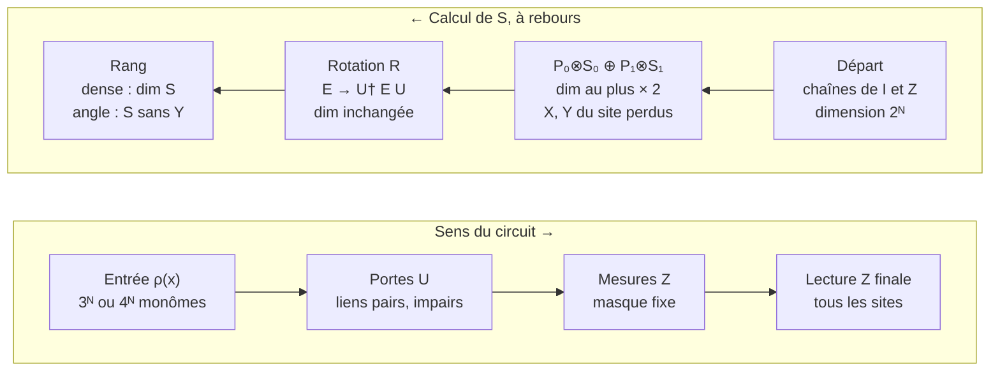

# Rang de l'espace des effets : l'algorithme exact

*Note du 11 novembre 2026, issue #317. Elle décrit l'algorithme de
`src/QELM/evaluation/effect_rank.py` (PR #314, issue #313) et démontre chaque
étape. Les figures et les résultats sont dans
[`experiments/effect_rank/`](../../experiments/effect_rank/README.md).*

## Ce que calcule l'algorithme

L'algorithme calcule exactement le rang de la matrice A des probabilités des
records, sans jamais lister les records. Il le fait en construisant, à rebours
dans le temps, une base orthonormée de l'espace S engendré par les effets du
circuit.

- **Records.** Un record m regroupe tous les résultats de mesure d'un passage
  dans le circuit : les mesures en milieu de circuit et la lecture Z finale.
  Avec un masque fixe contenant K mesures intermédiaires, il y a 2^(N+K)
  records.
- **Effets.** Si K_m est le produit des portes et des projecteurs le long du
  record m, la probabilité du record est Pr(m | x) = Tr[E_m ρ(x)], avec
  E_m = K_m† K_m. E_m est un opérateur hermitien positif sur N qubits : c'est
  l'effet du record.
- **Matrice A.** On développe ρ(x) sur les monômes de Bloch de l'entrée.
  Pr(m | x) devient une combinaison linéaire de ces monômes, et A contient les
  coefficients : une ligne par record, une colonne par monôme.
- **Rang.** rang A est la dimension de l'espace des fonctions de x qu'on peut
  écrire comme Σ_m c_m Pr(m | x). C'est exactement ce qu'une lecture
  quelconque du record, linéaire ou non, peut reproduire avec une infinité de
  tirs. Toute fonction hors de cet espace est inaccessible.

Le résultat central, démontré plus bas, est simple. En dense, rang A = dim S.
En angle, rang A = dimension de la projection de S sur les chaînes de Pauli
sans Y.

## Cadre

**Circuit.** N qubits en chaîne ouverte, profondeur T (ici T = N). La couche t
applique, dans cet ordre :

1. les portes à deux qubits sur les liens pairs (0,1), (2,3), … ;
2. les portes sur les liens impairs (1,2), (3,4), … ;
3. une mesure projective Z de chaque site i tel que masque[t, i] = vrai.

Après la dernière couche, tous les sites sont lus en Z. C'est la convention de
`BrickworkCircuit` du repo, où la profondeur compte des périodes complètes.

**Masque.** Pour chaque seed, on tire une fois u uniforme de taille (T, N), et
le masque au taux p est u < p. Les masques sont donc emboîtés d'un p à
l'autre, et les quatre classes de portes voient les mêmes masques.

**Encodages.** L'entrée est un état produit ρ(x) = ⊗ᵢ (I + nᵢ · σ)/2, où nᵢ
est le vecteur de Bloch du qubit i.

| Encodage | Vecteur de Bloch nᵢ | Fonctions par qubit | Nombre de monômes |
| --- | --- | --- | --- |
| angle | (sin θᵢ, 0, cos θᵢ) | 1, sin θᵢ, cos θᵢ | 3ᴺ |
| dense | (sin θᵢ cos φᵢ, sin θᵢ sin φᵢ, cos θᵢ) | 1, nˣ, nʸ, nᶻ | 4ᴺ |

**Base de Pauli réelle.** Tout opérateur hermitien E sur N qubits s'écrit de
façon unique E = Σ_α e_α σ_α, où α parcourt les 4ᴺ chaînes de {I, X, Y, Z}ᴺ et
les e_α sont réels. On représente donc chaque opérateur par un vecteur réel de
longueur 4ᴺ, rangé comme un tenseur (4, 4, …, 4) avec l'indice 0 = I, 1 = X,
2 = Y, 3 = Z par site. Le qubit 0 est le plus significatif, comme dans les
portes du repo.

**Lien effets ↔ monômes.** Comme Tr[σ_α σ_β] = 2ᴺ δ_αβ, on a :

```math
\Pr(m \mid x) = \operatorname{Tr}[E_m \rho(x)] = \sum_{\alpha} e^{(m)}_{\alpha} \prod_{i} n_i^{\alpha_i}, \qquad n_i^{I} = 1
```

Le coefficient du monôme α dans Pr(m | x) est donc exactement e_α de l'effet
E_m, sans facteur parasite. Une ligne de A est le vecteur de Pauli de E_m,
restreint aux monômes que l'encodage produit.

## L'idée en une image

Lister les records est impossible : il y en a 2^(N+K), soit plus de 10¹⁵ à
N = 7 et p = 0,5. Mais on n'a pas besoin des effets un par un, seulement de
l'espace qu'ils engendrent, qui vit dans un espace de dimension 4ᴺ. On part de
la fin du circuit, où cet espace est connu, et on remonte couche par couche :
chaque opération agit linéairement sur l'espace entier.



Les portes et les mesures sont répétées T fois (une fois par couche). Les
portes ne font que tourner S. Seules les mesures changent sa dimension : elles
peuvent la doubler (deux résultats possibles), mais elles effacent les
composantes X et Y du site mesuré.

## Les étapes, avec leur preuve

On note Sₜ l'espace engendré par les effets de la fin du circuit, à partir
d'un instant donné. On le tient sous forme d'une matrice Q dont les lignes
sont une base orthonormée (vecteurs de Pauli de longueur 4ᴺ). La dimension de
Sₜ est le nombre de lignes R.

### Étape 0 : la lecture finale

Les effets de la lecture Z finale seule sont les projecteurs |z⟩⟨z| pour
z ∈ {0,1}ᴺ. Chacun est un produit de P₀ = (I + Z)/2 et P₁ = (I − Z)/2. Leur
espace engendré est celui des opérateurs diagonaux, c'est-à-dire des chaînes
de {I, Z}ᴺ. Base de départ : les 2ᴺ vecteurs unitaires de ces chaînes.

### Étape 1 : la récursion linéaire

L'effet d'un record complet se factorise : si la couche courante applique
l'opération de Kraus L (portes puis projecteurs) et que la suite du circuit
donne l'effet E', alors E = L† E' L. L'ensemble des effets à l'instant t est
donc {L† E' L}, avec L parcourant les branches de la couche et E' les effets
de la suite. Comme E' ↦ L† E' L est linéaire :

```math
S_t = \operatorname{vect}\{ L^\dagger E' L \} = \sum_{L} L^\dagger\, S_{t+1}\, L
```

On n'a jamais besoin des effets un par un : il suffit de faire agir chaque
opération sur l'espace Sₜ₊₁, représenté par sa base.

### Étape 2 : une mesure Z du site i

Une mesure Z au site i a deux branches, P₀ et P₁ sur ce site. Il faut
l'espace engendré par {P₀ E P₀, P₁ E P₁} pour E ∈ S. On décompose E selon le
site i :

```math
E = I \otimes A + X \otimes C + Y \otimes D + Z \otimes B
```

Comme P_s X P_s = P_s Y P_s = 0, P_s I P_s = P_s et P_s Z P_s = ±P_s :

```math
P_0 E P_0 = P_0 \otimes (A + B), \qquad P_1 E P_1 = P_1 \otimes (A - B)
```

Les deux branches sont des records distincts, donc ce sont deux générateurs
séparés. Le nouvel espace est :

```math
S' = P_0 \otimes S_0 \;\oplus\; P_1 \otimes S_1, \qquad S_0 = \operatorname{vect}\{A_E + B_E\}, \quad S_1 = \operatorname{vect}\{A_E - B_E\}
```

La somme est directe et orthogonale, car P₀ et P₁ sont orthogonaux dans la
base de Pauli. En pratique, pour chaque ligne de Q on lit les composantes I et
Z du site i (deux vecteurs de longueur 4ᴺ⁻¹), on forme A + B et A − B, on
orthonormalise chaque famille séparément, et on remet le site i : P₀ a pour
vecteur de Pauli (1, 0, 0, 1)/√2 sur ce site, P₁ a (1, 0, 0, −1)/√2. Les
nouvelles lignes sont déjà orthonormées entre les deux blocs.

Conséquences directes :

- dim S' = dim S₀ + dim S₁ ≤ 2 dim S : une mesure fait au plus doubler
  l'espace ;
- les composantes X et Y du site i disparaissent : c'est la perte de
  cohérence ;
- répété sur les K mesures et la lecture finale, cela redonne la borne par le
  nombre de records, dim S ≤ 2^(N+K).

### Étape 3 : une porte à deux qubits

En Heisenberg, une porte U sur les sites (i, i+1) envoie E sur U† E U. Sur les
deux sites concernés, c'est une matrice réelle 16 × 16 :

```math
R_{ab} = \tfrac{1}{4} \operatorname{Tr}\!\left[\sigma_a\, U^\dagger \sigma_b U\right], \qquad e' = R\, e
```

R est orthogonale (U† · U préserve le produit de Hilbert-Schmidt et la base de
Pauli normalisée est orthonormée) et R fixe l'identité. On l'applique à chaque
ligne de Q, sur l'indice des deux sites. Une base orthonormée reste
orthonormée : une porte ne change jamais la dimension, et il n'y a rien à
réorthonormaliser.

**Ordre.** On remonte le temps : pour la couche t, on défait d'abord les
mesures, puis les portes impaires, puis les portes paires (l'inverse de
l'ordre direct). Les portes d'une même demi-couche agissent sur des sites
disjoints et commutent.

### Étape 4 : le rang vu par chaque encodage

Après la couche 1, Q engendre S, l'espace de tous les effets du circuit.

- **Dense.** Les 4ᴺ fonctions ∏ᵢ nᵢ^αᵢ sont linéairement indépendantes sur
  (sphère)ᴺ. Les lignes de A sont donc les vecteurs de Pauli complets des E_m,
  et rang A = dim S = R, le nombre de lignes de Q.
- **Angle.** Seules les chaînes sans Y produisent un monôme : nʸ = 0, donc
  toute composante Y disparaît de Tr[E ρ(x)]. Les 3ᴺ fonctions restantes
  (produits de 1, sin θ, cos θ) sont indépendantes. Donc rang A = rang de Q
  restreinte aux colonnes sans Y. C'est la dimension de la projection de S, au
  plus min(dim S, 3ᴺ).

C'est pour ça que dim S peut dépasser 3ᴺ sans que le rang angle dépasse sa
borne.

## Pseudo-code et correspondance avec le code

```
entrées : R[t][g] (matrices 16×16 des portes), masque (T × N booléen), tol = 1e-6
Q ← base des chaînes {I, Z}^N                      # 2^N lignes, longueur 4^N
pour t = T−1, …, 0 :                               # à rebours
    pour chaque site i avec masque[t, i] :
        A, B ← composantes I et Z du site i dans chaque ligne de Q
        Q0 ← orthonormaliser(A + B, tol)
        Q1 ← orthonormaliser(A − B, tol)
        Q  ← [P0 ⊗ Q0 ; P1 ⊗ Q1]
    pour chaque porte g de la couche t, de la dernière à la première :
        Q  ← R[t][g] appliquée aux deux sites de g, ligne par ligne
rang_dense ← nombre de lignes de Q
rang_angle ← rang de Q restreinte aux colonnes sans Y
```

| Pseudo-code | Fonction dans `effect_rank.py` |
| --- | --- |
| R pour une porte U | `heisenberg_transfer(gate)` |
| ordre des portes dans une couche | `brick_pairs(n)` : liens pairs puis impairs |
| base de départ | `final_readout_basis(n)` |
| mesure du site i | `measure_site(basis, n, site, tol)` |
| porte sur (i, i+1) | `apply_gate(basis, n, site, transfer)` |
| orthonormaliser | `_orthonormal_rows(m, tol)` |
| colonnes sans Y | `no_y_columns(n)` |
| boucle complète | `effect_rank(transfers, masks, tol)` |
| tirage d'un circuit | `draw_circuit(kind, n, depth, rng)` |

**Orthonormaliser, en détail.** Pour une famille M de r vecteurs de longueur
d :

1. si r ≤ d : matrice de Gram G = M Mᵀ (r × r), diagonalisation G = V Λ Vᵀ, on
   garde les λₖ > tol² λ_max, et les lignes Λ^(−1/2) Vᵀ M ; puis une passe de
   Cholesky QR pour corriger la perte d'orthogonalité ;
2. si r > d : l'espace est au plus de dimension d, on diagonalise Mᵀ M (d × d)
   et on garde ses vecteurs propres au-dessus du seuil.

Le seuil porte sur les valeurs singulières : une direction est gardée si sa
valeur singulière dépasse 10⁻⁶ fois la plus grande.

## Coût, limites et vérifications

**Coût.** Le coût dépend du rang R, pas du nombre de records 2^(N+K).

- Mémoire : Q occupe R × 4ᴺ nombres réels (8 octets chacun), plus les copies
  A ± B.
- Une porte : environ 16 × R × 4ᴺ opérations.
- Une mesure : une matrice de Gram en R² × 4ᴺ⁻¹ opérations et une
  diagonalisation en R³. C'est elle qui domine.

| N | 4ᴺ | Temps typique par seed (21 valeurs de p, 4 cœurs) |
| --- | --- | --- |
| 6 | 4 096 | 20 s pour Haar |
| 7 | 16 384 | 5 à 11 min pour Haar, 1,5 à 3 min pour Z₂ |
| 8 | 65 536 | environ 18 min pour U(1), 5 min pour Clifford |

Haar et Z₂ à N = 8 atteindraient R ~ 10⁴ : plusieurs Go pour Q et des heures
par seed. N = 10 (4¹⁰ ≈ 10⁶) est hors de portée ici pour toutes les classes.

**Vérifications** (`tests/test_effect_rank.py`) :

1. **Énumération directe à N = 3.** Pour les quatre classes et deux valeurs de
   p, on construit tous les K_m, tous les E_m = K_m† K_m, la matrice A
   complète, et on compare son rang (dense et angle) à celui de l'algorithme.
   Ils sont égaux.
2. **Matrices de transfert.** R est orthogonale, fixe l'identité, et R e
   redonne les coefficients de U† E U calculés directement.
3. **Orthonormalité.** Après une porte et une mesure, Q Qᵀ = identité à 10⁻¹⁰
   près.
4. **Bouts.** Rang dense = 2ᴺ à p = 0 et à p = 1 ; rang dense = 2ᴺ pour
   Clifford.
5. **Bornes et reproductibilité.** Rangs sous les bornes de symétrie ; même
   seed, même rang.

**Tolérance.** Le seuil de 10⁻⁶ sur les valeurs singulières vient de la route
par matrice de Gram : ses valeurs propres sont précises à environ 10⁻¹⁶ fois
la plus grande, donc on ne peut pas descendre beaucoup plus bas. Une direction
réelle mais plus faible que 10⁻⁶ serait comptée comme nulle. Sur les cas
testés, l'énumération directe (seuil 10⁻⁹) et l'algorithme donnent les mêmes
rangs, et une version par SVD (seuil 10⁻⁹) donnait les mêmes rangs sur quatre
circuits testés à N = 6.

## Deux exemples à la main

### Un qubit : pourquoi l'angle ne voit pas Y

Prenons un seul qubit, une rotation U puis la lecture Z. À rebours :
S = vect{I, Z}, puis S = vect{I, U† Z U}. Si U est la rotation qui envoie Z
sur Y, alors S = vect{I, Y}.

- Dense : dim S = 2, rang 2. La lecture mesure nʸ, qui est bien une fonction
  de l'entrée.
- Angle : la projection sans Y donne vect{I}, rang 1. La probabilité vaut 1/2
  pour toute entrée : le record ne dit rien de θ.

Le circuit et ses effets sont les mêmes ; seul ce que l'entrée laisse voir
change.

### Deux qubits : la borne par les records

N = 2, T = 2, une porte U₁ sur (0, 1), une mesure du site 0, une porte U₂,
puis la lecture finale. Il y a 2^(2+1) = 8 records.

1. Lecture finale : S = vect{II, IZ, ZI, ZZ}, dimension 4.
2. Porte U₂ : rotation, dimension 4.
3. Mesure du site 0 : S = P₀ ⊗ S₀ ⊕ P₁ ⊗ S₁, où S₀ et S₁ sont des espaces
   d'opérateurs sur le qubit 1 (dimension au plus 4 chacun). Dimension au plus
   8.
4. Porte U₁ : rotation, la dimension ne change pas.

Avec une porte Haar tirée au hasard, l'algorithme donne 8 en dense et 8 en
angle : la borne par les records est atteinte, et c'est la moitié des 16
directions possibles. Sans la mesure, on reste à 4. Avec des portes U(1) ou
Z₂, on obtient 4 même avec la mesure : les composantes conservées par la
symétrie ne se mélangent pas avec les autres. Avec Clifford : 4 en dense et 3
en angle.
