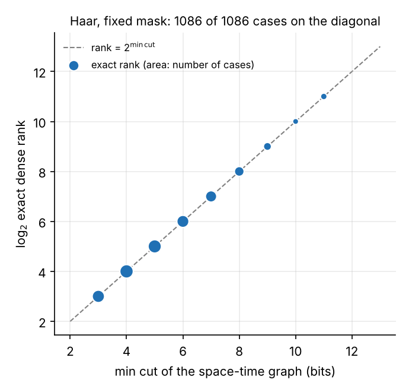
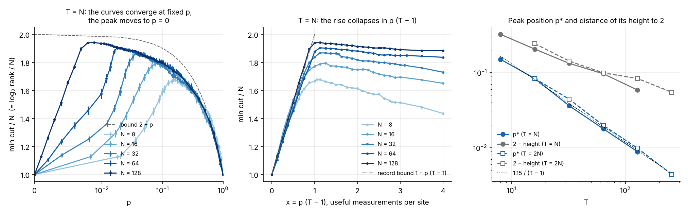
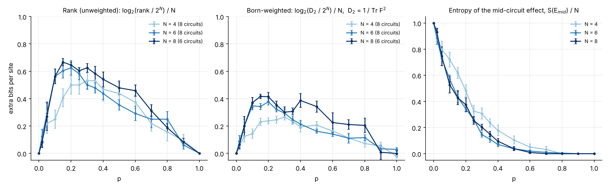

# La transition du rang de l'espace des effets est-elle une MIPT ? Bilan et plan

*Note du 11 novembre 2026, issue #319. Elle part des PR #310 (expressivité de
Fourier) et #314 (rang exact de l'espace des effets, masque fixe), des analyses du
dossier `effect-rank-313/analyses` du projet et de la note d'algorithme de la PR
#318. Elle ajoute trois calculs rapides (section 3), faits sur une machine de 4
cœurs en moins d'une heure. Leurs scripts sont dans le dossier
`effect-rank-mipt-319/` du projet, pas encore dans la bibliothèque : c'est le
premier point du plan (section 5).*

**Cadre.** Brickwork ouvert sur `N` qubits, profondeur `T`. Une couche est une
période complète (liens pairs, liens impairs), puis une mesure `Z` de chaque site
du masque. Le masque est fixe : il est tiré une fois, avec le taux `p`, et il fait
partie du circuit. Lecture `Z` finale de tous les sites. Le record `m` a la
probabilité `Pr(m | x) = Tr[E_m rho(x)]`, et le **rang** est la dimension de
l'espace engendré par les effets `E_m`. Il vaut `2^N` à `p = 0` et à `p = 1`, et
il passe par un pic entre les deux.

## 1. Réponse courte

1. **Tel qu'il est défini, le pic du rang n'est pas une MIPT.** Pour les circuits
   de Haar (encodage dense, masque fixe), le rang est exactement `2^C`, où `C` est
   la coupe minimale d'un graphe qui ne dépend que des positions des mesures :
   1 086 cas sur 1 086 (figure 1). Les portes n'interviennent pas, tant qu'elles
   sont génériques. C'est une quantité géométrique.
2. **À grand `N`, le pic part vers `p = 0`.** Le flot maximal donne le rang
   jusqu'à `N = 128` (figure 2) :
   - le pic est à `p* ≈ 1,15 / (T − 1)`, c'est-à-dire à environ une mesure utile
     par site, pour `T = N` comme pour `T = 2N` ;
   - sa hauteur tend vers la borne `4^N` (2 bits par site) ;
   - à `p` fixé, `log₂(rang) / N` converge vers une courbe lisse `r_∞(p) ≤ 2 − p`,
     qui ne dépend ni de `N` ni de `T`.

   Il n'y a donc ni `p_c` fini, ni exposant `ν` : le pic est le passage entre un
   rang limité par le nombre de records (`2^(N + K)`) et un rang limité par le
   déphasage que les mesures font subir à l'entrée.
3. **Le rang est la version « Rényi 0 » d'une quantité dont la MIPT est la
   version pondérée.** Le rang compte une direction dès que son poids n'est pas
   nul. La MIPT est une propriété des trajectoires typiques, pondérées par la
   règle de Born. C'est la même différence qu'entre l'entropie de Hartley `S_0`,
   qui est une coupe minimale et dont la transition est une percolation, et les
   entropies `S_n` avec `n ≥ 1`, qui portent la MIPT (Skinner, Ruhman, Nahum, PRX
   9, 031009 (2019) ; **cité de mémoire, à relire**). Trois faits déjà acquis vont
   dans le même sens :
   - Clifford a une MIPT à `p_c ≈ 0,16`, et son rang dense vaut `2^N` pour tout
     `p` (#314) ;
   - le pic dépend du nombre de mesures `K`, pas de `p` (analyses de #314) ;
   - il disparaît quand le masque est retiré à chaque tir (figure E de #314).
4. **Deux quantités pondérées sont les bons candidats** (section 3.3) :
   - l'**entropie de l'effet du registre seul**, `S(E_mid)`. C'est exactement
     l'entropie de purification de Gullans et Huse, donc un paramètre d'ordre
     connu de la MIPT ;
   - la **dimension effective** `D₂ = 1 / Tr F²` du repère des effets, qui est le
     rang pondéré par Born. Elle se calcule par échantillonnage jusqu'à `N ≈ 14`.
     Qu'elle ait une singularité à `p_c` est une question ouverte.
5. **Pour le projet, l'énoncé à viser change.** Ce n'est pas « le pic du rang est
   une MIPT ». C'est : « le rang est géométrique et ne voit pas la MIPT ; la MIPT
   apparaît dans la répartition pondérée de cet espace, et en particulier dans la
   part que la lecture finale doit encore fournir ». La section 4 dit ce qu'il
   faut mesurer pour l'établir, et la section 5 dans quel ordre.

## 2. Ce qui est déjà établi

| | Résultat | Source |
| --- | --- | --- |
| **E1** | Toute moyenne lisible par le QELM est une combinaison des `3^N` monômes de Bloch (angle) ou des `4^N` (dense). `C(p)` est calculé exactement et vérifié par énumération. | #310 |
| **E2** | Le rang de l'espace des effets se calcule exactement par une récurrence de Heisenberg à rebours, sans énumérer les records. Vérifié par énumération à `N = 3`. | #314, #318 |
| **E3** | Haar, U(1), Z₂ : le rang vaut `2^N` aux deux bouts et a un pic, qui glisse de `p ≈ 0,3` (`N = 3`) à `p ≈ 0,15` (`N = 7`). | #314 |
| **E4** | Rang ≤ `2^(N + K)`, où `K` compte les mesures hors dernière couche. Haar sature cette borne jusqu'à `K ≈ 2`. | analyses de #314 |
| **E5** | Le pic est à `K* ≈ N − 1` mesures utiles, à `T = N` comme à `T = 2N`. Donc `p* ≈ K* / (N (T − 1))`. | analyses de #314 |
| **E6** | Au pic, le rang dense de Haar croît comme `3,47^N` (`T = N`) et `3,59^N` (`T = 2N`), sous la borne `4^N`. En angle, la fraction de `3^N` atteinte monte vers 1. | analyses de #314 |
| **E7** | Clifford : l'espace est engendré par exactement `2^N` chaînes de Pauli. Rang dense `2^N` pour tout `p` ; rang angle `≈ (3/2)^N`. | #314 et analyses |
| **E8** | Avec un masque tiré à chaque tir et noté dans le record, Haar, U(1) et Z₂ saturent leur borne de symétrie avec 4 à 18 masques (`N ≤ 5`). | analyses de #314 |

**Ce que ces résultats ne disent pas.** Aucun ne donne un `p_c` : E5 dit au
contraire que la position du pic suit `1/T`. Aucun ne relie le rang à l'intrication
ou à la purification. Et E7 montre que le rang peut rester plat à travers une MIPT
bien établie.

## 3. Ce que les calculs rapides ajoutent

### 3.1 Le rang de Haar est une coupe minimale

**Le graphe.** On écrit la matrice `A` (records × monômes) comme un réseau de
tenseurs et on compte les bits qui peuvent passer de l'entrée aux records :

- un fil de qubit porte un opérateur, donc 2 bits ;
- une porte est un nœud où se rejoignent quatre fils ;
- une mesure `Z` ne garde que la partie diagonale : le fil entre avec 1 bit,
  ressort avec 1 bit, et 1 bit part vers le record ;
- la lecture finale prend 1 bit par site.

La coupe minimale `C` entre les `N` entrées et l'ensemble des records borne le
rang : rang ≤ `2^C`. Deux coupes simples redonnent les bornes connues. Couper tous
les records donne `N + K` (E4). Couper juste avant les mesures de la première
couche donne `2N − n₁`, où `n₁` est le nombre de sites mesurés à cette couche,
soit `2 − p` bits par site en moyenne.

**Figure 1. Rang dense exact contre coupe minimale, Haar, masque fixe.** Abscisse :
coupe minimale du graphe, en bits. Ordonnée : `log₂` du rang exact de
`QELM.evaluation.effect_rank`. Chaque point est un couple de valeurs, et son aire
croît avec le nombre de cas. Tirets : rang = `2^C`. Cas : `N = 3, 4, 5` à `T = N`
et `N = 3, 4` à `T = 2N` (10 circuits, 21 valeurs de `p`), `N = 6` à `T = N` (4
circuits, 9 valeurs de `p`), avec les circuits et les masques de #314.
- **Les 1 086 cas sont sur la diagonale.** La borne est atteinte à chaque fois.
- **Conséquence.** Pour Haar, le rang dense à masque fixe ne dépend que du masque.
  On peut le calculer pour des centaines de qubits.
- **Statut.** C'est une conjecture vérifiée numériquement jusqu'à `N = 6`, pas un
  théorème. Les tenseurs des portes ne sont pas génériques au sens strict (ils
  conservent l'identité), ce qui n'a rien changé ici.

### 3.2 Limite de grande taille

**Figure 2. Coupe minimale par site, `N = 8` à 128.** Moyenne sur les masques (50
pour `N = 8`, 6 pour `N = 128`), barres d'erreur standard. Couleur : `N`, du clair
au foncé.
- **Gauche : `C / N` contre `p`, `T = N`** (axe des `p` logarithmique au-delà de
  0,01). Tirets : la borne `2 − p`.
  - À `p` fixé, les tailles se superposent : 1,85 à `p = 0,05` ; 1,79 à 0,1 ;
    1,70 à 0,2 ; 1,61 à 0,3 ; 1,45 à 0,5 ; 1,10 à 0,9, pour `N = 32` à 128 et aussi
    à `T = 2N`. La courbe limite est lisse, sans point singulier visible.
  - Le pic se déplace vers la gauche et monte.
- **Centre : même chose contre `x = p (T − 1)`**, le nombre de mesures utiles par
  site. Tiret-point : la borne par les records, `1 + x`. La montée suit cette
  borne pour toutes les tailles, jusqu'à `x ≈ 1`.
- **Droite : position `p*` du pic et écart de sa hauteur à 2, contre `T`.** Ronds :
  `T = N` ; carrés vides : `T = 2N`. Pointillés : `1,15 / (T − 1)`.
  - `p*` suit `1,15 / (T − 1)` sur une décade et demie.
  - L'écart à 2 baisse lentement : 0,32 ; 0,21 ; 0,13 ; 0,10 ; 0,06 pour
    `N = 8` à 128 à `T = N`, soit à peu près comme `T^(−0,6)`.
- **Lecture de E5 et E6.** `K* ≈ N` et la base 3,5 sont des effets de taille
  finie : à grand `N`, le pic est à une mesure par site et la base tend vers 4.

### 3.3 Version pondérée par Born

Avec la lecture finale, chaque effet est de rang 1 : `E_{m,z} = |φ><φ|` avec
`|φ> = K_m† |z>`, où `K_m` est l'opérateur de Kraus du registre `m` des mesures en
milieu de circuit. Deux quantités en découlent.

- **Entropie de l'effet du registre seul.** `E_mid = K_m† K_m = Σ_z E_{m,z}`. Son
  spectre normalisé est celui de l'état `K_m K_m† / Tr` obtenu à partir de l'état
  maximalement mixte. `S(E_mid)` est donc l'entropie de purification, et c'est le
  nombre de bits sur l'entrée que la lecture finale doit encore fournir une fois
  le registre connu.
- **Dimension effective.** Soit `F = E_m[ |ê_m)(ê_m| ]` avec `ê_m = E_m / Tr E_m`,
  les records étant tirés avec la règle de Born pour une entrée maximalement mixte.
  Le rang est le nombre de valeurs propres non nulles de `F`. La dimension
  effective `D₂ = 1 / Tr F²` les pondère : elle vaut `2^N` pour une base et environ
  `4^N / 2` pour un POVM de type Haar. On l'estime par
  `Tr F² = E_{m,m'} |<φ̂_m|φ̂_m'>|⁴` sur des paires de records indépendants.

**Figure 3. Rang, dimension effective et entropie de l'effet du registre, Haar,
`T = N`, `N = 4, 6, 8`.** Un circuit et un masque fixe par graine (8, 8 et 6
circuits), masques emboîtés en `p` comme dans #314. Barres : erreur standard sur
les circuits.
- **Gauche : `log₂(rang / 2^N) / N`**, calculé par la coupe minimale sur ces
  mêmes masques.
- **Centre : `log₂(D₂ / 2^N) / N`.** 64 registres par point (`N = 4, 6`) ou 40
  (`N = 8`), somme exacte sur la lecture finale.
  - `D₂` a aussi un maximum, mais plus bas : 0,27 ; 0,38 ; 0,42 bit par site pour
    `N = 4, 6, 8`, contre 0,53 ; 0,62 ; 0,67 pour le rang. Une grande partie des
    directions comptées par le rang a un poids très faible.
  - Ce maximum est à `p = 0,3` ; 0,2 ; 0,15 : à ces tailles, il glisse comme
    celui du rang.
  - Au-delà de `p ≈ 0,5`, l'estimateur manque de registres (les coïncidences
    deviennent rares) : les points à `N = 8` y sont bruités et biaisés.
- **Droite : `S(E_mid) / N`.** Elle décroît de 1 à 0. À ces tailles et à `T = N`,
  les courbes ne se croisent pas de façon résolue : c'est attendu, la transition
  de purification demande `N ≥ 12` et des temps plus longs.
- **Statut.** Calcul préliminaire, pour montrer que les deux quantités sont
  accessibles. Il ne donne pas de `p_c`. Il ne dit pas non plus si le maximum
  de `D₂` continue de glisser vers 0 à plus grand `N`, comme celui du rang, ou
  s'il s'arrête à une valeur finie : c'est le point 3 du plan.

## 4. Ce qu'il faut caractériser pour parler de MIPT

Le critère est celui de la note
[`qelm-voit-il-la-mipt.md`](qelm-voit-il-la-mipt.md), section 1 : croisement
résolu (a), dérive vers `p_c` (b), oracle résolu sur les mêmes données (c), pas de
contrôle trivial aussi bon (d), part de l'oracle finie à `p_c` (e).

| Élément | État pour le rang | Ce qu'il faut |
| --- | --- | --- |
| **Paramètre d'ordre** | Le rang n'en est pas un : géométrique (3.1), plat en Clifford (E7). | Une quantité pondérée par Born, non nulle d'un seul côté. Candidats : `S(E_mid) / N` (connu) ; `log₂(D₂ / 2^N) / N` ; la part de `D₂` due à la lecture finale. |
| **`p_c`** | Aucun : `p* ∝ 1/T` (3.2). | Un croisement en `N` qui converge vers une valeur finie, tests (a) et (b). |
| **`p_c` de référence** | Pas mesuré dans cette convention (une mesure par période complète, bords ouverts, masque fixe). Les valeurs connues, `≈ 0,17` (Haar) et `≈ 0,16` (Clifford), sont pour une mesure après chaque demi-couche. | L'oracle `S(E_mid)` ou le qubit de référence, sur les mêmes circuits, test (c). |
| **Taille finie, collapse, `ν`** | Sans objet pour le rang. Le seul collapse est en `p (T − 1)`, et c'est un comptage. | Collapse en `(p − p_c) N^(1/ν)` de la quantité pondérée, à comparer à `ν ≈ 1,3`. Crédible seulement avec des tailles `N ≥ 16`, donc en Clifford. |
| **Lien avec la purification** | Aucun pour le rang. Identité exacte pour `S(E_mid)` (3.3). | Montrer comment `D₂` se partage entre le registre et la lecture finale, et si ce partage suit `S(E_mid)`. |
| **Contrôles triviaux** | Le rang est lui-même un contrôle trivial : c'est une fonction du masque. | Comparer toute courbe à `K`, à `p N T` et à la coupe minimale, test (d). |
| **Robustesse au masque** | Le pic disparaît avec un masque tiré à chaque tir (E8). | Une signature de MIPT doit survivre aux deux protocoles. |
| **Robustesse à l'encodage** | Angle : la projection sur `3^N` sature, le pic s'aplatit en fraction de la borne (E6). | Vérifier que la quantité pondérée ne dépend de l'encodage que par un facteur lisse. |
| **Robustesse à la symétrie** | U(1) et Z₂ décrochent de la borne par les records plus tôt que Haar (E4). La coupe minimale n'y est qu'une borne. | Dire si le rang y reste géométrique (coupe par secteur de charge). En U(1), séparer MIPT d'intrication et charge sharpening. |
| **Nombre fini de tirs** | Le rang est à nombre de tirs infini. | Le nombre de valeurs propres de `F` au-dessus de `1/S`, à relier à la capacité `C(S)` de #310. |

## 5. Plan d'expériences, par priorité

Machine : 12 cœurs, 62 Go, pas de GPU. Les coûts sont des ordres de grandeur,
extrapolés des calculs de la section 3 (4 cœurs).

| # | Expérience | Ce qu'elle tranche | Tailles | Coût |
| --- | --- | --- | --- | --- |
| **1** | **Coupe minimale dans la bibliothèque**, avec tests (égalité avec le rang exact pour Haar, `N = 3` à 5 ; bornes pour U(1), Z₂ ; valeurs aux deux bouts), puis comparaison aux runs `N = 7` de #314. | Fait de 3.1 un résultat testé. Remplace le calcul en `4^N` pour Haar. | `N` ≤ 7 pour la comparaison, `N` ≤ 512 pour la coupe | Minutes |
| **2** | **`p_c` de référence dans la convention de #314** : `S(E_mid)` et qubit de référence, en Clifford (stabilisateurs) et en Haar (vecteur d'état), `T = N`, `2N`, `4N`. | Donne l'oracle du test (c). Sans lui, rien d'autre ne s'interprète. | Clifford `N` = 16 à 64 ; Haar `N` = 8 à 14 | Clifford : moins d'une heure ; Haar : une nuit |
| **3** | **Taille finie de `D₂`** par échantillonnage de trajectoires (deux passes de vecteur d'état par record, puis recouvrements de paires). 20 circuits, 2 000 records par point, grille serrée autour du `p_c` de 2. Tests (a) à (e), avec `K` et la coupe minimale comme contrôles. | Dit si le rang pondéré a un croisement à `p_c`, ou s'il dérive comme le rang. | `N` = 6 à 14 | Une nuit |
| **4** | **Partage registre / lecture finale** : `D₂` du registre seul contre `D₂` complet, sur les trajectoires de 3. | Relie l'espace des effets à la purification. C'est le candidat le plus direct au paramètre d'ordre. | `N` = 6 à 12 | Inclus dans 3 |
| **5** | **Clifford à grande taille** : pour des états stabilisateurs, les recouvrements valent 0 ou `2^(−j)`, donc `D₂` et son partage sont exacts. | Le seul endroit où `ν` et le collapse sont crédibles. | `N` = 16 à 64 | Quelques heures |
| **6** | **Symétries et angle par la coupe** : comparer les rangs exacts de #314 (U(1), Z₂, angle) à la coupe minimale et à une coupe par secteur. | Dit si le rang est géométrique dans toutes les classes. | `N` ≤ 7, données existantes | Minutes |
| **7** | **Spectre complet de `F`** (exact, récurrence à deux copies ou échantillonnage) et nombre de directions au-dessus de `1/S`. | Relie le rang à la capacité à nombre de tirs fini. | `N` ≤ 6 ou 7 | Heures |
| **8** | **Masque tiré à chaque tir** pour 3 et 4. | Robustesse au protocole. | `N` = 6 à 12 | Une nuit |
| **9** | **Dérivées de `r_∞(p)`** par flot maximal à `N` = 512 et plus. | Cherche une singularité de type percolation dans le rang lui-même, pour fermer cette branche. | `N` ≤ 1 024 | Une heure |

**Ordre conseillé.** 1 et 2 d'abord : ils sont courts et tout le reste en dépend.
Puis 3 et 4 ensemble, qui décident si l'idée tient en Haar. 5 ensuite, si 3 ou 4
montrent un croisement. 6 à 9 sont des contrôles.

## 6. Réserves

- **3.1 est une conjecture vérifiée, pas un théorème.** Elle est testée jusqu'à
  `N = 6`, pour Haar et l'encodage dense seulement. La figure 2 en dépend
  entièrement.
- **La figure 3 est préliminaire** : 4 à 8 circuits, 40 à 64 registres,
  estimateur biaisé à grand `p`, tailles `N ≤ 8`.
- **Rien ne garantit que `D₂` ait une singularité à `p_c`.** C'est une quantité
  de bord à quatre copies. Elle peut aussi n'avoir qu'un maximum lisse. Le
  candidat sûr est `S(E_mid)`, mais c'est l'oracle connu, pas une quantité propre
  au QELM.
- **Les `p_c` cités (0,17 ; 0,16) le sont de mémoire** et pour une autre
  convention de couche. Le point 2 du plan les remplace par une mesure.
- **La comparaison avec `S_0` est une analogie.** Le graphe ici relie l'entrée aux
  records, pas deux moitiés du système. Aucune transition de percolation n'a été
  cherchée dans `r_∞(p)` (point 9).
