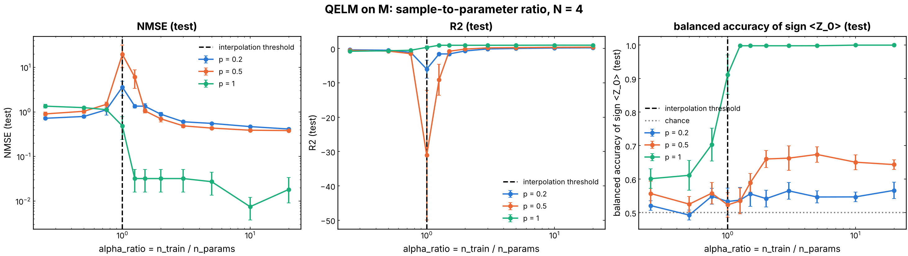
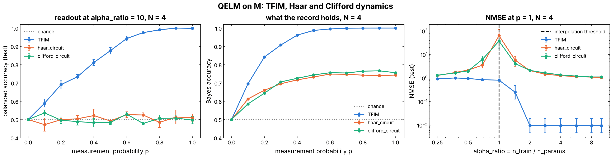
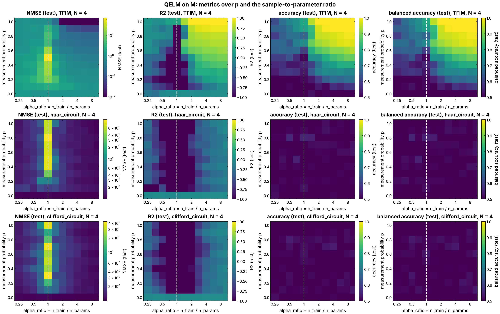

# QELM on the measurement record `M`

Can a linear readout tell, from the record of outcomes of intermediate
measurements alone, which charge sector a reservoir started in? The ancilla
`R` is a reference qubit entangled with the charge of the system; the system
qubits are measured in Z with probability `p` after each time step, and a
ridge readout of the record `M` predicts the measured outcome of `R`. This is
the "charge learning" side of the measurement-induced phase transition (MIPT)
seen through a QELM: the record holds the charge only if the dynamics
conserves it and enough qubits are measured.

## Experiment overview

| | |
| --- | --- |
| Script(s) | `experiments/QELM_M/exp_QELM_M.py` (sweep over `p`, `h`, `N`), `exp_QELM_M_ratio.py` (sweep over the sample-to-parameter ratio), launchers `exp_QELM_M.sh`, `exp_QELM_M_ratio.sh` |
| Config | `conf/config.yaml`, `conf/QELM_M_ratio.yaml`, `conf/training/measurements/projective.yaml` |
| Physical model | all-to-all TFIM `H = h sum_i Z_i + sum_{i<j} J_ij X_i X_j`, `J_ij` uniform in `[-J/2, J/2]`, `h = 10 J` by default, a new disorder per sample; or a brickwork of Haar U(4) (`models=haar_circuit`) or two-qubit Clifford gates (`models=clifford_circuit`), new gates per sample unless `fixed_instance=true` (issue #171) |
| System sizes `N` | `4` by default (system qubits, ancilla excluded) |
| Control parameters | measurement probability `p`, field `h` (`H_VALUES`), ratio `alpha_ratio = n_train / n_params` |
| Initial state | `(|0>_R |Q1>_S + |1>_R |Q2>_S) / sqrt(2)`, `Q1 = N // 2`, `Q2 = Q1 - 1` |
| ML task | binary classification of the Z outcome `Y = ±1` of `R` (the initial charge sector) from the flattened record `M`, ridge readout, scored by accuracy, balanced accuracy, NMSE and R2 |
| Issues / PRs | #94, #96, #104, #130, #164, #167, #168, #171, #174, #195 |

## Methodology

For each sample:

1. Draw a new TFIM (or new gates) and prepare the charge-sector state; `R`
   does not evolve.
2. Split the evolution time into `nbr_time_evolution = 5` steps. After each
   step, measure each system qubit in Z with probability `p` (Born rule).
3. The features are the record `M`, shape `(5, N)`, flattened: `±1` for a
   measured qubit, `0` for an unmeasured one. The label is the Z outcome of
   `R` measured at the end, the charge sector the system started in, `±1`
   with probability 1/2 whatever `p` (issue #104).
4. Fit a ridge readout (`n_params = 5 N + 1` weights) on the training
   samples and score it on a test set; the accuracy is compared with the
   majority-class level `accuracy_baseline` (issue #130).

`exp_QELM_M_ratio.py` sets `n_train = round(alpha_ratio * n_params)` with a
fixed test set of 200 samples, to locate the interpolation threshold
`alpha_ratio = 1` (double descent). Each run also records the entropies of the
ancilla (`S_vN`, the purification order parameter) and of half the system
(`S_half`, issue #174).

How to run it:
[experiments/README.md, "Run the QELM experiment on the measurement record"](../README.md#run-the-qelm-experiment-on-the-measurement-record-work-in-progress).
The analysis notebooks are `notebooks/results/02_QELM_M_analysis.ipynb`,
`03_QELM_M_alpha_ratio.ipynb` and `05_QELM_M_circuits.ipynb`.

## Results and discussion

- **TFIM, `h = 10 J`.** The field term nearly conserves the charge, so the
  outcomes of a complete round add up to `N - 2 Q`: the readout learns the
  sector more as `p` grows, from chance at `p = 0` (empty record) to a
  balanced accuracy of 1.00 at `p >= 0.9` (Figure 2, left). At `p = 1` the
  test NMSE drops by one to two orders of magnitude once
  `alpha_ratio > 1` (Figures 1 and 3).
- **Double descent.** At `alpha_ratio = 1` the test NMSE peaks (up to about
  20 at `p = 0.5`, and about 60 for the circuits) and the R2 dives: the
  weakly regularized readout interpolates the noise of the training labels.
  Above the threshold the scores saturate at a floor set by what the record
  holds, so the gap between the curves of different `p` at large ratio is
  the physical signal (Figure 1).
- **Haar and Clifford circuits.** Without a conserved charge the readout of
  `M` stays at chance at every `p` and every ratio, even though the record
  does carry information on the sector (the exact Bayes accuracy reaches
  about 0.75, Figure 2, middle). That information is not linear in `M`; see
  [`haar_readouts`](../haar_readouts/README.md) for nonlinear readouts of the
  same question.
- **Caveat.** The figures were made before issue #235 and label the size
  `N = 4`, which counted the ancilla: the system has 3 qubits.

## Figures

**Figure 1. Sample-to-parameter ratio sweep, TFIM.** Test NMSE (log scale,
left), R2 (middle) and balanced accuracy (right) of the ridge readout of `M`
against `alpha_ratio = n_train / n_params`, for `p = 0.2, 0.5, 1`, at 3
system qubits (`N = 4` in the old convention of the title), mean over seeds
with standard errors. The dashed line is the interpolation threshold
`alpha_ratio = 1`, the dotted line chance. The target at the time of this
figure was the sign of `<Z_0>` on the final state (before issue #104). The
error peaks at the threshold (double descent); above it only `p = 1` reaches
a perfect readout. Produced by `notebooks/results/03_QELM_M_alpha_ratio.ipynb`
(issue #96).

**Figure 2. TFIM against Haar and Clifford circuits.** Left: balanced test
accuracy of the readout of `M` at `alpha_ratio = 10` against `p`. Middle:
the exact Bayes accuracy `sign(<Z_0>)` on the state of `R`, which was later
removed (issue #195) because it uses `P(Y | rho_R)` and knows the unitary of
each sample, so it is an upper bound on what any readout could do, not the
ceiling of a readout of `M`. Right: test NMSE at `p = 1` against the ratio.
3 system qubits (`N = 4` in the old convention). The TFIM record carries the
charge linearly; the circuits' records do not. Produced by
`notebooks/results/05_QELM_M_circuits.ipynb` (issue #171).

**Figure 3. Metrics over the `(alpha_ratio, p)` plane.** One row per
dynamics (TFIM, Haar, Clifford), one column per metric (test NMSE, R2,
accuracy, balanced accuracy); the dashed line is `alpha_ratio = 1`. 3 system
qubits (`N = 4` in the old convention). For the TFIM the learnable region is
the upper right corner, large `p` and `alpha_ratio > 1`; the vertical stripe
at the threshold is the double-descent peak, present for every dynamics;
the circuits stay at chance everywhere. Produced by
`notebooks/results/05_QELM_M_circuits.ipynb` (issues #164, #171).
