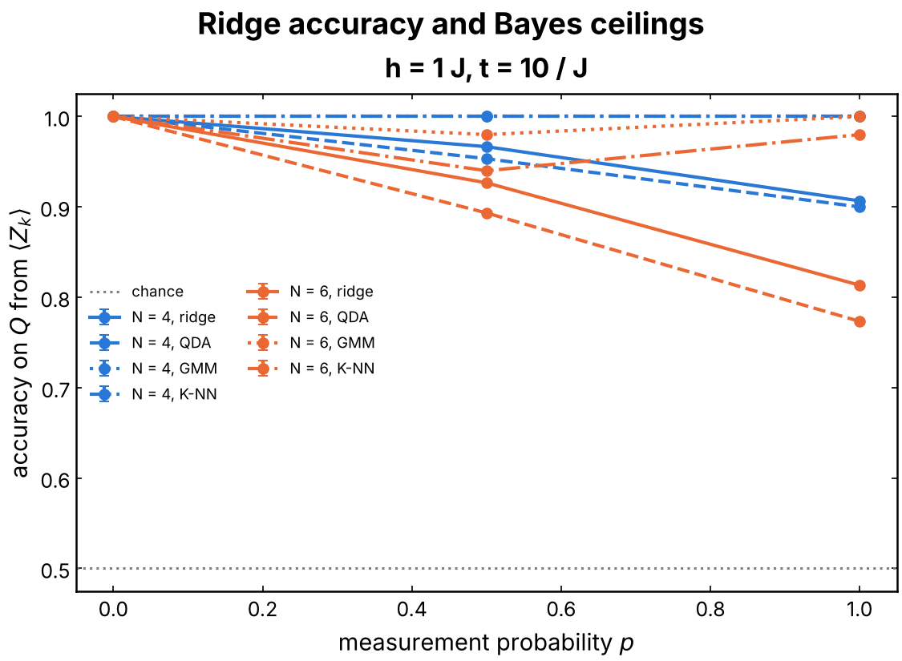
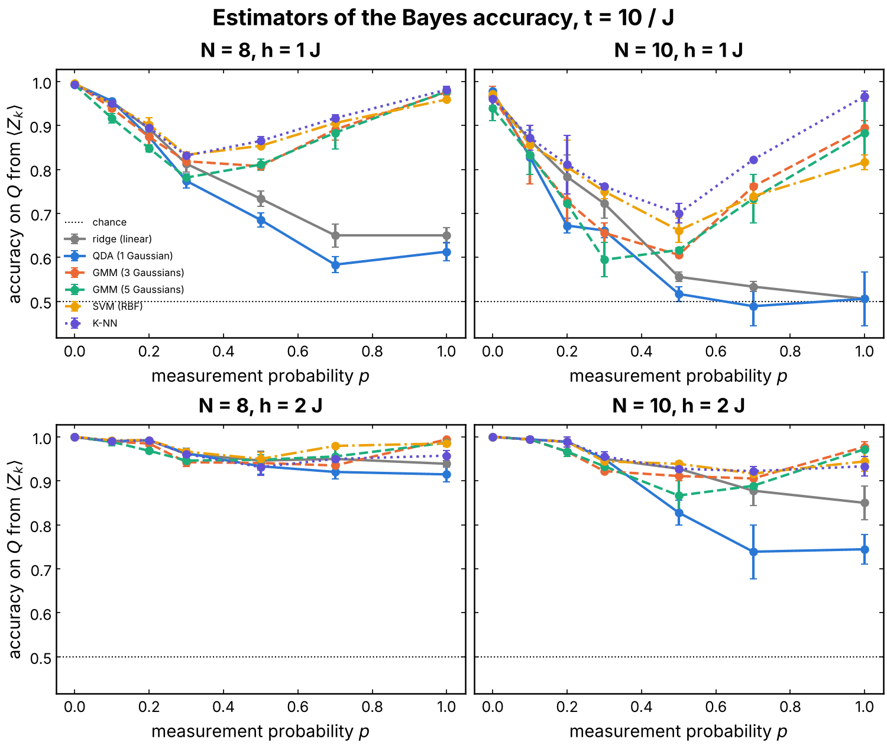
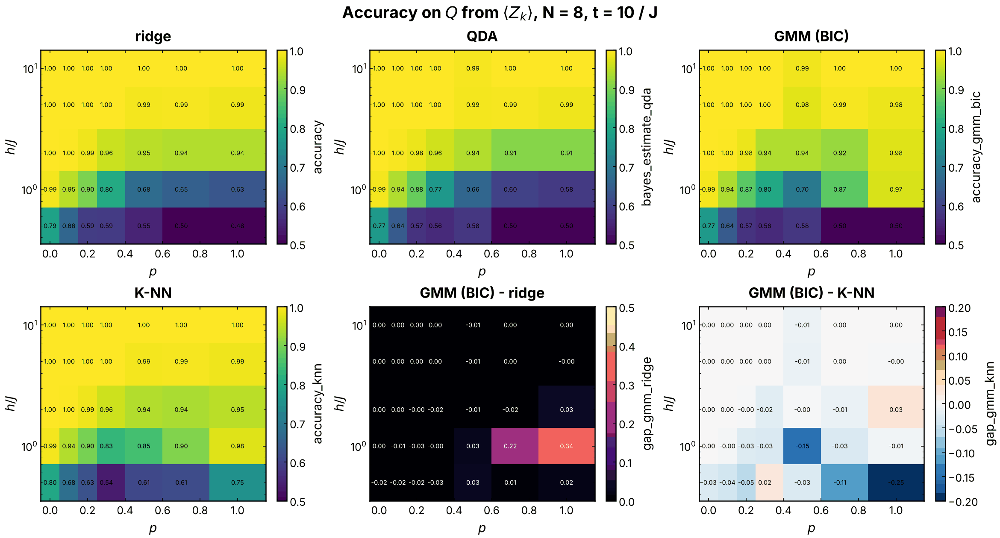
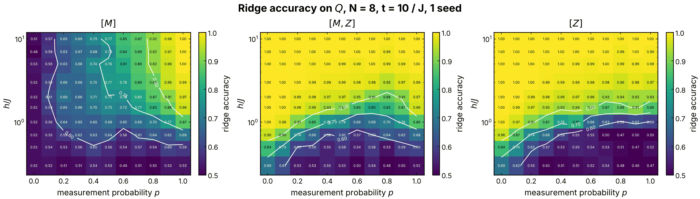
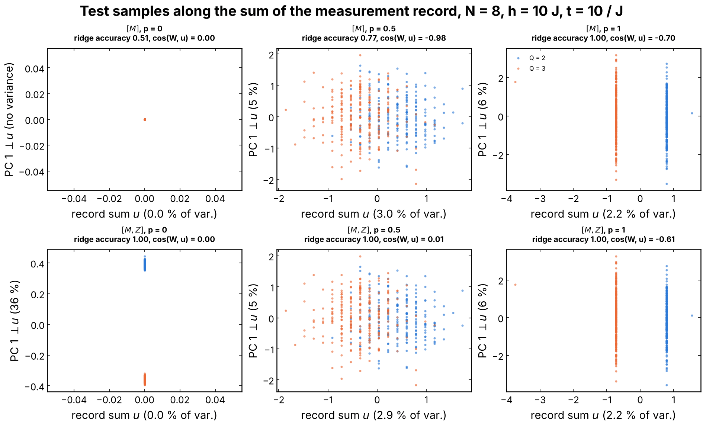
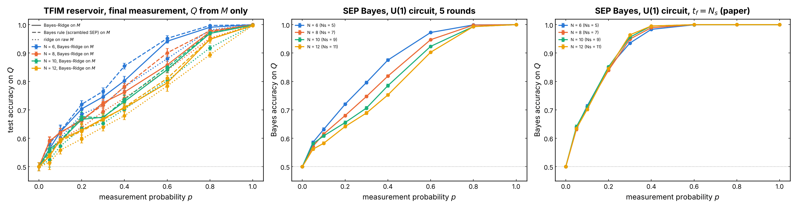
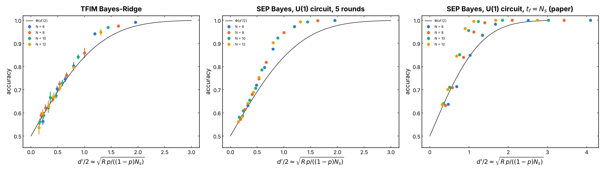
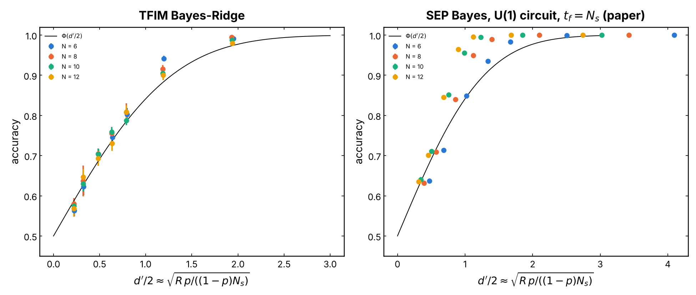
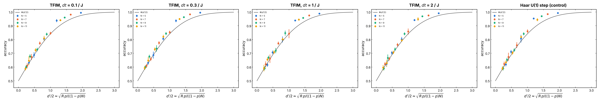
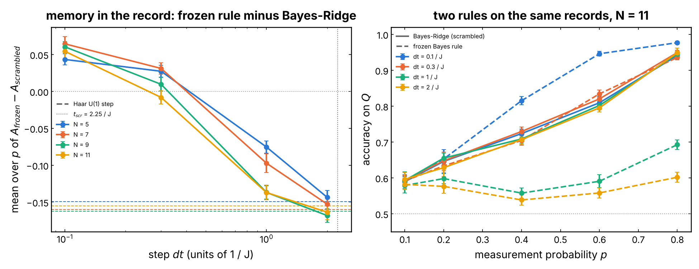

# QELM on the charge `Q` under intermediate measurements

The central experiment of the learnability side of the project. A reference
qubit `R` fixes the charge sector `Q` of a disordered TFIM reservoir; the
system qubits are measured in Z with probability `p` between time steps, and
readouts of the final observables `<Z_k>`, of the measurement record `M`, or
of both, try to recover `Q`. Sweeping `p` and the transverse field `h` maps
where the charge stays **learnable**, and comparing the linear ridge readout
with Bayes ceilings (QDA, Gaussian mixtures, K-NN, SVM) separates what is
lost physically from what is only lost to a linear readout. The Bayes-Ridge
pipeline on `M` (issue #233) connects the task to the charge-learnability
transition of Barratt et al. (2022), reproduced in
[`learnability`](../learnability/README.md).

## Experiment overview

| | |
| --- | --- |
| Script(s) | `experiments/QELM_Q/exp_QELM_Q.py`, launcher `exp_QELM_Q.sh`; analysis scripts `plot_bayes_ceiling.py`, `bayes_benchmark.py`, `gmm_phase_diagram.py`, `plot_knn.py`, `plot_knn_metrics.py`, `plot_pca.py`, `plot_ridge_heatmap.py`, `plot_bayes_ridge_fss.py`, `plot_dt_collapse.py` |
| Config | `conf/config.yaml`, `conf/training/measurements/projective.yaml` |
| Physical model | all-to-all TFIM `H = h sum_i Z_i + sum_{i<j} J_ij X_i X_j`, `J_ij` uniform in `[-J/2, J/2]`, `J = 1`, a new disorder per sample; `unitary_step=haar_u1` replaces each step by an independent Haar unitary on each charge sector (control of issue #253) |
| System sizes `N` | 3 to 11 system qubits (`N_VALUES`); density matrix or state vector (`STATE=vector`) |
| Control parameters | measurement probability `p`, field `h`, total time `t` (step `dt = t / 5`), final measurement round on or off |
| Initial state | `(|0>_R |Q1>_S + |1>_R |Q2>_S) / sqrt(2)`, `Q1 = N // 2`, `Q2 = Q1 - 1`; `R` measured first, `samples.balanced=true` alternates its outcome |
| ML task | binary classification of `Q` (prediction on the right side of `(Q1 + Q2) / 2`) from `<Z_k>`, `<X_k>`, `<Y_k>`, two-site correlators, `M`, `[M, <Z_k>]`, `[M, <X_i X_j>]`; ridge readout, with QDA, GMM, K-NN and SVM ceilings and the Bayes-Ridge pipeline on `M` |
| Issues / PRs | #163, #179, #183, #191, #199, #200, #201, #202, #213, #214, #215, #225, #233, #253 |

## Methodology

For each sample:

1. Draw a new TFIM, prepare the state above and measure `R` in Z: the
   outcome fixes the system in the sector `Q1` or `Q2`, the label `Y = Q`.
2. Evolve the system for the time `t` in `nbr_time_evolution = 5` steps.
   Between two steps (and after the last one if
   `final_measurement=true`), measure each system qubit in Z with
   probability `p` (Born rule, the state collapses). The measurements draw
   from their own generator, so at `p = 0` the run is exactly the unitary
   QELM of [`QELM_Z`](../QELM_Z/README.md).
3. Build the features: the final `<Z_k> = Tr(Z_k rho)` (primary), the other
   one- and two-site observables, and the record `M` (`±1` measured, `0`
   not). Each feature set gets its own ridge readout, fitted on 70 % of the
   samples and scored on the rest.
4. On the same split, compute the ceilings of the accuracy on `<Z_k>`:
   QDA (one Gaussian per sector), a Bayes rule with a mixture of 3 Gaussians
   per sector (GMM), and `sqrt(n_train)` nearest neighbors (issue #202).
5. Read `Q` from `M` alone with the Bayes-Ridge pipeline (issue #233): the
   log-likelihoods `log P(M | Q)` of the fully scrambled limit of the
   symmetric exclusion process (before each round the configuration is
   uniform on the sector), then a ridge on the two log-likelihoods.

Sweeps average over seeds; error bars are the standard error over seeds,
or the binomial error of the pooled test sets when larger. How to run every
sweep and plot: [experiments/README.md, "Run the QELM experiment on the charge Q
under intermediate measurements"](../README.md#run-the-qelm-experiment-on-the-charge-q-under-intermediate-measurements-issue-163)
and its subsections. Notebooks: `notebooks/results/04_QELM_Q_measurements.ipynb`,
`06_QELM_Q_observables_p_h.ipynb`, `08_QELM_Q_linear_observables.ipynb`.

## Results and discussion

- **Symmetries.** The TFIM and the Z measurements conserve the parity of
  `Q`, so `<X_k> = <Y_k> = 0` exactly and only Z-diagonal observables carry
  the charge (issue #191). At `h >> J` the charge itself is nearly
  conserved, `sum_k <Z_k> ~ N - 2 Q`, and the ridge readout of `<Z_k>` stays
  at accuracy 1.00 for every `p` (Figures 3 and 4, `h = 10 J`).
- **A learnability wall in `(p, h)`.** At smaller fields the couplings move
  the charge, and the measurements cost accuracy, the more so the smaller
  `h` and the larger `N`. At 7 system qubits and `h = J`, the ridge on
  `<Z_k>` falls from 0.99 at `p = 0` to 0.63 at `p = 1`; at `h = 0.5 J` it
  reaches chance by `p ~ 0.6` (Figure 3). Notebook 06 finds, at 5 system
  qubits and `h = J`, 0.79 at `p = 1`.
- **The wall is in the linear readout, not in the data.** Where the ridge
  fails at `h = J` and large `p`, the mixture and K-NN ceilings stay high:
  0.97 and 0.98 at `p = 1` against 0.63 for the ridge, a gap of 0.34 (Figure
  3). The measured qubits split a sector into several clusters; one
  Gaussian (QDA, 0.58) blurs them, so the QDA is not a ceiling there
  (issues #200, #215). Averaged over `p` at `h = J`, the ridge, QDA, 3-GMM,
  SVM and K-NN reach 0.81, 0.78, 0.90, 0.91, 0.92 at 7 system qubits and
  0.70, 0.66, 0.78, 0.80, 0.84 at 9 (Figure 2). The nonlinear ceilings are
  not monotonic in `p`: lowest at intermediate `p` (about 0.3 at 7 qubits,
  0.5 at 9), they recover toward `p = 1`, while the ridge keeps falling. At
  `h = 0.5 J` and large `p` the ridge, QDA and mixture reach chance, while
  the K-NN keeps 0.6 to 0.75 (Figure 3).
- **The record restores linear learnability.** `M` alone learns `Q` more as
  `p` grows, at large `h` up to 1.00 at `p = 1`, because each complete round
  sums to `N - 2 Q`; that direction holds only about 2 % of the variance of
  the record, so a PCA plane hides it while the ridge finds it (Figure 5,
  issue #225). `[M, <Z_k>]` is as good as the better of its parts (Figure 4).
- **Bayes-Ridge on `M` and finite-size scaling (issue #233).** With a fixed
  number of rounds `R = 5`, the accuracy of the TFIM falls toward 1/2 as
  `N` grows, and all sizes collapse on the parameter-free curve
  `Phi(d'/2)`, `d'/2 ~ sqrt(R p / ((1 - p) N))` (Figure 7). With `R = N`
  rounds at fixed `dt = 2 / J`, the curves collapse again and tend to the
  smooth limit `Phi(sqrt(p / (1 - p)))` (Figure 8, left): the TFIM record
  behaves as the fully scrambled model, with no sharpening that would sign
  a transition at these sizes. The local U(1) circuit with the protocol of
  the paper does not collapse on `Phi(d'/2)`: its exact Bayes accuracy lies
  above it at large `d'` (Figure 8, right).
- **The step `dt` (issue #253).** From `dt = 0.1 / J` to `2 / J` the
  Bayes-Ridge accuracy equals that of the Haar U(1) control to `±0.01` for
  every `N` and `p`, and keeps the same collapse (Figure 9). A "frozen" Bayes
  rule (no dynamics) beats it by up to 0.14 at `dt = 0.1 / J`, `N = 11`,
  `p = 0.6`, so the record does keep a memory of earlier rounds at small
  `dt`, but the counting statistic of the scrambled rule is insensitive to
  it; the memory is gone by `dt ~ 0.3 / J`, far below the scrambling time
  `t_scr ~ 2.25 / J` of [`diagnostics`](../diagnostics/README.md) (Figure 10).
- **Caveat on sizes.** Figures 1 to 5 were made before issue #235 and label
  `N` with the ancilla included: `N = 4, 6, 8, 10` in their titles are 3, 5,
  7, 9 system qubits. Figures 6 to 8 label `N = Ns + 1` too (6 to 12, i.e. 5
  to 11 system qubits); Figures 9 and 10 use the new convention (5 to 11).

## Figures

**Figure 1. Ridge accuracy and Bayes ceilings on `<Z_k>`.** Test accuracy on
`Q` against `p` at `h = J`, `t = 10 / J`, 500 samples per run, for 3 (blue)
and 5 (orange) system qubits (`N = 4, 6` in the old convention). Solid: ridge
readout; dashed: QDA; dotted: GMM (3 Gaussians per sector); dash-dotted:
K-NN; gray dotted line: chance. At 5 qubits the ridge drops to 0.81 at
`p = 1` and the QDA lower still (0.77), while the GMM and K-NN stay near 1:
the sectors remain separable, nonlinearly. Produced by
`experiments/QELM_Q/plot_bayes_ceiling.py` (issue #202).

**Figure 2. Is the QDA ceiling enough?** One panel per `(h, N)`, `h = J, 2 J`
and 7, 9 system qubits (`N = 8, 10` in the old convention), 300 samples per
run, seeds 42 and 43: test accuracy against `p` of the ridge readout, the
QDA, Bayes rules with 3 and 5 Gaussians per sector, an RBF SVM and the K-NN,
with chance. At `h = J` the QDA falls below the ridge at large `p`, while
the mixtures, SVM and K-NN go through a minimum at intermediate `p` and
recover toward `p = 1` (K-NN 0.98 at 7 qubits, 0.97 at 9). At `h = 2 J`
every estimator stays at 0.85 or above except the QDA at 9 qubits (0.74). Produced by
`experiments/QELM_Q/bayes_benchmark.py` (issue #200).

**Figure 3. Accuracy over the `(p, h)` plane at 7 system qubits.** `N = 8` in
the old convention, `t = 10 / J`, 500 samples, 3 seeds; `h / J` in
`0.5, 1, 2, 5, 10` (log scale). Top: ridge, QDA, and the mixture whose number
of Gaussians per sector is chosen by BIC. Bottom: K-NN, the gap mixture minus
ridge (the learnability wall of the linear readout, up to 0.34 at `h = J`,
`p = 1`), and the gap mixture minus K-NN (about 0 except at `h <= J`, large
`p`, where the K-NN does better). Produced by
`experiments/QELM_Q/gmm_phase_diagram.py` (issue #215).

**Figure 4. Ridge accuracy over `(p, h)` for three feature spaces.** 7 system
qubits (`N = 8` in the old convention), `t = 10 / J`, one seed, `h` from
`0.3 J` to `10 J`. Left: the record `[M]`, at chance at `p = 0` and growing
with `p` and `h`. Right: the final `<Z_k>` alone, perfect at large `h`,
failing at small `h` and large `p`. Middle: `[M, <Z_k>]`, the best of both.
White contours at 0.6, 0.75 and 0.9. Produced by
`experiments/QELM_Q/plot_ridge_heatmap.py` (issue #225).

**Figure 5. Where a ridge accuracy of 1 comes from.** Test samples of `[M]`
(top) and `[M, <Z_k>]` (bottom) at `h = 10 J`, 7 system qubits (`N = 8` in
the old convention), `p = 0, 0.5, 1`, colored by sector. Horizontal axis: the
projection on the unit vector `u` that sums the record, with its share of
the training variance; vertical axis: the first principal component
orthogonal to `u`. At `p = 1` every round sums to `N - 2 Q` and the sectors
fall on two vertical lines along a direction holding 2.2 % of the variance.
Titles give the ridge accuracy and the cosine between the ridge weights and
`u`. Produced by `experiments/QELM_Q/plot_pca.py` (issue #225).

**Figure 6. Bayes-Ridge on the record, `R = 5` rounds.** Test accuracy on
`Q` against `p`, one color per size (`N = 6, 8, 10, 12` including the
ancilla, i.e. 5 to 11 system qubits), 2000 balanced samples, seeds 42 and 43,
`h = 10 J`, `t = 10 / J`, final measurement on. (a) TFIM: Bayes-Ridge (solid),
Bayes rule of the scrambled model (dashed), ridge on the raw record
(dotted). (b) Exact SEP Bayes accuracy of the random U(1) circuit with 5
rounds. (c) The same with the `t_f = N` protocol of Barratt et al. (2022).
The TFIM accuracy decreases with `N` at fixed `p`. Produced by
`experiments/QELM_Q/plot_bayes_ridge_fss.py` (issue #233).

**Figure 7. Collapse, `R = 5`.** The accuracies of Figure 6 against
`d'/2 ~ sqrt(R p / ((1 - p) N))`, the discriminability of the two charges
predicted by the scrambled model; black: the parameter-free prediction
`Phi(d'/2)`. All sizes fall on one curve, so the accuracy depends on
`R p / ((1 - p) N)` only and tends to 1/2 as `N^(-1/2)` at fixed `R`. The
Gaussian approximation underestimates the exact accuracy by about 0.03
above `d'/2 ~ 0.8`. Produced by `plot_bayes_ridge_fss.py` (issue #233).

**Figure 8. Collapse, `R = N` rounds.** Left: TFIM with as many rounds as
system qubits at fixed `dt = 2 / J` (`t = 2 N / J`), sizes labeled with the
ancilla; the points collapse on `Phi(d'/2)` and tend to the smooth limit
`Phi(sqrt(p / (1 - p)))`. Right: exact SEP Bayes accuracy of the local U(1)
circuit with the protocol of the paper (`2 N` rounds), which lies above the
scrambled prediction at large `d'`. Produced by `plot_bayes_ridge_fss.py`
(issue #233, follow-up sweep).

**Figure 9. Effect of the step `dt` on the collapse.** Bayes-Ridge accuracy
against `d'/2`, one panel per `dt = 0.1, 0.3, 1, 2 / J` (`R = 5`, `t = 5 dt`)
and one for the Haar U(1) control, colors for `N = 5, 7, 9, 11` system
qubits, 2000 balanced samples, seeds 42 and 43; black: `Phi(d'/2)`. Every
`dt` gives the collapse of the control; the excess above `Phi` at large `d'`
(up to +0.05 to +0.07) is present for the control too, so it is the
Gaussian approximation, not the dynamics. Produced by
`experiments/QELM_Q/plot_dt_collapse.py` (issue #253).

**Figure 10. Memory of the record.** Left: mean over `p` of
`A_frozen - A_scrambled` against `dt`, one color per `N`, dashed lines for the
Haar U(1) control. Right: at `N = 11`, both rules against `p` (solid:
Bayes-Ridge; dashed: frozen rule), one color per `dt`. At `dt = 0.1 / J` the
frozen rule wins by +0.04 to +0.06 on average (0.95 against 0.81 at
`p = 0.6`): the record remembers earlier rounds. By `dt ~ 0.3 / J` the
advantage is gone, and at `dt = 2 / J` the gap equals that of the control
(-0.15 to -0.17): the step has fully scrambled the sector. Produced by
`experiments/QELM_Q/plot_dt_collapse.py` (issue #253).
