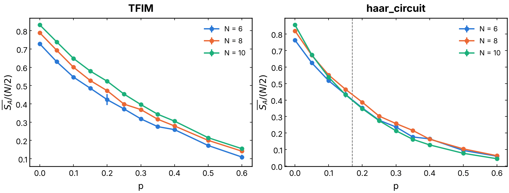
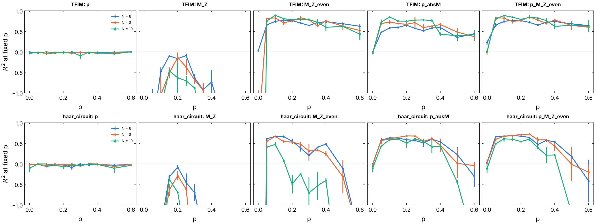
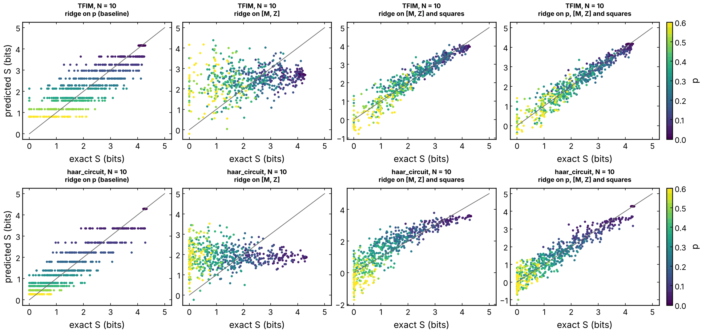
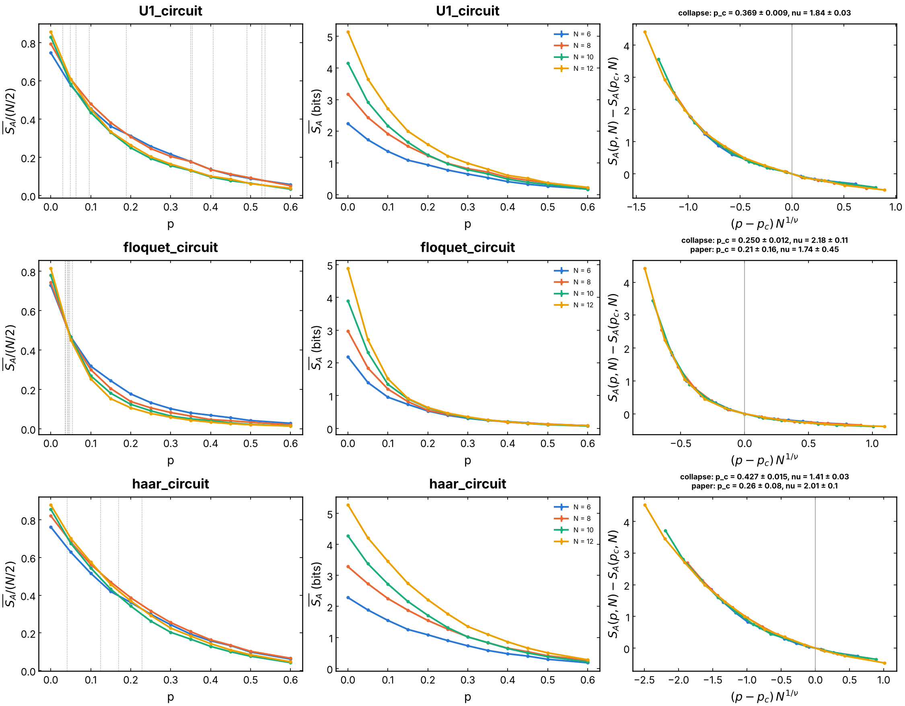

# Entanglement-entropy prediction and phase classification across the MIPT

Can a linear readout of local measurements predict a global, nonlinear
quantity, the half-chain entanglement entropy `S_A`, across the
measurement-induced phase transition (MIPT)? This folder simulates monitored
dynamics without ancilla, locates the volume-law to area-law transition of
`S_A` with finite-size scaling, and asks how much of `S_A` a ridge readout of
the measurement record `M` and the final magnetizations recovers. It holds
the comparison of a **continuous-time** reservoir (the all-to-all TFIM,
`exp(-i H dt)` per round) with **Floquet / circuit** reservoirs (the local
Floquet Ising chain of Skinner, Ruhman and Nahum (2019), Haar and U(1)
brickworks), and the **phase classification** task: a ridge classifier of
the label "volume law" (`p < p_c`) or "area law" (`p > p_c`).

## Experiment overview

| | |
| --- | --- |
| Script(s) | `experiments/QELM_S/exp_QELM_S.py`, launcher `exp_QELM_S.sh`; plots `plot_QELM_S.py`, `plot_entropy_fss.py` |
| Config | `conf/QELM_S.yaml` (`entropy_task`), models in `conf/models/` |
| Physical model | `TFIM`: all-to-all `H = h sum_i Z_i + sum_{i<j} J_ij X_i X_j`, `h = 10 J`, `exp(-i H dt)` per round, new disorder per trajectory; `haar_circuit`: brickwork of Haar U(4) gates, new gates per trajectory; `U1_circuit`: random charge-conserving brickwork (Agrawal et al., Barratt et al. 2022); `floquet_circuit`: every brick `exp{-i[phi_xx XX + theta_x (X1 + 1X)]} exp{-i[phi_zz ZZ + theta_z (Z1 + 1Z)]}` with `phi_xx = 0.3`, `phi_zz = 0.6`, `theta_x = 0.2`, `theta_z = 0.4` (Skinner et al., PRX 9, 031009 (2019), Eq. (1)); open boundaries |
| System sizes `N` | 6 to 12 (up to 16 for the late-time protocol), no ancilla |
| Control parameters | measurement probability `p` (0 to 0.6), number of rounds (`2 N`, or `4 N` half-layers for the Floquet chain), averaging window `entropy_task.average_from` |
| Initial state | Néel state `|0101...>` |
| ML task | regression of `S_A` (bits) from local features (`M`, `<Z_k>`, a single Z shot, `|M|`, their squares, indicators of `p`), ridge readout (`alpha = 1e-3`), scored by the pooled R2 and the R2 at fixed `p`; with `entropy_task.p_c` set, ridge classification of the phase label (`accuracy_phase_<set>`) |
| Issues / PRs | #230 (PR #232), #239 (PR #240), #251 (PR #252) |

## Methodology

For every `p` of the grid, `samples_per_p` trajectories (200 by default):

1. Start in the Néel state. Apply a unitary step (one brickwork period, one
   Floquet half-layer, or `exp(-i H dt)`), then measure each qubit in Z with
   probability `p` (Born rule). Repeat for `2 N` rounds (Floquet: `4 N`
   half-layers, plus one when `N / 2` is odd, so that the last layer always
   holds the bond across the cut).
2. The target is the von Neumann entropy `S_A` of the first `N / 2` qubits
   right after the last measurements (or, with `average_from=0.5`, the
   Rényi entropies `S_1, S_2, S_inf` and the tripartite information `I_3`
   averaged over the second half of the run).
3. All `p` are pooled into one dataset, split 70 / 30 with the same share at
   every `p`, and a ridge readout is fitted on each feature set. Because
   `S_A` depends mostly on `p`, the **R2 at fixed `p`** (the share of the
   trajectory-to-trajectory variance of `S_A` that the readout explains) is
   the fair score; the `p` indicators alone score 0 on it by construction.
4. Finite-size scaling: collapse `S_A(p, N) - S_A(p_c, N)` against
   `(p - p_c) N^(1/nu)`, minimizing the mismatch of the rescaled curves over
   `(p_c, nu)` (`QELM.evaluation.finite_size`, the method of Sec. IV of
   Skinner et al.), with statistical (bootstrap) and systematic (choice of
   sizes and window) errors.

How to run it: [experiments/README.md, "Run the entanglement-entropy prediction"](../README.md#run-the-entanglement-entropy-prediction-issue-230)
and its subsections on the Floquet chain.

## Results and discussion

- **Continuous TFIM: no area law in range.** For the all-to-all TFIM
  (`h = 10 J`, `dt = 1 / J`), `S_A / (N/2)` grows with `N` at every `p` up to
  0.6: no crossing and no area law at `N <= 10` (Figure 1, left). The
  all-to-all couplings have no light cone (see
  [`diagnostics`](../diagnostics/README.md)), so measurements at these rates
  do not disentangle it.
- **Haar brickwork: a broad crossover.** The ratio grows with `N` at
  `p ~ 0`, the curves meet around `p ~ 0.05` to `0.15`, and `N = 10` drops
  below `N = 8` from `p ~ 0.2`, consistent with `p_c ~ 0.17` of Zabalo et al.
  (2020) for `S_1` (Figure 1, right).
- **Floquet chain (Skinner et al.): `p_c` and `nu`.** At `p >= 0.2`, `S_A`
  hardly depends on `N` (0.53 to 0.64 bits at `p = 0.2`), the area law; at
  `p = 0` it grows linearly with `N` (Figure 4). With the final entropy only
  and `N <= 12`, the collapse gives `p_c = 0.250 +- 0.012`, `nu = 2.18 +- 0.11`,
  and narrowing the window moves the minimum to `p_c = 0.14` to `0.17`. The
  cost has a long diagonal valley in the `(p_c, nu)` plane. With late-time
  averages (issue #251) on `N = 6` to `16` (a scratch run of the same
  protocol, `--min-N 8 --p-min 0.05`), `S_1` gives
  `p_c = 0.209 +- 0.008 (stat) +- 0.024 (sys)` and
  `nu = 2.03 +- 0.12 (stat) +- 0.26 (sys)`, in line with Table I of the paper
  (`0.21 +- 0.16`, `1.74 +- 0.45`); the `I_3` curves of `N = 8, 12, 16` cross
  at `p = 0.11` to `0.13`, and the systematic part is a drift toward lower
  `p_c` as small sizes are dropped.
- **Haar and U(1) and the parity of `N / 2`.** Their curves form two
  families (`N / 2` odd or even), depending on whether the cut bond got its
  gate in the last layer; within a family the Haar curves cross near
  `p ~ 0.17` (6 against 10) and `0.12` (8 against 12). A single collapse
  mixing both families is not reliable for them.
- **What the readout recovers.** The pooled R2 is carried almost entirely by
  `p` (the `p` baseline reaches 0.80 to 0.93 for the Floquet chain). A
  linear readout of `[M, <Z_k>]` cannot follow `S_A` at all, because `S_A`
  is even in the signs of the outcomes and a linear function of `M` is odd
  (Figure 3, second column). Adding the squares (`|M|`, `<Z_k>^2`) puts the
  predictions on the diagonal, including within one `p`. Between `p = 0.05`
  and `0.4`, the positions of the measurements alone (`p_absM`) explain
  about 40 to 85 % of the fixed-`p` variance of `S_A` (Figure 2), as in the
  minimal-cut picture of Skinner et al.; the outcomes add about 0.1 on the
  TFIM and almost nothing on Haar. At large `p` and `N = 10` the readout
  overfits (431 features for 1540 training trajectories).
- **Phase classification.** The label is a function of `p`, so the `p`
  baseline classifies it perfectly; the task is only informative for
  feature sets without the indicators of `p`, and is recorded as
  `accuracy_phase_<set>` in every run with `entropy_task.p_c` set.

## Figures

**Figure 1. Volume law to area law.** Mean half-chain entropy
`<S_A> / (N/2)` against `p`, for `N = 6` (blue), 8 (orange), 10 (green),
averaged over 200 trajectories per `p` and 2 seeds (error bars: standard
error over seeds, mostly smaller than the markers). Left: all-to-all TFIM
(`h = 10 J`, `dt = 1 / J`). Right: Haar brickwork, with the dashed line at
`p_c ~ 0.17` (Zabalo et al. 2020). A volume law gives a ratio independent of
`N`, an area law a ratio that decreases with `N`. Produced by
`experiments/QELM_S/plot_QELM_S.py` (issue #230).

**Figure 2. How much of the fluctuation of `S_A` at fixed `p` the readout
explains.** R2 at fixed `p` (60 test trajectories per `p`, relative to the
mean of `S_A` at that `p`) against `p`. Top row: TFIM; bottom row: Haar.
Columns: `p` indicators (baseline, 0 by construction), raw `[M, Z]`, `[M, Z]`
with their squares, `p` indicators with `|M|`, and `p` indicators with
`[M, Z]` and squares. Colors: `N = 6, 8, 10`; mean over 2 seeds with
standard errors; the axis is cut at -1. Produced by
`experiments/QELM_S/plot_QELM_S.py` (issue #230).

**Figure 3. Predicted against exact `S_A`, trajectory by trajectory.**
`N = 10`, seed 1, the 660 test trajectories (60 per `p`), colored by `p`
(viridis, 0 to 0.6); gray: the diagonal. Top: TFIM; bottom: Haar. Columns:
ridge on the `p` indicators (one value per `p`, horizontal rows), on raw
`[M, Z]` (stuck near the mean: sign symmetry), on `[M, Z]` and squares, and
on `p`, `[M, Z]` and squares, which separates trajectories of the same `p`.
Negative predictions come from the unconstrained linear readout. Produced by
`experiments/QELM_S/plot_QELM_S.py` (issue #230).

**Figure 4. Finite-size scaling, U(1), Floquet and Haar.** One row per model;
`N = 6` (blue), 8 (orange), 10 (green), 12 (yellow); 200 trajectories per
`p`, 3 seeds, final-time entropy. Left: `S_A / (N/2)` against `p`, with the
crossings of every pair of sizes (gray dotted). Middle: `S_A` in bits.
Right: collapse `S_A(p, N) - S_A(p_c, N)` against `(p - p_c) N^(1/nu)` at the
fitted `(p_c, nu)` (Floquet: `0.250 +- 0.012`, `2.18 +- 0.11`, error from the
seed-by-seed fits). The Floquet crossings near `p ~ 0.04` mark where the
finite-size deficit of the volume law changes sign, not `p_c`; the Haar and
U(1) collapses mix the two parity families. Produced by
`experiments/QELM_S/plot_entropy_fss.py` (issue #239).
