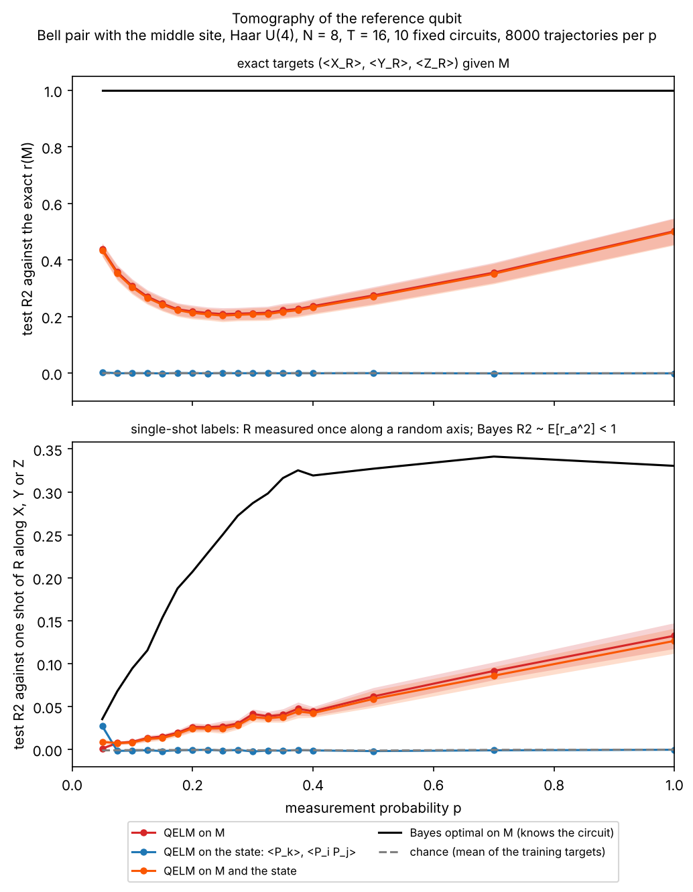
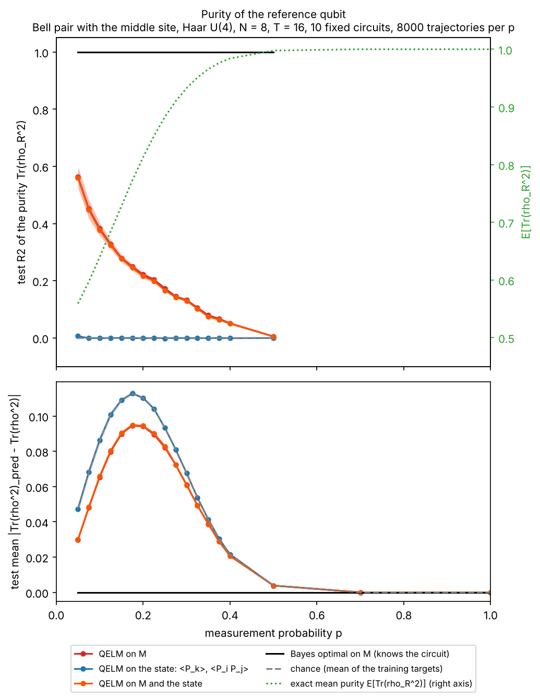
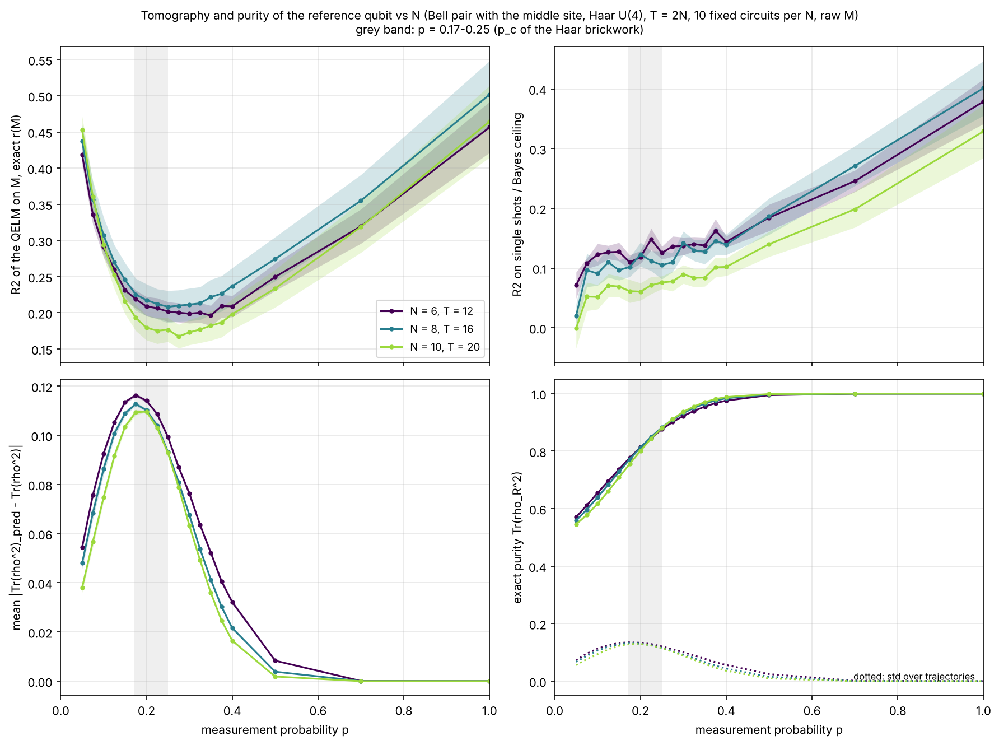
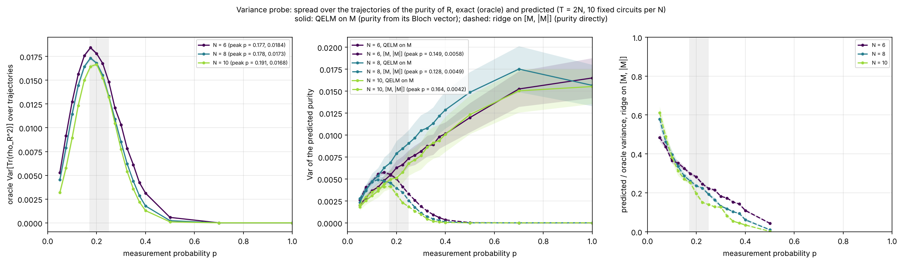
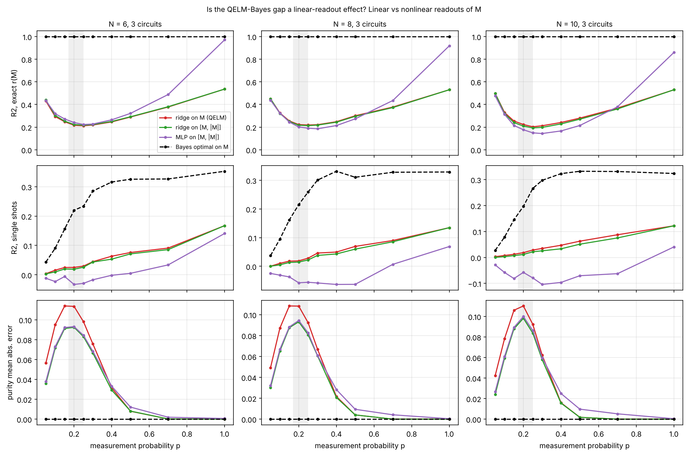
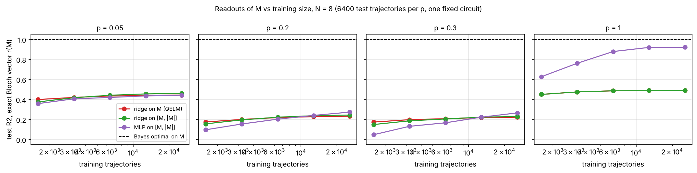

# Tomography and purity of the reference qubit (issue #277)

The task of [`nonlinear_M/`](../nonlinear_M/README.md) (#269): a reference
qubit `R` in a Bell pair with the middle site of the chain, purified (or not)
by the measurements of a Haar U(4) brickwork. Predicting the Z outcome of `R`
is capped at 3/4, because the record purifies `R` along a direction set by
the gates (#275). This experiment asks the readouts for the whole state of
`R` instead: its **Bloch vector** `r = (<X_R>, <Y_R>, <Z_R>)` given the
record `M` (tomography), and its **purity** `Tr(rho_R^2) = (1 + |r|^2) / 2`,
the order parameter of the purification transition. Which readout of the
QELM recovers them, and how does that change across the MIPT?

## Experiment overview

| | |
| --- | --- |
| Script(s) | `experiments/bloch_purity/bloch_purity.py`, launcher `bloch_purity.sh`, figures `plot_bloch_purity.py` |
| Config | `conf/bloch_purity.yaml` |
| Physical model | Haar U(4) brickwork on an open chain of `N` qubits, one fixed circuit per seed, Z measurement of each qubit with probability `p` after each round |
| System sizes `N` | 8 (`N = 10, 12` with the cluster command of `experiments/README.md`) |
| Control parameters | `p` from 0.05 to 1 (18 values), `T = 2N = 16` rounds |
| Initial state | `R` (never acted on) in the Bell pair `(|00> + |11>) / sqrt 2` with site `N // 2`, the other sites in `|0>` |
| ML task | regression of `r(M)` (3 targets, exact or single-shot labels) and of `Tr(rho_R^2)`; ridges on `M`, on the state, on both; test `R2` and mean absolute error |
| Issues / PRs | #277; builds on #269 / PR #278 and #270 / PR #275 |

## Methodology

1. One trajectory: `T` rounds of Haar U(4) gates (the same circuit for every
   trajectory of a seed), each followed by a Z measurement of every system
   qubit with probability `p`. Row `t` of the record `M` holds the outcomes,
   +-1, and 0 for an unmeasured qubit.
2. Exact targets: the reduced state `rho_R` of `R` given `M` and the
   circuit, its Bloch vector `r(M)` and its purity `(1 + |r|^2) / 2`.
3. Single-shot labels (`bloch_task.labels=both`, the default): at the end of
   the trajectory, `R` is measured once along an axis `a` drawn uniformly in
   `X, Y, Z`, giving `s = +-1` with `E[s | M, a] = r_a(M)`. This is the label
   an experiment has: one copy of `R` per trajectory. The purity has no
   single-shot label (it needs two copies), so it is always scored on its
   exact value. The shots use their own generator, so the exact scores do not
   depend on this option.
4. Features, none of which needs to simulate the circuit:
   - **QELM on M**: the raw record `vec(M)` (`N T = 128` features).
     `bloch_task.m_features=raw_abs` uses `[vec(M), vec(|M|)]` instead;
   - **QELM on the state**: `<P_k>` and `<P_i P_j>` (`P` in `X, Y, Z`) of the
     final chain state (108 features), before `R` is measured for the exact
     targets, after the single shot for the shot labels (the outcome is
     imprinted on the chain, as in the Z task of #269);
   - **QELM on M and the state**: both side by side.
5. Readout: a ridge (`RidgeCV`, one alpha per target chosen by leave-one-out
   over `10^-3 .. 10^4`), fitted on 70 % of the 8000 trajectories of one `p`
   and scored on the other 30 %. For the shots, one ridge per axis.
6. References: **Bayes optimal on M**, the exact `r(M)` and purity of an
   observer who knows the circuit. Against the exact targets its `R2` is 1
   (the oracle of #277); against single shots it predicts `r_a(M)` and its
   `R2` is `~ E[r_a^2]`, at most about 1/3 (a pure `R` along a random
   direction). **Chance**: the mean of the training targets, `R2 = 0`.
7. Scores: the `R2` of the vector, `1 - sum |r_pred - r|^2 / sum |r - mean
   r|^2` over the three components (and each component), the `R2` against
   the shots pooled over the three axes, the `R2` of the purity, and the mean
   absolute error of the purity, which stays defined when `R` is pure on every
   trajectory.
8. Sweep: 10 seeds (42 to 51), one circuit each; the figures show the mean
   over circuits and the standard error.

How to run it: [Run the tomography and purity of the reference
qubit](../README.md#run-the-tomography-and-purity-of-the-reference-qubit-issue-277).

## Results and discussion

`N = 8`, `T = 16`, 10 fixed circuits, 8000 trajectories per `p`, QELM on M
on the raw record (standard error over circuits about 0.025 on the exact
`R2`, 0.005 on the shot `R2`):

| p | E[Tr rho^2] | Bloch exact, M | Bloch exact, state | Bloch shots, M | Bloch shots, state | Bloch shots, Bayes | purity MAE, every readout |
|---|---|---|---|---|---|---|---|
| 0.05 | 0.56 | 0.44 | 0.00 | 0.001 | 0.027 | 0.035 | 0.048 |
| 0.10 | 0.64 | 0.31 | 0.00 | 0.009 | 0.00 | 0.094 | 0.086 |
| 0.175 | 0.77 | 0.23 | 0.00 | 0.019 | 0.00 | 0.187 | 0.113 |
| 0.25 | 0.88 | 0.21 | 0.00 | 0.027 | 0.00 | 0.250 | 0.093 |
| 0.40 | 0.98 | 0.24 | 0.00 | 0.044 | 0.00 | 0.319 | 0.022 |
| 0.70 | 1.00 | 0.36 | 0.00 | 0.091 | 0.00 | 0.341 | 0.000 |
| 1.00 | 1.00 | 0.50 | 0.00 | 0.132 | 0.00 | 0.330 | 0.000 |

- **Exact targets: the QELM on M reads part of the Bloch vector, with a
  minimum near the transition.** Its `R2` falls from 0.44 at `p = 0.05` to a
  plateau of 0.21 between `p = 0.2` and `0.3`, then rises to 0.50 at
  `p = 1`. The minimum sits where `R` purifies (`E[Tr rho^2]` from 0.8 to
  0.93). The QELM on the state reads nothing (`|R2| < 0.01`): chain
  expectation values before `R` is measured hold no coherence between the
  two branches of `R`. M and the state together equal M alone.
- **Single shots: the Bayes ceiling is the purification curve.** Against one
  shot of `R`, the Bayes decoder reaches `E[r_a^2]`: 0.035 at `p = 0.05`,
  then up to about 1/3 once `R` is pure. The QELM on M follows far below
  (0.02 at `p_c`, 0.13 at `p = 1`): training on ±1 labels with 128 features
  and about 1900 trajectories per axis costs most of what it reads from the
  exact targets. The QELM on the state, which now reads the chain after the
  shot, is close to Bayes at `p = 0.05` (0.027 against 0.035, the outcome is
  copied on the chain while `R` is still entangled with it) and at chance as
  soon as `p >= 0.075`.
- **The purity is not read from the raw record.** On `vec(M)`, its `R2` is
  0 within 0.01 at every `p` and the mean absolute error of every readout
  equals that of chance: a bell that peaks at **0.113 at `p = 0.175`**, where
  the purity varies most over the trajectories, and goes to 0 once `R` is
  pure. The purity is even in the outcomes: it depends on *where* the chain
  was measured, which `vec(M)` does not see linearly. With
  `bloch_task.m_features=raw_abs` (`[M, |M|]`, earlier run of the same
  circuits) the `R2` of the purity rises to 0.56 at `p = 0.05` and 0.22 at
  `p = 0.2`, and the peak of the error falls to 0.095.
- **Gap to Bayes.** On exact targets, a ridge on M recovers at best half of
  the Bloch vector; on single shots, at best 40 % of the Bayes ceiling. The
  larger sizes on the cluster (`N = 10, 12`) tell how the gap scales.

## Figures



**Figure 1. Tomography of the reference qubit.** Test `R2` of the Bloch
vector of `R` against `p`, `N = 8`, `T = 16`, 10 fixed Haar circuits, 8000
trajectories per `p`. Top: against the exact `(<X_R>, <Y_R>, <Z_R>)` given
`M`. Bottom: against one Pauli measurement of `R` along a random axis per
trajectory. Red: ridge on the raw record `M` (QELM on M); orange: ridge on
`M` and the state (QELM on M and the state, almost on the red curve); blue:
ridge on `<P_k>`, `<P_i P_j>` of the final chain (QELM on the state); black:
Bayes optimal on M (the exact `r(M)`: `R2 = 1` on top, `E[r_a^2]` at the
bottom); dashed grey: chance. Bands: standard error over the circuits.
Produced by `experiments/bloch_purity/plot_bloch_purity.py` (#277).



**Figure 2. Purity of the reference qubit.** Top: test `R2` of a ridge
fitted on `Tr(rho_R^2)` against `p`, same runs and colors as Figure 1; the
Bayes line (`R2 = 1`) is left out so that the scale shows the QELMs, all
below 0.011 (at `p = 0.05`) and within 0.002 of chance from `p = 0.2` on.
Points where the purity varies by less than 0.01 over the trajectories
(`p >= 0.7`) are not drawn. Bottom: mean absolute error of the predicted
purity, defined at every `p`; Bayes is 0, and the three QELM curves lie on
chance. The dotted horizontal line marks the top of the bell (0.113 at
`p = 0.175`). Produced by `experiments/bloch_purity/plot_bloch_purity.py`
(#277).

## Finite-size scaling, nonlinear readouts and variance probe (issue #282)

Same task and settings (Bell pair with the middle site, Haar U(4), local
encoding, `T = 2N`, fixed circuits, raw `M`, the 18 values of `p`, 8000
trajectories per `p`), at `N = 6, 8, 10` with 10 circuits each (seeds
42..51). The question: do the minimum of the Bloch `R2` and the peak of the
purity error move or sharpen with `N`, and do the curves of different `N`
cross near `p_c ≈ 0.17-0.25`? Positions of extrema use a parabola through
the three points around the extremum of the averaged curve; crossings are
sign changes of the difference of two averaged curves; the brackets are
16-84 % bootstrap intervals over the circuits
([`figures/fss/fss_summary.json`](figures/fss/fss_summary.json)).

### Result: no clear MIPT signature in the decoded observables

| | N = 6 | N = 8 | N = 10 |
|---|---|---|---|
| min of Bloch `R2` (QELM on M, exact): `p` | 0.34 [0.30, 0.35] | 0.26 [0.25, 0.28] | 0.28 [0.275, 0.28] |
| min of Bloch `R2`: value | 0.196 | 0.208 | 0.167 |
| peak of the purity error: `p` | 0.176 | 0.178 | 0.189 |
| peak of the purity error: height / FWHM | 0.116 / 0.283 | 0.113 / 0.260 | 0.110 / 0.242 |
| oracle `Var[Tr rho_R^2]` peak: `p` | 0.177 [0.175, 0.179] | 0.178 [0.176, 0.181] | 0.191 [0.187, 0.194] |
| oracle variance peak: height / FWHM | 0.0184 / 0.236 | 0.0173 / 0.218 | 0.0168 / 0.199 |
| `[M, |M|]` predicted-purity variance peak: `p` / height | 0.149 / 0.0058 | 0.128 / 0.0049 | 0.164 / 0.0042 |

- **Bloch `R2`.** The dip is a broad plateau between `p ≈ 0.2` and `0.35`
  whose minimum does not move monotonically with `N` (0.34, 0.26, 0.28) and
  does not sharpen. The `N = 10` curve lies below the other two between
  `p = 0.15` and `0.4`; `N = 6` and `N = 8` are within error bars. Crossings
  exist only at `p ≈ 0.08-0.11` (`N = 6/10`, `8/10`), below `p_c`, and none
  between `N = 6` and `8` in the bulk of the bootstrap.
- **Single shots.** The fraction of the Bayes ceiling read by the QELM on M
  rises with `p` without a dip, and is lower at `N = 10` at every `p`
  (about 0.06-0.10 near `p_c`, against 0.10-0.15 at `N = 6, 8`). Part of
  this decrease is a sample effect: `vec(M)` has `2 N^2` features (72, 128,
  200) for the same 6400 training trajectories.
- **Purity error.** On the raw record every readout equals chance, so the
  error is the mean absolute deviation of the exact purity. Its peak barely
  moves (0.176 → 0.189), gets lower and narrower slowly (FWHM 0.283 → 0.242
  from `N = 6` to `10`). The curves of different `N` do not cross between
  `p = 0.05` and `0.5` (except `N = 8/10` in half of the resamplings).
- **Purification curve.** The mean purity of `R` at `t = 2N` is the only
  quantity whose curves cross at every pair of sizes: `p = 0.205`
  (`N = 6/8`), `0.23` (`6/10`), `0.264` (`8/10`), each with a narrow
  bootstrap interval. The crossing drifts upward with `N`, by more than the
  error bars: at these sizes and at `T = 2N`, this is not a converged
  estimate of `p_c` (≈ 0.17 for the Haar brickwork), and the drift can come
  from the depth `T = 2N`, short of the purification time in the mixed phase.

### Variance probe

The decoded analogue of the charge sharpening of #137: the variance over the
trajectories of the purity of `R`, exact (the oracle, the Bayes decoder that
knows the circuit) and predicted by the QELM
([`figures/fss/purity_variance.png`](figures/fss/purity_variance.png)).

- **Oracle.** A peak at `p ≈ 0.18-0.19`, inside the `p_c` window, that
  narrows with `N` (FWHM 0.236, 0.218, 0.199, intervals of ±0.003) but
  *decreases* in height (0.0184, 0.0173, 0.0168) and drifts to larger `p`.
  The narrowing is slower than the `N^{-1/nu}` of a transition with
  `nu ≈ 1.3` (from `N = 6` to `10`, a factor 0.84 against 0.67), and a peak
  that loses height is not the sharpening of a variance at a transition.
- **QELM.** The ridge on the raw record predicts a constant purity (the
  purity is even in the outcomes). The ridge on `[M, |M|]` predicts a purity
  whose variance has a peak at `p ≈ 0.13-0.16`, below the oracle peak and
  lower with `N` (0.0058, 0.0049, 0.0042). Its fraction of the oracle
  variance falls monotonically with `p` (0.5-0.6 at `p = 0.05`, 0.15-0.3 at
  `p_c`, 0 once `R` is pure) and is smaller at larger `N` from `p ≈ 0.1` on.
  The purity built from the Bloch vector of the QELM on M varies most where
  the exact purity does not vary at all (`p >~ 0.5`): its variance is the
  error of the readout, not a decoded signal.

### Is the QELM-Bayes gap due to the linear readout?

Two diagnostics (`bloch_task.nonlinear_readouts`): a ridge on
`[vec(M), vec(|M|)]` and an MLP (one hidden layer of 512 ReLU units, weight
decay 1, early stopping) on the same features.

- **Sweep** (3 circuits per `N`, 10 values of `p`,
  [`figures/fss/bloch_nonlinear.png`](figures/fss/bloch_nonlinear.png)): the
  ridge on `[M, |M|]` is on the ridge on `M` for the Bloch vector, and
  lowers the purity error by 0.015-0.02 at its peak. The MLP matches the
  ridge for `p <~ 0.1`, is *below* it near `p_c` with 6400 training
  trajectories, and is far above it at `p = 1` (`R2` 0.97, 0.92, 0.86 at
  `N = 6, 8, 10`, against 0.53 for the ridge). On single shots (about 2100
  noisy labels per axis) the MLP overfits and is below the ridge.
- **Learning curves** (one circuit, 32 000 trajectories per `p`, 6400 held
  out, `readout_learning_curve.py`,
  [`figures/fss/learning_curve_N8.png`](figures/fss/learning_curve_N8.png)):

  | `N = 8`, training trajectories | 1600 | 6400 | 25 600 |
  |---|---|---|---|
  | `p = 0.2`: ridge on M / MLP | 0.18 / 0.10 | 0.22 / 0.20 | 0.23 / 0.27 |
  | `p = 0.3`: ridge on M / MLP | 0.17 / 0.05 | 0.21 / 0.17 | 0.22 / 0.27 |
  | `p = 1`: ridge on M / MLP | 0.45 / 0.63 | 0.49 / 0.88 | 0.49 / 0.92 |

  The ridge saturates (it gains 0.01 from 6400 to 25 600). At `p = 1` the gap
  is a linear-readout effect: the MLP reaches `R2 ≈ 0.92-0.97` at all three
  sizes. Near `p_c`, the MLP passes the ridge only from about 10 000
  trajectories at `N = 6, 8` (25 600 at `N = 10`) and is still rising at 25 600 (0.27-0.30, against 0.21-0.27
  for the ridge), far from 1: there the gap is not closed by a generic
  nonlinear readout at these sample sizes. The same holds at `N = 6` and
  `N = 10` ([`learning_curve_N6.png`](figures/fss/learning_curve_N6.png),
  [`learning_curve_N10.png`](figures/fss/learning_curve_N10.png)).

### Figures



**Figure 3. Tomography and purity vs `N`.** `N = 6, 8, 10`, `T = 2N`, 10
fixed Haar circuits per `N`, 8000 trajectories per `p`. (a) Test `R2` of the
QELM on M against the exact Bloch vector `r(M)`. (b) Test `R2` against
single-shot labels, divided by the Bayes ceiling `E[r_a^2]`. (c) Mean
absolute error of the predicted purity (equal for every readout of the raw
record). (d) Mean exact purity of `R` (solid) and its standard deviation
over the trajectories (dotted). Grey band: `p = 0.17-0.25`. Bands: standard
error over the circuits. Produced by
`experiments/bloch_purity/plot_bloch_fss.py` (#282).



**Figure 4. Variance probe.** Same runs. Left: variance over the test
trajectories of the exact purity of `R` (oracle). Middle: variance of the
predicted purity, from the Bloch vector of the QELM on M (solid) and from
the ridge on `[M, |M|]` fitted on the purity (dashed). Right: dashed curve of
the middle divided by the oracle, where the oracle variance exceeds `1e-4`.
Peaks in the legends: parabola through the three points around the maximum.
Produced by `experiments/bloch_purity/plot_bloch_fss.py` (#282).



**Figure 5. Linear vs nonlinear readouts of M.** 3 fixed circuits per `N`,
8000 trajectories per `p`. Rows: `R2` against the exact Bloch vector, `R2`
against single shots, mean absolute error of the purity. Red: ridge on M
(QELM on M); green: ridge on `[M, |M|]`; purple: MLP on `[M, |M|]`; dashed
black: Bayes optimal on M. Produced by
`experiments/bloch_purity/plot_bloch_fss.py` (#282).



**Figure 6. Learning curves at `N = 8`.** One fixed circuit (seed 42),
32 000 trajectories per `p`, 6400 held out for the test. Test `R2` of the
exact Bloch vector against the number of training trajectories, for the
ridge on M, the ridge on `[M, |M|]` and the MLP; dashed: Bayes (`R2 = 1`).
Produced by `experiments/bloch_purity/readout_learning_curve.py` (#282).

### Reproduce

```bash
# Figures 3 and 4: 30 runs (about 1.5 h on 4 cores; N = 10 takes 20 min a run)
N_VALUES="10 8 6" MAX_JOBS=4 SAVE_ARRAYS=false NONLINEAR=abs \
    ./experiments/bloch_purity/bloch_purity.sh
uv run python experiments/bloch_purity/plot_bloch_fss.py \
    outputs/bloch_purity/<date_time> --out figs
# Figure 5
N_VALUES="10 8 6" SEEDS="42 43 44" NONLINEAR=true MAX_JOBS=3 \
    P_VALUES="0.05 0.1 0.15 0.2 0.25 0.3 0.4 0.5 0.7 1" \
    ./experiments/bloch_purity/bloch_purity.sh
# Figure 6 (and N = 6, 10)
uv run python experiments/bloch_purity/bloch_purity.py N=8 seed=42 \
    bloch_task.samples_per_p=32000 'bloch_task.p_values=[0.05,0.2,0.3,1.0]' \
    bloch_task.labels=exact hydra.run.dir=outputs/bloch_purity/big8
uv run python experiments/bloch_purity/readout_learning_curve.py \
    outputs/bloch_purity/big8/bloch_purity.npz --out figs
```

Figures 3-4 merge two sweeps of the same circuits and trajectories (the
first with `LABELS=both`, the second with `LABELS=exact NONLINEAR=abs` for
the variance probe; their common scores are identical):
`plot_bloch_fss.py sweep1 sweep2` merges the runs of the same `N` and seed.
On a cluster, `MAX_JOBS` fills a node; `N = 12` costs about 16 times
`N = 8` per trajectory.
