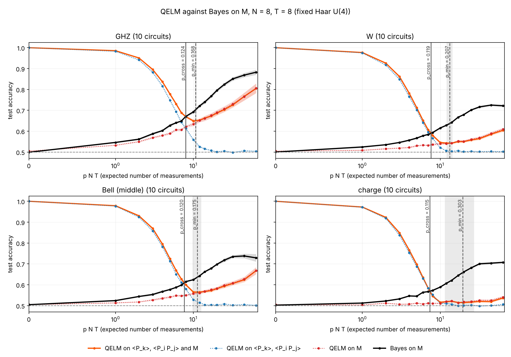
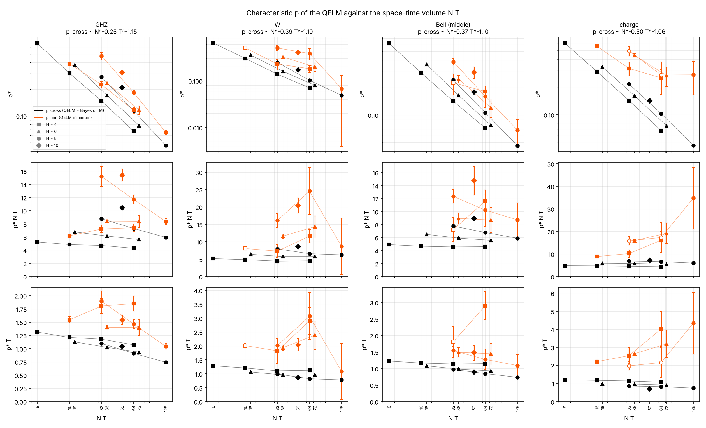
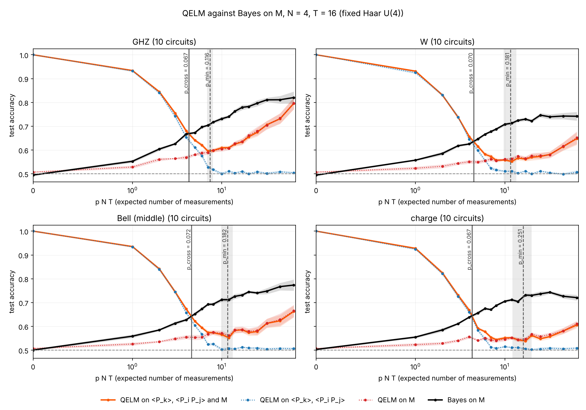
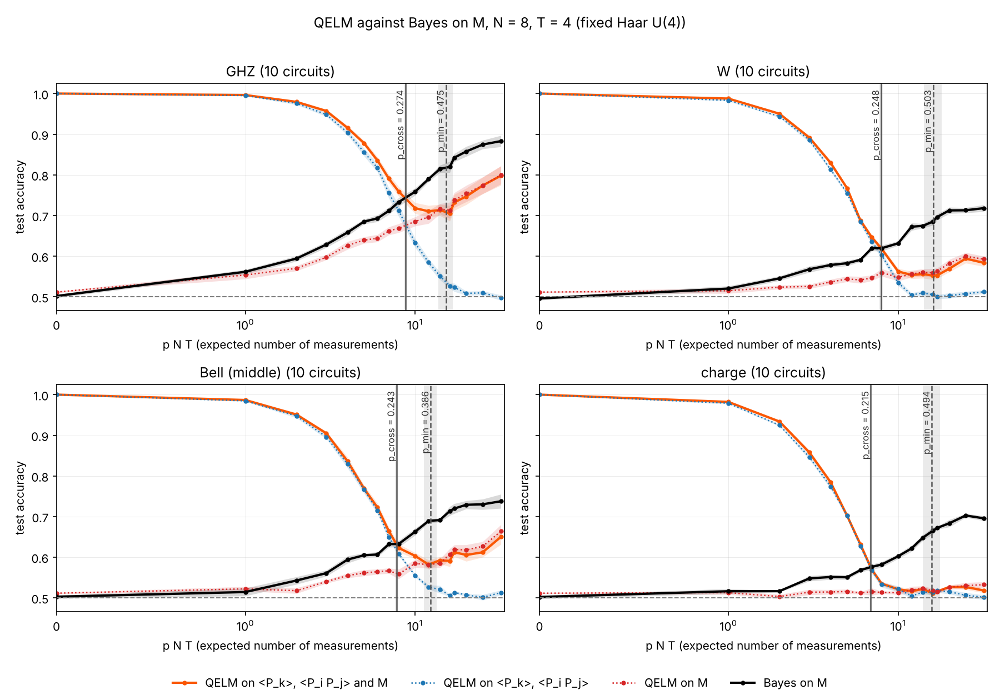
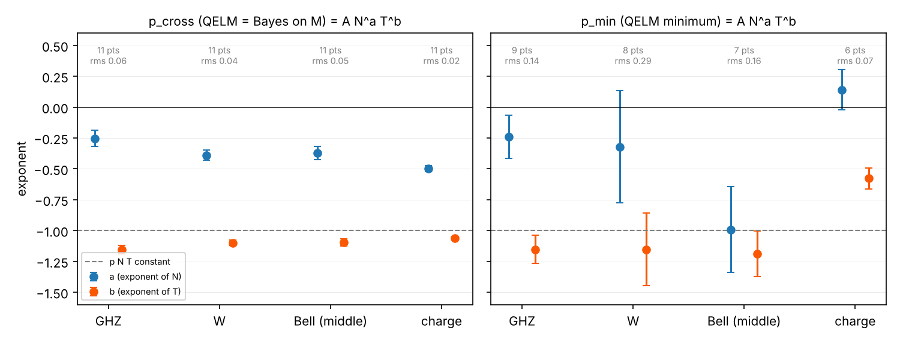
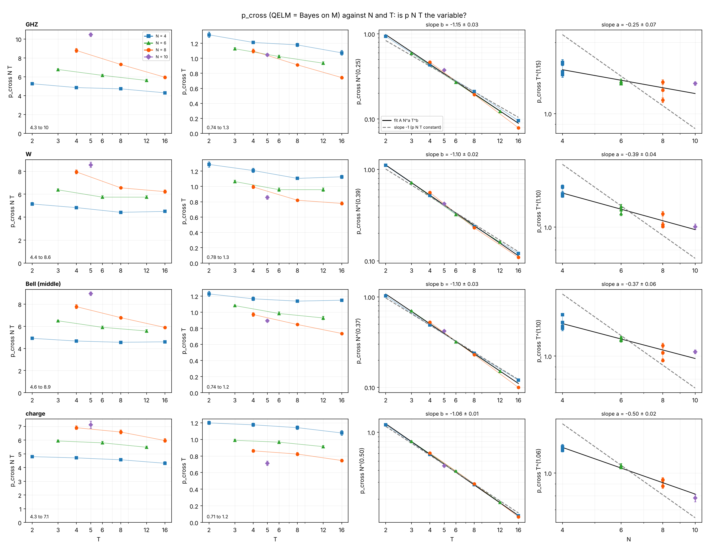
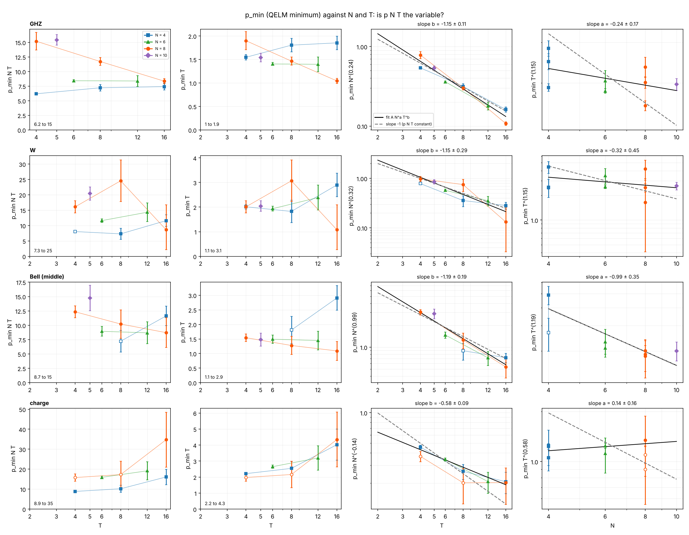
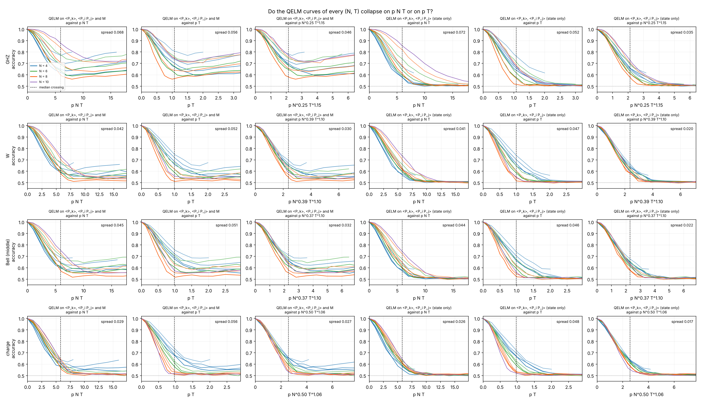

# Characteristic p of the QELM against the space-time volume `N T`

On a fixed monitored Haar circuit, the QELM that reads the final state
(`<P_k>`, `<P_i P_j>`) and the record `M` starts near accuracy 1 at `p = 0`
and falls as measurements destroy the information on the reference qubit
`R`, while the Bayes decoder of `M` (the observer who knows the circuit)
rises with `p`. Two rates mark the handover: `p_cross`, where the QELM falls
below Bayes on `M`, and `p_min`, the bottom of the QELM curve before the
record readout takes over. This experiment measures both for the four
encodings of #278 (GHZ, W, Bell pair with the middle site, charge) and asks
whether they are set by the expected number of measurements `p N T`
(issue #285).

## Experiment overview

| | |
| --- | --- |
| Script(s) | `experiments/nonlinear_M/nonlinear_M.py` (simulation, from #278), `experiments/characteristic_p/characteristic_p.py` (grid, estimators, figures), launcher `characteristic_p.sh` |
| Config | `conf/nonlinear_M.yaml` (`modes=[raw]`, `mlp_reference=false`, `quantum_baseline=true`) |
| Physical model | open chain of `N` system qubits, brickwork of Haar U(4) gates, one fixed circuit per seed; Z measurement of each site with probability `p` after each of the `T` rounds |
| System sizes `N` | 4, 6, 8, 10 |
| Control parameters | `p` on a grid dense in `p N T` (0 to 64, plus `p = 0.5, 1`), depth `T` from `N / 2` to `4 N` |
| Initial state | `(|0>_R |a> + |1>_R |b>) / sqrt 2` with the encodings `ghz`, `w`, `bell`, `charge` of #278 |
| ML task | label `Y` = Z outcome of `R`; readouts: ridge on `[<P_k>, <P_i P_j>, vec(M)]` (the QELM, `ridge_M_quantum`), ridge on the state alone, ridge on `M` alone, Bayes `sign(<Z_R>)`; test accuracy (30 % held out) |
| Issues / PRs | #285, built on #278 (#269) |

## Methodology

1. For each encoding, `(N, T)` and seed (one fixed Haar circuit), run
   `nonlinear_M.py` at every `p` of `characteristic_p.py grid N T`, with
   `PER_P` trajectories per `p`. Each readout is fitted on 70 % of the
   trajectories of one `p` and scored on the rest.
2. Average the accuracy curves over the circuits (standard error over the
   circuits).
3. `p_cross`: the first `p > 0` where the mean QELM curve falls to or below
   the mean Bayes curve, by linear interpolation between the two grid
   points around the change of sign.
4. `p_min`: the `p > 0` of the minimum of the mean QELM curve, refined by
   the vertex of the parabola through the lowest grid point and its two
   neighbours. **Not defined** if the minimum is on the first or last grid
   point, or if the curve does not rise after it by more than two standard
   errors (a plateau at chance).
5. Errors: standard deviation over 1000 bootstrap resamplings of the
   circuits; `*_defined_fraction` is the share of resamplings where the
   estimate exists. Points defined in less than 90 % of the resamplings are
   drawn hollow and left out of the power-law fit
   `p* = A N^a T^b` (least squares in log).

Two sweeps:

- **N = 8, T = 8**: 10 circuits, 8000 trajectories per `p`, as asked.
- **Scan**: `N:T` = `4:2,4,8,16`, `6:3,6,12`, `8:4,8,16`, `10:5`, 10
  circuits, 2000 trajectories per `p` (`N T` from 8 to 128).

How to run it: [Run the characteristic p of the QELM against `N T`](../README.md#run-the-characteristic-p-of-the-qelm-against-n-t-issue-285).
The scan took about 2.5 hours on 4 cores; for larger `N` or `T`, run the
launcher on the cluster with `MAX_JOBS`.

## Results and discussion

N = 8, T = 8, 10 circuits, 8000 trajectories per `p` (Figure 1):

| encoding | `p_cross` | `p_cross N T` | `p_min` | `p_min N T` | QELM accuracy at `p_min` |
| --- | --- | --- | --- | --- | --- |
| GHZ | 0.124 ± 0.002 | 8.0 | 0.168 ± 0.005 | 10.7 | 0.65 |
| W | 0.119 ± 0.002 | 7.6 | 0.207 ± 0.018 | 13.3 | 0.54 |
| Bell | 0.120 ± 0.001 | 7.7 | 0.175 ± 0.023 | 11.2 | 0.57 |
| charge | 0.115 ± 0.001 | 7.4 | 0.30 ± 0.12 | 19 | 0.51 |

- **`p_cross` hardly depends on the encoding** (7.4 to 8.0 expected
  measurements at `N = T = 8`): it is set by the death of the state readout,
  which is the same for every encoding (#278), not by the rise of Bayes.
- **`p_min` is defined for GHZ, Bell and W, not really for the charge.**
  For the charge, the QELM stays on a plateau at 0.51 to 0.52 from
  `p N T ≈ 10` to 64; the bootstrap error (± 0.12) covers the whole plateau.
  For W the dip is shallow (0.54) and its position less precise.
- **`p* N T` is not constant (Figure 2, middle row).** Over the scan,
  `p_cross N T` goes from 4.3 (`N = 4`, `T = 16`) to 10.5 (`N = 10`,
  `T = 5`). The fit gives `p_cross ∝ N^a T^b` with `b` between -1.06 and
  -1.15 and `a` between -0.25 and -0.50, for every encoding (`scan_fits.json`):
  `p_cross` is set mainly by the depth, `p_cross T ≈ 0.7` to 1.3 (bottom
  row), i.e. about one measurement per site over the circuit, with a weak
  decrease with `N`. A scaling in `N T` alone would need `a = b`.
- **Fitted exponents with errors (Figure 5):** for `p_cross`, `b` = -1.15
  ± 0.03 (GHZ), -1.10 ± 0.02 (W), -1.10 ± 0.03 (Bell), -1.06 ± 0.01
  (charge) and `a` = -0.25 ± 0.07, -0.39 ± 0.04, -0.37 ± 0.06, -0.50 ±
  0.02 (least-squares standard errors, 11 points, rms in log 0.02 to 0.06).
  `a` is between 7 and 20 standard errors away from -1, so `p N T` is
  excluded for every encoding (Figures 6 and 7).
- `p_min` follows the same trend with more scatter: `p_min T ≈ 1.0` to 1.9
  for GHZ and Bell (`b ≈ -1.15`), 2 to 3 for W, 2 to 4 for the charge,
  where the fit has too few defined points to be meaningful.
- At the two shallowest circuits (`N = 4, T = 2`; `N = 6, T = 3`),
  `p_min` is not defined for any encoding: the QELM has not risen
  significantly by `p = 1`. It is also undefined for Bell at `N = 4, T = 4`
  and for the charge at `N = 10, T = 5` (defined in 27 % and 19 % of the
  resamplings).
- The number of trajectories moves `p_cross` a little: at `N = T = 8`, GHZ,
  2000 trajectories give 0.114 ± 0.001, 8000 give 0.124 ± 0.002 (the state
  readout learns a little longer with more data). The scan uses 2000
  everywhere, so its trends are consistent, but its absolute values are
  biased low by about 8 %.

## Figures



**Figure 1. QELM and Bayes on `M` against `p N T`, N = 8, T = 8.** One
panel per encoding, 10 fixed Haar circuits, 8000 trajectories per `p`.
Orange: the QELM on `<P_k>`, `<P_i P_j>` and `M`; blue dotted: the QELM on
the state alone; red dotted: the QELM on `M` alone; black: the Bayes decoder
of `M`; bands: one standard error over the circuits; dashed grey line:
chance. Vertical lines: `p_cross` (solid) and `p_min` (dashed), with their
bootstrap error as a grey band. The QELM falls below Bayes after about 8
expected measurements for every encoding, then rises again with the record
readout (GHZ, Bell, W) or stays near chance (charge). Produced by
`characteristic_p.py plot` (issue #285).



**Figure 2. `p_cross` (black) and `p_min` (orange) against `N T`.** One
column per encoding, one marker per `N` (square 4, triangle 6, circle 8,
diamond 10), points of one `N` joined. Top: `p*` (log-log); middle: `p* N T`;
bottom: `p* T`. Error bars: bootstrap over the 10 circuits; hollow markers:
`p_min` defined in less than 90 % of the resamplings. Scan with 2000
trajectories per `p`. `p* N T` is not flat and splits by `N`, while
`p_cross T` stays between 0.7 and 1.3: the handover is set by the number of
measurements per site, not by the total. The title gives the power-law fit
of `p_cross`. Produced by `characteristic_p.py plot` (issue #285).



**Figure 3. Same as Figure 1 at N = 4, T = 16** (2000 trajectories per
`p`): the same `N T = 64` as Figure 1, but `p_cross N T ≈ 4.3` to 4.6
against 6.6 to 7.3 at `N = T = 8` with the same 2000 trajectories, which
shows that `N T` alone does not fix the crossing.



**Figure 4. Same as Figure 1 at N = 8, T = 4** (2000 trajectories per
`p`): with a shallow circuit, `p_cross N T ≈ 7` to 9 and the minimum moves
to `p ≈ 0.4` to 0.5, close to the end of the grid.

### Is `p N T` the variable?



**Figure 5. Exponents of the fit `p* = A N^a T^b`** for `p_cross` (left)
and `p_min` (right), per encoding. Blue: `a` (exponent of `N`); orange:
`b` (exponent of `T`); error bars: least-squares standard errors; grey
text: number of fitted `(N, T)` and rms residual in log. Dashed line: -1,
where both exponents sit if `p* N T` is constant. For `p_cross`, `b ≈ -1.1`
for every encoding but `a` is only -0.25 to -0.5: the crossing scales with
the depth, weakly with the width. `p_min` gives `b ≈ -1.15` for GHZ, W and
Bell with errors 4 to 10 times larger; for the charge (6 points, plateau)
the fit is not meaningful. Scan of 10 circuits, 2000 trajectories per `p`.



**Figure 6. `p_cross` against `N` and `T`.** One row per encoding; color
and marker: `N` (blue square 4, green triangle 6, orange circle 8, purple
diamond 10). Column 1: `p_cross N T` against `T`; it would be flat and the
same for every `N` if `p N T` were the variable, it spreads from 4.3 to 10
(text, bottom left) and splits by `N`. Column 2: `p_cross T` against `T`,
0.7 to 1.3 for every encoding and `N`: about one measurement per site over
the circuit. Column 3: `p_cross N^-a` against `T` (log-log) with the fit
`A T^b` (black) and a slope -1 (dashed grey). Column 4: `p_cross T^-b`
against `N` with the fit `A N^a` and the slope -1: the points follow the
much flatter fit. Error bars: bootstrap over the circuits.



**Figure 7. Same as Figure 6 for `p_min`.** Hollow markers: `p_min`
defined in less than 90 % of the bootstrap resamplings (not fitted); lower
error bars cut at a quarter of the value for the log axes. The `T`
dependence is the same as for `p_cross` (column 3) for GHZ, W and Bell,
`p_min T ≈ 1` to 3; the `N` dependence is lost in the scatter. For the
charge the "minimum" sits on the chance plateau and moves with `T` as `T^-0.6`.



**Figure 8. Do the whole QELM curves collapse?** One row per encoding.
Columns 1 to 3: the QELM on `<P_k>`, `<P_i P_j>` and `M`; columns 4 to 6:
the QELM on the state alone (`<P_k>`, `<P_i P_j>`). In each group, the
accuracy of every `(N, T)` of the scan against `p N T`, `p T`, and the
fitted variable `p N^-a T^-b` of `p_cross` (Figure 5). Color: `N`;
lightness: `T` (darker = deeper). Dashed line: the median crossing. Text:
the mean spread of the curves (standard deviation across `(N, T)`, averaged
over `0` to `1.5` times the median crossing; `collapse_spread.json`).

| encoding | readout | spread vs `p N T` | vs `p T` | vs `p N^-a T^-b` |
| --- | --- | --- | --- | --- |
| GHZ | state only | 0.072 | 0.052 | **0.035** |
| W | state only | 0.041 | 0.047 | **0.020** |
| Bell | state only | 0.044 | 0.046 | **0.022** |
| charge | state only | 0.026 | 0.048 | **0.017** |

Neither `p N T` nor `p T` collapses the curves: against `p N T` the large
`N` fall later, against `p T` they fall earlier. The fitted variable
`p N^(0.25 to 0.5) T^(1.06 to 1.15)`, fixed by the crossing only, collapses
the **whole** decay of the state readout, with a spread 1.5 to 2.5 times
smaller. The weak `N` dependence is therefore a property of the full curve,
not of the crossing point alone. `p T` alone is not the variable: one
measurement per site sets the order of magnitude of the crossing, but
larger chains lose the state readout after fewer measurements per site.

The scaling figures are drawn from the saved summary, without simulation:

```bash
uv run python experiments/characteristic_p/characteristic_p.py scaling \
    experiments/characteristic_p/figures/scan_summary.json \
    --out experiments/characteristic_p/figures
```

Data: `figures/N8_T8_summary.json`, `figures/scan_summary.json` (curves and
estimates of every `(N, T)`), `figures/scan_fits.json` (power-law fits with the standard errors `a_err`, `b_err`), `figures/collapse_spread.json` (spreads of Figure 8).
