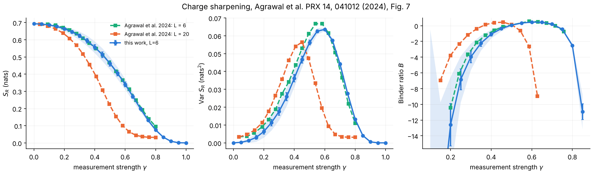
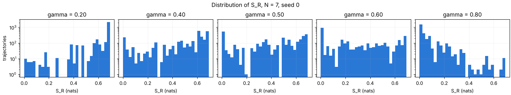

# Charge sharpening: benchmark against Agrawal et al. (2024)

A test of the library on a published result: the **purification of a
reference qubit** that encodes the global charge of a monitored U(1)
circuit, Fig. 7 of Agrawal et al., "Observing quantum measurement collapse
as a learnability phase transition", PRX 14, 041012 (2024). The entropy
`S_R` of the reference qubit `R` measures how much of the charge the
measurements have not yet revealed: it is the quantity a decoder of the
record would have to read, so this benchmark validates the purification
side (decoding) of the project before the QELM readouts are applied to it.

## Experiment overview

| | |
| --- | --- |
| Script(s) | `experiments/charge_sharpening/charge_sharpening.py`, launcher `charge_sharpening.sh`, plot `plot_charge_sharpening.py` |
| Config | `conf/charge_sharpening.yaml` (composes `conf/config.yaml`) |
| Physical model | brickwork of random charge-conserving U(1) two-qubit gates (`U1_circuit`), open boundaries, one fixed circuit instance per seed, `depth = N / 2 = 3` layers |
| System sizes `N` | 6 system qubits (the paper's `L = 6`), plus `R` |
| Control parameters | weak-measurement strength `gamma` (0 learns nothing, 1 is projective), 0 to 1 |
| Initial state | `(|0>_R |010101> + |1>_R |010100>) / sqrt(2)`, Eq. (B1), scrambled by 5 all-to-all layers of random U(1) gates |
| Observable | `S_R` (nats) over `samples.L = 10000` trajectories: mean, variance and Binder ratio `B = 1 - mu_4 / (3 mu_2^2)`, with bootstrap errors |
| Issues / PRs | #134 (charge conservation check), #137, #151 |

## Methodology

1. Prepare the state of Eq. (B1) and scramble it.
2. Apply `depth = 3` brickwork layers (each a full period, even then odd
   bonds). Between two layers (2 rounds), measure every system qubit weakly
   with strength `gamma` (`QELM.training.measurements.weak`).
3. Record `S_R` of each trajectory and the click record `M`. After each step
   the weight of the state outside its starting charge sector
   (`charge_leakage`) is checked to be zero (issue #134).
4. Average over trajectories and seeds; compare with the curves digitized
   from the paper in [`reference/`](reference/README.md) and write the
   deviation at the reference points to `comparison.json`.

The paper does not give the timing of layers and measurements; this one was
chosen against the digitized curves (measuring after every layer sharpens
the charge about 0.1 too early in `gamma`). Two exact limits are tested:
`S_R` is maximal in every trajectory at `gamma = 0` and zero at `gamma = 1`.

How to run it: [experiments/README.md, "Run the charge-sharpening benchmark"](../README.md#run-the-charge-sharpening-benchmark-issue-137).
Notebook: `notebooks/benchmarks/03_charge_sharpening.ipynb`.

## Results and discussion

- **The paper is reproduced at `L = 6`.** Over 18 reference points the mean
  `S_R` deviates from the paper's curve by 0.007 nats RMS (0.020 at most),
  and its variance by 0.004 nats^2 RMS (0.007 at most) (Figure 1).
- **The Binder ratio** follows the paper's curve near its maximum but has
  large errors at small `gamma`, where `mu_2` is tiny (RMS deviation 0.9 over
  12 points, dominated by `gamma <= 0.25`).
- **Sharpening at this size** is a smooth crossover centered near
  `gamma ~ 0.6` (peak of the variance); the paper's `L = 20` curve sharpens
  earlier, near `gamma ~ 0.45`. The distribution of `S_R` (Figure 2) goes
  from concentrated at `ln 2` (charge hidden) to concentrated at 0 (charge
  learned), with a broad, flat distribution in between: trajectory to
  trajectory, the record either has or has not revealed the charge.

## Figures

**Figure 1. Fig. 7 of Agrawal et al. (2024), reproduced.** Against the
measurement strength `gamma`: mean entropy of the reference qubit `S_R`
(nats, left), its variance over trajectories (middle) and its Binder ratio
`B` (right). Blue: this work, 6 system qubits, 10000 trajectories, 5 seeds
(circuit instances), error bars and band from the bootstrap and the spread
of instances. Squares: curves digitized from the paper, `L = 6` (green) and
`L = 20` (orange). Produced by
`experiments/charge_sharpening/plot_charge_sharpening.py` (issue #137).

**Figure 2. Distribution of `S_R` over the trajectories** (log scale), at
`gamma = 0.2, 0.4, 0.5, 0.6, 0.8`, 6 system qubits (`N = 7` in the title is
the old convention that counted `R`), seed 0. Produced by
`notebooks/benchmarks/03_charge_sharpening.ipynb` (issue #137).
