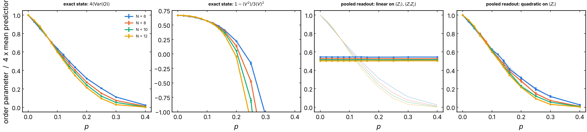
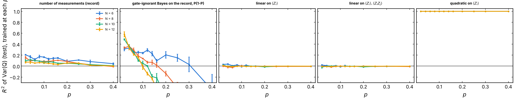
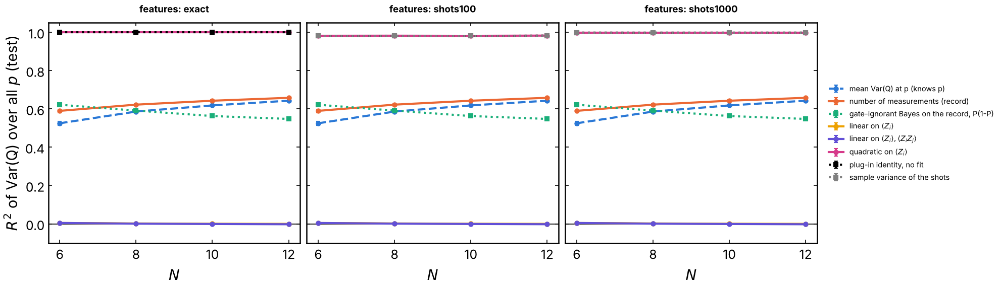
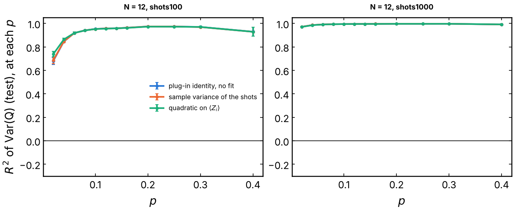

# Charge variance: can a QELM readout see charge sharpening?

The charge-sharpening transition of U(1) monitored circuits (Agrawal et al.,
PRX 12, 041002 (2022); Barratt et al., PRL 129, 120604 (2022)) separates a
phase where single trajectories keep charge fluctuations from a phase where
the measurements make the global charge `Q` sharp. Its order parameter is the
charge variance of the trajectory state, `Var(Q)`. This experiment asks
whether a readout of the final state can learn `Var(Q)` trajectory by
trajectory, and which features it needs. The identity

    Var(Q) = (1/4) [ sum_ij <Z_i Z_j> - (sum_i <Z_i>)^2 ]

is linear in the two-point functions but quadratic in the one-point
functions. So the question is whether a linear QELM on `<Z_i>` and
`<Z_i Z_j>` is enough, or whether a nonlinear readout is needed. It is the
U(1) counterpart of the `S_R` readout of
[`clifford_state_readout`](../clifford_state_readout/README.md) (#292).

## Experiment overview

| | |
| --- | --- |
| Script(s) | `experiments/charge_variance/charge_variance.py`, launcher `charge_variance.sh`, plot `plot_charge_variance.py`; simulation in `QELM.evaluation.charge_variance` |
| Config | `conf/charge_variance.yaml` |
| Physical model | random U(1) brickwork (Haar `2 x 2` block on `{01, 10}`, random phases on `00`, `11`), open chain, a new circuit per trajectory: the circuit of Barratt et al. (2022), as in [`learnability`](../learnability/README.md) |
| System sizes `N` | 6, 8, 10, 12 (dense state vectors), no ancilla |
| Control parameters | measurement probability `p` per site after each layer, 13 values in `[0, 0.4]`, `T = N` steps |
| Initial state | `(|Q0> + |Q1>) / sqrt(2)`, the uniform states of charges `Q0 = N // 2` and `Q1 = N // 2 - 1` |
| ML task | regression of the exact `Var(Q)` of the final state from `<Z_i>`, `<Z_i Z_j>` (exact, or from 100 or 1000 shots); ridge readouts, `R2` on held-out trajectories |
| Issues / PRs | #299 (follows #137, #113, #292) |

## Methodology

1. **State.** A state of definite charge has `sum_i <Z_i> = N - 2Q` and
   `Var(Q) = 0` at every `p`, so there would be nothing to learn. The chain
   starts in a superposition of two sectors. Gates conserve `Q` and
   measurements are diagonal, so the state stays
   `sqrt(w) |psi_0> + sqrt(1 - w) |psi_1>` and `Var(Q) = w (1 - w)`. This is
   `1/4` while the record hides the charge and 0 once the record reveals it.
   `w` is the posterior of `Q0` for an observer who knows the gates. The
   entropy of a reference qubit entangled with the two sectors (#137) is
   `H(w)`.
2. **Trajectories.** Each trajectory runs `T = N` steps (even then odd
   bonds), measures every site in Z with probability `p` after each layer
   (Born rule), and gets a new circuit. There are 2000 trajectories per
   `p`. The weight outside the two sectors is checked along every
   trajectory (issue #134) and is exactly 0 in every run.
3. **Target and features.** The target is the exact `Var(Q)` of the final
   state. The features are `<Z_i>` and `<Z_i Z_j>` (`i < j`) of the final
   state: exact, or the sample means over `n_shots = 100` or `1000`
   Z-basis bitstrings of that state.
4. **Readouts.** All fitted readouts are ridge regressions with standardized
   features and the penalty chosen by cross-validation:
   - `linear_z` reads `<Z_i>`;
   - `linear_zz` reads `<Z_i>` and `<Z_i Z_j>`, the standard QELM;
   - `quadratic_z` reads `<Z_i>`, their squares and the products
     `<Z_i><Z_j>`.

   Controls:
   - `chance`;
   - `n_meas`, a ridge on the number of measurements of the record;
   - `sep`, the posterior `P` of the gate-ignorant optimal decoder of the
     record (the exclusion process of Barratt et al. 2022), giving
     `P (1 - P)`. It uses no fit and no state;
   - `plugin`, the identity above applied to the features, with no fit;
   - `direct` (shots only), the sample variance of the Hamming weight of the
     shots;
   - `p_mean` (pooled), the mean training `Var(Q)` at the trajectory's `p`.
5. **Protocols.** 75 % of each `p` trains and 25 % tests. **Per p** fits
   one readout at each `p`, so its `R2` is the information beyond `p`.
   **Pooled** fits one readout for all `p` and is not told `p`; its mean
   prediction at each `p` is its estimate of `<Var(Q)>(p)`.
6. **Order parameters.** Two quantities are computed on every trajectory:
   `4 <Var(Q)>`, which is 1 at `p = 0`, and the ratio
   `1 - <V^2> / (3 <V>^2)`, which is 2/3 when every trajectory has the same
   variance and falls as the distribution of `V = Var(Q)` broadens. Each
   comes with bootstrap errors. Crossings of consecutive sizes are found by
   linear interpolation, skipping `p = 0`. There are 3 seeds per `N`; error
   bars are the standard error over seeds.

How to run it: [experiments/README.md, "Learn the per-trajectory charge variance of a U(1) circuit"](../README.md#learn-the-per-trajectory-charge-variance-of-a-u1-circuit-issue-299).

## Results and discussion

All numbers are from 3 seeds per size, `N = 6, 8, 10, 12`, 13 values of
`p`, 2000 trajectories per `p` (sweep of the code of this folder).

- **Linear readouts see nothing, with or without two-point functions.**
  Per `p`, `R2` of `linear_z` and `linear_zz` lies within 0.04 of 0 at every
  `p` and `N`. Pooled over `p`, `R2 = 0.00` at every `N`, and the mean
  prediction is the same constant at every `p` (Figure 1, third panel).
  The pooled failure is exact, not a lack of data. Averaged over the Born
  outcomes, a measurement dephases the state in the Z basis. Averaged over
  the random U(1) gates, the evolution of the diagonal is already the
  classical exclusion process, which ignores the coherences. So the
  measurements leave the averaged diagonal unchanged, and `E[<Z_i>]` and
  `E[<Z_i Z_j>]` over trajectories are the same at every `p`. Any readout linear in the
  state therefore has a mean prediction independent of `p`: it cannot follow
  any order parameter of the transition. Per `p`, the term
  `(sum_i <Z_i>)^2` is missing, and the linear part of `Var(Q)` carries no
  usable signal: `sum_ij <Z_i Z_j>` and `sum_i <Z_i>` are both linear in
  `w`, while `w (1 - w)` is symmetric about `w = 1/2`.
- **A quadratic readout of `<Z_i>` is exact.** `R2 = 1.000` per `p` and
  pooled, at every `N`. With two sectors, `<Q^2>` is linear in `<Q>`, so
  `Var(Q)` is a quadratic function of `sum_i <Z_i>` alone. With more
  sectors this no longer holds, and the readout would need `<Z_i Z_j>`
  linearly plus `<Z_i>` quadratically, which is exactly the `plugin`
  identity.
- **The readout adds nothing over the direct estimator from shots.** On 100
  shots, the pooled `R2` is 0.98 for `quadratic_z`, `plugin` and `direct`
  alike; on 1000 shots it is 0.998. Per `p` at `N = 12` and 100 shots,
  `R2` goes from 0.7 at `p = 0.02` (where `Var(Q)` hardly varies around
  `1/4`) to 0.97 (Figure 4). Once each trajectory state can be sampled,
  the sample variance of `Q` already gives the order parameter, and a
  trained readout recovers the same estimator.
- **Record-only controls.** `n_meas` reaches a pooled `R2` of 0.59 to 0.66,
  about what `p_mean` gets from knowing `p` (0.52 to 0.64); per `p` it stays
  at or below 0.21. The gate-ignorant decoder `sep` has a pooled `R2` of 0.62
  at `N = 6`, falling to 0.55 at `N = 12`. Per `p` it is positive at small
  `p` (0.3 to 0.6 at `p = 0.02`) and turns negative above `p ~ 0.1` at
  `N >= 10` (Figure 2). An observer who does not know the gates misjudges
  the charge variance in the sharp phase: it believes the charge is less
  sharp than it is.
- **Charge sharpening at these sizes.** `4 <Var(Q)>` (Figure 1, left) falls
  from 1 at `p = 0` to 0.002 to 0.024 at `p = 0.4`. It decreases with `N`
  above `p ~ 0.1` and increases with `N` below, but the curves of different
  sizes stay within 0.04 of each other for `p <= 0.10`. The crossings
  of consecutive sizes are at `p = 0.081, 0.064, 0.071` (6-8, 8-10, 10-12).
  The ratio crosses at `p = 0.094, 0.104, 0.088`. This is consistent with
  `p# ~ 0.1` for qubits (Barratt et al. 2022, whose gate-ignorant
  `p_tails ~ 0.1` we reproduced in `learnability`). The crossing is poorly
  determined, though. On the 25 % test trajectories alone, the crossings of
  `4 <Var(Q)>` move to `0.096, 0.027, 0.053`, and those of the ratio to
  `0.110, 0.053, 0.082`. The pooled quadratic readout reproduces these
  test-set values exactly, since it is exact. Locating `p#` to better than
  `+-0.03` would need more trajectories near the crossing, or larger sizes
  (matrix product states, as in the paper at `L = 20`).

**Caveat on access.** The features are expectation values of the state of one
trajectory. An experiment prepares that state once, so estimating `<Z_i>` or
`<Z_i Z_j>` of a trajectory (or drawing 100 shots of it) would need
post-selection on the record, or many copies. This is the same limit as #292
and #295. The results bound what a QELM readout of the state can do; they are
not a protocol that can be run as is.

## Figures

**Figure 1. Charge sharpening and its pooled readouts.** Against `p`, for
`N = 6, 8, 10, 12`, 3 seeds of 2000 trajectories per `p`, error bars are the
standard error over seeds. Left: `4 <Var(Q)>` of the exact final state.
Second panel: the ratio `1 - <V^2> / (3 <V>^2)`, cut at -1. Third and fourth
panels: 4 times the mean prediction, on the test trajectories, of the pooled
readout (one ridge for every `p`, not told `p`) on `<Z_i>, <Z_i Z_j>` and
quadratic on `<Z_i>`; dotted lines are the exact curves. The linear readout
predicts the same value at every `p`, and the quadratic one follows the exact
curve. Produced by `experiments/charge_variance/plot_charge_variance.py`
(issue #299).

**Figure 2. `R2` of `Var(Q)` per `p`**, exact features, one readout trained
at each `p` and scored on held-out trajectories (`p = 0`, where `Var(Q) = 1/4`
exactly, is undefined and not drawn). Panels from left to right: number of
measurements, gate-ignorant Bayes decoder of the record, linear on `<Z_i>`,
linear on `<Z_i>, <Z_i Z_j>`, quadratic on `<Z_i>`. The y axis is cut at
-0.3. Produced by `plot_charge_variance.py` (issue #299).

**Figure 3. Pooled `R2` over all `p` against `N`**, for exact features and for
features estimated from 100 and 1000 shots. Dashed: `p_mean`, which knows `p`
but not the trajectory. Dotted squares: readouts with no fit. The quadratic,
plug-in and direct estimators overlap at the top; the two linear readouts
overlap at 0. Produced by `plot_charge_variance.py` (issue #299).

**Figure 4. Finite shots at `N = 12`.** `R2` per `p` of the plug-in identity,
the sample variance of the shots and the quadratic readout, with features from
100 (left) and 1000 (right) shots of each trajectory state. The three
estimators coincide. Produced by `plot_charge_variance.py` (issue #299).
