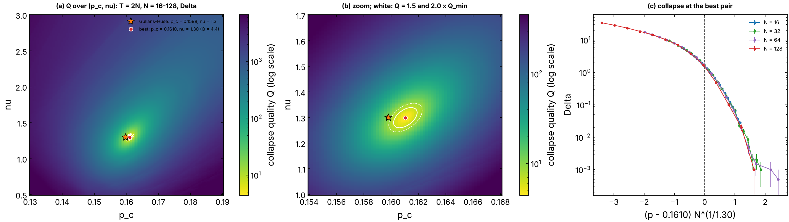
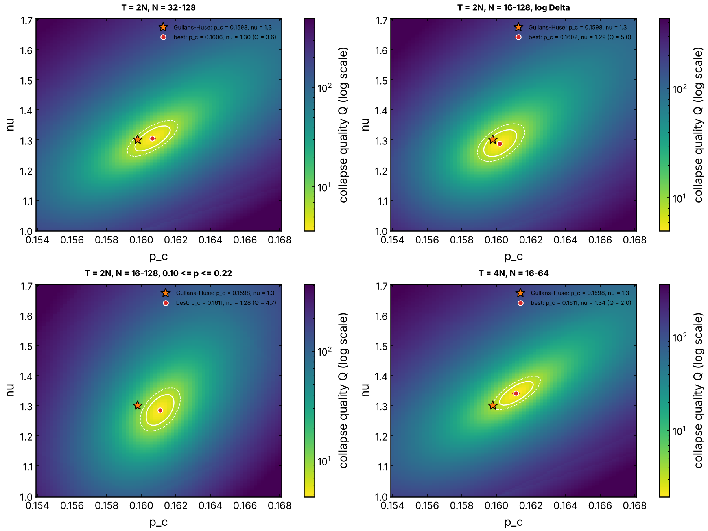

# Which (p_c, nu) collapse the Clifford MIPT best? (issue #346)

The data are the `transition` runs of issue #337, copied in `sources/`:
the periodic brickwork of random two-qubit Clifford gates (Gullans & Huse),
a `Z` measurement of each site with probability `p` after every half-layer,
depth `T = 2N` (`N = 16, 32, 64, 128`, with 4000, 2000, 2000 and 1000
circuits per `p`) or `T = 4N` (`N = 16, 32, 64`), 23 values of `p` from
0.08 to 0.30.

## The cost

The order parameter is `Delta`, the entropy of the references after the
mid-circuit record. At fixed `T / N` it is scale invariant at the
transition (the curves of all sizes cross there, at `Delta ~ 1.7`), so the
scaling form has no power of `N` in front:

    Delta(p, N) = F(x),   x = (p - p_c) N^(1/nu).

`nu` is the correlation-length exponent (written `mu` in the request). For
each pair `(p_c, nu)` the cost is the Houdayer-Hartmann quality `Q`
(`QELM.evaluation.finite_size_scaling.collapse_quality`, PRB 70, 014418):
every point `(x_i, y_i, dy_i)` of size `N` is compared with every other size
`M` whose scaled curve brackets `x_i`, linearly interpolated there to
`(Y, dY)`, and

    Q = mean over all such pairs of (y_i - Y)^2 / (dy_i^2 + dY^2).

`Q ~ 1` means the sizes agree within their error bars. Points with
`Delta = 0` (no error bar) are left out. The best pair is the Nelder-Mead
minimum of `Q`, started at the grid minimum; its error bars come from a
parametric bootstrap (40 resamples), so they are statistical only.

## Run

    uv run python experiments/clifford_collapse_map/collapse_map.py

About 45 s. It writes `figures/collapse_map.png`, `collapse_map_variants.png`,
their `.json` (the maps on the grid, `null` where no two sizes overlap) and
`summary.json`.

## Results

**(a)** `log Q` over `0.13 <= p_c <= 0.19`, `0.5 <= nu <= 3`: one narrow
valley, no second minimum. **(b)** zoom with the contours `Q = 1.5 Q_min`
and `2 Q_min` (a visual guide, not a confidence region). **(c)** the
collapse at the best pair.

| data | p_c | nu | Q_min | Q at (0.1598, 1.30) |
|---|---|---|---|---|
| T = 2N, N = 16-128, Delta (main) | 0.1610 ± 0.0002 | 1.299 ± 0.005 | 4.45 | 10.62 |
| T = 2N, N = 32-128 | 0.1606 ± 0.0002 | 1.304 ± 0.007 | 3.61 | 5.54 |
| T = 2N, N = 16-128, log Delta | 0.1602 ± 0.0002 | 1.287 ± 0.005 | 5.00 | 6.32 |
| T = 2N, N = 16-128, 0.10 <= p <= 0.22 | 0.1611 ± 0.0001 | 1.284 ± 0.008 | 4.72 | 13.99 |
| T = 4N, N = 16-64 | 0.1611 ± 0.0002 | 1.340 ± 0.008 | 1.97 | 3.91 |

Reading:

- The best collapse is at `p_c = 0.161`, `nu = 1.30`. The paper value of
  Gullans & Huse, `(0.1598, 1.30)`, has the same `nu` and a `p_c` lower by
  0.001. It sits just outside the `2 Q_min` contour of the main case
  (`Q = 10.6` against `2 Q_min = 8.9`), and inside it once `N = 16` is
  dropped (`5.5` against `7.2`) or with `log Delta` (`6.3` against `10.0`).
- `p_c` and `nu` are correlated (the valley is tilted): a larger `p_c`
  wants a larger `nu`.
- The spread between the five data choices (`p_c` from 0.160 to 0.161,
  `nu` from 1.28 to 1.34) is larger than the bootstrap errors, so the
  real uncertainty is systematic: about ±0.001 on `p_c` and ±0.05 on `nu`.
- `Q_min` is 2 to 5, not 1: the sizes do not collapse fully within their
  (small) error bars. Dropping `N = 16` lowers `Q_min` and moves `p_c`
  towards 0.1598, the expected sign of corrections to scaling at small `N`.
