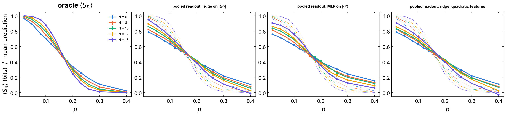
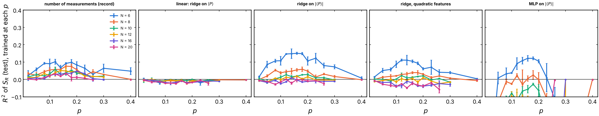
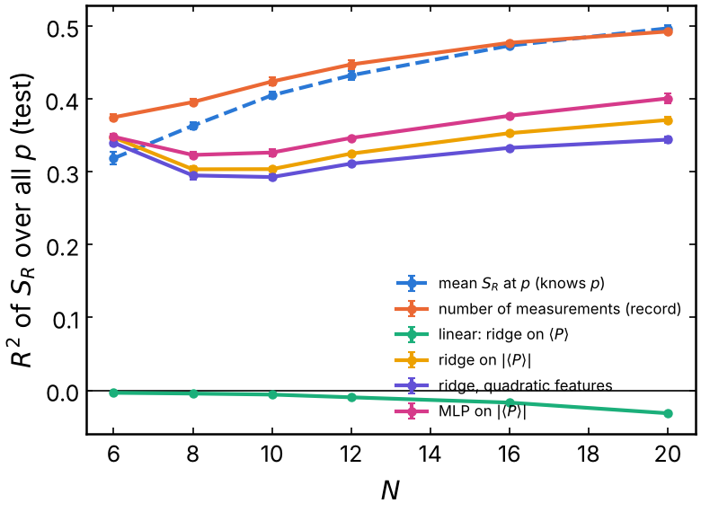

# Learn S_R of the reference qubit from the final Clifford state

Can a QELM-style readout of the final state of the **system** learn the
entropy `S_R` of the reference qubit `R` (equivalently its purity
`Tr(rho_R^2)`) trajectory by trajectory? If it could, the trained readout
would be a probe of the measurement-induced phase transition (MIPT) through
the purification order parameter. The circuits are random Clifford
circuits, simulated with stabilizer tableaux, so the sizes go up to `N = 20`.
This is issue #292. It extends #280, where
a linear readout of the state gave `R2 ≈ 0` for the purity.

**Short answer: no.** The one- and two-site observables of the system carry
no information on `S_R` beyond what the number of measurements already
gives, and what little there is vanishes with `N`. A readout trained on all
`p` at once learns `p` from the state and then predicts the mean `S_R` at
that `p`, worse than a baseline that is simply told `p`. It does not measure
`S_R`.

## Experiment overview

| | |
| --- | --- |
| Script(s) | `experiments/clifford_state_readout/clifford_state_readout.py`, launcher `clifford_state_readout.sh`, figures `plot_clifford_state_readout.py` |
| Config | `conf/clifford_state_readout.yaml` |
| Physical model | periodic brickwork of random two-qubit Clifford gates (uniform over the 11 520 elements), `QELM.models.circuits.stabilizer`, new gates for every trajectory |
| System sizes `N` | 6, 8, 10, 12, 16, 20 (`T = 2N`); 6 to 16 (scrambled) |
| Control parameters | measurement probability `p` per site and step, 13 values from 0.02 to 0.40 |
| Initial state | `R` in a Bell pair with the middle site `N // 2`, the rest in `|0>` |
| ML task | target `S_R` (0 or 1 bit); features `<P_k>`, `<P_i Q_j>` of the system (`P, Q = X, Y, Z`); ridge, quadratic ridge, MLP; `R2` and MAE |
| Issues / PRs | #292 (this one), #280 (Bloch vector and purity from `M` and the state), #185 (Gullans & Huse probe) |

## Methodology

1. `R` (qubit 0) and the middle site start in `(|00> + |11>) / sqrt(2)`.
2. `scramble_steps` steps without measurement: 0 in the main sweep (the
   protocol of the QELM tasks), `2N` in the second sweep (`t0 = 2L` of
   Gullans & Huse 2020, whose crossing is known, `p_c = 0.1598`).
3. `steps = 2N` measured steps. A step is one half-layer of the brickwork
   (each site gets one gate), then a Z measurement of each system qubit with
   probability `p`. This is the step of #185, not the full layer of
   `haar_readouts`: `p` here is per half-layer.
4. Target: `S_R`. For a stabilizer state `rho_R` is pure or `I / 2`, so
   `S_R` is 0 or 1 and the purity is `1 - S_R / 2`. The two targets are
   affine in each other, so they have the same `R2`, and the purity has half
   the mean absolute error. Everything below is said for `S_R` and holds for
   the purity.
5. Features: the exact expectation values `<P_k>` and `<P_i Q_j>` of the
   final state, on the system only (`3N + 9N(N-1)/2` values, 1770 at
   `N = 20`), each 0 or ±1.
6. Readouts, fitted on 75 % of the trajectories and scored on the other 25 %:
   - `linear`: ridge (`RidgeCV`, standardized) on the signed features, the
     linear QELM;
   - `abs`: ridge on `|
|` (the squares);
   - `quadratic`: ridge on the features, their squares and the products of
     every two one-site features;
   - `mlp`: one hidden layer of 32 units, L2 penalty 10, early stopping, on
     `|
|`; a classifier whose output is `P(S_R = 1)`;
   - controls: `chance` (training mean), `n_meas` (ridge on the number of
     measurements of the trajectory and its square: it reads the record, not
     the state) and, pooled only, `p_mean` (the mean training `S_R` at the
     trajectory's `p`: it knows `p` and nothing else).
7. Two protocols. **Per p**: one readout per `p`. Its `R2` is the
   information on `S_R` beyond `p`, since the per-`p` mean scores 0.
   **Pooled**: one readout for every `p`, not told `p`. Its mean prediction
   at each `p` is its estimate of the order parameter `<S_R>(p)`.

2000 trajectories per `p`, seeds 42, 43, 44 (one run per seed and `N`).
Error bars are standard errors over the three seeds. How to run it: see
[Learn S_R of the reference qubit from the final Clifford state](../README.md#learn-s_r-of-the-reference-qubit-from-the-final-clifford-state-issue-292).

**Access assumption.** The features are exact expectation values of the
trajectory state. An experiment prepares each trajectory state once, so it
would need post-selection on the record (or many copies of the same record)
to estimate them. The results are therefore an upper bound on what a QELM of
the state could do, and even this upper bound fails.

## Results and discussion

- **The oracle reproduces the known transition.** With scrambling, the
  curves `<S_R>(p)` of consecutive sizes cross at `p = 0.159, 0.180, 0.156,
  0.163` (6-8, 8-10, 10-12, 12-16), against `p_c = 0.1598` of Gullans & Huse.
  At `p = 0.16`, `<S_R> = 0.47` to `0.51` for every `N` (Figure 1). Without
  scrambling (`T = 2N` from the Bell pair) the crossing drifts, `0.076,
  0.106, 0.127, 0.127` up to `N = 16`: at this depth the probe has not
  reached its scaling regime. That is the main sweep, used for the readouts
  because it is the protocol of the QELM tasks.
- **The signs carry nothing: linear `R2 ≈ 0` at every `p` and `N`**
  (Figure 2, second panel; between -0.03 and 0.00). This is exact, not a
  failure of the fit. `S_R`, and the stabilizer group up to signs (so every
  `|
|`), depend only on the gates and on which sites are measured. The
  signs also depend on the outcomes, which are uniformly random given the
  rest. The test `test_signs_are_outcomes_but_abs_and_entropy_are_not`
  checks this. It is the Clifford version of the parity problem of #280.
- **The outcome-independent part `|
|` carries little, and only at small
  `N`.** Best per-`p` `R2` of `abs`: 0.15 (`N = 6`), 0.06 (8), 0.03 (10),
  0.02 (12), 0.01 (16), 0.00 (20). The record control `n_meas` gets 0.10,
  0.08, 0.06, 0.05, 0.05, 0.04: from `N = 8` on, the state does worse than
  just counting the measurements. The quadratic features and the MLP do no
  better (the MLP overfits, `R2 < 0` for `N ≥ 8`). Same picture with
  scrambling: `abs` 0.16 down to 0.02 at `N = 16`, `n_meas` 0.12 down to
  0.06.
- **Why.** In the mixed phase the information on `R` is held by stabilizers
  of weight about `N`, which one- and two-site observables cannot see. In
  the pure phase, `R` is purified by measurements whose record no
  observable of the final state remembers in a form that distinguishes "pure"
  from "mixed". At small `N` every operator is close to local, so the
  features see a little.
- **Pooled readouts learn `p`, not `S_R`.** Over all `p`, `R2` of `abs`,
  `quadratic` and `mlp` is 0.30 to 0.40. The baseline `p_mean`, which only
  knows `p`, gets 0.32 to 0.50, and `n_meas` 0.37 to 0.49 (Figure 3). From
  `N = 8` on, every state readout is below both. Their mean prediction
  (Figure 1, right panels) is a flattened copy of `<S_R>(p)`: the readout
  infers `p` from how many sites carry a `Z` stabilizer, then shrinks
  toward the global mean.
- **The crossing of the pooled predictions is not a signature.** With
  scrambling the predicted curves of different `N` do cross near the oracle
  crossing (`abs`: 0.150, 0.235, 0.168, 0.160). But a shrunk estimate
  `ŷ = ȳ + λ (y(p) - ȳ)` crosses wherever the oracle equals the global mean
  `ȳ` (0.49 to 0.50 here), and in this probe that happens to be near `p_c`, where
  `<S_R> ≈ 1/2`. Without scrambling, where the oracle crossing drifts, the
  pooled crossings are scattered (`abs`: none, 0.062, 0.145, 0.104, 0.136).
  The predicted curves are just the per-`p` means read off `p`, not a
  measurement of `S_R`.
- **Caveats.** Only one- and two-site features. A readout of the full
  stabilizer group computes `S_R` exactly (GF(2) rank), but that is the
  oracle, not a QELM. Clifford dynamics only: with Haar gates, signs and
  magnitudes are no longer separated, but #280 found the same `R2 ≈ 0` for
  the purity from the state. 2000 trajectories per `p`: at `N = 20` the
  quadratic ridge has 5310 features for 1500 training samples per `p`, and
  its small negative `R2` is overfitting.

## Figures

**Figure 1. Order parameter, scrambled probe (`t0 = 2N`, then `2N` measured
steps).** Left: oracle `<S_R>` (bits) against `p`, one color per `N`. The
curves cross at `p ≈ 0.16` (Gullans & Huse: 0.1598). Right: mean prediction
of the pooled readouts (one readout for all `p`, not told `p`), ridge on
`|
|`, MLP on `|
|`, quadratic ridge, each against the oracle (dotted).
The predictions are flattened copies of the oracle, pivoting where it
equals its global mean. Error bars: standard error over 3 seeds, 2000
trajectories per `p` (500 test). Unscrambled version:
[`order_parameter_T2N.png`](figures/order_parameter_T2N.png). Produced by
`plot_clifford_state_readout.py` (#292).

**Figure 2. Per-`p` `R2` of `S_R`, unscrambled probe (`T = 2N`), `N = 6` to
`20`.** Each panel is one readout trained and tested at each `p`:
number of measurements (control, reads the record), linear ridge on
`
`, ridge on `|
|`, quadratic ridge, MLP on `|
|`. `R2 = 0` is the
per-`p` mean of `S_R`. The linear readout is at 0 everywhere. The others are
at most 0.15 at `N = 6`, vanish with `N`, and never beat the measurement
count from `N = 8` on. The MLP panel is clipped below -0.1 (overfitting).
Error bars: 3 seeds. Scrambled version:
[`r2_per_p_scrambled.png`](figures/r2_per_p_scrambled.png).

**Figure 3. `R2` of `S_R` over all `p`, pooled readouts, against `N`
(`T = 2N`).** Dashed: `p_mean`, which is told `p` and predicts its mean
`S_R`. The state readouts sit below it and below the measurement count from
`N = 8` on, so what they explain is the dependence on `p`. Scrambled
version: [`r2_pooled_scrambled.png`](figures/r2_pooled_scrambled.png).
