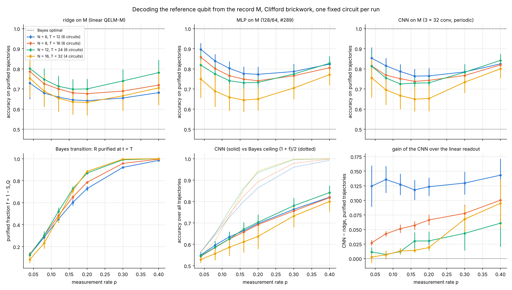
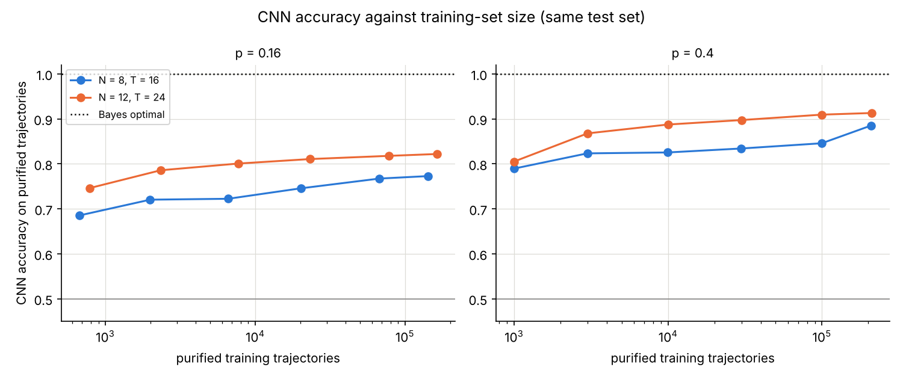

# CNN decoder of the record M on Clifford circuits

Does a nonlinear readout with a local (convolutional) bias recover the
learnability transition of the reference qubit? The Dehghani
decoder experiment ([`dehghani_decoder/`](../dehghani_decoder/README.md),
issue #287) showed that the ridge on `vec(M)` (the linear QELM-M) only reads
weight-1 parities, and that a generic MLP gains less and less with `N`.
Dehghani et al. (Nat. Commun. 14, 2918, 2023) decode with a convolutional
network (CNN). Here the same protocol, simulated with stim, is decoded by a
CNN with training sets of up to 2·10⁵ trajectories, and compared with the
ridge, the MLP and the Bayes-optimal decoder on the same trajectories
(issue #293).

**Short answer: no.** The CNN does no better than the MLP, stays far below
Bayes (0.65 to 0.85 against 1 on purified trajectories), and shows no
crossing in `N` that would track the Bayes transition. Its accuracy grows
only logarithmically with the training-set size. This is at `T = 2N` and
`N ≤ 16`; Dehghani et al. recover the transition at much shorter depth and
larger `L` (see [Comparison with Dehghani et al.](#comparison-with-dehghani-et-al)).

## Experiment overview

| | |
| --- | --- |
| Script(s) | `experiments/cnn_decoder/cnn_decoder.py` (`sweep`, `scaling`), `plot_cnn_decoder.py` |
| Config | command-line options (see [`experiments/README.md`](../README.md#run-the-cnn-decoder-experiment-issue-293)) |
| Physical model | periodic brickwork of random two-qubit Clifford gates, one **fixed** circuit per `(N, seed)`, the circuits of `dehghani_decoder/` |
| System sizes `N` | 6, 8, 12 (6 circuits each), 16 (4 circuits); `T = 2N` steps |
| Control parameters | measurement rate `p` = 0.04, 0.08, 0.12, 0.16, 0.2, 0.3, 0.4 |
| Initial state | reference `R` in a Bell pair with site `N/2`, other sites in `\|0⟩` |
| ML task | label: outcome of `σ_P` on `R` along its purification axis `P`; input: `M ∈ {-1, 0, +1}^{T×N}`; readouts: ridge, MLP (#289), CNN; score: accuracy on the purified test trajectories |
| Issues / PRs | #293, PR #294, built on #287 / PR #289 |

## Methodology

1. For each `(N, seed)`, the gates of the fixed circuit are drawn as in
   `dehghani_decoder.py`. For each `p`, 60 000 trajectories are sampled with
   stim (`simulate_records`): the measured sites are drawn anew per
   trajectory, and the record `M`, the purification axis of `R` and its sign
   `<P_R> = ±1` are kept.
2. The trajectories are split 70 / 30 (the split of `decode_accuracy`, so all
   readouts see the same test set). On a trajectory where `R` is purified
   along `P`, the label is `<P_R>`, a deterministic parity of outcomes; on the
   others it is a fair coin for every decoder. So the Bayes-optimal accuracy
   is 1 on purified trajectories and `(1 + f)/2` over all trajectories, with
   `f = 1 − S_Q` the purified fraction.
3. Readouts, trained only on purified trajectories:
   - ridge and MLP (128/64) of #289, one per axis;
   - CNN (`QELM.evaluation.cnn_decoder`, JAX): input channels `M` and `M²`
     (the mask of measured sites), three 3×3 convolutions of 32 channels,
     periodic in space and zero-padded in time, ReLU, no pooling; a dense
     ReLU layer of 128; one logit per axis. A trajectory purified along `P`
     trains only the logit of `P` (masked logistic loss). AdamW, batch 256,
     early stopping on a validation tenth of the training set. From 0.3 M
     (`N = 6`) to 2.1 M (`N = 16`) parameters, mostly in the dense layer.
4. `scaling`: for one circuit (seed 43) at `N` = 8 and 12 and `p` = 0.16 and
   0.4, 300 000 trajectories are sampled, the test set is fixed, and the CNN
   is trained on the first 10³ to 2.1·10⁵ training trajectories.

Error bars are standard errors over circuits. How to run it:
[`experiments/README.md`](../README.md#run-the-cnn-decoder-experiment-issue-293).

## Results and discussion

- **The CNN is as good as the MLP, not better** (Figure 1, top). The mean
  over circuits of CNN − MLP on purified trajectories is between −0.04 and
  +0.03 at every `(N, p)`. The CNN is slightly behind at small `p` and small
  `N`, and slightly ahead at large `p` and `N = 12, 16` (+0.01 to +0.03),
  where the parities are short and local and the convolution is the right
  bias.
- **Both stay far below Bayes.** On purified trajectories, Bayes is 1 and
  the CNN is 0.65 to 0.85 (for example 0.74 at `N = 8`, `p = 0.16`, and
  0.65 at `N = 16`, `p = 0.16`). Over all trajectories, the gap to the Bayes
  ceiling `(1 + f)/2` goes from about 0.01 at `p = 0.04` to 0.20 to 0.27
  at `p = 0.3`, for every `N` (Figure 1, bottom middle).
- **The CNN gain over the linear readout shrinks with N** (Figure 1, bottom
  right). At `p = 0.16` it is +0.12 at `N = 6`, +0.06 at `N = 8`, +0.03 at
  `N = 12`, +0.01 at `N = 16`. At `N = 16` and `p ≤ 0.2`, the ridge, the
  MLP and the CNN are within 0.02 of each other. Whatever the CNN learns
  beyond weight-1 parities becomes a small correction at large `N`.
- **No transition in the learned decoders.** The purified fraction `f`
  (Bayes) has the expected crossing: the `N` curves cross near `p ≈ 0.12`
  (Figure 1, bottom left). The CNN accuracy over all trajectories has no
  such crossing. `N = 6, 8, 12` lie on top of each other, and `N = 16` is
  below at every `p`. On purified trajectories, every readout has a shallow
  minimum near `p ≈ 0.16–0.2`, for every `N`. There the parities that fix
  the sign are longest: few measurements purify `R` late, through many
  outcomes. Its position does not move measurably with `N` at this
  resolution in `p`. It is a property of the labels, which any decoder of
  `M` inherits, not a learnability transition of the CNN.
- **Logarithmic sample complexity** (Figure 2). From 10³ to 2·10⁵
  trajectories, the CNN gains about 0.02 to 0.03 per decade of data. On the
  seed-43 circuit at `p = 0.16`, it goes from 0.69 to 0.77 at `N = 8` and
  from 0.75 to 0.82 at `N = 12`; the ridge on 4.2·10⁴ trajectories is at
  0.72 and 0.80. At that rate, Bayes accuracy would need an astronomically
  large training set. This is consistent with the exponential sample
  complexity of learning long parities: Dehghani et al. find it grows
  roughly exponentially with the purification time `t_p` and is nearly
  independent of `L`; Agrawal et al. (PRX 14, 041012, 2024) find that a
  recurrent network needs a training set that appears to grow exponentially
  with `L` to match the optimal decoder (#289 for the MLP). It is not a lack of
  capacity: the validation loss is lowest after 2 to 4 epochs and rises
  after, so the network overfits rather than underfits.
- **Circuit-to-circuit spread is large.** Two of the circuits (`N = 12` and
  `N = 16`, seed 42) have almost no weight-1 parities: the ridge is at
  0.50, and the MLP and CNN at 0.50 to 0.70 even at `p = 0.4`. Other circuits
  of the same size have the ridge at 0.80. This is why the error bars at
  `N = 16` are wide; 4 to 6 circuits per size is not enough to locate a
  crossing of the learned decoders to better than ±0.05 in `p`.

Caveats. The CNN is one architecture with one set of hyperparameters (chosen
on `N = 8` pilots: pooling cost 0.02 to 0.03, wider layers gained ≤ 0.02).
Sizes stop at `N = 16` and data at 2·10⁵ trajectories, both limited by CPU
time (a point at `N = 16` takes about 10 minutes). A larger network, a
different label convention, or Dehghani's per-circuit learnability threshold
(accuracy ≥ 0.98) would not change the conclusion that the CNN stays far
from Bayes at these sizes.

## Comparison with Dehghani et al.

Like Dehghani et al., this experiment trains one network per fixed circuit
and feeds the full record `M`. The convolution gives a local bias, but there
is **no light-cone crop** of the input; Dehghani et al. also use the full
record for their phase analysis and keep the crop for a scalability test.
The differences that matter:

- **Depth.** Dehghani's scaling collapse uses `t_d = L/16` (2 to 4 steps at
  `L = 32` to 64), where most purified trajectories purify early through
  short parities. Here `T = 2N` (12 to 32 steps).
- **Score.** Dehghani count the fraction of circuits learnt to accuracy
  ≥ 0.98 (`S̃_Q = 1 − R_l`), out of `10²` to `10³` circuits. Here the score is
  the mean accuracy over 4 to 6 circuits.
- **Sizes.** `L = 32` to 64 for their collapse, `N = 6` to 16 here. Their
  learned `p_c ≈ 0.13` (joint fit `0.14 ± 0.03`); 0.16 is the literature
  value they compare with.

So this experiment does not contradict Dehghani et al.: it tests a deeper,
smaller regime, where the labels are long parities. The short-depth,
large-`L` regime was not tested. A claim-by-claim check of the literature
behind this comparison is in [`literature_check.md`](literature_check.md)
(issue #297).

## Figures

**Figure 1. Accuracy of the readouts of M against the measurement rate.**
Top: accuracy on the purified test trajectories of the ridge (left), the
MLP of #289 (middle) and the CNN (right), one color per `N`, `T = 2N`. The
dotted line is the Bayes decoder (1) and the grey line is chance (0.5).
Bottom left: purified fraction `f = 1 − S_Q` at `t = T`. Its crossing in `N`
near `p ≈ 0.12` is the Bayes transition. Bottom middle: CNN accuracy over all
trajectories (solid) and its Bayes ceiling `(1 + f)/2` (dotted). Bottom
right: CNN minus ridge on purified trajectories. Points: mean over 6
circuits (`N = 6, 8, 12`) or 4 circuits (`N = 16`), 60 000 trajectories per
point (42 000 for training); error bars: standard error over circuits.
Produced by `experiments/cnn_decoder/plot_cnn_decoder.py` (issue #293).

**Figure 2. CNN accuracy against the training-set size.** Accuracy on a
fixed set of purified test trajectories, against the number of purified
training trajectories (log scale), at `p = 0.16` (left, near the transition)
and `p = 0.4` (right, purifying phase), for one circuit (seed 43) at
`N = 8` (blue) and `N = 12` (orange). The dotted line is Bayes. The gain is
about 0.02 to 0.03 per decade. Produced by
`experiments/cnn_decoder/plot_cnn_decoder.py` (issue #293).

`figures/summary.json` holds every curve: the mean and standard error over
circuits per `N` and `p`, and the scaling curves.
