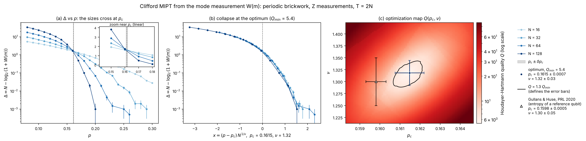

# Error bars on (p_c, nu) comparable to the literature

Our previous `(p_c, nu)` errors (#346, #348, #358) are statistical only: a
parametric bootstrap of the collapse, about 0.001 on `p_c`. The literature
quotes errors of about 0.005 that include the systematic part. This
experiment computes both parts with the exact Houdayer-Hartmann quality,
and places our three estimators of `(p_c, nu)` next to the literature on the
same circuit.

## What is added

| File | Role |
| --- | --- |
| `src/QELM/evaluation/finite_size_scaling.py` | `hh_terms`, `hh_quality`: the exact quality of Houdayer & Hartmann, PRB 70, 014418 (2004), appendix A |
| `tests/test_finite_size_scaling.py` | hand-computed case, `S ~ 1` for noisy exact scaling, minimum at the true pair |
| `error_budget.py` | every error estimator for Haar `Delta` (`T = 2N`, `4N`) |
| `pc_nu_plane.py` | the two `(p_c, nu)` planes, Clifford and Haar |
| `figures/` | outputs of both scripts |

### Exact quality versus `collapse_quality`

For each point, Houdayer-Hartmann fit **one** weighted straight line through
the bracketing points of **all** the other sizes and read it at the point
(eqs. A2, A3). `collapse_quality` interpolates each other size on its own
and averages over pairs. The optimum barely moves (Haar `T = 2N`: 0.1805,
1.59 against 0.1803, 1.61), but the value does (`Q = 1.98` against
`S = 3.35`), so only the exact version has the reference value `S ~ 1`.

## Error budget, Haar Delta (`error_budget.py`)

| Estimator | What it measures | p_c, T = 2N | nu, T = 2N | p_c, T = 4N | nu, T = 4N |
| --- | --- | --- | --- | --- | --- |
| Parametric bootstrap (200) | circuit noise | 0.0008 | 0.017 | 0.0007 | 0.017 |
| Bootstrap x sqrt(S_min) | same, for an imperfect ansatz | 0.0015 | 0.032 | 0.0019 | 0.047 |
| Region S <= 1.3 S_min (Zabalo et al.) | valley width | 0.0045 | 0.080 | 0.0070 | 0.19 |
| S_min + 1, one parameter (Melchert) | valley width | 0.0045 | 0.088 | 0.0035 | 0.089 |
| Half range over 24 (18) analysis variants | systematic | 0.0043 | 0.053 | 0.0056 | 0.20 |
| Drop large sizes, line in 1/N_max (Skinner et al.) | finite size | 0.0032 | 0.018 | 0.0030 | 0.22 |

Proposed quote: `p_c = 0.180 ± 0.002 (stat) ± 0.004 (syst)`,
`nu = 1.61 ± 0.03 ± 0.05` at `T = 2N` (`N = 4-12`), and
`p_c = 0.163 ± 0.002 ± 0.006`, `nu = 1.86 ± 0.05 ± 0.20` at `T = 4N`
(`N = 4-10`). The gap between `T = 2N` and `T = 4N` (0.017) is larger than
every error bar and is shown separately, not hidden in the error.

The variants are fixed in advance: `N_min` (smallest or second smallest
size), `N_max` (largest or second largest), window in `p` (all,
0.10-0.26, 0.12-0.24), `Delta` or `log Delta`, at least three sizes.

## (p_c, nu) planes (`pc_nu_plane.py`)

Error bars and contours: the region `Q <= 1.3 Q_min`, the rule of Zabalo
et al., PRB 101, 060301(R) (2020). Literature: only the same circuit.

| Circuit | Observable | Sizes | p_c | nu | Q_min |
| --- | --- | --- | --- | --- | --- |
| Clifford | Delta | N = 16-128 | 0.1615 ± 0.0007 | 1.32 ± 0.03 | 5.4 |
| Clifford | I3 of quarters, 0.10 <= p <= 0.24 | N = 16-256 | 0.1582 ± 0.0009 | 1.27 ± 0.05 | 1.5 |
| Clifford | S(N/2) - S(p_c, N), 0.10 <= p <= 0.24 | N = 16-256 | 0.1639 ± 0.0031 | 1.17 ± 0.09 | 6.5 |
| Clifford | Gullans & Huse PRX 2020, I3 | N = 128-512 | 0.1593(5) | 1.28(2) | |
| Clifford | Gullans & Huse PRL 2020, S_Q | N = 64-256 | 0.1598(5) | 1.30(5) | |
| Haar | Delta, T = 2N | N = 4-12 | 0.1803 ± 0.0048 | 1.61 ± 0.10 | 3.3 |
| Haar | Delta, T = 4N | N = 4-10 | 0.1629 ± 0.0072 | 1.86 ± 0.18 | 7.5 |
| Haar | I3 of quarters, n = 1 | N = 8-20 | 0.1909 ± 0.0084 | 1.07 ± 0.13 | 9.6 |
| Haar | S(N/2) - S(p_c, N), 0.10 <= p <= 0.30 | N = 8-20 | unconstrained | | 1.6 |
| Haar | Zabalo et al. 2020, I3, n = 1, T = 4N | N = 8-24 | 0.168(5) | 1.2(2) | |
| Haar | Zabalo et al. 2020, I3, Renyi-2, T = 4N | N = 8-24 | 0.162(3) | 1.3(1) | |

For Haar `S(N/2)`, the region `Q <= 1.3 Q_min` breaks into islands
(`p_c` 0.13 to 0.18, `nu ~ 0.6`): this collapse does not constrain
`(p_c, nu)` at `N <= 20`, as #358 found.

## How the literature quotes its errors

- Zabalo et al. 2020: half-width of the region `O <= 1.3 O_min` of the
  Kawashima-Ito cost (supplement, eqs. S1-S4).
- Choi, Bao, Qi, Altman 2020: standard deviation of `nu` over 100 fits on
  80 of the 100 values of `p`; the authors say it is statistical only.
- Skinner, Ruhman, Nahum 2019: refits without the sizes above `L0`, line in
  `1 / L0`, error = gap between `L0 = L_max / 2` and `L0 -> inf`.
- Gullans & Huse 2020: not described.

## How to run

From the repository root:

    uv run python experiments/collapse_error_budget/error_budget.py --ratio 2
    uv run python experiments/collapse_error_budget/error_budget.py --ratio 4
    uv run python experiments/collapse_error_budget/pc_nu_plane.py \
        --bipartite-runs outputs/bipartite_entropy
    # redraw only, from figures/pc_nu_plane_full.json:
    uv run python experiments/collapse_error_budget/pc_nu_plane.py --plot-only

The Haar and Clifford `Delta` runs are in git
(`experiments/haar_collapse_map/runs`, `experiments/clifford_collapse_map/sources`).
The #358 runs (14 MB, per-sample values) are not; `--bipartite-runs` points
to them.

## Clifford methodology figure (`clifford_methodology.py`)

One figure that explains the method on Clifford, from the mode measurement
`W(m)` only: `Delta = N - log2(1 + W(m))` of #346, `T = 2N`,
`N = 16, 32, 64, 128`, all 23 values of `p` from 0.08 to 0.30. `I3` and
`S(N/2)` (#358) are left out on purpose: they come from the state of the
references, not from `W(m)`.

    uv run python clifford_methodology.py

**(a)** `Delta` against `p`, one shade of blue per `N` (light for small
`N`): the curves cross at `p_c` (grey band `p_c ± δp_c`, linear zoom in
the inset). **(b)** the collapse against `(p - p_c) N^(1/nu)` at the
optimum. **(c)** the exact Houdayer-Hartmann quality `Q` over
`(p_c, nu)` (red, log scale, light near `Q_min`, dark for high `Q`): the optimum `Q_min = 5.4` at
`p_c = 0.1615 ± 0.0007`, `nu = 1.32 ± 0.03`, the contour
`Q = 1.3 Q_min` whose projections give these bars, and Gullans & Huse
(PRL 2020, entropy of a reference qubit: `0.1598 ± 0.0005`, `1.30 ± 0.05`).
Same values as `pc_nu_plane.py`. `--p-max 0.21` cuts the tail and gives
`0.1619 ± 0.0008`, `1.33 ± 0.03`, `Q_min = 6.2`. A few seconds.

## No-readout methodology figures (`no_readout_methodology.py`, #385)

Same style, for the provisional `(p_c, nu)` fits of the no-readout runs
of #378 (PR #380) at `T = 4N`: one PNG per model and observable in
`figures/no_readout/`. Every observable is a Renyi-2 entropy from the
Fourier weights `W_A`. The fits are read from `figures/no_readout/fits_T4N.json`
(the analysis JSON of #378), not redone; the runs are not in git.

    uv run python experiments/collapse_error_budget/no_readout_methodology.py \
        --runs <runs folder> --fits experiments/collapse_error_budget/figures/no_readout/fits_T4N.json \
        --out experiments/collapse_error_budget/figures/no_readout
