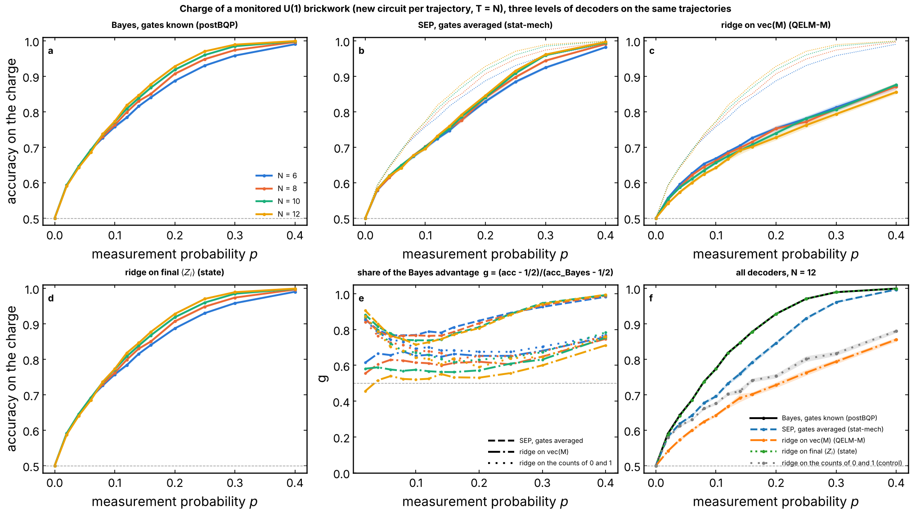
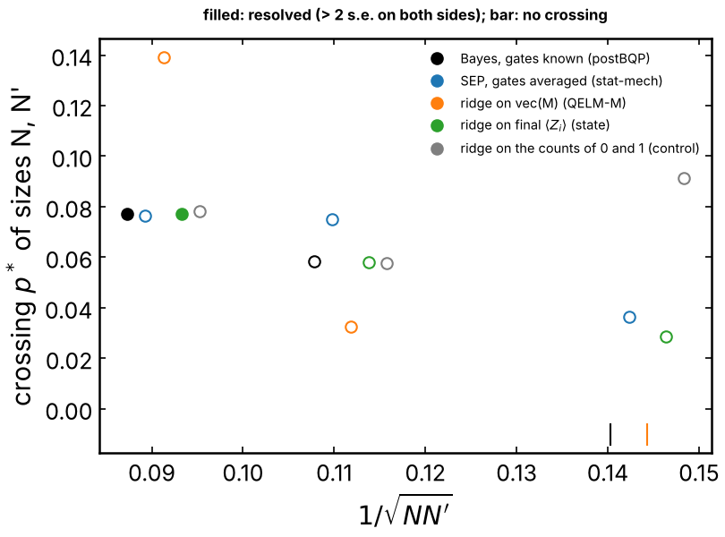

# Three levels of decoders of the U(1) charge, on the same trajectories

Agrawal et al. (PRX 2024, Appendix B) decode the charge of a monitored U(1)
circuit with three families of decoders: the optimal decoder that knows the
gates (they call it "postBQP"), the stat-mech decoder that averages over the
gates (a symmetric exclusion process, SEP), and a trained network. This
experiment scores the same hierarchy, plus the linear readouts of the QELM,
on **one** set of trajectories. The question is where the ridge of the QELM
sits, and whether it keeps a finite share of the optimal decoder as `N`
grows, the criterion (e) of the note of #303. The figure is proposal B of
the discussion of that appendix (#307).

## Experiment overview

| | |
| --- | --- |
| Script(s) | `experiments/decoder_hierarchy/decoder_hierarchy.py`, launcher `decoder_hierarchy.sh`, plot `plot_decoder_hierarchy.py`; helpers in `QELM.evaluation.decoder_hierarchy` |
| Config | `conf/decoder_hierarchy.yaml` |
| Physical model | random U(1) brickwork (Haar `2 x 2` block on `{01, 10}`, random phases on `00`, `11`), open chain, a new circuit per trajectory, the circuit of Barratt et al. (2022) and of [`learnability`](../learnability/README.md) |
| System sizes `N` | 6, 8, 10, 12 (dense state vectors), no ancilla |
| Control parameters | measurement probability `p` per site after each layer, 13 values in `[0, 0.4]`, `T = N` steps (`2N` measurement rounds) |
| Initial state | `(|Q0> + |Q1>) / sqrt(2)`, the uniform states of `Q0 = N // 2` and `Q1 = N // 2 - 1` |
| ML task | binary classification of the charge; expected accuracy given the exact posterior |
| Statistics | 3 seeds (42, 43, 44), 4000 trajectories per `p` and seed, 70 % for training the ridges |
| Issues / PRs | #307, after #113, #233, #299, #303 |

## Methodology

1. **Trajectories.** `QELM.evaluation.charge_variance.sample_trajectories`.
   The gates conserve `Q` and the measurements are diagonal, so the state
   stays `sqrt(w) |psi_0> + sqrt(1 - w) |psi_1>`, and the records have the
   law of a charge drawn with probability 1/2 each. The weight `w` left in
   `Q0` is then exactly the posterior `P(Q0 | m, U)` of an observer who
   knows every gate: the optimal decoder comes for free with the simulation.
2. **Decoders**, all guessing `Q0` or `Q1` on the same held-out
   trajectories:
   - `bayes`: `w > 1/2`. Optimal; it needs the gates.
   - `sep`: the SEP posterior from the record alone
     (`QELM.evaluation.learnability.sep_posterior`), the gate-averaged
     decoder of Barratt et al. (2022). No fit.
   - `ridge_M`: ridge on `vec(M)` (+1 / -1 for the outcome, 0 for an
     unmeasured site, `2N^2` features), the QELM-M.
   - `ridge_Z`: ridge on the `<Z_i>` of the final state. It needs the exact
     state of the trajectory, so it is an upper bound for an experiment.
   - `n_ones`: ridge on the numbers of 0 and of 1 outcomes in the record,
     a control that counts particles and forgets where and when.

   The ridges (`RidgeCV`, standardized features) are trained per `p` on a
   charge drawn from `w` for each trajectory, the label an experiment sees.
3. **Score.** The expected accuracy of a guess given `w` (`w` for `Q0`,
   `1 - w` for `Q1`), averaged over the test trajectories: no label noise.
   The share of the advantage of Bayes is `g = (acc - 1/2) / (acc_Bayes -
   1/2)`. Error bars: standard error over the seeds, or the standard error
   over trajectories when it is larger.
4. **Crossings.** For each decoder and pair of consecutive sizes, the first
   `p > 0` where the accuracies cross, called resolved when the difference
   is beyond 2 errors on both sides.

How to run it:
[experiments/README.md, "Compare three levels of decoders"](../README.md#compare-three-levels-of-decoders-of-the-u1-charge-issue-307).
The 12 runs take about 75 minutes with 4 runs at once (`N = 12` dominates).

## Results and discussion

Accuracy at `p = 0.16` (standard errors about 0.004 on the accuracies and
0.02 to 0.04 on `g`):

| `N` | Bayes | SEP | ridge on `<Z_i>` | ridge on `M` | counts | `g` SEP | `g` ridge on `M` |
| --- | --- | --- | --- | --- | --- | --- | --- |
| 6 | 0.840 | 0.777 | 0.840 | 0.726 | 0.733 | 0.81 | 0.66 |
| 8 | 0.850 | 0.776 | 0.850 | 0.715 | 0.722 | 0.79 | 0.61 |
| 10 | 0.868 | 0.785 | 0.868 | 0.707 | 0.727 | 0.78 | 0.56 |
| 12 | 0.877 | 0.791 | 0.877 | 0.701 | 0.741 | 0.77 | 0.53 |

- **The hierarchy of Agrawal et al. holds on the same trajectories**:
  Bayes ≥ SEP ≥ ridge on `M`, at every `p` and `N`.
- **The optimal decoder sharpens with `N`.** Above `p ≈ 0.08` its
  accuracy rises with `N`, and the crossing of `N = 10` and 12 at
  `p* = 0.077` is the only resolved crossing of the run (with the ridge on
  `<Z_i>`, which equals Bayes). The crossings of smaller sizes are not
  resolved. The accuracy is not the quantity of Barratt et al., who cross
  Binder ratios of the posterior (`p_tails ≈ 0.1` in
  [`learnability`](../learnability/README.md)); the two numbers are not
  compared here.
- **The SEP keeps a stable share of Bayes**, `g ≈ 0.77–0.81` at
  `p = 0.16` for every `N`, and its curves follow those of Bayes (crossing
  of 10 and 12 at 0.076, not resolved).
- **The ridge on `M` loses its share as `N` grows**: `g(0.16)` falls from
  0.66 to 0.53 between `N = 6` and 12, and its accuracy curves are ordered
  the other way (they fall with `N` above `p ≈ 0.1`, while Bayes rises).
  Its only crossing (`N = 10` and 12, `p ≈ 0.14`) is not resolved. It is
  even below the control that only counts the outcomes, by 0.02 to 0.04
  above `p = 0.06`: with `2N^2` features and 2800 training trajectories,
  the ridge pays a variance that the two counts do not.
- **The ridge on the final `<Z_i>` equals Bayes** to 0.003, as T7 of #303
  says: `sum_i <Z_i>` is affine in `w`. It only shows that the features of
  the exact state already contain the posterior.

In the terms of #303: on these trajectories the linear QELM-M fails
criterion (e). It does not inherit the sharpening of the optimal decoder,
its share decreases with `N`, and the gate-ignorant SEP, which has no
trained parameter, does better at every size.

**Limits.** `N ≤ 12` and `T = N`, as in Barratt et al.; the optimal decoder
itself resolves only one crossing. No trained network (LSTM or CNN) is in
the comparison, and no epoch count.

## Figures

**Figure 1. Accuracy on the charge of each decoder, on the same
trajectories.** Random U(1) brickwork, a new circuit per trajectory, `T = N`,
`N = 6` to 12 (colors), 3 seeds of 4000 trajectories per `p`. Bands:
standard error. Dashed gray: chance. (a) Bayes with the gates known. (b) SEP
with the gates averaged; dotted, Bayes of the same color. (c) Ridge on
`vec(M)`; dotted, Bayes. (d) Ridge on the final `<Z_i>`. (e) Share of the
advantage of Bayes `g` for the SEP (dashed), the ridge on `M` (dash-dot)
and the counting control (dotted), one color per `N`. (f) Every decoder at
`N = 12`. The ridge on `M` falls with `N` while Bayes rises, and stays below
the counting control. Produced by `plot_decoder_hierarchy.py` (#307).

**Figure 2. Crossings of consecutive sizes.** Crossing `p*` of the accuracy
of `N` and `N'` against `1/sqrt(N N')`, one color per decoder (slightly
shifted horizontally). Filled: resolved (beyond 2 standard errors on both
sides); open: not resolved; bar at the bottom: no crossing. Only Bayes and
the ridge on `<Z_i>` (which equals it) have a resolved crossing, for
`N = 10` and 12. Data: `figures/summary.json`. Produced by
`plot_decoder_hierarchy.py` (#307).
