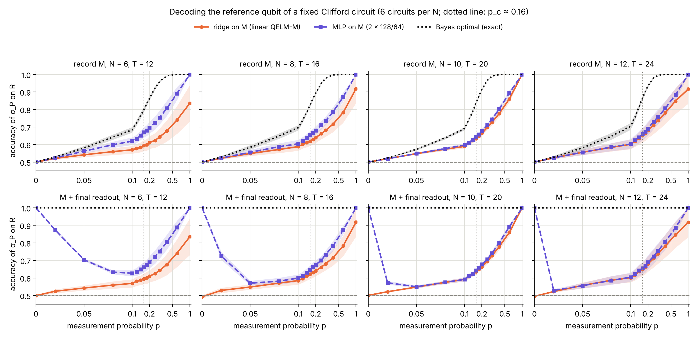
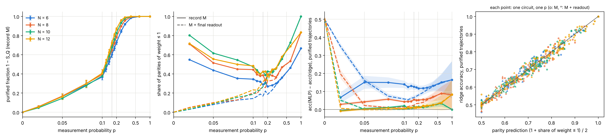
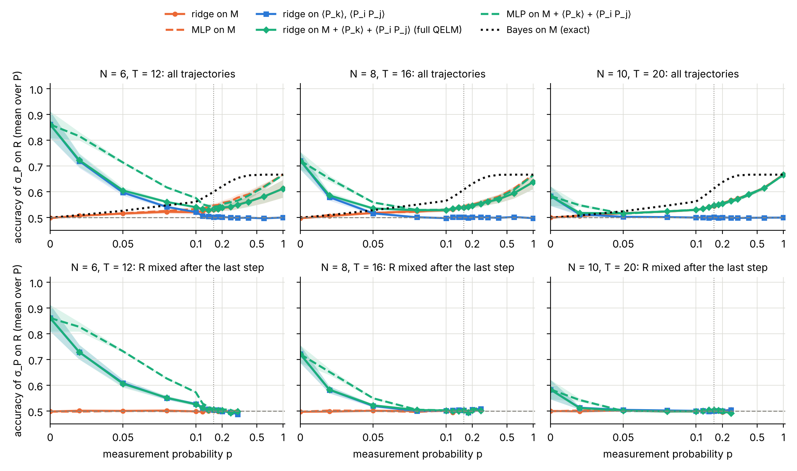

# Decoding a purified reference qubit: Dehghani et al. (2023) and linear readouts of `M`

Dehghani, Lavasani, Hafezi and Gullans, "Neural-network decoders for
measurement induced phase transitions", Nat. Commun. 14, 2918 (2023), train a
CNN on the measurement record `M` of a monitored Clifford circuit to predict
the final state of a reference qubit `R`. They find a learnability
transition: the task is learnable once `R` is purified (`p > p_c`) and
impossible while `R` stays mixed. This experiment reproduces their protocol
and asks whether a **linear** readout of `M`, the QELM-M, can do the same.
It also tests two richer inputs: `M` plus a final readout of the system, and
`M` plus the QELM features `<P_k>`, `<P_i P_j>` of the final state.

## Experiment overview

| | |
| --- | --- |
| Script(s) | `experiments/dehghani_decoder/dehghani_decoder.py` (`--case record`, `--case qelm`), plot `plot_dehghani_decoder.py` |
| Config | command-line options; simulation and decoders in `QELM.evaluation.dehghani_decoder` |
| Physical model | periodic brickwork of random two-qubit Clifford gates, one **fixed** circuit per seed; one step = one half-layer, then a Z measurement of each site with probability `p`; stim tableau simulation |
| System sizes `N` | 6, 8, 10, 12 (cases 1 and 2), 6, 8, 10 (case 3); `T = 2N` steps |
| Control parameters | measurement probability `p`, 15 values from 0 to 1 |
| Initial state | `|0...0>`, the middle site `N // 2` in a Bell pair `(|00> + |11>)/√2` with `R` |
| ML task | label: outcome of `σ_P` on `R`, `P = X, Y, Z`; readouts: ridge (RidgeCV), MLP (128, 64, ReLU), exact Bayes; 70/30 split per `p` |
| Issues / PRs | #287, PR #289; earlier Haar tests: #247, #255, #269, #277 |

## The paper, point by point

| | Dehghani et al. 2023 | This experiment |
| --- | --- | --- |
| Gates | random Clifford, periodic brickwork; Haar only as an `L = 8` illustration | random Clifford, periodic brickwork |
| Circuits | one network per fixed circuit; the measured sites change per trajectory | the same |
| Depth | `T ≈ 10` for the decoders; FSS on the early-time decay rate | `T = 2N` |
| Input | `M ∈ {-1, 0, +1}^{T×L}` | the same, `vec(M)` |
| Label | outcome of `σ_P` on `R`; only the points purified along `P` | the same (cases 1, 2); all trajectories (case 3) |
| Decoder | CNN (2 conv, max-pool, dense ReLU, sigmoid) | ridge, MLP, and the exact Bayes decoder |
| Learnability | accuracy `≥ 0.98` per circuit; `S̃_Q = 1 − R_l` | accuracy against `p`, purified fraction `1 − S_Q` |
| Linear baseline | none | ridge = linear QELM-M |

The paper does **not** state why a linear decoder would fail. In a Clifford
circuit the reason is exact. When `R` is pure along `P`, its sign is a parity
of recorded outcomes, `<P_R> = c · s_j1 ⋯ s_jk`. A linear function of `M`
carries nothing of a parity of `k ≥ 2` independent outcomes. So a ridge can
only use the trajectories where `k ≤ 1`.

## Methodology

1. Draw one fixed Clifford circuit (gates of every bond and step) per seed
   (42 to 47).
2. For each `p`, sample 30 000 trajectories (15 000 for case 3). Each draws
   its measured sites, gets its outcomes from stim, and gives `M`
   (`T × N`, 0 where a site is not measured).
3. Read the reduced state of `R` exactly (`peek_bloch`): it is mixed, or
   pure along X, Y or Z with a sign `±1`.
4. **Case 1, `M`** (the paper): one decoder per axis `P`, trained and
   tested on the trajectories purified along `P`. `acc_pure` is the
   accuracy there, where Bayes gives 1. Over all trajectories, along the
   purification axis, `acc_all = f · acc_pure + (1 − f)/2`, with `f` the
   purified fraction; Bayes gives `(1 + f)/2`.
5. **Case 2, `M` + final readout**: after the last step every system site is
   measured once more in Z, one shot, and these `N` outcomes are an extra
   row of `M`. The system is then a product state, so `R` is **always**
   pure and Bayes gives 1 at every `p`.
6. **Case 3, full QELM, `M` + `<P_k>` + `<P_i P_j>`**: for each axis `P`, a
   copy of the final state measures `σ_P` on `R` (the label). Then it reads
   the exact `<P_k>` and `<P_i P_j>` (`P = X, Y, Z`, all pairs, `3N + 9N(N−1)/2`
   values) of the system. This is the convention of the "QELM on the state"
   of #269 and #277. One decoder per axis, on all trajectories; the
   accuracy is averaged over the three axes. Bayes on `M` alone then gives
   at most 2/3, since `R` is pure along one axis and a coin along the
   other two.
7. **Parity diagnostic**: replay up to 100 purified trajectories 32 times
   each, with the same measured sites and new outcomes. Then test whether
   the sign of `R` is constant or equals `±` a single outcome. This gives
   `w₁`, the share of labels that are parities of weight `≤ 1`.
8. Mean and standard error over the 6 circuits.

How to run it:
[experiments/README.md, "Run the Dehghani decoder experiment"](../README.md#run-the-dehghani-decoder-experiment-issue-287).

## Results and discussion

- **The parity argument explains the linear readout quantitatively.** On
  the purified trajectories, the ridge accuracy equals `(1 + w₁)/2`. It is
  right on the weight-1 labels and at chance on the others. Over 696
  points (4 sizes, 6 circuits, 15 `p`, cases 1 and 2), the residual is
  0.02 RMS with a mean of −0.001 (Figure 2, right). The linear QELM-M is
  limited by the parity structure of the record, not by noise or by
  sample size.
- **`w₁` is 0.3 to 0.45 for `0.1 ≤ p ≤ 0.3`**, so the ridge stays at 0.65 to
  0.72 on purified trajectories while Bayes is at 1. `w₁` rises toward 1 at
  `p = 1`, where `R` is fixed by the first measurement of its partner, and at
  small `p`, where few outcomes exist.
- **The MLP beats the ridge, but less and less as `N` grows.** On the
  purified trajectories, at 30 000 trajectories per `p`, it gains about
  +0.13 at `N = 6`, +0.05 at `N = 8`, and +0.01 at `N = 10` and 12 for
  `0.05 ≤ p ≤ 0.3` (Figure 2, third panel). It reaches 1 only at `p = 1`,
  where the measured sites are always the same. This is the exponential
  sample complexity of the paper (their Fig. 2): the parity is learnable in
  principle, but its support changes with every measurement pattern.
- **The transition shows in `1 − S_Q`, not in the learned accuracies.** The
  purified fraction at `T = 2N` rises from 0 to 1. Its curves are ordered by
  `N` for `p ≥ 0.1` (at `p = 0.16`: 0.60, 0.65, 0.68, 0.72 for `N = 6` to 12).
  Below that they cannot be told apart within the error bars (±0.03). That
  fits a crossing near `p ≈ 0.1`, the lower end of the paper's
  `0.1 ≲ p_c ≲ 0.15` from finite-size scaling. The exact Bayes accuracy
  `(1 + f)/2` inherits it. Neither the ridge nor the MLP shows a crossing
  at these sizes: their accuracy rises smoothly with `p` for every `N`.
- **Case 2: a final readout does not bring a transition.** It purifies `R`
  in every trajectory, so Bayes is 1 everywhere. The ridge gains nothing:
  its curve is that of case 1, again `(1 + w₁)/2`. The MLP is exact at
  `p = 0`, where the label is one fixed parity of the `N` final outcomes.
  For `N ≥ 8` it falls to the ridge as soon as `p = 0.02` to 0.05. It
  recovers only at large `p`. The dip comes from the number of measurement
  patterns, not from the MIPT. Its position moves to smaller `p` with `N`.
- **Case 3: the full QELM is the maximum of its two parts.** With exact
  `<P_k>` and `<P_i P_j>`, the state readout works only at small `p`: 0.86,
  0.72, 0.58 at `p = 0` for `N = 6, 8, 10`. It falls as `N` grows because
  2N steps of scrambling push the label into non-local operators. It is at
  chance from `p ≈ 0.08` (`N = 6`) or `p ≈ 0.05` (`N = 8, 10`). The record
  takes over above that. With the ridge, `M + state` follows the better of
  the two, at most 0.02 above it near the crossover. The MLP on `M + state` gains only at `N = 6` and small
  `p` (0.82 against 0.72 at `p = 0.02`). The crossover moves to smaller `p`
  with `N`, so it is a scrambling effect, not the MIPT. On trajectories
  where `R` is still mixed after the last step, everything is at chance as
  soon as the state readout dies.
- **Answer to the question of #287.** A linear readout of `M` does not show
  the learnability transition, and the parity structure of the record
  explains exactly why. Adding the final readout or the QELM features of
  the state does not change that. A nonlinear decoder is necessary but, at
  the sample sizes tried, not sufficient beyond `N = 8`. The transition is
  only clean in the exact (Bayes) decoder.
- **Caveats.** The MLP stands in for the CNN of the paper: no convolution,
  no light-cone crop (their Fig. 4 shows both cut the sample complexity).
  `T = 2N` instead of `T ≈ 10`, and no pre-scrambling (#255 shows a sharper
  crossing with it). 6 circuits per size. The features of case 3 are exact
  expectation values, which one trajectory cannot give in an experiment.

## Figures

**Figure 1. Accuracy of three decoders of the record.** Accuracy of the
outcome of `σ_P` on `R` along its purification axis, over all trajectories
(`acc_all`), against `p` (symlog axis). Top row: the record `M` (the paper's
protocol). Bottom row: `M` plus a final single-shot Z readout of every site.
Columns: `N = 6, 8, 10, 12`, `T = 2N`. Orange: ridge on `vec(M)` (linear
QELM-M). Violet dashed: MLP (128, 64). Black dotted: exact Bayes decoder,
`(1 + f)/2` top, 1 bottom. Bands: ± one standard error over 6 fixed
circuits, 30 000 trajectories per `p`. Gray dashed: chance. Dotted vertical:
`p_c ≈ 0.16`. The ridge and the MLP stay far under Bayes between `p ≈ 0.1`
and 0.5. The MLP only gets away from the ridge at `N = 6`. Produced by
`experiments/dehghani_decoder/plot_dehghani_decoder.py` (issue #287).

**Figure 2. Purification and parity structure.** Left: purified fraction
`1 − S_Q` of `R` after `T = 2N` steps (record only), against `p`, for
`N = 6` to 12. Error bars: standard error over 6 circuits. Second panel:
share `w₁` of purified labels that are a parity of at most one outcome
(solid: record, dashed: record plus final readout). Third panel: gain of the
MLP over the ridge on the purified trajectories. It shrinks with `N`. Right:
ridge accuracy on purified trajectories against `(1 + w₁)/2`, one point per
circuit and `p` (circles: record, triangles: record plus readout, colors as
in the left panel). The points lie on the diagonal (0.02 RMS): the ridge
reads exactly the weight-1 parities. Produced by
`experiments/dehghani_decoder/plot_dehghani_decoder.py` (issue #287).

**Figure 3. The full QELM, `M + <P_k> + <P_i P_j>`.** Accuracy of the outcome
of `σ_P` on `R`, averaged over the three axes, against `p`, for `N = 6, 8, 10`
(`T = 2N`, 6 circuits, 15 000 trajectories per `p`). Top: all
trajectories. Bottom: trajectories where `R` is still mixed after the last
step, stopped where more than 95 % are pure. Orange: ridge (solid) and MLP
(dashed) on `M`. Blue: ridge on the exact `<P_k>`, `<P_i P_j>` of the
system after `R` is measured. Green: ridge (solid) and MLP (dashed) on both.
Black dotted: Bayes on `M` alone, which tops at 2/3 because two of the
three axes are coins. The state readout carries the label only at small
`p`, less and less as `N` grows. The record takes over above. Their
combination follows the better one. Produced by
`experiments/dehghani_decoder/plot_dehghani_decoder.py` (issue #287).

`figures/summary.json` holds the mean and standard error of every curve.
