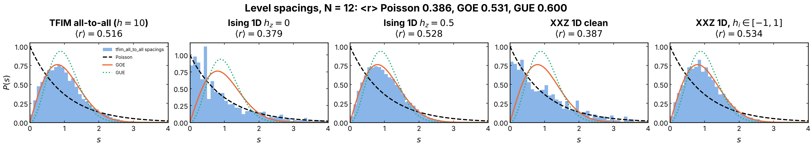
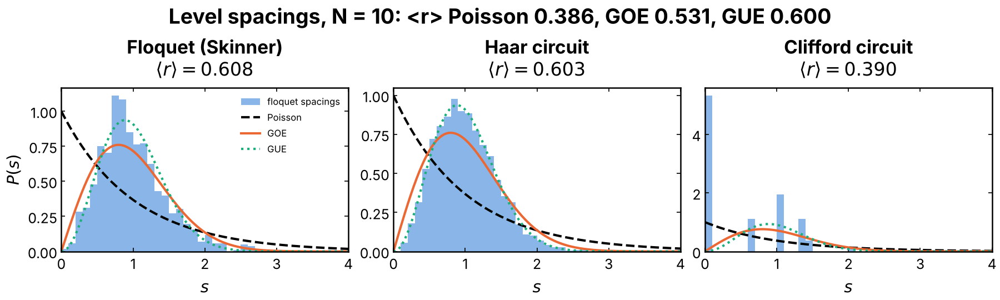
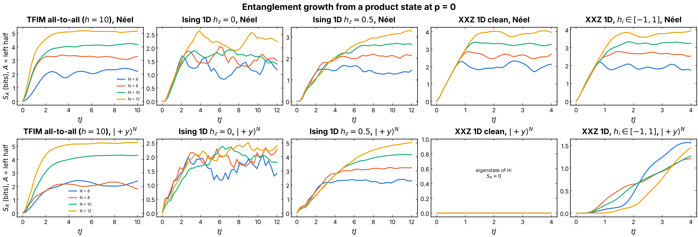
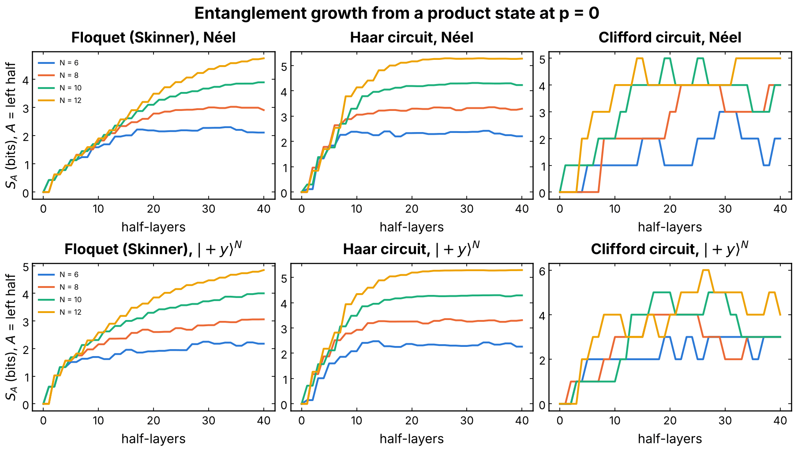
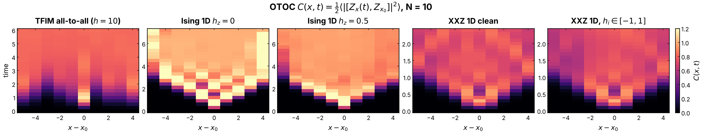
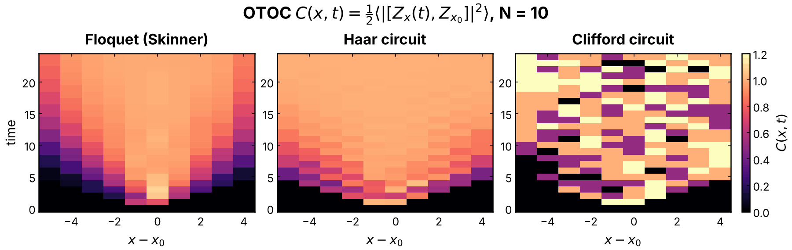
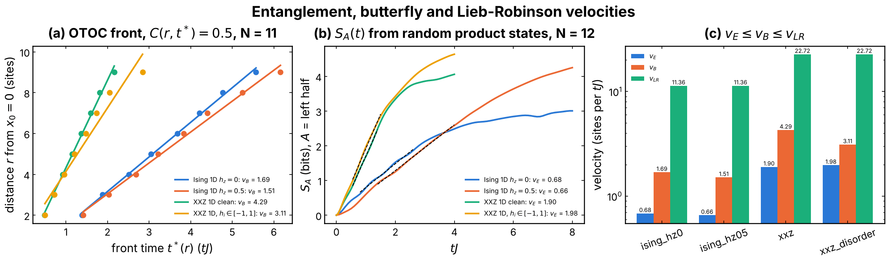
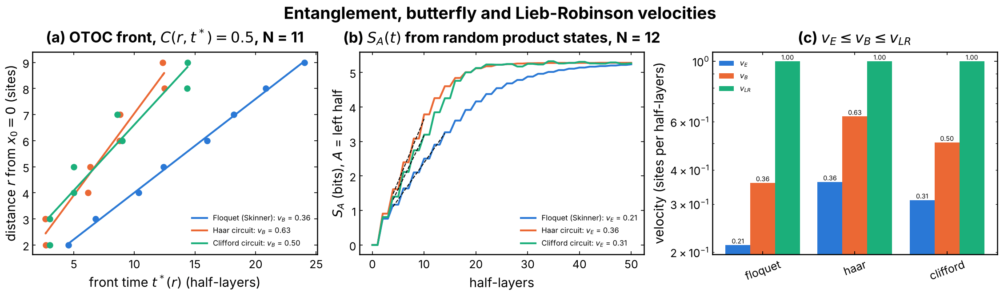

# Chaos and locality of the reservoirs

A measurement-induced transition needs a unitary dynamics that is
**chaotic** (to build a volume law that survives weak measurement) and
**local** (a light cone, so that the spreading of information competes with
the measurements). This folder measures both properties for every reservoir
of the project, to explain why some of them show an entanglement transition
and others do not. It is a physics diagnostic, with no learning task.

## Experiment overview

| | |
| --- | --- |
| Script(s) | `experiments/diagnostics/diagnostics_physiques.py` (`--families`, `--models`, `--parts`, `--quick`) |
| Code | `QELM.evaluation.chaos_locality` |
| Continuous reservoirs (`exp(-i H tau)`) | all-to-all TFIM (`h = 10`); open Ising chain `h_x = 1.05`, `h_z = 0` and `h_z = 0.5`, `J_i` in `[0.5, 1.5]`; clean XXZ chain `J = Delta = 1`; XXZ with fields `h_i` in `[-1, 1]` |
| Discrete reservoirs (one half-layer per step) | Floquet Ising chain of Skinner et al. (2019); Haar brickwork; random Clifford brickwork |
| System sizes `N` | 12 for the continuous spectra, 10 for the quasi-energies, 6 to 12 for the entropy growth, 10 for the OTOC, 8 for the reference qubit, 11 and 12 for the velocities, 11 for the scrambling time |
| Diagnostics | level statistics (`<r>`), half-chain entropy growth at `p = 0`, OTOC `C(x, t)`, reference-qubit probes of Gullans and Huse, velocities `v_E`, `v_B`, `v_LR`, scrambling time |
| Issues / PRs | #243 (PR #244) |

## Methodology

- **(A) Spectra.** Unfolded level spacings of the central third of every
  symmetry sector, pooled over disorder draws, against Poisson and the GOE /
  GUE; the mean gap ratio `<r>` (0.386 Poisson, 0.531 GOE, 0.600 GUE). A
  random circuit with new gates at every step has no spectrum, so its
  Floquet version (one draw of a period, repeated) is used.
- **(B1) Entanglement growth.** Half-chain `S_A(t)` at `p = 0` from the Néel
  state and from `|+y>^N`, one curve per `N`; a local model grows linearly
  at an `N`-independent rate.
- **(B2) Light cone.** `C(x, t) = (1/2) <|[Z_x(t), Z_x0]|^2>` at infinite
  temperature, a "V" for a local model; the velocities `v_E` (slope of
  `S_A(t)`), `v_B` (front of the OTOC) and `v_LR` (one site per half-layer
  for a circuit, the Nachtergaele-Sims bound for a Hamiltonian), with
  `v_E <= v_B <= v_LR` for a chaotic local model; the scrambling time at
  `N = 11`.
- **(B3) Reference qubit.** A qubit `R` in a Bell pair with the center of the
  chain: the entropy one extra measurement at `(x, t)` would remove from it,
  and `S_R(t)` when outcomes beyond a distance `l` are discarded.

How to run it: [experiments/README.md, "Check the chaos and the locality of the reservoirs"](../README.md#check-the-chaos-and-the-locality-of-the-reservoirs-issue-243)
(the default sizes take about two hours; `--quick` runs in seconds).

## Results and discussion

| Family | Reservoir | Chaos (`<r>`) | Local | `v_E / v_B / v_LR` | `t_scr` (`N = 11`) |
| --- | --- | --- | --- | --- | --- |
| continuous | TFIM all-to-all (`h = 10`) | yes (0.516, GOE) | **no** | no light cone | 2.25 |
| continuous | Ising chain, `h_z = 0` | no (0.379, Poisson, integrable) | yes | 0.68 / 1.69 / 11.4 | 3.04 |
| continuous | Ising chain, `h_z = 0.5` | yes (0.528, GOE) | yes | 0.66 / 1.51 / 11.4 | 3.27 |
| continuous | XXZ, clean | no (0.387, Poisson) | yes | 1.90 / 4.29 / 22.7 | 1.15 |
| continuous | XXZ, `h_i` in `[-1, 1]` | yes (0.534, GOE) | yes | 1.98 / 3.11 / 22.7 | 1.21 |
| gates | Floquet (Skinner) | yes (0.608, GUE) | yes, strict cone | 0.21 / 0.36 / 1 | 13.6 |
| gates | Haar | yes (0.603, GUE) | yes, strict cone | 0.36 / 0.63 / 1 | 7.7 |
| gates | Clifford | not spectrally (0.390, finite-order spectrum) | yes, strict cone | 0.31 / 0.50 / 1 | 7.0 (noisy) |

Velocities in sites per `1/J` (continuous) or per half-layer (gates),
`t_scr` in `1/J` or half-layers; for the local models `t_scr ~ (N/2) / v_B`
and the hierarchy `v_E <= v_B <= v_LR` holds everywhere.

- The **all-to-all TFIM** used by `QELM_M` and `QELM_Q` is chaotic but has no
  light cone: information reaches every site at once, which is why its
  entanglement shows no area law at the rates swept in
  [`QELM_S`](../QELM_S/README.md), and why its record behaves as the fully
  scrambled model in [`QELM_Q`](../QELM_Q/README.md).
- The **Floquet chain** and the **Haar brickwork** are both chaotic and
  strictly local: the reservoirs where the entanglement transition of
  `QELM_S` is seen. The **Ising chain with `h_z = 0.5`** and the **disordered
  XXZ chain** are the chaotic, local continuous-time candidates; at
  `h_z = 0` and for the clean XXZ chain the dynamics is integrable.

## Figures

**Figure 1. Level statistics, continuous reservoirs.** Histogram of the
unfolded level spacings `s` (central third of every symmetry sector, `N = 12`,
pooled over disorder draws) against Poisson `exp(-s)`, the GOE and the GUE,
one panel per Hamiltonian; `<r>` in each title. Produced by
`experiments/diagnostics/diagnostics_physiques.py` (issue #243).

**Figure 2. Level statistics, gate reservoirs** (Floquet quasi-energies,
`N = 10`): the Floquet chain and the Haar Floquet circuit follow the GUE; the
Clifford circuit has a finite-order spectrum. Produced by
`diagnostics_physiques.py` (issue #243).

**Figure 3. Entanglement growth at `p = 0`, continuous reservoirs.**
Half-chain `S_A(t)` from the Néel state (top) and from `|+y>^N` (bottom), one
curve per `N` from 6 to 12. `|+y>^N` has zero energy for the TFIM and the
Ising chains, so `S_A` saturates near the Page value; for the SU(2)-symmetric
XXZ chain it is an eigenstate and nothing grows. Produced by
`diagnostics_physiques.py` (issue #243).

**Figure 4. Entanglement growth at `p = 0`, gate reservoirs**, as Figure 3,
time in half-layers. Produced by `diagnostics_physiques.py` (issue #243).

**Figure 5. Light cone of the continuous reservoirs.** OTOC
`C(x, t) = (1/2) <|[Z_x(t), Z_x0]|^2>` at infinite temperature, `x0 = N/2`,
`N = 10`, distance `x - x0` (horizontal) against time (vertical). The
chains draw a "V"; in the all-to-all TFIM every site lights up at once
(no cone). Produced by `diagnostics_physiques.py` (issue #243).

**Figure 6. Light cone of the gate reservoirs**, as Figure 5: a strict cone
of one site per half-layer. Produced by `diagnostics_physiques.py`
(issue #243).

**Figure 7. Velocities of the local continuous reservoirs.** Entanglement
velocity `v_E` (slope of `S_A(t)` from random product states, `N = 12`),
butterfly velocity `v_B` (front `C(r, t*) = 0.5` of the OTOC from the edge,
`N = 11`) and the Lieb-Robinson bound `v_LR`. Produced by
`diagnostics_physiques.py` (issue #243).

**Figure 8. Velocities of the gate reservoirs**, as Figure 7, with
`v_LR = 1` site per half-layer. Produced by `diagnostics_physiques.py`
(issue #243).
