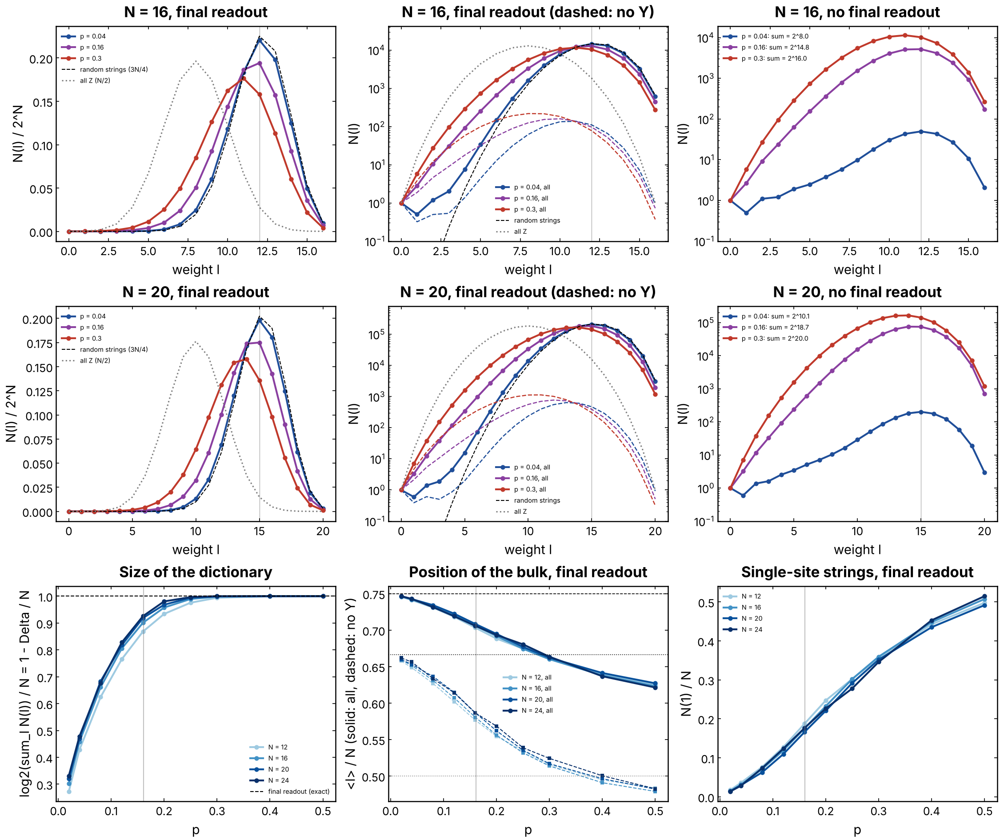
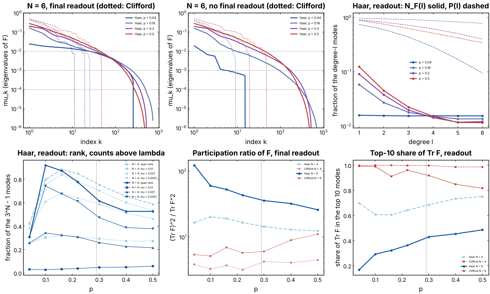

# Spectrum of the effect dictionary across the MIPT (issue #356)

The dictionary is the set of input functions that the readout of the record
can represent at `K = inf`: the span of the effects `E_m` on the Pauli
(Fourier) basis. This folder plots its spectrum in two ways: the weight
histogram `N(l)` of the effect group for Clifford gates, and the sorted
eigenvalues of the record covariance `F` for Haar gates. The full reading,
in French, is in
[`documentation/notes/spectre-du-dictionnaire.md`](../../documentation/notes/spectre-du-dictionnaire.md).

## Experiment overview

| | |
| --- | --- |
| Scripts | `clifford_weights.py`, `haar_spectrum.py`, figures `plot_clifford_weights.py`, `plot_haar_spectrum.py`, launcher `run.sh` |
| Library | `QELM.evaluation.dictionary_spectrum` |
| Clifford model | periodic brickwork of #337, one half-layer per step, `Z` measurement with probability `p` after every step, `T = 2N`, `p_c = 0.161` |
| Haar model | open brickwork of #334, one layer = even then odd bonds then measurements, `T = 2N`, `p_c = 0.29`; the same masks with Clifford gates as an exact reference |
| Sizes | Clifford: `N = 12, 16` (1000 circuits), `20` (400), `24` (60), 10 values of `p` from 0.02 to 0.5. Haar: `N = 4` (12 seeds, 2000 records), `N = 6` (4 seeds, 6000 records), 7 values of `p` from 0.04 to 0.5 |
| Records | with the final readout (`full`) and without it (`mid`) |
| Issues / PRs | #356; builds on #334, #337, #339, #349, #352 and #353 |

## Methodology

**Clifford.** For each circuit, `effect_groups` gives the generators of the
group `G` of the effect. `weight_enumerator` lists its `2^r` strings by
doubling on bit masks and counts their Hamming weights `l`, all of them and
those without `Y` (the strings the angle encoding sees). The script checks,
circuit by circuit, that `sum_l N(l) = 2^N` with the final readout and
`2^(N - Delta)` without it. References: `2^r` uniformly random strings
(peak at `3N/4`) and the `2^N` `Z` strings (every site measured, peak at
`N/2`).

**Haar.** For each seed and `p`, Born-drawn records give
`F = E_m[v v^T]` with `v_a = sqrt(w_a) c_a(m) / c_0(m)` (#334): its
eigenvalues are the squared singular values of the Born-weighted dictionary
matrix (records times Pauli modes). The exact span of the effects gives the
rank. Two degree profiles extend `N(l)` to Haar: `P(l)`, the diagonal of the
projector on the span summed over degree `l` (it sums to the rank), and
`N_F(l) = sum_{|a| = l} E_m[(c_a / c_0)^2]`. For Clifford gates both equal
the visible histogram `N_vis(l)` exactly, and the eigenvalues of `F` are
`2^-l` with multiplicity `N_vis(l)` (tested).

## Run

    experiments/dictionary_spectrum/run.sh      # about 1 h on 4 cores
    uv run python experiments/dictionary_spectrum/plot_clifford_weights.py outputs/dictionary_spectrum
    uv run python experiments/dictionary_spectrum/plot_haar_spectrum.py outputs/dictionary_spectrum

The Haar runs of the figure used 4 seeds at `N = 6` and 12 at `N = 4`
(`run.sh` asks for 8 and 20).

## Results

**Clifford, `N(l)`.**

- Exact: `sum_l N(l) = 2^N` with the readout, `2^(N - Delta)` without.
- Observed: below `p_c` the histogram is that of random strings, peaked at
  `3N/4`. Above `p_c` the bulk moves only to `<l>/N = 0.66` at `p = 0.3`
  and `0.62` at `p = 0.5`; it does not fold onto small `l`. `<l>/N` is the
  same for `N = 12` to `24` at every `p`, with no sharpening at `p_c`.
- Observed: the change above `p_c` is a tail of local strings, `O(N)` of
  them among `2^N`, visible only on a log scale. `N(1)/N` rises smoothly from
  0.03 (`p = 0.04`) to 0.35 (`p = 0.3`), independent of `N`.

**Haar, spectrum of `F`.**

- Observed (`N = 6`): at `p = 0.04` the spectrum is flat (`mu ~ 10^-2`) up
  to its rank `2^N`. Raising `p` lifts the top (`mu_1` from 0.02 to 0.28)
  and steepens the tail; the share of `Tr F` in the 10 largest modes goes
  from 0.17 to 0.49, monotonically. The change is smooth, mostly below
  `p = 0.1`, with no feature at `p_c = 0.29`, and the tail stays long (38 %
  of the modes have `mu > 10^-4` at `p = 0.5`): it is not an exponential
  collapse onto a few modes. At `N = 4` the trend is weak and not monotonic.
- Observed: `N_F(l)` is flat in `l` at `p = 0.04` and leans towards low
  degrees as `p` grows (degree 1: 1.6 % of the modes read at `p = 0.04`,
  12 % at `p = 0.5`), as in Clifford.
