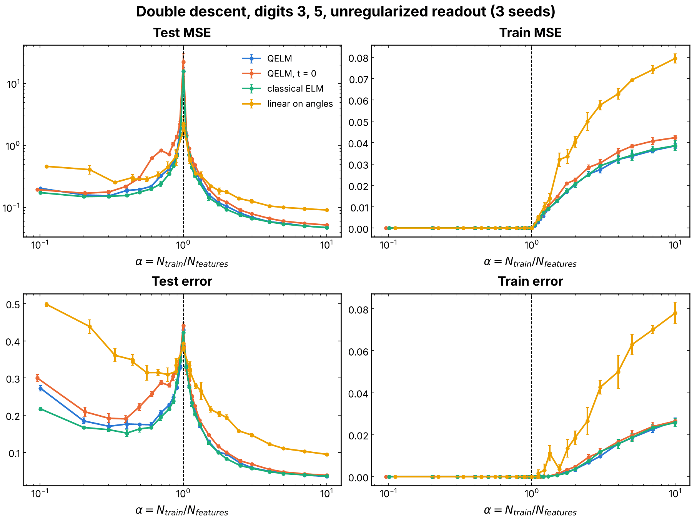
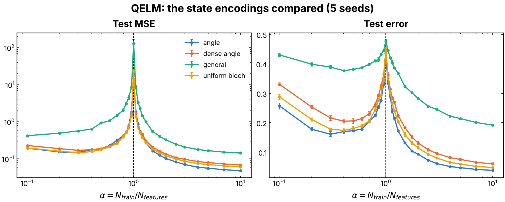

# Double descent of the QELM readout on MNIST

A static, nonlinear classification task, with no measurement, that
characterizes the readout itself: as the number of training samples crosses
the number of independent features, the test error of an unregularized
linear readout peaks (double descent). It sets the statistical baseline that
the sample-to-parameter sweeps of [`QELM_M`](../QELM_M/README.md) must be
read against, and compares the quantum reservoir with classical references
on the same images. The protocol follows "Harnessing quantum extreme
learning machines for image classification", Phys. Rev. Applied (2025).

## Experiment overview

| | |
| --- | --- |
| Script(s) | `experiments/double_descent/double_descent.py`, launcher `double_descent.sh`, plot `plot_double_descent.py` |
| Config | `conf/double_descent.yaml` |
| Physical model | one fixed quench `U = exp(-i H t)` of a TFIM drawn once per seed, `h = J`, `t = 10 / J`, no ancilla |
| System sizes `N` | 8 qubits |
| Data | MNIST digits 3 against 5 by default (`CLASSES="3 5 8"` for three classes), or scikit-learn's 8x8 digits (`DATASET=digits`) |
| Encoding | PCA to `N` components mapped to angles in `[0, pi]`, qubit `i` in `R_y(theta_i)|0>` (`rotation_encoding`), or the product encodings of the paper (`angle`, `dense_angle`, `uniform_bloch`, `general`, issue #196) |
| ML task | one-hot classification, features `<X_i>, <Y_i>, <Z_i>` and `<X_i X_j>, <Y_i Y_j>, <Z_i Z_j>` plus a bias (109 columns at `N = 8`), ridge readout with `alpha = 0` (`W = pinv(Phi) Y`), test MSE and classification error |
| Issues / PRs | #181, #196 |

## Methodology

1. Fit the PCA on the training images of the chosen digits, encode each
   image in the product state, apply `U`, read the observables.
2. For each `alpha = n_train / n_features` from 0.1 to 10, draw `n_train`
   images from a pool of 2000, 20 times, fit the readout and score it on the
   whole MNIST test split of the chosen digits (1902 images for 3 and 5).
   `n_features` is the **rank** of the feature matrix, so the peak sits at
   `alpha = 1`.
3. Compare with three references on the same images and readout: a
   classical ELM (a fixed random ReLU layer of the same width), the same
   observables at `t = 0` (a fixed, non-entangling feature map, checked
   against its closed form to `1e-15`), and a linear readout of the `N`
   angles; plus a readout of the 784 pixels.

How to run it: [experiments/README.md, "Run the double-descent experiment on MNIST"](../README.md#run-the-double-descent-experiment-on-mnist-issue-181).
Notebook: `notebooks/results/07_double_descent_mnist.ipynb` (about 40 s for
three seeds).

## Results and discussion

- **Double descent at `alpha = 1` for every model.** The test MSE of the
  QELM, the `t = 0` features, the ELM and the linear readout all peak at
  `alpha = 1` (above 10 for the 109-feature models), where the training error
  first becomes nonzero (Figure 1).
- **The quench adds little on this task.** With the full pool (3 seeds,
  digits 3 and 5), the test accuracy is 0.968 for the QELM, 0.966 at `t = 0`,
  0.966 for the classical ELM, 0.923 for the linear readout on the angles and
  0.964 for the pixels. The nonlinearity of the encoding and of the products
  `<P_i P_j>` does most of the work; the entangling dynamics changes the
  result by about 0.002.
- **Encodings (issue #196, 5 seeds).** The QELM reaches 0.965 with the angle
  encoding, 0.958 with the uniform Bloch encoding, 0.945 with the dense angle
  encoding and 0.817 with the general encoding, against 0.96 for the ELM in
  every case; all peak at `alpha = 1` (Figure 2). The general encoding is
  already at 0.813 with the `t = 0` features, so its loss comes from the
  encoding, not from the dynamics.

## Figures

**Figure 1. Double descent, digits 3 and 5.** Test MSE (log scale, top left),
train MSE (top right), test classification error (bottom left) and train
error (bottom right) against `alpha = n_train / n_features` (log scale), for
the QELM (blue), the same observables at `t = 0` (orange), the classical ELM
(green) and the linear readout on the angles (yellow); unregularized
readout, `N = 8`, 3 seeds, 20 training draws per `alpha`, error bars over
seeds. The dashed line is `alpha = 1`: below it the readout interpolates the
training set (train error 0), at it the test error peaks. Produced by
`experiments/double_descent/plot_double_descent.py` (issue #181).

**Figure 2. Encodings of the paper.** Test MSE and test error of the QELM
against `alpha`, one curve per product encoding of the paper (`angle`,
`dense_angle`, `general`, `uniform_bloch`), digits 3 and 5, `N = 8`, 5 seeds.
The general encoding (green) stays far above the others at every `alpha`. Produced
by `experiments/double_descent/plot_double_descent.py --encodings` (issue
#196).
