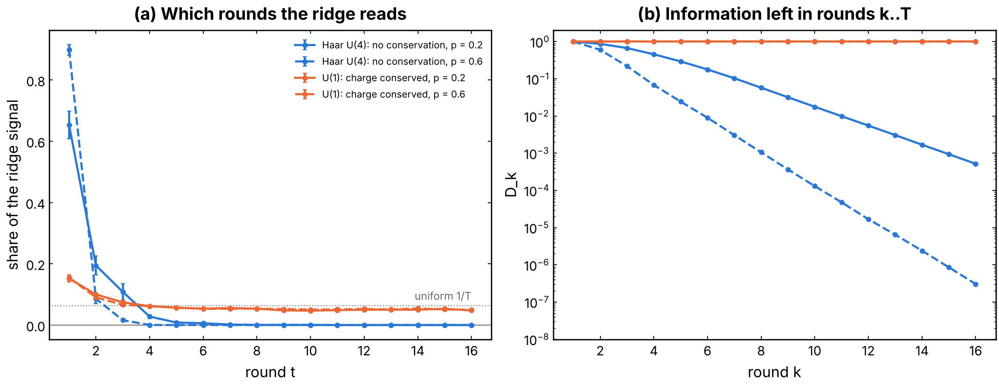
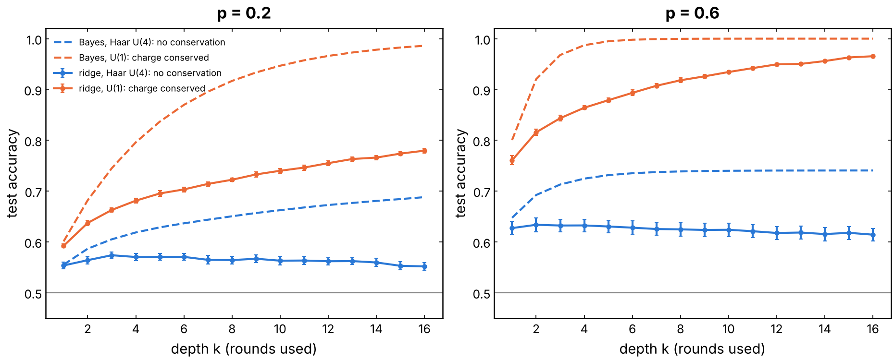
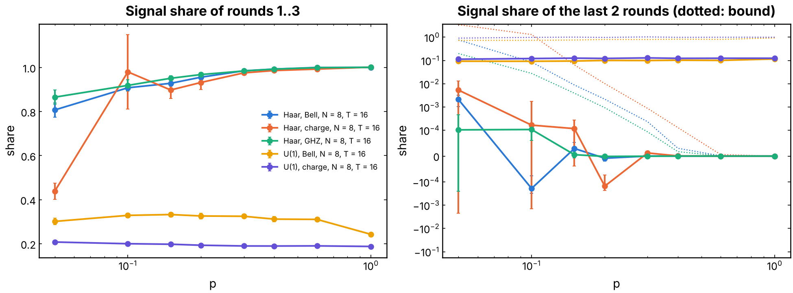
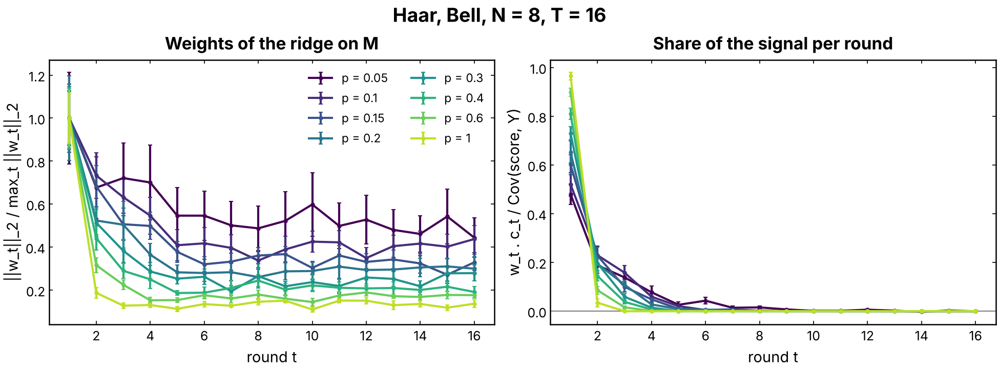
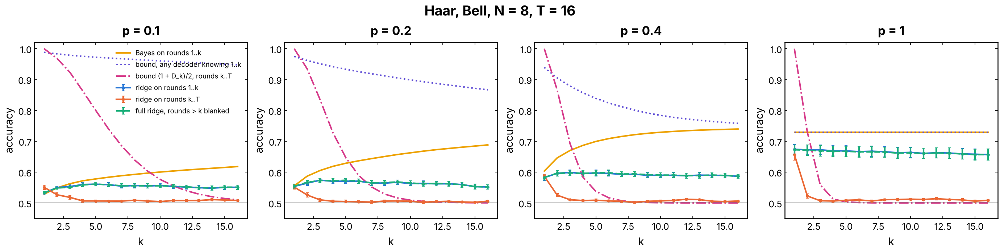
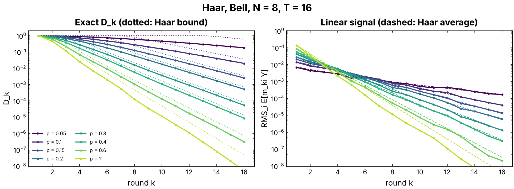
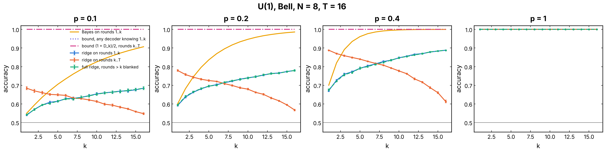

# Which rounds of the record does the linear QELM read? (issue #288)

The "early-layers" hypothesis: to guess the label of a reference qubit from the measurement record `M`, the linear QELM (ridge on `vec(M)`) only uses the first rounds, before Haar scrambling hides the initial state, and ignores the late ones (`t = 15, 16` at `N = 8`, `T = 2N`). This folder tests it on the task of [`nonlinear_M`](../nonlinear_M/README.md) (#269): fixed Haar circuits and a reference qubit `R` entangled with the chain. It does so in two ways. First, it measures the trained model round by round. Second, it computes the exact bounds of the note [`documentation/notes/early-layers-proof.md`](../../documentation/notes/early-layers-proof.md), which holds the statements and their proofs. Charge-conserving U(1) gates are the control where the hypothesis must fail.

## Experiment overview

| | |
| --- | --- |
| Script(s) | `experiments/early_layers/early_layers.py`, launcher `early_layers.sh`, figures `plot_early_layers.py` |
| Config | `conf/early_layers.yaml` |
| Physical model | open brickwork chain, Haar U(4) gates (no conserved charge) or U(1) gates (charge conserved), one fixed circuit per seed, a Z measurement of each site with probability `p` after each round |
| System sizes `N` | 8 system qubits plus `R`, `T = 2N = 16` rounds |
| Control parameters | `p` in {0.05, 0.1, 0.15, 0.2, 0.3, 0.4, 0.6, 1.0} |
| Initial state | `(\|0>_R \|a> + \|1>_R \|b>)/sqrt 2`: `bell` (middle site), `ghz`, `charge` (encodings of `nonlinear_M`) |
| ML task | label `Y` = Z outcome of `R`; ridge (`RidgeCV`) on `vec(M)` and on windows of `M`; accuracy |
| Issues / PRs | #288; builds on #269 / #278 (the Haar gates of a seed are the same as there) |

## Methodology

1. One trajectory: start from the encoding, then for each round `t = 1 .. T` apply the gates, then measure each site with probability `p`. `M[t, i]` is `+-1`, or `0` if the site is not measured. After every round, store `<Z_R>` and the Helstrom value `H_t` of the joint state. At the end, measure `R`, which gives `Y`. There are 4000 trajectories per `p` and 10 circuits (seeds 42 to 51) per configuration.
2. For each `p`, a ridge on `vec(M)` is trained on 70 % of the trajectories. Round by round, the script then reports:
   - the weight norm `||w_t||`;
   - the **signal share** `w_t . c_t / Cov(s, Y)`, where `c = E[m Y]` is computed exactly (the shares add up to 1);
   - the test accuracy of the model with the rounds after `k` blanked to their training mean;
   - the accuracy of ridges retrained on rounds `1..k` (prefix) and `k..T` (suffix).
3. The exact quantities are computed from the circuit, with no sampling:
   - the trace distance `D_k` of the trajectory-averaged chain states. No decoder of rounds `k..T` beats `(1 + D_k)/2`;
   - `c_{t,i}`, with `|c_{t,i}| <= p D_t`;
   - for Haar gates, the average over circuits from the exact Pauli-weight Markov chain.

   The Bayes accuracy of the prefix, `(1 + E|<Z_R>_k|)/2`, and the Helstrom bound `(1 + E[H_k])/2` on every decoder of the whole record are sample means.

## Results and discussion

`N = 8`, `T = 16`, 10 circuits, 4000 trajectories per `p` (standard error of an accuracy ≈ 0.005).

| Configuration | p | ridge, full | ridge, rounds 1..3 | ridge, rounds 4..16 | ridge, rounds 15..16 | share of rounds 1-3 | share of rounds 15-16 (proven bound) | `D_15` |
|---|---|---|---|---|---|---|---|---|
| Haar, Bell | 0.1 | 0.551 | 0.553 | 0.506 | 0.509 | 0.91 | -2e-4 (0.09) | 2.8e-2 |
| Haar, Bell | 0.2 | 0.552 | 0.574 | 0.505 | 0.502 | 0.96 | -8e-6 (2e-3) | 9.4e-4 |
| Haar, Bell | 0.4 | 0.586 | 0.599 | 0.508 | 0.504 | 0.99 | 3e-7 (3e-5) | 1.9e-5 |
| Haar, Bell | 1.0 | 0.657 | 0.672 | 0.506 | 0.506 | 1.00 | -4e-11 (2e-8) | 2.1e-8 |
| Haar, GHZ | 0.2 | 0.639 | 0.652 | 0.515 | 0.505 | 0.97 | -1e-6 (9e-4) | 1.6e-3 |
| Haar, GHZ | 1.0 | 0.805 | 0.814 | 0.497 | 0.502 | 1.00 | 5e-10 (3e-8) | 1.1e-7 |
| U(1), Bell | 0.2 | 0.773 | 0.659 | 0.726 | 0.593 | 0.33 | 0.10 | **1** |
| U(1), Bell | 0.6 | 0.964 | 0.848 | 0.933 | 0.718 | 0.31 | 0.10 | **1** |
| U(1), charge | 0.2 | 0.743 | 0.621 | 0.723 | 0.586 | 0.19 | 0.12 | **1** |

- **Haar gates: the hypothesis holds, and its core is proven.** Rounds 4 to 16 alone are at chance (0.50 to 0.52), as Theorem 1 requires (`(1 + D_k)/2` with `D_15 < 10^-3` from `p = 0.2`). The ridge retrained on rounds 1 to 3 matches the full ridge, and is even slightly better (0 to 0.02). Blanking rounds `> 3` never lowers the accuracy. Rounds 1 to 3 carry 80 to 100 % of the signal of the model, and the share of rounds 15 and 16 is below a proven bound that is `<= 2·10^-3` from `p = 0.2`.
- **But the late weights are not small.** The weight norm of rounds 15 and 16 is 14 to 44 % of that of round 1 for Bell, 7 to 26 % for GHZ (figure `weights_*`, left). These weights fit sampling noise, since their signal share is zero within `10^-4`. A paper should therefore state the hypothesis with the signal share or the ablation, not with the size of the weights, which would contradict it.
- **The late rounds still help the Bayes decoder.** For Bell at `p = 0.2`, Bayes goes from 0.60 (3 rounds) to 0.69 (16 rounds). The late rounds are useless alone and informative jointly with the early ones, through correlations that the ridge cannot represent. At `p = 1`, Bayes and the Helstrom bound coincide from round 1 on: after one fully measured round nothing more can be learned.
- **Small `p` is the weak spot.** At `p = 0.05`, rounds 4 to 10 still carry 19 % of the signal (Bell), and `D_15 = 0.21` leaves the theorem weak.
- **U(1) gates: the hypothesis fails, as Proposition 4 predicts.** `|a>` and `|b>` lie in two charge sectors that every gate and measurement preserves, so `D_k = 1` at every round. Rounds 15 and 16 alone reach 0.59 to 0.72, rounds 4 to 16 alone beat rounds 1 to 3, and the signal is spread almost evenly over the 16 rounds.
- **Haar, charge encoding:** the ridge is at chance at every `p` (0.50 to 0.53, as in #278), so there is little signal to split. Its exact `D_k` decays like that of Bell.

## Figures

**Summary figures** (`plot_story.py`, Bell encoding, `p = 0.2` solid and `p = 0.6` dashed):

*(a) Share of the ridge's signal carried by each round `t` (`w_t . c_t / Cov(s, Y)`, with `c` exact; the shares add up to 1; dotted line: the uniform share `1/T`). Haar U(4) (blue): rounds 1 to 3 carry 96 to 100 % of the signal and the rest is zero. U(1) (orange): about 6 % per round from round 4 on, spread over the whole circuit. (b) `D_k`, the largest advantage over chance of any decoder (Bayes included) of rounds `k..T` alone, computed exactly (log scale). Without a conservation law it decays exponentially; with the conserved charge it stays at 1. Mean over 10 circuits, N = 8, T = 16. #288.*

*Test accuracy against the number `k` of rounds used, which is a circuit of depth `k`: ridge on `vec(M)` (solid, with error bars) and Bayes (dashed). Haar U(4) (blue): the ridge is flat or even falls slightly after `k = 2` or `3` (0.574 at `k = 3`, 0.552 at `k = 16`, `p = 0.2`), so a deeper circuit does not help it. U(1) (orange): the ridge gains at every round (`p = 0.2`: 0.59, then 0.66, then 0.78 at `k = 1, 3, 16`) and so does Bayes (up to 0.99). Mean over 10 circuits, N = 8. #288.*

**Detailed figures:**

*Left: the share of the ridge's signal `Cov(s, Y)` carried by rounds 1 to 3, against `p`, for each configuration (mean and standard error over 10 circuits). Right: the share of rounds 15 and 16 (symlog scale), with the proven bound `p sum_t D_t ||w_t||_1 / Cov(s, Y)` (dotted). Haar gates: the early rounds carry nearly all the signal and the late share sits at zero, below a bound that falls as `D_t`. U(1) gates: the signal is spread over every round. `plot_early_layers.py`, #288.*

*Haar gates, Bell encoding. Left: weight norm `||w_t||_2` of the ridge per round, normalized to its largest round. Right: signal share of each round. The weights of the late rounds stay at 15 to 50 % of those of round 1, while their share of the signal is zero: they fit noise. `plot_early_layers.py`, #288.*

*Haar gates, Bell encoding, four values of `p`. Against `k`:*
- *the ridge retrained on rounds `1..k` (blue) and on rounds `k..T` (orange);*
- *the full ridge with rounds `> k` blanked (green, dashed);*
- *the Bayes accuracy of rounds `1..k` (yellow);*
- *the Helstrom bound on any decoder that knows rounds `1..k` (purple, dotted);*
- *the exact bound `(1 + D_k)/2` on any decoder of rounds `k..T` alone (pink, dash-dotted).*

*The suffix ridge falls to chance below the bound, and the prefix ridge saturates from `k = 2` or `3`. `plot_early_layers.py`, #288.*

*Haar gates, Bell encoding. Left: exact `D_k`, the mean over 10 circuits (solid), and the Haar bound `sqrt(E[mu_k])/2` from the Pauli-weight chain (dotted), on a log scale. Right: RMS over sites of the exact linear signal `E[m_{k,i} Y]` (solid) and its Haar average from the chain (dashed). Both decay exponentially in `k`, faster at larger `p`. `plot_early_layers.py`, #288.*

*U(1) gates, Bell encoding, same curves as above. `D_k = 1` at every round, and the late rounds alone decode the label. `plot_early_layers.py`, #288.*

The other configurations have the same figures in `figures/` (`*_haar_ghz_N8`, `*_haar_charge_N8`, `*_u1_charge_N8`), and `figures/summary.json` holds every averaged curve.

## Run it

See [Run the early-layers study](../README.md#run-the-early-layers-study-of-the-linear-qelm-on-m-issue-288) in `experiments/README.md`.
