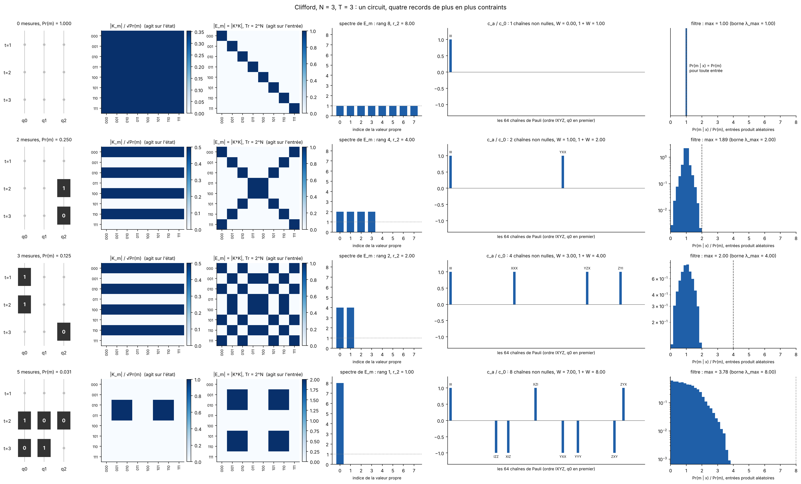
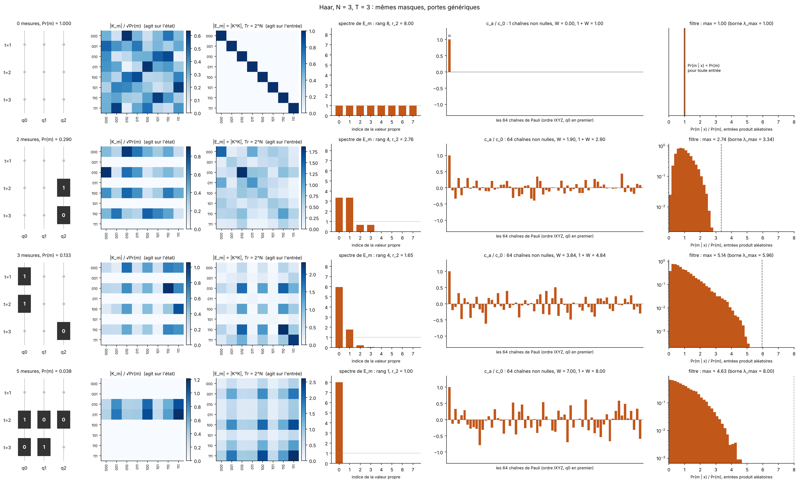
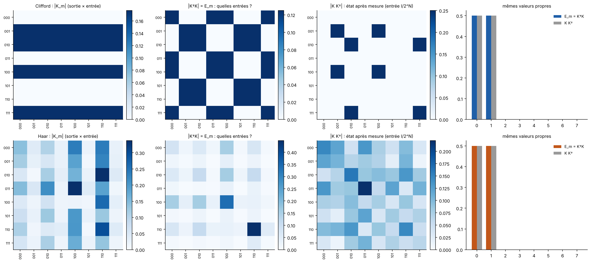
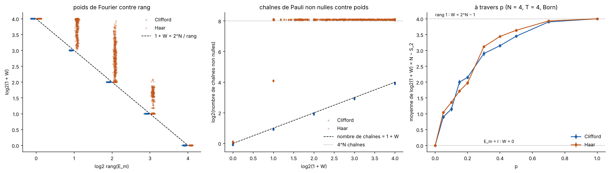

# Anatomy of a record: the Kraus operator K_m and the effect E_m

What are the Kraus operator `K_m` and the effect `E_m = K_m^dagger K_m` of a
mid-circuit record, on which the effect rank (#314, #321), the frame
dimension (#322) and the Fourier weight `W(m)` (#325, #327) are built? This
folder computes them exactly at `N = 3` and `N = 4` and draws them, to make
three statements visible: `K_m` acts on the state and `E_m` on the input;
the Fourier weight of `Pr(m | x)` is a participation ratio of the spectrum
of `E_m`; and the Pauli picture of the summary of #320 (identity: one
string; rank one: `2^N` strings) holds for Clifford gates only. Issue #329.

## Experiment overview

| | |
| --- | --- |
| Script(s) | `experiments/effect_anatomy/plot_effect_anatomy.py` (no run folder: everything is computed in the script, about 15 s) |
| Library | `QELM.evaluation.effect_anatomy` |
| Physical model | open brickwork of `effect_rank` (one layer = even bonds, odd bonds, then `Z` measurement of the masked sites), Clifford or Haar two-qubit gates; mid-circuit record only, no final readout |
| System sizes `N` | 3 (single records, `T = 3`), 4 (statistics, `T = 4`) |
| Control parameters | measurement mask; `p` = 0 to 1 for the statistics |
| Input | dense encoding: product pure states, Bloch vectors uniform on each sphere (the encoding of the project restricts the azimuth to `[0, pi]`; this does not change any of the quantities shown) |
| Issues / PRs | #329; builds on #320 (note of #319), #324, #326, #328 |

## Definitions

- **Kraus operator.** `K_m = P_{m_T} U_T ... P_{m_1} U_1`, the gates and the
  projectors on the observed outcomes, in time order. It maps the input
  state to the post-measurement state: `rho -> K_m rho K_m^dagger / Pr(m)`.
  `sum_m K_m^dagger K_m = I` (tested).
- **Effect.** `E_m = K_m^dagger K_m`, a positive operator on the input
  space: `Pr(m | x) = Tr[E_m rho(x)]`. Polar decomposition: `K_m = V sqrt(E_m)`
  with `V` a partial isometry. `E_m` keeps what the record says about the
  input; `V` says where the state goes. `K K^dagger` (the post-measurement
  state of the maximally mixed input) has the same spectrum as `E_m` but
  other eigenvectors.
- **Pauli coefficients and Fourier weight.** `c_a = Tr[P_a E_m] / 2^N`, so
  that `Pr(m | x) = sum_a c_a B_a(x)` on the Bloch monomials, and
  `W = sum_{a != 0} c_a^2 / c_0^2`. Parseval gives
  `1 + W = 2^N Tr[E^2] / Tr[E]^2 = 2^N / r_2`, with
  `r_2 = Tr[E]^2 / Tr[E^2]` the participation ratio of the spectrum
  (`1 <= r_2 <= rank`). Hence `N - log2(1 + W) = log2 r_2` is the Renyi-2
  entropy of the normalised effect (the purification entropy).

## Check of the summary of #320

1. "`E_m = I`, one string, `W = 0`": correct, and the converse holds:
   `W = 0` if and only if `E_m` is proportional to `I`. For projective
   measurements every measurement halves the rank of `K_m` at least, so
   full rank only happens with no measurement at all.
2. "Rank one: `W = 2^N - 1`": correct **for any gates**, since `r_2 = 1`.
   It is the maximum of `W`.
3. "Rank one: weight spread over `2^N` strings": **Clifford only.** A
   Clifford effect is `2^k` times a stabilizer projector with `k`
   independent generators: `2^(N - k)` equal eigenvalues, `r_2 = rank`, and
   `c_a = +-c_0` on the `2^k` strings of the stabilizer group, zero elsewhere.
   So `1 + W = 2^k = 2^N / rank` = number of non-zero strings, and rank one
   means `k = N`, hence `2^N` strings. A Haar effect of rank one has the
   same `W = 2^N - 1`, but over up to `4^N` strings (64 of 64 at `N = 3`,
   256 of 256 at `N = 4`) with unequal coefficients.
4. Between the two ends, for Haar gates the rank does not fix `W`: the
   non-zero eigenvalues are unequal, `r_2 < rank` and
   `1 + W > 2^N / rank`. `W` measures the Renyi-2 rank, not the rank.
5. "Projector onto the input": `E_m` of rank one is `2^N |phi><phi|`, a
   projector onto one state `phi` of the input space, not onto the input
   itself. With product inputs, `Pr(m | x) / Pr(m)` reaches `2^N` only if
   `phi` is a product state; for entangled `phi` its maximum is lower
   (3.78 of 8 for the Clifford record of Figure 1, 4.63 for the Haar one).

## Results



**Figure 1. One Clifford circuit, `N = 3`, `T = 3`, four records with 0,
2, 3 and 5 measurements (rows).** Columns: (1) mask (black squares) and
outcomes (Born rule, mixed input); (2) `|K_m| / sqrt(Pr(m))`, rows = output
basis states, columns = input basis states; (3) `|E_m|` rescaled to
`Tr E = 2^N` (`E = I` without measurement); (4) eigenvalues of `E_m`, dotted
line at 1; (5) `c_a / c_0` on the 64 strings, non-zero strings named;
(6) histogram of `Pr(m | x) / Pr(m)` over 20 000 product inputs, dashed
line at the largest eigenvalue.
- Rank 8, 4, 2, 1 with 1, 2, 4, 8 strings and `W` = 0, 1, 3, 7: each
  independent constraint halves the rank and doubles the number of strings;
  `rank x strings = 2^N = 8` on every row.
- The non-zero eigenvalues are equal (1, 2, 4, 8): the effect is flat on
  its support.
- The histogram widens with `W`: `Pr(m | x)` goes from flat (row 1) to
  strongly input-dependent (row 4, ratios 0 to 3.78).



**Figure 2. Same masks, Haar gates.** Same columns.
- Rank 8, 4, 4, 1, but `r_2` = 8, 2.76, 1.65, 1 and `W` = 0, 1.90, 3.84,
  7: rows 2 and 3 have the same rank and different `W`, because the
  eigenvalues are unequal.
- Every row with a measurement has all 64 strings non-zero; the rank-one
  row has `W = 7` exactly, as in Figure 1.



**Figure 3. `K_m`, `E_m = K^dagger K` and `K K^dagger` for one record of
rank 2 (outcomes `0, 1, 1` on the first layer), Clifford (top) and Haar
(bottom), `K` normalised to `Tr[K^dagger K] = 1`.** Right: the eigenvalues
of `E_m` and of `K K^dagger` are equal (0.5, 0.5). Their eigenvectors are
not: the two matrices do not commute (norm of the commutator 0.18 for both)
and the top eigenvectors overlap by 0.35 (Clifford) and 0.31 (Haar).
`E_m` says which inputs make the record likely; `K K^dagger` is where the
state is after it.



**Figure 4. `N = 4`, `T = 4`, 20 circuits x 10 Born-drawn records per
`p`, 10 values of `p` (2 000 records per gate set).** Left: `log2(1 + W)`
against `log2(rank)` (small horizontal jitter). Centre: `log2` of the number
of non-zero strings against `log2(1 + W)`. Right: mean of `log2(1 + W)`
(`= N - S_2`) against `p`, error bars the standard error.
- Clifford records lie exactly on `1 + W = 2^N / rank` and on
  `strings = 1 + W` (residuals below `1e-15`).
- Haar records lie on or above the first line (up to 1.93 bits above) and
  have 16 or 256 non-zero strings as soon as `W > 0`, never `1 + W`; `1 + W = 2^N / r_2` holds for all
  records of both sets to `1e-15`.
- `log2(1 + W)` goes from 0 at `p = 0` to `N = 4` at `p = 1` for both; at
  these sizes and depths no transition is visible, as expected
  (`p_c ≈ 0.29` in this convention needs `N >= 16`, #324, #328).

## Reproduce

```bash
uv run python experiments/effect_anatomy/plot_effect_anatomy.py --out experiments/effect_anatomy/figures
```

Every number above is in `figures/summary.json`.
