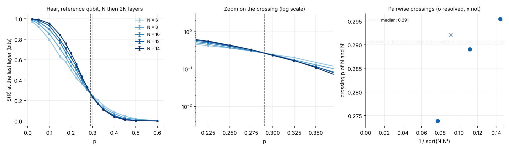
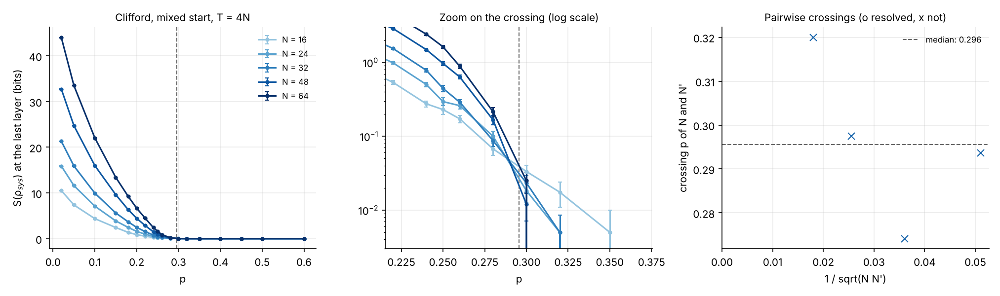
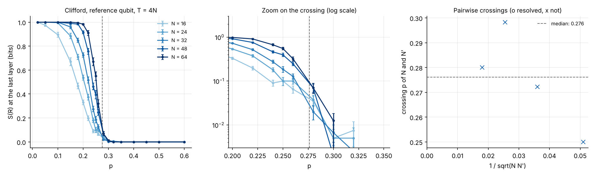
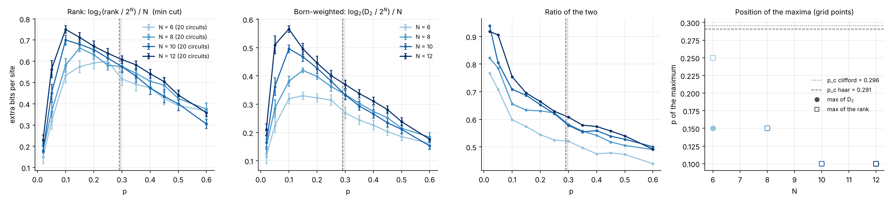
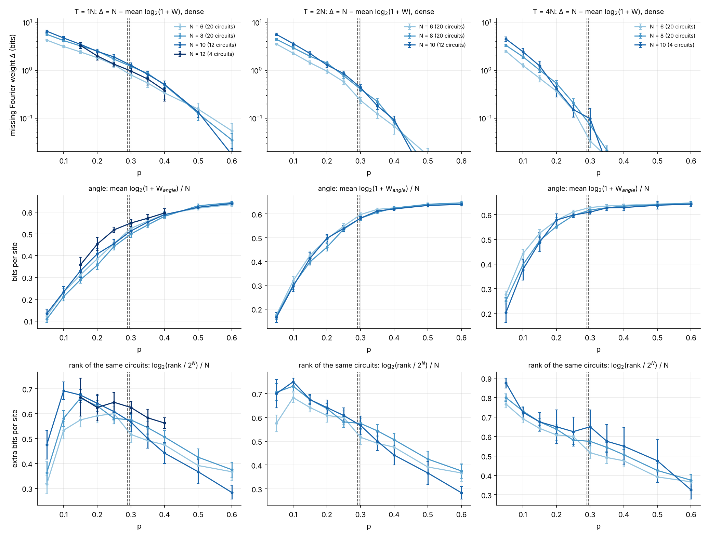

# Reference MIPT probes and Born-weighted effect dimension

Does a Born-weighted version of the effect-space rank see the
measurement-induced transition? The rank of `experiments/effect_rank` is a
min cut of the space-time graph (issue #321): its peak moves to `p = 0` like
`1 / T` and it has no critical point. This folder measures, in the same layer
convention, (i) where the transition is, with two standard probes, and (ii)
the effective dimension `D_2 = 1 / Tr F^2` of the effects, which weights each
direction of the span by the Born rule (issue #322).

## Experiment overview

| | |
| --- | --- |
| Script(s) | `experiments/effect_mipt/effect_mipt.py` (subcommands `clifford`, `haar`, `frame`), `plot_effect_mipt.py` |
| Library | `QELM.evaluation.effect_mipt`, `QELM.evaluation.effect_rank.mincut_bits` |
| Physical model | open brickwork; one layer = even bonds, odd bonds, then a `Z` measurement of each site with probability `p` (the convention of `effect_rank`, one measurement round per **two** half-layers) |
| `clifford` | Clifford gates, `N` = 16, 24, 32, 48, 64, `T = 4N`; entropy of an initially maximally mixed system and of a reference qubit (Bell pair with the middle site, `2N` unmeasured layers first). 200 circuits per point, plus 400 (300 at `N = 48`, 200 at `N = 64`) on `p` = 0.18 to 0.32 |
| `haar` | Haar gates, `N` = 6 to 14, reference qubit, `N` unmeasured layers then `T = 2N`; 400 trajectories per point, plus 1 200 (`N` ≤ 10), 600 (`N = 12`), 500 (`N = 14`) on `p` = 0.175 to 0.35; fresh circuit and mask per trajectory |
| `frame` | Haar gates, `N` = 6, 8, 10, 12, `T = N`, 20 circuits with one fixed mask each (seeds and nested masks of `effect_rank.py`), 600 Born-drawn records per point |
| Control parameter | `p` = 0.02, 0.05, 0.1, ..., 0.5, 0.6 |
| Issues / PRs | #322; depends on #321; plan in the note of #319 |

## Methodology

1. **Mixed-state entropy (Clifford).** Each system qubit starts in a Bell
   pair with an ancilla. After the monitored layers, `S(rho_sys)` is the
   entropy of the ancillas. Its spectrum is that of the mid-circuit effect
   `K_m^dagger K_m` normalised by its trace, so it is the number of bits on
   the input that the final readout still has to supply.
2. **Reference qubit.** One reference qubit in a Bell pair with the middle
   site, unmeasured layers, then the monitored layers; `S(R)` is 1 bit while
   the system remembers the qubit and 0 once the record has purified it.
3. **Frame potential.** With the final readout each effect is
   `|phi_r><phi_r|`, `phi_r = K_m^dagger |z>`. A record is drawn with the
   Born rule from a Haar-random input (which averages to the maximally mixed
   state), then `phi_r` is computed by running `|z>` backwards.
   `Tr F^2 = E |<phi_r|phi_r'>|^4` over pairs of independent records
   (U-statistic over 600 records), and `D_2 = 1 / Tr F^2`: `2^N` for one
   basis, about `4^N / 2` for a Haar POVM. The estimator is checked against
   the enumeration of every record at `N = 3`.
4. **Crossings.** For consecutive sizes, the first sign change of the
   difference of the curves, linearly interpolated; "resolved" when the
   difference exceeds two standard errors on a grid point on each side.

## How to reproduce

```bash
for n in 16 24 32 48 64; do uv run python experiments/effect_mipt/effect_mipt.py clifford --n $n --samples 200; done
for n in 6 8 10 12 14; do uv run python experiments/effect_mipt/effect_mipt.py haar --n $n --samples 400; done
for n in 6 8 10 12; do uv run python experiments/effect_mipt/effect_mipt.py frame --n $n --seeds $(seq 0 19) --samples 600; done
uv run python experiments/effect_mipt/plot_effect_mipt.py outputs/effect_mipt
```

The finer grids are the same commands with `--p ... --seeds 1 --tag fine`.
About 3 hours on 4 cores in total; the Clifford `N = 64` runs dominate.

## Outputs

`outputs/effect_mipt/<probe>_N<n>_*.json` (not versioned; a copy is in the
project folder `effect-mipt-322/runs`). Figures and `summary.json` (every
plotted value, the crossings) in `experiments/effect_mipt/figures/`.

## Results



**Figure 1. Haar, entropy of the reference qubit at the last layer.** Left:
against `p`, `N = 6` to 14 from light to dark blue, error bars the standard
error. Centre: zoom on the crossing, log scale. Right: crossing of each pair
of consecutive sizes against `1 / sqrt(N N')`; circle resolved, cross not.
Dashed line: the median of the crossings.
- **The curves cross between `p = 0.27` and 0.30:** 0.295 (6/8), 0.289
  (8/10), 0.292 (10/12, not resolved), 0.274 (12/14).
- At `p = 0.275` the five sizes agree within errors (0.30 to 0.33 bit).



**Figure 2. Clifford, entropy of the initially mixed system after `T = 4N`
layers.** Same panels, `N = 16` to 64.
- **The entropy grows with `N` up to `p = 0.28`** (0.07, 0.10, 0.09, 0.17,
  0.22 bit for `N = 16` to 64) **and no longer at `p = 0.30`** (0.03, 0.02,
  0.02, 0.01, 0.03), where it is below 0.04 bit for every size.
- No pairwise crossing is resolved: beyond 0.28 the entropies are a few
  hundredths of a bit and 200 to 600 circuits do not separate the sizes.



**Figure 3. Clifford, entropy of the reference qubit after `T = 4N`
layers.** Same panels. The step sharpens with `N` and ends at
`p ≈ 0.28` to 0.30; crossings not resolved, as in Figure 2.

**Reference value.** In this convention the transition is at
`p_c = 0.29 ± 0.02` for Haar and for Clifford. It is higher than the usual
0.16 to 0.17 because there is one measurement round per two half-layers of
gates. `nu` is not determined: a two-parameter collapse runs to the edge of
any window with these sizes and samples, so none is reported.



**Figure 4. Rank and Born-weighted dimension of the same 20 Haar circuits,
`T = N`.** Colour: `N = 6` to 12. Vertical lines: the `p_c` of Figure 1
(dashed) and of Figure 2 (dotted). Error bars: standard error over circuits.
- **Left: `log2(rank / 2^N) / N`,** from the min cut of each mask.
- **Second: `log2(D_2 / 2^N) / N`.**
  - `D_2` is well below the rank: at its maximum 0.33, 0.42, 0.50, 0.57 bit
    per site for `N = 6, 8, 10, 12`, against 0.60, 0.66, 0.70, 0.75.
  - **Its maximum moves to small `p` with `N`, like that of the rank:**
    `p = 0.15`, 0.15, 0.10, 0.10.
  - **There is no crossing at `p_c`.** At `p = 0.3` the values are 0.27,
    0.33, 0.33, 0.37; the larger size is above or equal at every `p` below
    0.5.
- **Third: ratio of the two.** For `N >= 8` and `p >= 0.2` the ratio is
  the same for all sizes within a few hundredths (0.63 to 0.66 at
  `p = 0.2`, 0.58 to 0.61 at 0.3, 0.49 to 0.50 at 0.6): `D_2` follows the
  rank up to a smooth factor.
- **Right: `p` of the maximum** (grid points), `D_2` (discs) and rank (open
  squares), with the two `p_c`.

**Reading.** `D_2` behaves like the rank: a peak that follows the number of
measurements, no feature at `p_c ≈ 0.29`. Weighting the span by the Born
rule is not enough to see the transition. Of the candidates of the note of
#319, the one that does see it is the entropy of the mid-circuit effect
(Figure 2), which is the known purification order parameter.

## Per-record Fourier weight (issue #325)

For a mid-circuit record `m`, `Pr(m | x) = sum_a c_a(m) B_a(x)` on the Bloch
monomials, with `c_a` the Pauli coefficients of the effect `E_m`. The weight
outside the constant mode is `W(m) = sum_{a != 0} c_a^2 / c_0^2`. With the
dense encoding, `1 + W = 2^N Tr[E_m^2] / Tr[E_m]^2`, so the missing weight
`Delta = N - log2(1 + W)` is the Renyi-2 entropy of the effect, that is the
purification entropy: `Delta = N` when `x -> Pr(m | x)` is flat, `Delta = 0`
when the record fixes the input as well as a pure state would. The angle
encoding keeps the strings without `Y`. `fourier_weight` computes both from
the Kraus operator of a Born-drawn record (`sample_kraus`), and the `weight`
subcommand runs it on the circuits and masks of the rank runs:

```bash
uv run python experiments/effect_mipt/effect_mipt.py weight --n 8 --ratio 2 \
    --seeds $(seq 0 19) --samples 30
```



**Figure 5. Per-record Fourier weight, Haar, fixed masks, `T = N`, `2N`,
`4N` (columns).** Colour: `N = 6` to 12. Dashed lines: the two `p_c` of
Figures 1 and 2. Error bars: standard error over circuits. `N = 6, 8`: 20
circuits, 30 records each; `N = 10`: 12 circuits and 20 records (4 and 10 at
`T = 4N`); `N = 12`: 4 circuits and 5 records, `T = N` only.
- **Top: missing weight `Delta` in bits, dense, log scale.**
  - Below `p ≈ 0.2`, `Delta` grows with `N`: at `p = 0.1`, `T = 4N`, 1.26,
    1.92, 2.44 bits for `N = 6, 8, 10`. The record leaves a number of bits
    that grows with the size.
  - Above `p ≈ 0.35`, `Delta` falls below 0.1 bit at `T = 4N` for every
    size, and below 0.25 bit at `T = 2N`.
  - **Between the two the sizes are not separated**: no pairwise crossing is
    resolved (the interpolated ones range from 0.18 to 0.48). `N <= 10` is
    too small for Haar. The same quantity for Clifford at `N = 16` to 64 is
    Figure 2 (for a stabilizer state all Renyi entropies coincide), where
    the change of trend is at `p = 0.28` to 0.30.
  - `Delta` depends on `T`: at `T = N` the pure phase has not finished
    purifying (0.8 to 1.3 bits left at `p = 0.3`).
- **Middle: mean `log2(1 + W_angle) / N`, angle encoding.** It rises as
  `Delta` falls and saturates at 0.64 bit per site, close to the
  `log2(3/2) = 0.585` of a random pure state. The sizes agree within errors:
  the angle encoding sees the same per-record weight, on a smaller scale.
- **Bottom: rank of the same circuits** (min cut). It has its peak at small
  `p`, unrelated to the fall of `Delta`.

**Reading.** In the Fourier framework, the transition is in the weight of
each row of `A` (how far one record's function is from the constant), not
in the number of modes the rows span. At Haar sizes `N <= 12` this is a
trend, not a resolved crossing; the resolved evidence is the Clifford run.

## Caveats

- `D_2` is estimated from 600 records. Its in-sample standard error grows
  with `N` (about 0.05 bit at `N = 6`, 0.1 at `N = 8`, more beyond), and
  `log2` of a noisy mean is biased upwards in dimension. The circuit-to-
  circuit error bars of Figure 4 include this noise but not the bias.
- Sizes `N <= 12` for `D_2`: a feature that appears only at larger sizes is
  not excluded.
- The position of the maxima in Figure 4 is read on a grid of step 0.05.
- `p_c = 0.29 ± 0.02` is read from crossings, with no extrapolation in `N`.
