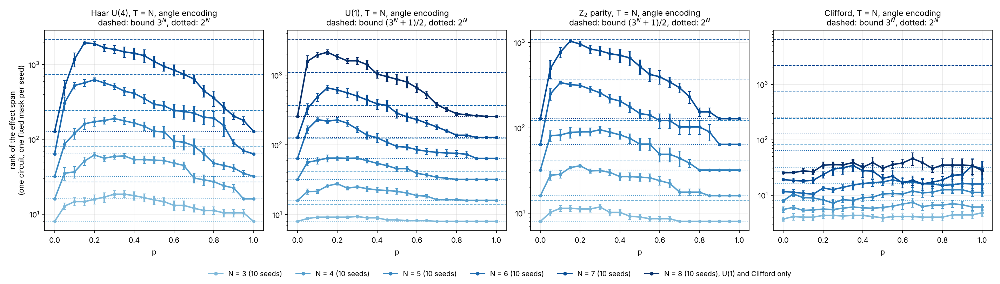
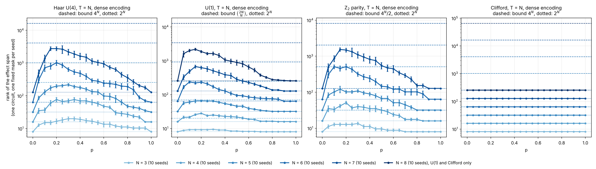
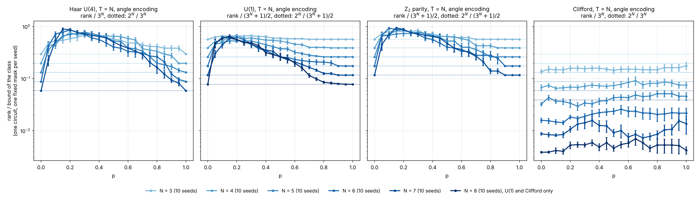
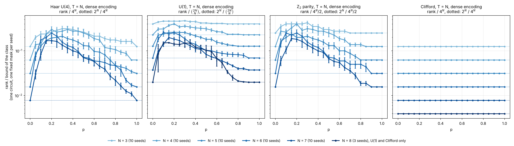
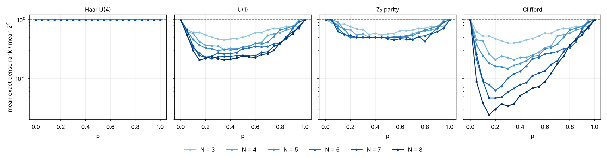
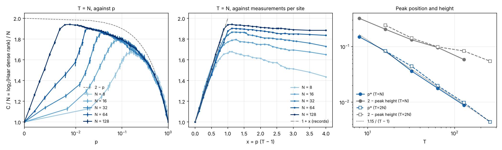

# Rank of the effect space against p, fixed mask, per circuit class

How large is the space of functions of the input that a readout of the
measurement record can reproduce, and how does it move across the
measurement-induced transition? For a monitored brickwork the probability of
a record `m` is `Pr(m | x) = Tr[E_m rho(x)]`, a linear combination of the
Bloch monomials of the product input `rho(x)`. The rank of the matrix `A` of
these coefficients (one row per record, one column per monomial) is the
dimension of the functions of `x` that any readout of the record, linear or
not, can reach with infinitely many shots. This folder computes it exactly for
one fixed circuit and one fixed mask per seed, and shows each circuit class on
its own panel with the sizes `N` on a colour gradient (issue #313).

## Experiment overview

| | |
| --- | --- |
| Script(s) | `experiments/effect_rank/effect_rank.py`, `plot_effect_rank.py`, launcher `effect_rank.sh` |
| Library | `QELM.evaluation.effect_rank` |
| Physical model | open brickwork of two-qubit gates, depth `T = N`; one layer is a full period (even bonds, then odd bonds), then the mid-circuit `Z` measurements; final `Z` readout of every site |
| Circuit classes | Haar U(4), U(1) (conserves `sum Z_i`), Z2 parity (conserves `prod Z_i`), Clifford |
| System sizes `N` | 3 to 7 for the four classes; 8 for U(1) and Clifford |
| Control parameters | measurement probability `p` = 0, 0.05, ..., 1 |
| Encodings | angle: `rho = prod (I + sin t_i X + cos t_i Z) / 2`, `3^N` monomials; dense: `Ry(t_i) Rz(f_i)`, Bloch vector on the sphere, `4^N` monomials |
| Sampling | 10 seeds; per seed one circuit per class and one uniform draw `u` of shape `(T, N)` |
| Issues / PRs | #313, PR #314; earlier figure with all classes on one panel: work around #309 |

## Methodology

1. **Masks.** For each seed, `u` is drawn once; the mask at rate `p` is
   `u < p`. Masks are therefore nested from one `p` to the next, and the four
   classes see the same masks.
2. **Span of the effects, backwards.** An orthonormal basis of the span of the
   effects `{E_m}` is kept as real Pauli coefficient vectors (length `4^N`):
   - after the final readout, the span is the diagonal strings `{I, Z}^N`,
     dimension `2^N`;
   - a `Z` measurement of site `i` maps the span `S` to
     `P_0 (x) span{A + B} + P_1 (x) span{A - B}`, where
     `E = I (x) A + Z (x) B + X (x) C + Y (x) D`; both halves are
     orthonormalised separately;
   - a gate maps `E -> U^† E U`, an orthogonal 16 x 16 rotation of the Pauli
     coefficients of its two sites.
   No record is listed, so the cost is set by the rank, not by the number of
   records.
3. **Ranks.** The dense encoding sees every Pauli string: its rank is the
   dimension of the span. The angle encoding has no `Y`: its rank is that of
   the projection of the span on the strings without `Y`.
4. **Bounds** (dashed lines):

   | Encoding | no symmetry | Z2 | U(1) |
   | --- | --- | --- | --- |
   | angle | `3^N` | `(3^N + 1) / 2` | `(3^N + 1) / 2` |
   | dense | `4^N` | `4^N / 2` | `C(2N, N)` |

   With the final readout alone the rank is at most `2^N` (dotted lines).
5. **Checks.** `tests/test_effect_rank.py` compares the ranks with a
   brute-force enumeration of every record and its effect at `N = 3` for the
   four classes. The error bars are standard errors over the seeds.

How to run it: [`experiments/README.md`](../README.md#run-the-effect-space-rank-against-p-issue-313).

**Reachable sizes.** The basis holds `rank x 4^N` doubles and each
measurement diagonalises a Gram matrix of size about the rank. On 4 cores and
16 GB, `N = 7` costs about 10 minutes per seed for Haar and `N = 8` about 20
minutes per seed for U(1). At `N = 8` Haar and Z2 reach ranks of order `10^4`
(already 2 900 and 1 500 at `N = 7` in dense), which means a basis of several
GB and hours per seed: they are left out. `N = 10` (vectors of length
`4^10 ~ 10^6`) is out of reach for every class, even Clifford, whose dense
rank `2^10` alone would take 8 GB.

## Results and discussion

- **Shape.** For Haar, U(1) and Z2 the rank is `2^N` at `p = 0` and `p = 1`,
  rises with the first measurements, peaks and falls back. The peak moves to
  smaller `p` as `N` grows: from `p ~ 0.3` at `N = 3` to `p ~ 0.15` at
  `N = 7` (and `N = 8` for U(1)), in both encodings.
- **Angle encoding, near the bound.** At the peak, the angle rank reaches a
  fraction of its bound that grows with `N` for Haar (0.69, 0.76, 0.78, 0.86,
  0.89 of `3^N` from `N = 3` to 7) and Z2 (0.84 to 0.95 of `(3^N + 1) / 2`).
  U(1) stays between 0.53 and 0.68 of the same bound with no trend (0.67 at
  `N = 3`, 0.60 at `N = 7`, 0.65 at `N = 8`): with the same bound as Z2, U(1)
  reaches less of it.
- **Dense encoding, far from the bound.** The dense fraction falls with `N`:
  0.31 to 0.17 of `4^N` for Haar, 0.47 to 0.17 of `C(2N, N)` for U(1), 0.43
  to 0.19 of `4^N / 2` for Z2 (`N = 3` to 7, U(1) to 8). A fixed mask leaves
  most of the `4^N` directions out of reach.
- **Clifford.** The dense rank is exactly `2^N` for every `p` and seed: the
  effects stay in the span of one stabilizer group. The angle rank is far
  below `2^N` (about 4 at `N = 3`, 16 to 34 at `N = 7` and 25 to 46 at
  `N = 8`, against 128 and 256), with no clear peak and large spread between
  circuits.
- **Caveats.** Ranks are exact up to a relative tolerance of `10^-6` on the
  singular values; the brute-force test validates it at `N = 3`. These are
  infinite-shot ranks: how many of these directions survive a finite number
  of shots is a separate question (see the capacity `C(S)` of the work
  around #309). The numbers of the earlier figure (different seeds) agree
  within the spread between circuits.

## Figures

**Figure 1. Rank of the effect space against p, angle encoding.** One panel
per class (Haar U(4), U(1), Z2 parity, Clifford), depth `T = N`, one circuit
and one fixed mask per seed. Solid lines with markers: mean rank over the
seeds, error bars the standard error; colour from light to dark blue for
`N = 3` to 8. Dashed lines: the bound of the class (`3^N` for Haar and
Clifford, `(3^N + 1) / 2` for U(1) and Z2) for each `N`, in its colour.
Dotted lines: `2^N`, the rank of the final readout alone. Log scale.
Produced by `experiments/effect_rank/plot_effect_rank.py` (issue #313).

**Figure 2. Same as Figure 1, dense encoding.** Bounds: `4^N` (Haar,
Clifford), `C(2N, N)` (U(1)), `4^N / 2` (Z2).

**Figure 3. Rank divided by the bound of the class, angle encoding.** Same
data as Figure 1. The dotted lines are `2^N` divided by the same bound. The
Haar and Z2 peaks get closer to 1 as `N` grows.

**Figure 4. Rank divided by the bound of the class, dense encoding.** Same
data as Figure 2. The peak fraction falls with `N` for every class.

The JSON next to each figure (`effect_rank_<encoding>.json`) holds the means,
standard errors, seed counts and bounds that are plotted.

## Min cut of the space-time graph (issue #321)

`QELM.evaluation.effect_rank.mincut_bits(masks)` is the minimum cut `C`,
in bits, between the input legs and the records of the brickwork: an
operator leg carries 2 bits, a `Z` measurement lets 1 bit through and sends
1 bit to the record, the final readout takes 1 bit per site. The matrix `A`
is a tensor network on this graph, so `rank <= 2^C` for every class.
`experiments/effect_rank/mincut_rank.py` draws the two figures below
(`uv run python experiments/effect_rank/mincut_rank.py`, about 40 minutes on
one core, almost all of it in the `N = 128` scan).

**Figure 5. Mean exact dense rank divided by the mean of `2^C`, against
`p`, one panel per class.** Same seeds and nested masks as Figures 1 to 4
(10 circuits per point, `N = 3` to 7, and `N = 8` for U(1) and Clifford).
Dashed line: ratio 1. Log scale.
- **Haar: the ratio is exactly 1 at every `N` and `p`.** Since
  `rank <= 2^C` circuit by circuit, the equality of the means gives the
  equality for each of the 1 050 circuits and masks. The Haar dense rank at
  fixed mask depends on the mask only.
- **Z2: the ratio is 1/2 for `N >= 5` over most of the range** (0.50 at
  `N = 6` from `p = 0.2` to 0.65): the parity sector halves the space the
  cut allows.
- **U(1) and Clifford stay well below the cut.** Clifford falls to about
  0.02 of `2^C` at `N = 7`, `p = 0.15`, since its span is always a
  stabilizer group of `2^N` strings.

**Figure 6. `C / N` (equal to `log2(rank) / N` for Haar) at large `N`.**
Mean over masks (50 at `N = 8`, 6 at `N = 64` and 128), error bars the
standard error. Colour from light to dark blue for `N = 8` to 128.
- **Left, `T = N`, against `p`** (log axis above 0.01). Dashed line:
  `2 - p`. At fixed `p` the sizes collapse onto one smooth curve (1.85 at
  `p = 0.05`, 1.70 at 0.2, 1.45 at 0.5), while the peak moves left and up.
- **Centre, against `x = p (T - 1)`,** the mean number of useful
  measurements per site. Dash-dot: the record bound `1 + x`, followed by
  every size up to `x ≈ 1`.
- **Right, peak position `p*` and `2 -` peak height against `T`.** Circles
  `T = N`, open squares `T = 2N`; dotted line `1.15 / (T - 1)`.
  - `p*` follows `1.15 / (T - 1)`: 0.15, 0.083, 0.036, 0.018, 0.0089 for
    `N = 8` to 128 at `T = N`, so the peak sits at about one useful
    measurement per site and goes to `p = 0`.
  - The height tends to 2 bits per site, the `4^N` bound: 1.68, 1.80, 1.87,
    1.90, 1.94.

**Reading.** The peak of the rank is the crossover between a rank limited by
the number of records and a rank limited by the dephasing of the input by
the first measurements. It has no finite critical point. The note
`documentation/notes/transition-rang-mipt.md` (PR #320) discusses what this
means for the measurement-induced transition.
