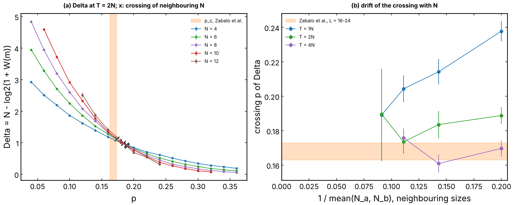
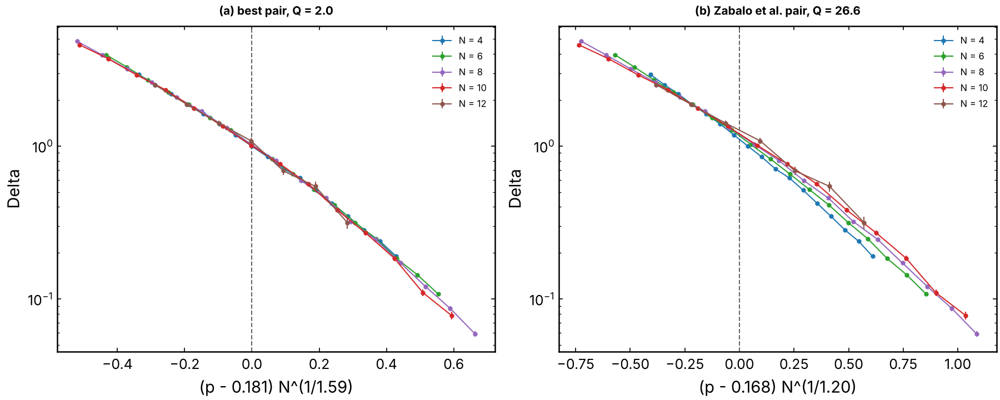
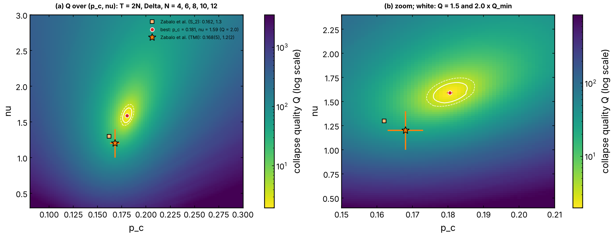
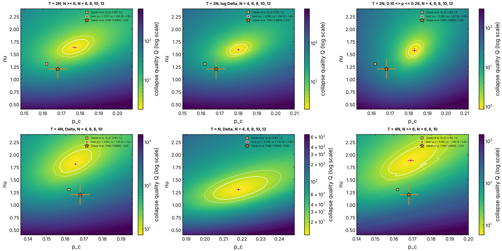

# Haar MIPT with the exact `W(m)` and `Delta`: crossing, collapse and `(p_c, nu)` map (issue #348)

A verification step: does the project's own probe, the dense Fourier weight
`W(m)` of the record and the missing weight `Delta = N - log2(1 + W(m))`,
computed **exactly** on Haar circuits, recover the literature transition?

## Model and probe

- **Circuit** (Zabalo et al., PRB 101, 060301(R) (2020); the Clifford runs
  of #337 / #346 use the same one): periodic brickwork of `N` qubits,
  half-layer `t` applies independent Haar two-qubit gates on the bonds of
  parity `t` (including `(N - 1, 0)`), then a `Z` measurement of each site
  with probability `p`. `T` counts half-layers (one time step of the paper).
- **Probe**: for one circuit, the Kraus operator `K_m` of one record is
  computed exactly (all `2^N` input basis states evolved together), with the
  outcomes drawn by the Born rule of the maximally mixed input. With
  `E = K^dagger K`, `1 + W(m) = 2^N Tr[E^2] / Tr[E]^2` (#314) and
  `Delta = N - log2(1 + W(m))`. `Tr[E^2] / Tr[E]^2` is the purity of the
  state reached from `I / 2^N`, so `Delta` is its **Renyi-2 entropy**: the
  purification order parameter of Gullans & Huse, without approximation.
  Code: `QELM.evaluation.haar_mipt.haar_record`; the test suite checks it
  against a slow reference and against `fourier_weight` of #314.
- **Data**: `N = 4, 6, 8, 10` (17 or 14 values of `p` from 0.04 to 0.36;
  4000, 4000, 3000, 1000 circuits per `p`; `T = N, 2N, 4N`) and `N = 12`
  (`p = 0.12` to 0.24, 120 circuits per `p`, single precision; `T = N, 2N`).
  One record per circuit. Runs in `runs/haar_N<N>.json` (about 6 h on 4
  cores in total, most of it `N = 10` and 12).

## Analysis

At fixed `T / N`, `Delta` is scale invariant at the transition, so the
curves of all sizes cross at `p_c` and

    Delta(p, N) = F((p - p_c) N^(1/nu)).

`nu` is the correlation-length exponent (the `mu` of the request). The cost
of a pair `(p_c, nu)` is the Houdayer-Hartmann quality `Q` of #346
(`QELM.evaluation.finite_size_scaling.collapse_quality`, `Q ~ 1` = collapse
within the error bars); best pair by Nelder-Mead from the grid minimum, 40
bootstrap resamples (statistical errors only).

## Run

    uv run python experiments/haar_collapse_map/run.py --n 8 --samples 3000
    uv run python experiments/haar_collapse_map/analyse.py

## Results

**Figure 1. Crossings.** (a) `Delta` against `p` at `T = 2N`, crosses: the
crossings of neighbouring sizes; orange band: `p_c = 0.168(5)` of Zabalo et
al. (b) Crossing of neighbouring sizes against `1 / mean(N)` for
`T = N, 2N, 4N`.

| `T` | 4/6 | 6/8 | 8/10 | 10/12 |
|---|---|---|---|---|
| `N` | 0.238(6) | 0.214(7) | 0.204(8) | 0.189(27) |
| `2N` | 0.189(5) | 0.184(8) | 0.174(7) | 0.190(19) |
| `4N` | 0.170(5) | 0.161(5) | 0.176(5) | not run |

- At `T = N` the crossing comes down steadily, 0.238 to 0.189.
- At `T = 2N` it comes down from 0.189 to 0.174 up to `N = 10`; the
  `10/12` crossing (0.190 ± 0.019) is not resolved with 120 circuits.
- At `T = 4N` the crossings already lie in the literature window
  (0.161 to 0.176).
- The three `T / N` approach each other from above as `N` grows, towards
  0.17 to 0.18. With `N <= 12` the crossings fix `p_c = 0.17 ± 0.01`.

**Figure 2. Collapse at `T = 2N`, `N = 4` to 12.** (a) At the best pair
`p_c = 0.181`, `nu = 1.59` (`Q = 2.0`). (b) At the Zabalo et al. pair
`(0.168, 1.2)`, nothing fitted (`Q = 26.6`): the sizes fan out above `p_c`.

**Figure 3. `Q` over `(p_c, nu)`, `T = 2N`, `N = 4` to 12.** (a) wide grid,
(b) zoom with the contours `1.5` and `2 Q_min`. Star: Zabalo et al. (TMI,
`S_1`), square: their Renyi-2 value.

**Figure 4. Same map for other data choices.**

| data | `p_c` | `nu` | `Q_min` | `Q` at `(0.168, 1.2)` | best `nu` at `p_c = 0.168` |
|---|---|---|---|---|---|
| `T = 2N`, `N = 4`-12 (main) | 0.1805 ± 0.0008 | 1.59 ± 0.02 | 1.98 | 26.6 | 1.51 |
| `T = 2N`, `N = 6`-12 | 0.1771 ± 0.0012 | 1.63 ± 0.02 | 1.80 | 15.5 | 1.56 |
| `T = 2N`, `log Delta` | 0.1800 ± 0.0008 | 1.59 ± 0.02 | 1.92 | 26.6 | 1.51 |
| `T = 2N`, `0.10 <= p <= 0.26` | 0.1830 ± 0.0012 | 1.57 ± 0.04 | 0.85 | 15.1 | 1.50 |
| `T = 4N`, `N = 4`-10 | 0.1655 ± 0.0007 | 1.81 ± 0.03 | 7.28 | 106.8 | 1.84 |
| `T = 4N`, `N = 6`-10 | 0.1690 ± 0.0016 | 1.88 ± 0.03 | 5.87 | 61.3 | 1.86 |
| `T = N`, `N = 4`-12 | 0.2180 ± 0.0010 | 1.30 ± 0.02 | 11.8 | 128.9 | 1.08 |

## Reading

- **`p_c`: the literature value is recovered.** The crossings drift down
  with `N` and the collapse optimum moves towards 0.168 when the smallest
  size is dropped (0.181 to 0.177 at `T = 2N`); at `T = 4N` it is already
  0.166 to 0.169. The spread over `T / N` (0.166 to 0.218, shrinking with
  `N`) is the dominant, systematic, error: `p_c = 0.17 ± 0.01` from
  `N <= 12`.
- **`nu`: not recovered quantitatively at these sizes.** Every collapse at
  `T >= 2N` prefers `nu = 1.6` to 1.9, against `1.2 ± 0.2` (TMI) and
  `1.3 ± 0.1` (Renyi-2) of Zabalo et al.; even with `p_c` fixed at 0.168 the
  best `nu` is 1.5 to 1.9. `nu` and `p_c` are correlated (tilted valley):
  the drift of the crossing towards lower `p` is absorbed by a larger `nu`.
  `T = N` gives `nu = 1.30` but with a bad collapse (`Q = 12`) and a `p_c`
  far from the others. The bootstrap errors (±0.02) are much smaller than
  this spread, so `nu = 1.6 ± 0.3` is the honest reading: compatible with
  the literature at about one standard deviation, not a confirmation. The
  same probe on Clifford up to `N = 128` (#346) gives `nu = 1.30`: the
  excess here is a small-size effect, which `N <= 12` cannot remove.
- **Which observable.** `Delta` (= Renyi-2 entropy of the initially mixed
  system), not the half-chain `S_2` of a pure trajectory nor the reference
  qubit.

## Reconciling with earlier Haar numbers

- **`p_c ≈ 0.29` (#324, `effect_mipt`)**: the open brickwork of the QELM
  convention has one measurement round per **two** half-layers. Per
  half-layer, `1 - (1 - 0.168)^2 = 0.31`, in line with `0.29 ± 0.02`.
- **`Delta` crossing 0.12 to 0.14 on the Floquet circuit (#333, #336)**:
  that circuit repeats one fixed brick (Skinner, Ruhman & Nahum), it is not
  Haar random, and its transition is elsewhere (their `p_c = 0.22 ± 0.05`
  for `n = 2`). On the random Haar circuit the same probe crosses at
  0.17 to 0.19, above it and close to the literature.
- **`S_2` crossing 0.22 ± 0.02 (#336)**: the half-chain `S_2` of the
  Floquet circuit, also a different circuit; the Haar Renyi-2 value of the
  literature is 0.162(3).

## Limits

- `N <= 12`: `K_m` has `4^N` entries (268 MB at `N = 12` in single
  precision), about 1 min per circuit at `N = 12`. `N = 12` has 120
  circuits per `p`, so its crossings are not resolved.
- One record per circuit; the error bars mix circuit and record
  fluctuations, as in the averages of the literature.
- No correction-to-scaling term in the fit.
