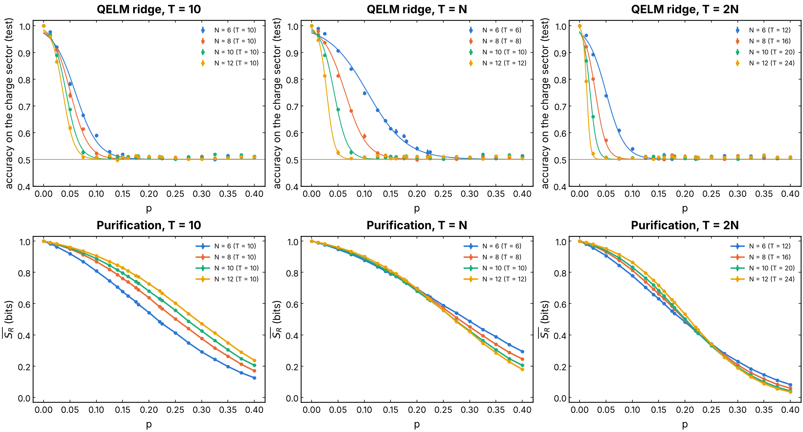
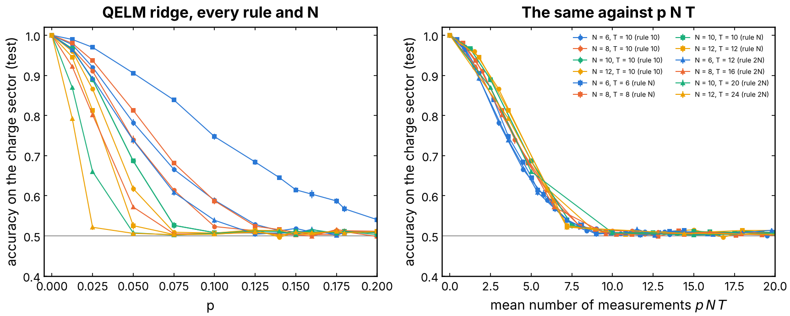
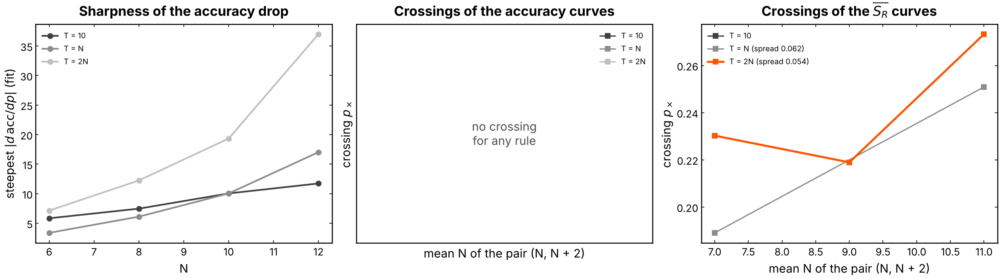
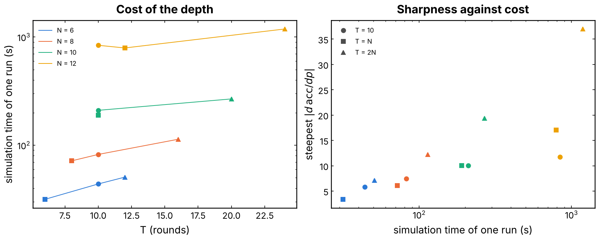
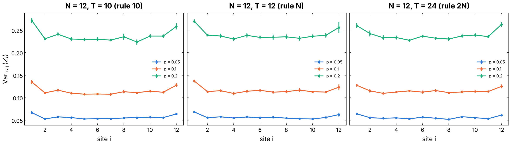
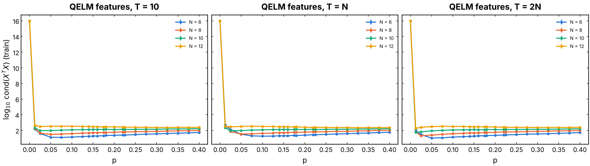

# Purification decoding: the charge of a random Haar or Clifford circuit with several readouts

The question of [`QELM_M`](../QELM_M/README.md), "can a readout of the
measurement record tell the initial charge sector?", for gates that conserve
nothing. A reference qubit `R` is entangled with the charge sector of the
system; as the system is measured, `R` **purifies** (its entropy `S_R`
falls), which means the record holds its state. The experiment compares that
purification curve, the information-theoretic limit, with what decoders of
the record and of the final state actually read: linear (ridge, logistic),
quadratic, K-NN, neural network, gradient boosting, and a benchmark of QELM
feature maps.

## Experiment overview

| | |
| --- | --- |
| Script(s) | `experiments/haar_readouts/haar_readouts.py`, launcher `haar_readouts.sh`, plot `plot_haar_readouts.py` |
| Config | `conf/haar_readouts.yaml` (`readouts_task`) |
| Physical model | brickwork of Haar-random U(4) gates (`haar_circuit`) or random two-qubit Clifford gates (`clifford_circuit`), new gates per trajectory (`random`) or one circuit per run (`fixed`) |
| System sizes `N` | 8 system qubits by default, plus `R`; state vector |
| Control parameters | measurement probability `p`, `n_rounds = 5` rounds of one brickwork layer and one Z measurement of each system qubit with probability `p` |
| Initial state | `(|0>_R |Q1>_S + |1>_R |Q2>_S) / sqrt(2)`, `Q1 = N / 2`, `Q2 = N / 2 - 1` |
| ML task | binary classification of the Z outcome of `R` (the sector) from the record `M`, from observables of the final state (`X`, `Y`, `Z`, `XX`, `YY`, `ZZ`, `all` = QELM, `M_all` = QELM-M) or from benchmark feature maps (`local2`, `born`, `reservoir`, `shot`, `M_shot`, `M_x_all`); readouts `ridge` (RidgeCV), `logistic`, `ridge_pairs`, `knn`, `mlp`, `gradient_boosting`; accuracy and R2 of the output |

## Methodology

1. Prepare the state above; run 5 rounds of one brickwork layer followed by
   a Z measurement of each system qubit with probability `p`.
2. Record `S_R` (bits), the purification curve; measure `R` in Z for the
   label; build the feature sets from the record and the final state.
3. At each `p`, 2000 trajectories, split 70 / 30; fit each readout on each
   feature set; average over seeds 42, 43, 44 (error bars: standard error).

How to run it: [experiments/README.md, "Run the charge of a random Haar or Clifford circuit with several readouts"](../README.md#run-the-charge-of-a-random-haar-or-clifford-circuit-with-several-readouts)
and "Benchmark of QELM readouts".

## Results and discussion

- **Purification is slow, decoding is not linear.** `S_R` falls from 1 bit
  at `p = 0` to 0.42 at `p = 0.4`, 0.25 at `p = 0.5` and 0.04 at `p = 0.7`,
  the same for fixed and random gates (Figure 1). Yet the ridge on `M` stays
  at chance (0.50 to 0.53) with `R2 ~ 0` at every `p`: the record holds the
  charge, but not in a linear form. Without a conserved charge, the outcomes
  of a round no longer sum to it.
- **The QELM reads the sector only before the measurements scramble it.**
  With a fixed circuit, the QELM features of the final state give accuracy
  1.00 at `p = 0` (a fixed unitary maps each sector to a fixed final state),
  then 0.92, 0.77, 0.63 at `p = 0.05, 0.1, 0.15` (Haar) and chance from
  `p ~ 0.2`, far before `R` is purified. Adding `M` changes nothing. Clifford
  gates drop faster (0.87, 0.69, 0.57). With random gates, every feature set
  is at chance at every `p` (Figures 2 and 3).
- **Richer feature maps do not move the wall.** All one- and two-site Pauli
  strings, the `2^N` Z-basis probabilities, a fixed Haar reservoir before
  them, the feedforward products `M x <O>` and a quadratic readout all reach
  1.00 at `p = 0` and fall to about 0.5 by `p ~ 0.2`, within about 0.05 of
  the QELM (Figure 4). A single Z-basis shot, what one run of an experiment
  gives, is at chance (0.56 at `p = 0`). The logistic readout gives the same
  curves within `±0.02`.
- **Conclusion.** Between `p ~ 0.2` and `p ~ 0.7` the reference qubit is
  still partly hidden, yet no tested decoder reads its sector: the
  information is in the record but spread over nonlinear, circuit-dependent
  correlations that a fixed readout does not capture.

## Figures


**Figure 1. Purification against the linear readout of the record.** Left:
mean entropy of the reference qubit `S_R` (bits) against `p`. Middle: test
accuracy of the ridge readout of `M` on the charge sector (gray: chance).
Right: R2 of its output. Haar circuit, `N = 8`, random gates (blue) and one
fixed circuit per seed (orange). Produced by
`experiments/haar_readouts/plot_haar_readouts.py`.


**Figure 2. Ridge on `M`, QELM and QELM-M, Haar circuit.** Left: `S_R`
(blue: fixed circuit, orange: random gates). Middle: test accuracy; right:
R2 of the output, for the ridge on `M` (blue), on the QELM observables
`<X_k>, <Y_k>, <Z_k>, <X_i X_j>, <Y_i Y_j>, <Z_i Z_j>` (orange) and on both
(green). Solid: fixed circuit; dashed: random gates. `N = 8`, 2000
trajectories per `p`, seeds 42 to 44. Produced by
`experiments/haar_readouts/plot_haar_readouts.py` with
`READOUTS=ridge FEATURES="M all M_all"`.


**Figure 3. The same for random two-qubit Clifford gates.** The
purification is almost that of Haar (random Clifford gates purify a little
faster); the QELM accuracy of the fixed circuit falls faster. Produced by
`experiments/haar_readouts/plot_haar_readouts.py`.


**Figure 4. Benchmark of QELM readouts, fixed Haar circuit, ridge.** Left:
`S_R`. Middle: test accuracy; right: R2, one color per feature map: QELM
observables (108 features), all one- and two-site Pauli strings (276), the
256 Z-basis probabilities, the same after a fixed Haar unitary, one Z-basis
shot, `M` with one shot, QELM-M, QELM x M (feedforward products) and the
quadratic ridge on the observables. `N = 8`, seeds 42 to 44. Produced by
`experiments/haar_readouts/plot_haar_readouts.py` (benchmark sweep).

## Depth T of the QELM (issue #268)

How many rounds `T` should the monitored circuit run before the QELM reads
it? Three rules are compared: `T = 10` for every `N` (Dehghani et al.,
Nature Comm. 2023), `T = N` (the light cone of the brickwork, two sites per
round, covers the chain) and `T = 2N` (the stationary regime of the MIPT),
for `N = 6, 8, 10, 12`.

| | |
| --- | --- |
| Script(s) | `depth_scaling.sh` (launcher), `plot_depth_scaling.py` (figures), notebook `notebooks/results/09_haar_depth_scaling.ipynb` |
| Config | `conf/haar_readouts.yaml`, `readouts_task.depth_rule` = `10`, `N` or `2N` |
| Physical model | Haar brickwork, one fixed circuit per seed (`haar_circuit.fixed_instance=true`), 10 circuits (seeds 42 to 51) |
| Control parameters | `p` in 22 values from 0 to 0.4 (the grid of the issue, `0.05` to `0.4` by `0.025` with `0.14, 0.16, 0.18, 0.22`, plus `0, 0.0125, 0.025`), `T` by the rule |
| ML task | ridge (`RidgeCV`) on the QELM features `all` (`<P_k>`, `<P_i P_j>`, 234 features at `N = 12`), 2000 trajectories per `p`, split 70 / 30 |
| Also recorded | `S_R` (the purification order parameter), the condition number of the training `X^T X`, the variance of `<Z_i>` per site, the run time |

Run it (about 3 h on 4 cores; resume a stopped sweep with `SKIP_DONE=1`):

```bash
MAX_JOBS=4 ./experiments/haar_readouts/depth_scaling.sh
uv run python experiments/haar_readouts/plot_depth_scaling.py outputs/haar_depth/<date_time>
```

### Results

- **The QELM loses the charge after about four measurements, whatever
  `T`.** The accuracy falls from 1 at `p = 0` to chance, and its midpoint
  `p_0` (sigmoid fit) sits at `p_0 N T = 4.0 +- 0.3`, the mean number of
  measurements in the whole circuit, for all 12 `(N, T)` (Figure D2). Plotted
  against `p N T`, the 12 curves fall on one (Figure D2, right). So
  `p_0 ~ 4 / (N T)`: 0.037 (`T = 10`), 0.029 (`T = N`) and 0.014
  (`T = 2N`) at `N = 12`.

  | `p_0` (`p_0 N T`) | N = 6 | N = 8 | N = 10 | N = 12 |
  | --- | --- | --- | --- | --- |
  | `T = 10` | 0.060 (3.6) | 0.051 (4.1) | 0.043 (4.3) | 0.037 (4.4) |
  | `T = N` | 0.106 (3.8) | 0.064 (4.1) | 0.043 (4.3) | 0.029 (4.1) |
  | `T = 2N` | 0.050 (3.6) | 0.030 (3.8) | 0.020 (4.0) | 0.014 (3.9) |

- **No finite-size crossing of the accuracy, for any rule.** The curves
  are ordered: a larger `N T` drops earlier, so they never cross and `p_0`
  goes to 0 with `N` (Figures D1 and D3). The steepest slope `|d acc / dp|`
  grows with `N T` (5.8 to 37), but that is the same collapse in `p N T`,
  not a sharper transition. The accuracy of a fixed readout of the final
  state therefore does not show the MIPT: it measures how many outcomes the
  record holds, not the phase. This is the mechanism of #261: each
  measurement splits the final states, and the averaged states of the two
  sectors seen by a linear readout become equal.
- **The MIPT is in `S_R`, and only with `T` that grows with `N`.**
  - With `T = 10`, the `S_R` curves never cross: a larger `N` stays more
    entangled at every `p`. At fixed `T`, the larger chains are further
    from their stationary state.
  - With `T = N`, they cross at `p_x = 0.19` (6 / 8) and `0.25`
    (10 / 12); the 8 / 10 pair does not cross on the grid.
  - With `T = 2N`, all three pairs cross, at `p_x = 0.23, 0.22, 0.27`
    (spread 0.054, drawn in `#fa5703`). This is above the `p_c ~ 0.17` of the Haar
    reference qubit, with a drift at these small sizes.
- **The edges are connected.** At `N = 12` and `T = 10` the variance of
  `<Z_i>` over the trajectories is flat in the bulk and 15 to 20 % higher on
  the two edge sites, for every rule (Figure D5). An edge qubit has one gate
  per round instead of two, so a measured outcome there is scrambled less;
  it is not cut off. One round of `haar_circuit` is a full brickwork period
  (even then odd bonds), so after 10 rounds the light cone spans 20 sites,
  more than `N = 12`.
- **The ridge is well conditioned.** `log10 cond(X^T X)` is 1 to 2.7 for
  `p > 0` at every `N` and `T` (16, singular, at `p = 0`, where a fixed
  circuit maps each sector to one state; Figure D6). The loss of accuracy is
  not a numerical problem.
- **Cost.** The time of a run grows slowly with `T`: at `N = 12`, 840 s
  (`T = 10`), 790 s (`T = 12`) and 1190 s (`T = 24`). Computing the 234
  observables of each trajectory costs as much as the circuit. The
  `T = 10` runs of `N = 12` shared the machine with the test suite, so
  their time is overestimated (Figure D4).

### Decision

- **For the QELM accuracy, no rule reveals the transition.** `T = 10`
  is enough (and cheapest) to benchmark readouts at small `p`. Its
  accuracy depends on `p N T` only, so results at different `T` translate
  into one another.
- **For finite-size scaling of the MIPT (`S_R`, or a decoder of the
  record), use `T = 2N`.** It is the only rule where every pair of sizes
  crosses, for 1.5 times the time of `T = N` at `N = 12`. `T = N` almost
  does (two crossings out of three), and `T = 10` does not. The criterion
  of the issue, "`T = N` if its crossing is as sharp as `T = 2N`", is not
  met here at `N <= 12`.

### Figures



**Figure D1. Transition profiles, one column per depth rule.** Top: test
accuracy of the QELM ridge on the charge sector against `p`, one color per
`N` (points: mean over 10 fixed circuits, error bars: standard error; line:
sigmoid fit). Bottom: mean entropy of the reference qubit `S_R` (bits).
Produced by `plot_depth_scaling.py`.



**Figure D2. The accuracy depends on `p N T` only.** Left: the 12 accuracy
curves against `p` (colors: `N`; markers: circle `T = 10`, square
`T = N`, triangle `T = 2N`). Right: the same against `p N T`, the mean
number of measurements in the circuit.



**Figure D3. Sharpness and finite-size crossings.** Left: steepest slope
`a / 4w` of the sigmoid fit of the accuracy against `N`. Middle: crossings
of the accuracy curves of successive `N` (none). Right: crossings of the
`S_R` curves of successive `N`, with their spread; `T = 2N`, the rule whose
crossings agree best, is in `#fa5703`.



**Figure D4. Cost against gain.** Left: simulation time of one run (44 000
trajectories) against `T`, one color per `N`. Right: the steepest accuracy
slope against that time.



**Figure D5. Light cone at `N = 12`.** Variance over the trajectories of
`<Z_i>` against the site `i`, at `p = 0.05, 0.1, 0.2`, one panel per rule
(error bars: standard error over the circuits).



**Figure D6. Conditioning of the ridge.** `log10` of the condition number of
`X^T X` of the training QELM features against `p`, one color per `N`.

The numbers of every curve (fits, crossings, times) are in
[`figures/depth/depth_summary.json`](figures/depth/depth_summary.json).
