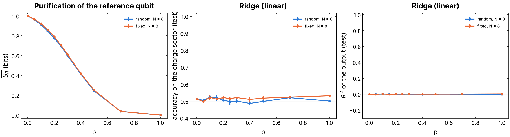
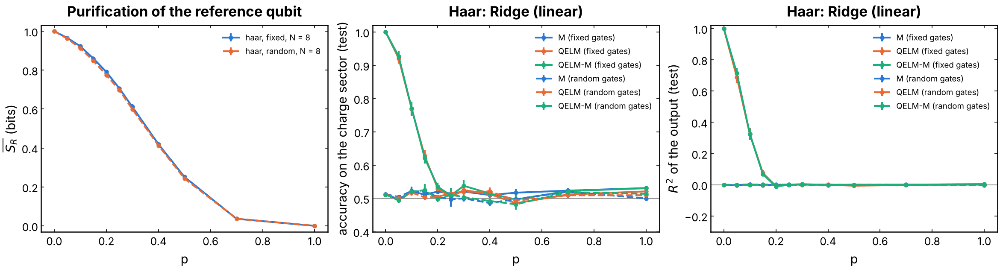
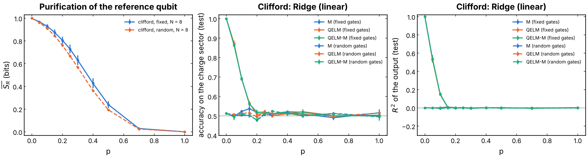
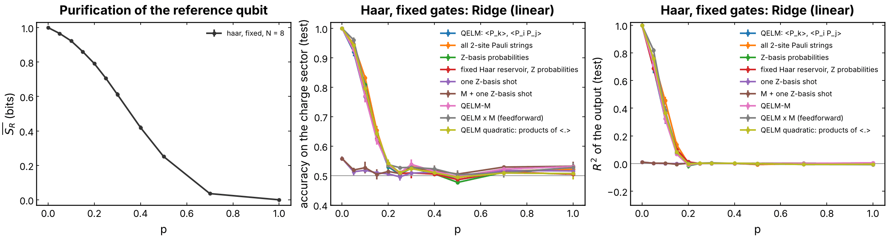

# Purification decoding: the charge of a random Haar or Clifford circuit with several readouts

The question of [`QELM_M`](../QELM_M/README.md), "can a readout of the
measurement record tell the initial charge sector?", for gates that conserve
nothing. A reference qubit `R` is entangled with the charge sector of the
system; as the system is measured, `R` **purifies** (its entropy `S_R`
falls), which means the record holds its state. The experiment compares that
purification curve, the information-theoretic limit, with what decoders of
the record and of the final state actually read: linear (ridge, logistic),
quadratic, K-NN, neural network, gradient boosting, and a benchmark of QELM
feature maps.

## Experiment overview

| | |
| --- | --- |
| Script(s) | `experiments/haar_readouts/haar_readouts.py`, launcher `haar_readouts.sh`, plot `plot_haar_readouts.py` |
| Config | `conf/haar_readouts.yaml` (`readouts_task`) |
| Physical model | brickwork of Haar-random U(4) gates (`haar_circuit`) or random two-qubit Clifford gates (`clifford_circuit`), new gates per trajectory (`random`) or one circuit per run (`fixed`) |
| System sizes `N` | 8 system qubits by default, plus `R`; state vector |
| Control parameters | measurement probability `p`, `n_rounds = 5` rounds of one brickwork layer and one Z measurement of each system qubit with probability `p` |
| Initial state | `(|0>_R |Q1>_S + |1>_R |Q2>_S) / sqrt(2)`, `Q1 = N / 2`, `Q2 = N / 2 - 1` |
| ML task | binary classification of the Z outcome of `R` (the sector) from the record `M`, from observables of the final state (`X`, `Y`, `Z`, `XX`, `YY`, `ZZ`, `all` = QELM, `M_all` = QELM-M) or from benchmark feature maps (`local2`, `born`, `reservoir`, `shot`, `M_shot`, `M_x_all`); readouts `ridge` (RidgeCV), `logistic`, `ridge_pairs`, `knn`, `mlp`, `gradient_boosting`; accuracy and R2 of the output |

## Methodology

1. Prepare the state above; run 5 rounds of one brickwork layer followed by
   a Z measurement of each system qubit with probability `p`.
2. Record `S_R` (bits), the purification curve; measure `R` in Z for the
   label; build the feature sets from the record and the final state.
3. At each `p`, 2000 trajectories, split 70 / 30; fit each readout on each
   feature set; average over seeds 42, 43, 44 (error bars: standard error).

How to run it: [experiments/README.md, "Run the charge of a random Haar or Clifford circuit with several readouts"](../README.md#run-the-charge-of-a-random-haar-or-clifford-circuit-with-several-readouts)
and "Benchmark of QELM readouts".

## Results and discussion

- **Purification is slow, decoding is not linear.** `S_R` falls from 1 bit
  at `p = 0` to 0.42 at `p = 0.4`, 0.25 at `p = 0.5` and 0.04 at `p = 0.7`,
  the same for fixed and random gates (Figure 1). Yet the ridge on `M` stays
  at chance (0.50 to 0.53) with `R2 ~ 0` at every `p`: the record holds the
  charge, but not in a linear form. Without a conserved charge, the outcomes
  of a round no longer sum to it.
- **The QELM reads the sector only before the measurements scramble it.**
  With a fixed circuit, the QELM features of the final state give accuracy
  1.00 at `p = 0` (a fixed unitary maps each sector to a fixed final state),
  then 0.92, 0.77, 0.63 at `p = 0.05, 0.1, 0.15` (Haar) and chance from
  `p ~ 0.2`, far before `R` is purified. Adding `M` changes nothing. Clifford
  gates drop faster (0.87, 0.69, 0.57). With random gates, every feature set
  is at chance at every `p` (Figures 2 and 3).
- **Richer feature maps do not move the wall.** All one- and two-site Pauli
  strings, the `2^N` Z-basis probabilities, a fixed Haar reservoir before
  them, the feedforward products `M x <O>` and a quadratic readout all reach
  1.00 at `p = 0` and fall to about 0.5 by `p ~ 0.2`, within about 0.05 of
  the QELM (Figure 4). A single Z-basis shot, what one run of an experiment
  gives, is at chance (0.56 at `p = 0`). The logistic readout gives the same
  curves within `±0.02`.
- **Conclusion.** Between `p ~ 0.2` and `p ~ 0.7` the reference qubit is
  still partly hidden, yet no tested decoder reads its sector: the
  information is in the record but spread over nonlinear, circuit-dependent
  correlations that a fixed readout does not capture.

## Figures

**Figure 1. Purification against the linear readout of the record.** Left:
mean entropy of the reference qubit `S_R` (bits) against `p`. Middle: test
accuracy of the ridge readout of `M` on the charge sector (gray: chance).
Right: R2 of its output. Haar circuit, `N = 8`, random gates (blue) and one
fixed circuit per seed (orange). Produced by
`experiments/haar_readouts/plot_haar_readouts.py`.

**Figure 2. Ridge on `M`, QELM and QELM-M, Haar circuit.** Left: `S_R`
(blue: fixed circuit, orange: random gates). Middle: test accuracy; right:
R2 of the output, for the ridge on `M` (blue), on the QELM observables
`<X_k>, <Y_k>, <Z_k>, <X_i X_j>, <Y_i Y_j>, <Z_i Z_j>` (orange) and on both
(green). Solid: fixed circuit; dashed: random gates. `N = 8`, 2000
trajectories per `p`, seeds 42 to 44. Produced by
`experiments/haar_readouts/plot_haar_readouts.py` with
`READOUTS=ridge FEATURES="M all M_all"`.

**Figure 3. The same for random two-qubit Clifford gates.** The
purification is almost that of Haar (random Clifford gates purify a little
faster); the QELM accuracy of the fixed circuit falls faster. Produced by
`experiments/haar_readouts/plot_haar_readouts.py`.

**Figure 4. Benchmark of QELM readouts, fixed Haar circuit, ridge.** Left:
`S_R`. Middle: test accuracy; right: R2, one color per feature map: QELM
observables (108 features), all one- and two-site Pauli strings (276), the
256 Z-basis probabilities, the same after a fixed Haar unitary, one Z-basis
shot, `M` with one shot, QELM-M, QELM x M (feedforward products) and the
quadratic ridge on the observables. `N = 8`, seeds 42 to 44. Produced by
`experiments/haar_readouts/plot_haar_readouts.py` (benchmark sweep).
