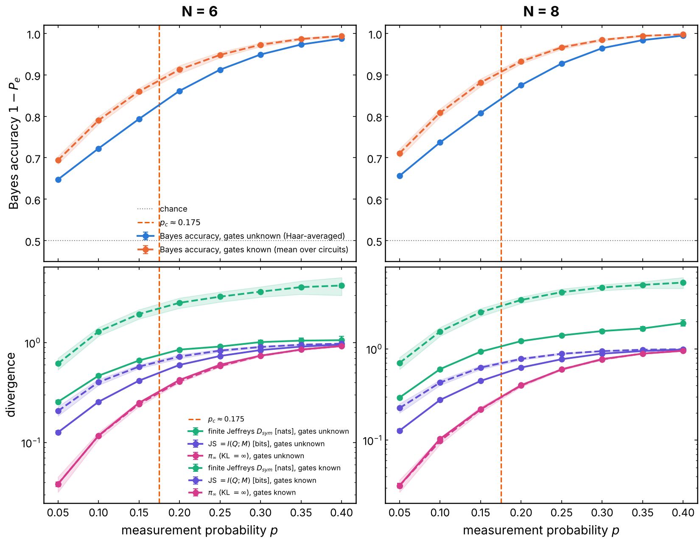
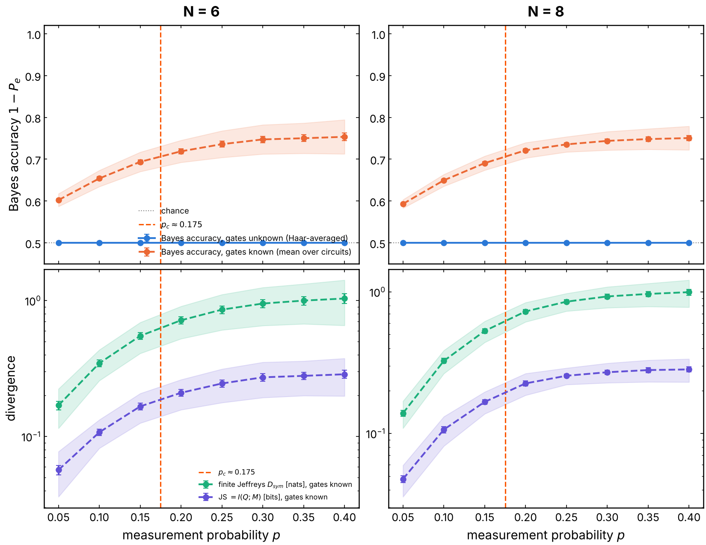
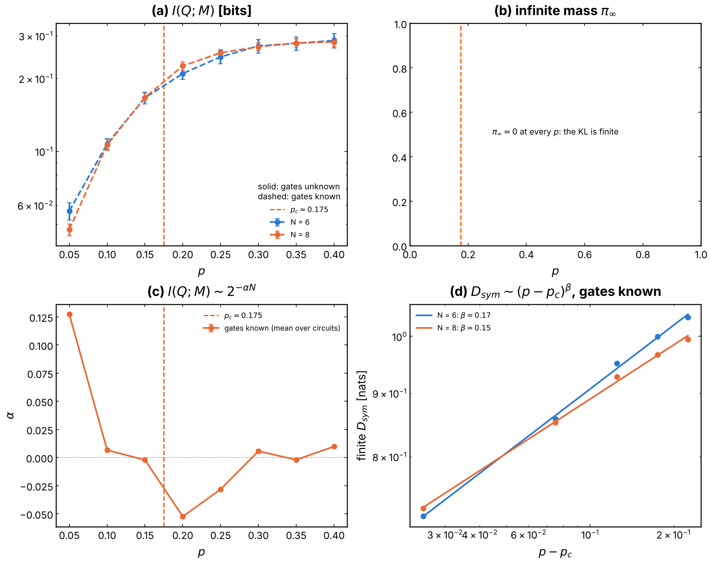
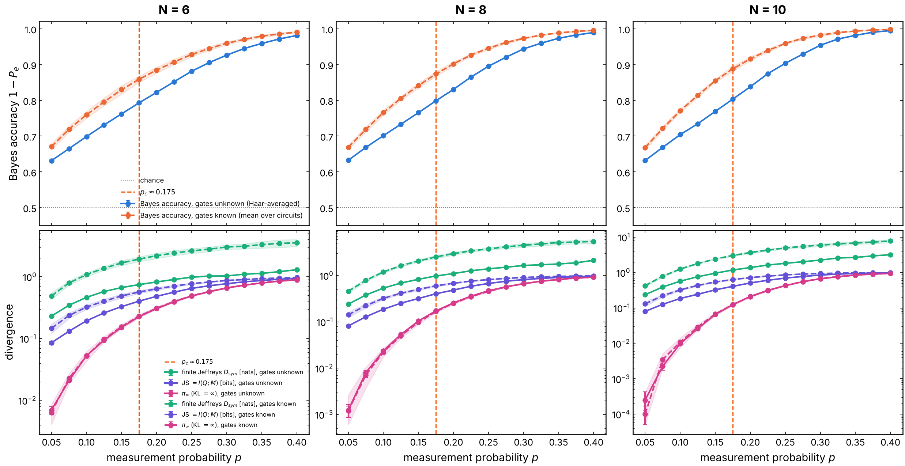
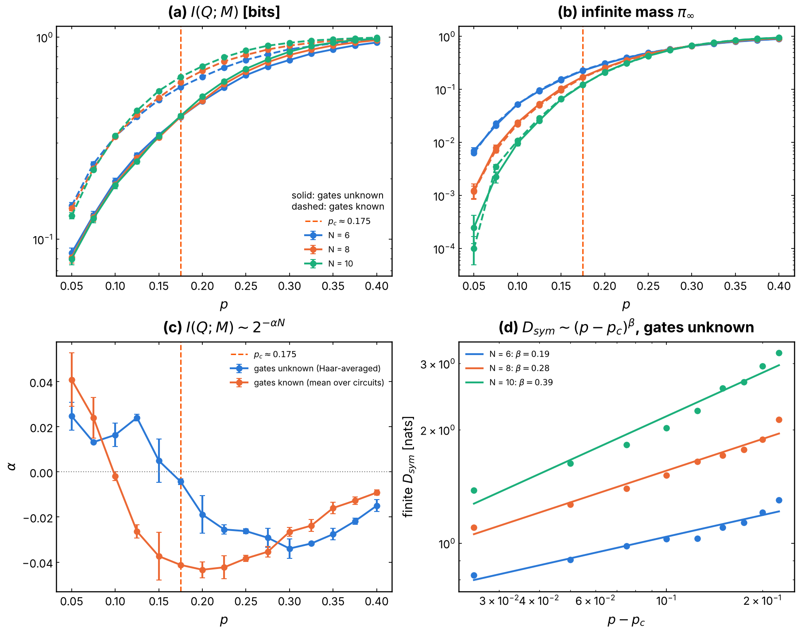
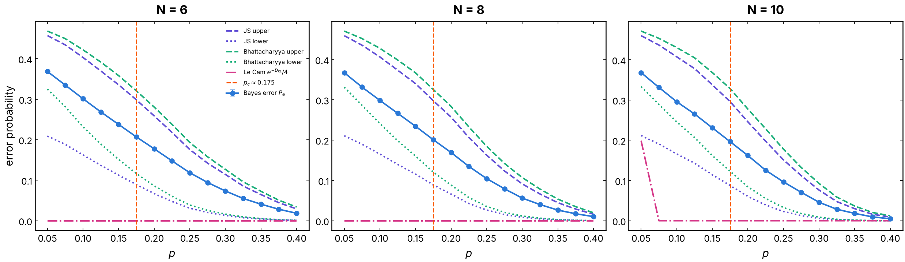

# KL divergence of the conditional record laws `P(M | Q)`: why the Bayes accuracy takes off

Issue #270. In the charge-learning setup of Barratt et al., PRL 129, 200602
(2022) ([`learnability/`](../learnability/README.md)), an observer reads the
measurement record `M` of a monitored U(1) brickwork and guesses which of two
charges `Q+` or `Q-` the chain started in. No classifier can do better than
the two conditional laws `P+(M) = P(M | Q+)` and `P-(M) = P(M | Q-)` allow:
the Bayes accuracy (the "blue curve") is fixed by how far apart they are.
This experiment measures that distance against the measurement probability
`p`: the Kullback-Leibler (KL) divergence asked for in the issue, and the
bounded distances that turn out to be the right order parameters (Jensen-Shannon,
i.e. the mutual information `I(Q; M)`, and the Bayes error itself).

## Experiment overview

| | |
| --- | --- |
| Script(s) | `experiments/kl_divergence/kl_divergence.py`, launcher `kl_divergence.sh`, figures `plot_kl_divergence.py` |
| Notebook | `notebooks/results/09_kl_divergence.ipynb` |
| Config | `conf/kl_divergence.yaml` |
| Library | `QELM.evaluation.kl_divergence` (on top of `QELM.evaluation.learnability`) |
| Physical model | open chain of `N` qubits, brickwork of random U(1) two-qubit gates (Haar on `{01, 10}`, random phases on `00`, `11`), `T = N` time steps of an even then an odd layer |
| System sizes `N` | 6, 8, 10 (no ancilla) |
| Control parameter | probability `p` of measuring each site in Z after each layer (`2 T` rounds), 0.05 to 0.40 by 0.025 |
| Initial state | uniform superposition of the bitstrings of charge `Q+ = N // 2` or `Q- = N // 2 - 1` |
| Task | distance between `P(M \| Q+)` and `P(M \| Q-)`, and the Bayes error of guessing `Q` from `M` |
| Observers | gates unknown (Eve of Barratt et al., likelihood averaged over the Haar gates: the blue curve); gates known (likelihood of the actual circuit, `N_c = 20` circuits) |
| Issues / PRs | #270 (builds on #113, #115) |

## Methodology

The sum over the `3^(2TN)` records is out of reach, so every divergence is a
Monte Carlo average over records drawn with their Born probability, through
the log-likelihood ratio of each record, `l(M) = ln P+(M) / P-(M)`.

1. **Gates unknown.** `L = 8000` records per `(N, p)`, each from a fresh
   circuit, half at each charge (`QELM.evaluation.learnability.sample_records`;
   a fresh circuit per record is an exact sample of the Haar-averaged law).
   `P(M | Q)` is the Haar-averaged law, a classical symmetric exclusion
   process evolved exactly on the `2^N` configurations
   (`sep_log_likelihood_ratio`).
2. **Gates known.** `N_c = 20` circuits per `(N, p)` (`draw_circuit`), 1000
   records each, drawn by the Born rule from that fixed circuit
   (`sample_circuit_records`). `P(M | Q, U)` is the squared norm of the state
   vector projected along the record (`circuit_log_likelihood`). Every
   statistic is computed per circuit, then averaged; the spread between
   circuits is shaded in the figures.
3. **Statistics** (`divergence_statistics`), from the records of `P+` and of
   `P-`, with their Monte Carlo errors:
   - `D(P+ || P-) = E_{P+}[l]`, `D(P- || P+)`, and the Jeffreys distance
     `D_sym`, their mean (the symmetrized KL of the issue);
   - **infinite mass** `pi_inf = P+(l = +inf)` (mean of both directions), and
     the **finite part** of the KL: the KL between the two laws restricted to
     the records that both allow, renormalized;
   - **Jensen-Shannon** `JS = I(Q; M)`, the mutual information with a flat
     prior, in bits (0 to 1). It is the order parameter of Fig. 2c of Barratt
     et al.: `E[H(P(Q | M))] = 1 bit - I(Q; M)` (checked in the tests);
   - Bhattacharyya coefficient `BC`, Bayes error
     `P_e = (1/2) sum min(P+, P-)`, Bayes accuracy `1 - P_e` (the blue curve;
     its empirical version, the 0/1 accuracy of Fig. 2b, agrees within the
     errors);
   - bounds on `P_e`: Bretagnolle-Huber / Le Cam `exp(-D_KL) / 4`, Lin's JS
     bounds `(1/4)(1 - JS)^2 <= P_e <= (1/2)(1 - JS)` and the Bhattacharyya
     bounds `(1 - sqrt(1 - BC^2)) / 2 <= P_e <= BC / 2`.
4. **Finite size.** For every `p`, the fit `I(Q; M) ~ 2^(-alpha N)` over
   `N = 6, 8, 10`; above `p_c`, the fit `D_sym ~ (p - p_c)^beta` for every
   `N`.

The estimators are checked in `tests/test_kl_divergence.py` against the exact
sums over all `3^8` records of `N = 4, T = 1` (both observers), against closed
forms for Gaussian laws, and the Haar average of `P(M | Q, U)` against the
exclusion process.

How to run it: [`experiments/README.md`, "Run the KL divergence of the
conditional record laws"](../README.md#run-the-kl-divergence-of-the-conditional-record-laws-issue-270).
The full sweep takes about 25 min on 4 cores (most of it at `N = 10`).

## Results and discussion

Sweep of this PR: `N = 6, 8, 10`, seed 0, 15 values of `p`, `L = 8000`
records (gates unknown) and `N_c = 20` circuits of 1000 records (gates known)
per point.

- **The KL divergence is infinite at every `p > 0`.** A record whose
  measurements, within one round, find more particles than `Q-` holds (or
  more holes than `N - Q+`) is impossible under `Q-`, so `l(M) = +inf` and
  `D(P+ || P-) = +inf`, at any `p > 0` and for both observers. The Le Cam
  bound `P_e >= exp(-D_KL) / 4` of the issue is therefore 0 and says nothing.
  The KL splits into two finite pieces:
  - the **infinite mass** `pi_inf`, the probability that a record gives the
    charge for certain, which needs about `N / 2` sites measured in one round.
    It is small at small `p` and falls with `N` (at `p = 0.05`:
    `7e-3, 1.2e-3, 3e-4` for `N = 6, 8, 10`), crosses near `p ~ 0.28 - 0.30`
    and dominates at large `p` (0.95 at `p = 0.4`, `N = 10`). At `N = 10`,
    `p = 0.05`, no impossible record was drawn in one direction, so the
    sampled KL looks finite there (and the Le Cam line of Fig. 3 is
    nonzero): a Monte Carlo average cannot see a mass below `1 / L`;
  - the **finite part**, which is not small below `p_c`: `D_sym` = 0.24 nats
    at `p = 0.05` for every `N`, and it grows smoothly with `p` and with `N`
    through `p_c` (1.18 nats at `p_c`, `N = 10`).
- **No plateau at 50 % below `p_c` at these sizes.** The Bayes accuracy of
  the observer who does not know the gates is already 0.63 at `p = 0.05`
  (0.6314, 0.6326, 0.6319 for `N = 6, 8, 10`) and rises smoothly to 0.995 at
  `p = 0.4`. Correspondingly `I(Q; M) = 0.08` bit, not 0, at `p = 0.05`. The
  expected picture (`D_KL = 0`, accuracy 0.5 for `p < p_c`) is an
  `N -> infinity` statement; at `N <= 10` the distributions are not
  indiscernible below `p_c`.
- **The transition is in the finite-size drift of `I(Q; M)`.** The mutual
  information decreases with `N` below a crossing and increases above it
  (Fig. 2a, c): the fitted rate `alpha` of `I ~ 2^(-alpha N)` is positive
  (0.013 to 0.025) for `p <= 0.125`, changes sign between `p = 0.15`
  (`+0.005 +- 0.010`) and `0.175` (`-0.004 +- 0.001`), and is negative above.
  So the size-crossing of the information sits at **`p ~ 0.17`**, the
  `p_c ~ 0.17 - 0.18` of the issue and, since `I = 1 - E[H]`, the same
  crossing as the mean entropy of Barratt et al.'s Fig. 2c
  (`p_success ~ 0.2`, issue #115). The decay below `p_c` is slow,
  `alpha ~ 0.02` bit per qubit: chance level (0.5) would need hundreds of
  qubits.
- **Knowing the gates helps, and moves the crossing down.** The observer who
  knows the circuit always has more information (`I(Q; M | U) >= I(Q; M)`,
  checked exactly in the tests): accuracy 0.67 at `p = 0.05`, 0.89 at `p_c`
  (`N = 10`), and a finite Jeffreys distance 2.5 times larger. Its `alpha`
  changes sign at `p ~ 0.10`, below the crossing of the Haar-averaged
  observer: knowing the circuit lets the observer learn the charge from a
  lower measurement rate, as expected from Barratt et al. (charge sharpening
  vs. learnability by a classical decoder). The spread between the 20
  circuits is small (std of `I` about 0.02 bit).
- **No clean power law above `p_c`.** The fit `D_sym ~ (p - p_c)^beta` gives
  `beta = 0.19, 0.28, 0.39` for `N = 6, 8, 10`, drifting with `N`, and the
  points curve on the log-log plot: the finite KL is smooth through `p_c`,
  not an order parameter with a singular onset at these sizes.
- **Bounds.** The JS and Bhattacharyya bounds bracket the Bayes error at
  every `p` (Fig. 3), within about 0.1 at `p_c`; they are the useful
  information-theoretic statements, not the KL.

**Synthesis: why the Bayes accuracy takes off at `p_c`.** The accuracy of
any decoder is `1 - P_e`, and `P_e` is a functional of the overlap of the two
record laws, sandwiched by `I(Q; M)`. What changes at `p_c` is not that a KL
divergence jumps from 0 to infinity (it is infinite on both sides, from rare
records that measure half the chain at once), but the direction in which the
information carried by the record flows with system size: below `p_c` the
scrambling dynamics hides the charge a little better for every added qubit
(`I` decays with `N`), above `p_c` the measurements reveal it a little better
(`I` grows with `N`, and the fraction of records that pin `Q` exactly,
`pi_inf`, takes over). In the thermodynamic limit this drift becomes the
transition between indiscernible laws (`I -> 0`, accuracy 1/2) and separated
ones (`I -> 1` bit, accuracy 1). At `N <= 10` the drift is weak (a few
hundredths of a bit per qubit), so the blue curve is smooth; the transition
shows in the crossing of the curves of different `N`, at `p ~ 0.17` for the
observer who does not know the gates.

Caveats: one seed, `N <= 10` (exact exclusion process on `2^N` states; the
cluster can take `N = 12, 14` with the same launcher), `T = N`, open
boundaries. `p_c = 0.175` in the figures is the value of the issue, drawn as a
reference, not fitted.

## Local encoding: a reference qubit on the middle site (validation, `N = 6, 8`)

Does the infinite mass come from the global target? The same diagnostic
with a local target (`kl.encoding=local`, `ENCODING=local` in the launcher):
a reference qubit `R` in a Bell pair with site `N // 2` of the Néel state
`|0101...>` (Gullans and Huse). `R` is never touched, so its final Z outcome
`r` is its initial one; given `r`, the chain starts in the Néel state with
the middle site set to `r` (`hypothesis_states`). Both gate sets were run
(`kl.gates`): the U(1) gates above, and Haar U(4) gates, which conserve
nothing (`GATES=u4`). For the observer who does not know the gates, the
average over U(4) gates is exact as well: each gate leaves the pair in the
maximally mixed state (`averaged_log_likelihood`). Sweep: `N = 6, 8`,
`p = 0.05` to `0.40` by 0.05, seed 0, `L = 8000`, `N_c = 20` circuits of
1000 records.

- **With U(1) gates, `pi_inf` does not collapse.** The two branches still
  differ by one particle (the Néel state with the middle site 0 or 1), so a
  record that counts the particles of a round is again impossible under one
  branch: `pi_inf = 0.03` to `0.95` (`N = 8`, `p = 0.05` to `0.4`), the same
  as for the charge. The KL stays infinite. `I(r; M)` grows with `N` at every
  `p` of the sweep (`alpha < 0`), with no crossing.
- **With Haar U(4) gates, `pi_inf = 0` exactly and the KL is finite**, both
  ways and for every circuit: no record is impossible when no charge is
  conserved. The Le Cam bound is no longer trivial (0.10 to 0.22, below the
  Bayes error 0.25 to 0.41). This is the clean setting for an
  information-theoretic statement, with two caveats:
  - the observer who does not know the gates learns **nothing**
    (`I = 0`, accuracy 0.5 at every `p`): averaged over Haar U(4) gates, the
    first gate on the middle site forgets which branch it started in, so the
    two averaged laws are identical. Only the observer who knows the circuit
    learns `r`;
  - the label is the **Z outcome** of `R`. Once the record purifies `R`, its
    Bloch vector points in a random direction, and `Z` is guessed right with
    probability `(1 + |z|) / 2`, 3/4 on average for a uniform direction. The
    Bayes accuracy indeed saturates at 0.75 (0.754 at `p = 0.4`, `N = 6`)
    and `I(r; M)` at 0.28 bit, far from 1 bit: the KL of the Z label
    measures purification only partly. The full purification is `S_R`
    (`experiments/haar_readouts/`).
  - The finite KL `D(P_0 || P_1)` of the observer who knows the circuit
    grows smoothly from 0.14 to 1.03 nats (`N = 8`). `I(r; M)` for
    `N = 6, 8` crosses near `p ~ 0.15`, close to the Haar MIPT
    (`p_c ~ 0.17`), but with two sizes and an error of about 0.01 bit the
    crossing is not resolved: `N = 10, 12` are needed (cluster).

**Figure 4. Local encoding, U(1) gates.** As Figure 1, the label being the Z
outcome of the reference qubit paired with the middle site. The infinite mass
(pink) is as large as for the charge. Produced by
`ENCODING=local GATES=u1 N_VALUES="6 8" ./experiments/kl_divergence/kl_divergence.sh`.

**Figure 5. Local encoding, Haar U(4) gates.** As Figure 1. Blue: the
observer who does not know the gates stays at 0.5. Orange: the observer who
knows the circuit, saturating at 3/4; bottom, its finite Jeffreys distance
(green) and `I(r; M)` (purple); `pi_inf = 0`, hence not drawn. Shaded: spread
between the 20 circuits.

**Figure 6. Local encoding, Haar U(4) gates, finite size.** As Figure 2 for
the observer who knows the circuit: `I(r; M)` for `N = 6, 8` (a), `pi_inf = 0`
(b), the rate `alpha` from two sizes only (c), and the finite Jeffreys
distance against `p - p_c` (d).

## Figures

**Figure 1. Bayes accuracy and the divergences that drive it.** One column
per `N`. Top: Bayes accuracy `1 - P_e` against `p`, blue for the observer who
does not know the gates (the blue curve), orange dashed for the one who knows
them (mean over 20 circuits, spread shaded); the dotted line is chance. Bottom,
log scale: finite part of the Jeffreys distance `D_sym` (nats, green),
`I(Q; M)` (bits, purple) and the infinite mass `pi_inf` (pink); solid: gates
unknown, dashed: gates known. Error bars: Monte Carlo errors (gates unknown),
error of the mean over circuits (gates known), mostly smaller than the
markers. Orange dashed line: `p_c = 0.175`. The accuracy is far from 0.5 below
`p_c` and every divergence is smooth through it. Produced by
`experiments/kl_divergence/plot_kl_divergence.py` (issue #270).

**Figure 2. Finite-size analysis.** (a) `I(Q; M)` against `p` for
`N = 6, 8, 10` (solid: gates unknown, dashed: gates known): the curves of the
Haar-averaged observer cross near `p ~ 0.17`. (b) Infinite mass `pi_inf`,
which falls with `N` at small `p` and crosses near `p ~ 0.28`. (c) Rate
`alpha` of the fit `I ~ 2^(-alpha N)` over the three sizes, with its fit error:
positive (information hidden as `N` grows) below `p ~ 0.17` for the observer
who does not know the gates and below `p ~ 0.10` for the one who knows them.
(d) Finite `D_sym` against `p - p_c`, log-log, with the fits
`D_sym ~ (p - p_c)^beta`: `beta` drifts with `N` (0.19, 0.28, 0.39). Produced
by `experiments/kl_divergence/plot_kl_divergence.py` (issue #270).

**Figure 3. Bayes error and its information-theoretic bounds.** One panel per
`N`, observer who does not know the gates. Blue: Bayes error `P_e`. Purple:
Lin's bounds from Jensen-Shannon; green: bounds from the Bhattacharyya
coefficient (dashed upper, dotted lower). Pink: Le Cam / Bretagnolle-Huber
bound `exp(-D_KL) / 4`, 0 since `D_KL = +inf` (at `N = 10`, `p = 0.05` the
8000 records drew no impossible record in one direction, so the sampled KL is
finite there). Produced by `experiments/kl_divergence/plot_kl_divergence.py`
(issue #270).
