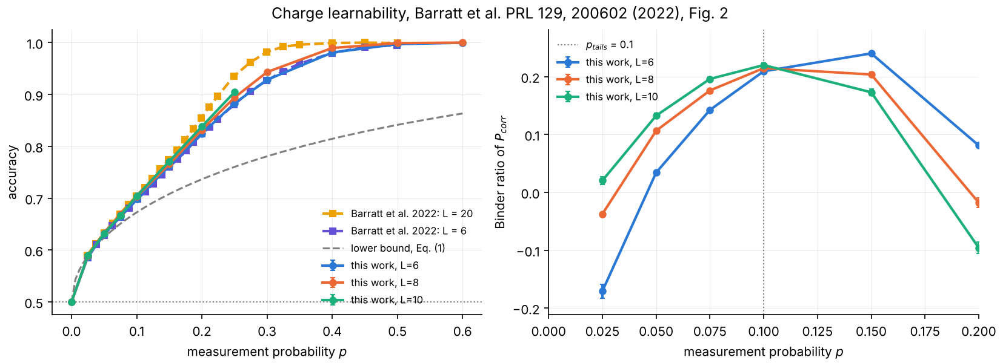
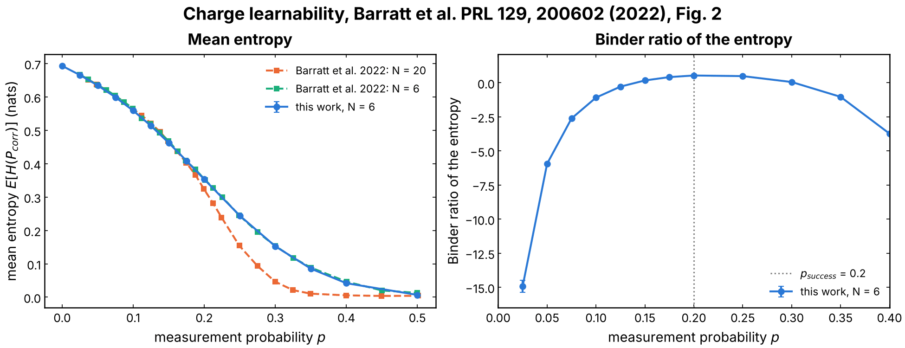
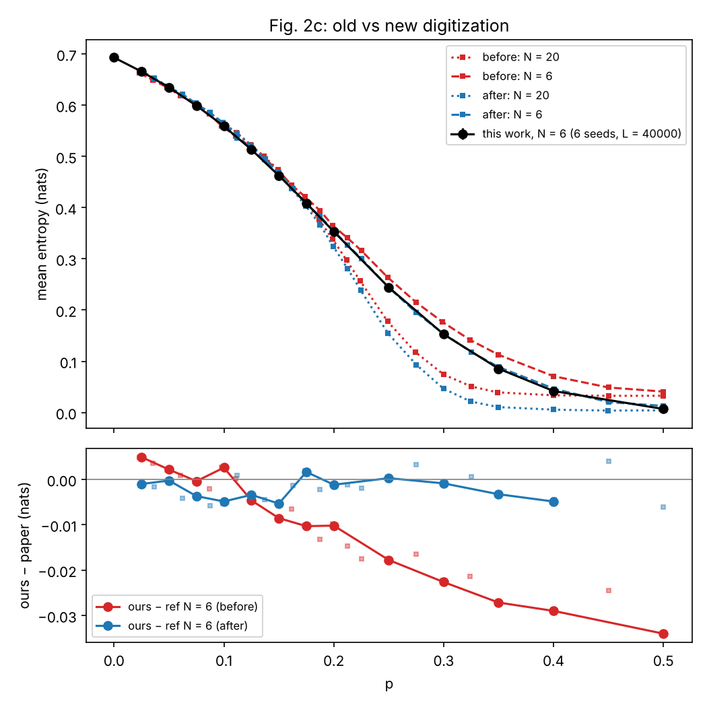

# Charge learnability: benchmark against Barratt et al. (2022)

The second test of the library on a published result, and the reference of
the charge-learning task: Fig. 2 of Barratt, Agrawal, Potter,
Gopalakrishnan and Vasseur, "Transitions in the learnability of global
charges from local measurements", PRL 129, 200602 (2022). An observer
("Eve") sees the measurement record of a monitored U(1) circuit and, with
the optimal Bayesian decoder, guesses which of two charges the chain started
in. Her accuracy and the statistics of her posterior show two transitions,
`p_tails ~ 0.1` and `p_success ~ 0.2`. This optimal decoder is the ceiling
against which the QELM readouts of [`QELM_Q`](../QELM_Q/README.md) are
compared (its scrambled limit is the Bayes-Ridge pipeline of issue #233).

## Experiment overview

| | |
| --- | --- |
| Script(s) | `experiments/learnability/learnability.py`, launcher `learnability.sh`, plot `plot_learnability.py` |
| Config | `conf/learnability.yaml`; simulation in `QELM.evaluation.learnability` |
| Physical model | random U(1) brickwork (`QELM.models.circuits`), a new circuit per record, chain of `L = N` qubits, no ancilla |
| System sizes `N` | 6, 8, 10 (the paper: 6 and 20) |
| Control parameters | measurement probability `p`, measured after each layer (`measure_every=layer`) for `t_f = L` steps |
| Initial state | uniform superposition of the bitstrings of charge `Q0 = L // 2` or `Q1 = L // 2 - 1`, half of the records each |
| ML task | Bayes posterior `P(Q | m)` from the Haar-averaged dynamics (a symmetric exclusion process); accuracy `P(P_corr > 1/2)` (a tie counts 1/2), Binder ratio of `P_corr`, mean binary entropy `H(P_corr)` (Fig. 2c) and its Binder ratio |
| Issues / PRs | #113, #115, #134, #151 |

## Methodology

1. Draw the charge, prepare the uniform superposition of that sector.
2. Evolve for `t_f = L` steps of a random U(1) brickwork. After each layer,
   measure every site in Z with probability `p` (Born rule). The paper does
   not say when within a step the sites are measured; measuring after each
   layer matches the digitized Fig. 2c within 0.02 nats, while measuring once
   per step learns the charge about twice too slowly in `p`.
3. Compute Eve's posterior `P_corr = P(Q* | m)` of the true charge with the
   symmetric exclusion process (she sees the record, not the gates).
4. Over `L = 40000` records per run (as in the paper), compute the accuracy,
   the Binder ratios and the mean entropy, compare with the digitized curves
   in [`reference/`](reference/README.md), and locate the crossings of the
   Binder curves of different sizes.

Exact limits tested: at `p = 0`, `P_corr = 1/2` and the accuracy is 1/2; at
`p = 1` the first record gives the charge. How to run it:
[experiments/README.md, "Run the charge-learnability benchmark"](../README.md#run-the-charge-learnability-benchmark-issue-113).
Notebooks: `notebooks/benchmarks/01_learnability_accuracy.ipynb`,
`02_learnability_entropy.ipynb`.

## Results and discussion

- **Fig. 2b reproduced.** At `L = 6` the accuracy deviates from the paper by
  0.002 RMS over 25 points (0.005 at most) (Figure 1, left).
- **`p_tails`.** The Binder ratios of `P_corr` for `L = 6, 8, 10` cross at
  `p = 0.106` to `0.107`, the `p_tails ~ 0.1` of the paper (Figure 1, right).
- **Fig. 2c and `p_success`.** The mean entropy `E[H(P_corr)]` goes from
  `ln 2` at `p = 0` to 0 at `p ~ 0.5`. After re-digitizing the paper's curve,
  the `N = 6` deviation is 0.003 nats RMS (0.006 at most) over 25 points, down
  from 0.016 with the first digitization (Figure 3). The Binder ratios of
  `H(P_corr)` cross at `p = 0.12` (6 against 8), `0.14` (6 against 10) and
  `0.18` (8 against 10): the crossing drifts upward with size, toward the
  `p_success ~ 0.2` of the paper.
- **Finite size.** At `L <= 10` the accuracy curves lie close together and
  below the paper's `L = 20` curve for `p >~ 0.2`: the sharpening of the
  transition needs larger systems than exact simulation reaches here.

## Figures

**Figure 1. Fig. 2b of Barratt et al. (2022), reproduced.** Left: accuracy of
the optimal decoder against `p`, this work for `L = 6, 8, 10` (circles, 40000
records, error bars from the bootstrap and seeds) over the paper's `L = 6`
and `L = 20` (squares) and the lower bound of their Eq. (1) (gray dashed).
Right: Binder ratio of `P_corr`, whose curves cross near `p_tails = 0.1`
(dotted line). Produced by `experiments/learnability/plot_learnability.py`
(issue #113).

**Figure 2. Fig. 2c, the success transition.** Left: mean binary entropy
`E[H(P_corr)]` (nats) against `p`, this work at `N = 6` (blue, 6 seeds,
40000 records) over the paper's `N = 6` (green) and `N = 20` (orange,
re-digitized curves). Right: Binder ratio of `H(P_corr)` at `N = 6`, maximal
near `p_success = 0.2` (dotted). The crossings of several sizes quoted above
come from the `N = 6, 8, 10` sweep of issue #115. Produced by
`experiments/learnability/plot_learnability.py` (issues #115, #151).

**Figure 3. Calibration of the digitized reference.** Top: mean entropy at
`N = 6` (black, 6 seeds, 40000 records) against the first (red) and the
re-digitized (blue) curves of the paper, `N = 6` (dashed) and `N = 20`
(dotted). Bottom: our curve minus the paper's `N = 6`, before and after. The
deviation that grew to -0.034 nats at `p = 0.5` was an error of the
digitization, not of the simulation. Produced for the calibration of
`reference/barratt2022_fig2c_entropy.csv`.
