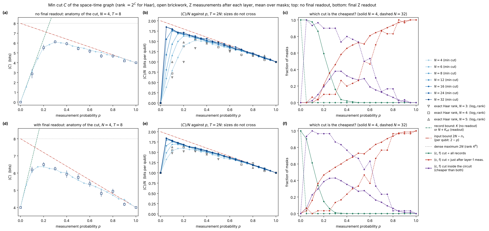
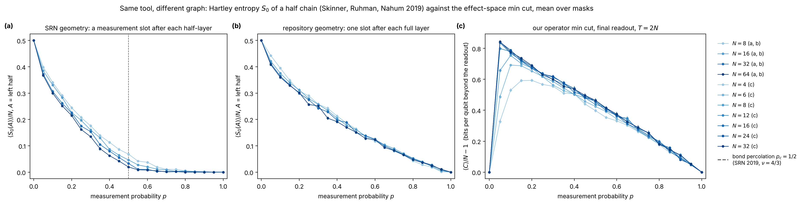

# Min cut and rank of the effect space, step by step

Pedagogical figures (issue #383), with small sizes only: before running large
campaigns, see how the bound `rank(E) <= 2^C` works, qubit by qubit and layer by
layer. Here `C` is the minimum cut between the input and the records (#321,
#362). The figures also relate this cut to the min cut of the Hartley entropy
`S_0` in Skinner, Ruhman, Nahum, PRX 9, 031009 (2019), arXiv:1808.05953 (SRN).
The French legends of the figures are in [`legendes.md`](legendes.md).

## Experiment overview

| | |
| --- | --- |
| Scripts | `fig_circuits.py` (drawings), `data.py` (curves), `fig_curves.py` (figures 3 and 4), `draw.py` (drawing helper), `ecircuit_data.py` and `fig_ecircuit.py` (figure 5) |
| Library | `QELM.evaluation.mincut_graph` (new: graph with or without final readout, causal pruning, partition, SRN `S_0`), `QELM.evaluation.r2_budget.effect_basis` (exact rank) |
| Physical model | open brickwork, one layer = even bonds, then odd bonds, then `Z` measurements with probability `p`; with or without the final `Z` readout of every site |
| Sizes | drawings `N = 4` (`T = 8` without readout, `T = 4` with readout); min cut `N = 4` to 32, `T = 2N`; exact Haar rank `N = 3, 4, 5`, `T = 2N`; `S_0`: `N = 8` to 64 |
| Sampling | min cut: 300 masks per `p` at `N = 4, 6`, down to 30 at `N = 32`; exact rank: 16 circuits per `p` (8 at `N = 5`); `S_0`: 200 to 16 masks |
| Cost | about 3 minutes on one core (`data.py`), a few seconds for each figure script |

## Methodology

**Graph and costs.** A free wire costs 2 bits (`{I, X, Y, Z}`). A wire that
enters a `Z` measurement, or leaves it until the next gate, costs 1 (`{I, Z}`).
A record bit costs 1, and so does the final readout of a site. The max flow from
the input to the records gives `C` (scipy). The minimal source side, read from
the residual graph, gives the cut that the figures draw.

**Causal pruning (new rule).** Without the final readout, the wires are traced
out at the end. A gate whose outputs are all traced is the identity
(`U^dagger I U = I`). The graph is therefore restricted to the causal past of the
records. With the final readout this changes nothing, and `mincut` equals
`effect_rank.mincut_bits` (tested).

**Exact rank.** The dimension of the span of the effects is computed by the
backward recursion `r2_budget.effect_basis(circuit, final=...)`.

**`S_0` of SRN.** This is the state network, not the operator one: each wire
costs 1, a measurement breaks the wire (cost 0), and the cut separates the top
legs of the left half from those of the right half. Two geometries are used: a
measurement slot after each half-layer (SRN, bond percolation `p_c = 1/2`), or
after each full layer (repository).

## Results and discussion

- **Rules confirmed:** costs 2 and 1. Without readout, `C = 0` at `p = 0`.
  Every single click gives rank 2 and every pair gives rank 4 (all 32 positions
  and 496 pairs at `N = 4`, `T = 8`). Zeno, `p = 1`: `C = 2N - n_1 = N`, with
  the cut just after the first layer of measurements (`2N` at the input).
- **`C = K` for `K < 2N` is false.** Only `C <= K` holds. Three clicks, q0 and
  q1 at layer `t` then q0 at `t + 1`, give `C = 2` and rank 4: the third click
  copies a bit that is already classical (14 of the 4 960 triples at `N = 4`,
  `T = 8`).
- **`2^C` against `2^C - 1`.** The dense rank is `2^C`. `2^C - 1` is the same
  count without the constant (the intercept). The 31 and 63 plateaus of #362
  come from the circuit with a final readout, `T = N = 4`, where `C` starts at
  `N`: 63 needs only two useful measurements. At `C = 7` the XZ count is 71 or
  80 (`3^4 - 1`), not 127.
- **Equality `rank = 2^C` (Haar).** With a final readout it holds in all 440
  cases of figure 3, in every test, and in the 4 386 cases of #321 and #362.
  Without a final readout, `rank <= 2^C` always holds, but the bound is missed
  for 1 of the 440 cases of figure 3, about 1 % of masks at `T = 2N` and 3.5 %
  at `T = N` (`N = 4`, 400 masks each), and 12 of 512 masks exhaustively at
  `N = 3`, `T = 3`. The missed ranks are not powers of 2 (60 against 64, 12
  against 16), and every such mask has measurements in the last measured layer.
- **General case.** `C` first follows the record bound, then the input bound
  `2 - p` bits per qubit. The peak moves towards `p = 0` as `N` grows (`p*` =
  0.30, 0.15, 0.05 for `N` = 4, 8, 32 without readout), and the sizes do not
  cross. At `N = 32` the cheapest cut runs inside the circuit for almost every
  mask between `p = 0.05` and 0.5.
- **SRN.** In their geometry, `S_0 / N` vanishes near `p = 1/2`, which checks
  the code. In the geometry of the repository, `S_0` stays volume-law until `p`
  close to 1 at these sizes, because the bonds between the two half-layers are
  never broken. Our rank is the Renyi-0 analogue for the QELM: a geometric
  count with no finite `p_c`, while the MIPT must appear in Born-weighted
  quantities (note #319).

## Figures

**Figure 1. Min cut drawn on the circuit, `N = 4`, `T = 8`, no final readout.**
Red crosses: cut edges, with their cost. Blue gates: input side. Each title
gives `C` and the exact Haar rank.

**Figure 2. Same with the final readout, `N = 4`, `T = 4`.** Under each panel:
the XZ rank without the constant.

**Figure 3. Mean min cut against `p`, `T = 2N`.** Top: no final readout.
Bottom: final readout. (a, d) `N = 4` with the record and input bounds and the
exact ranks. (b, e) `C / N` for `N = 4` to 32. (c, f) Fraction of masks where
the cut goes through every record, just after the first layer of measurements,
or inside the circuit.

**Figure 4. `S_0` of a half chain by min cut (SRN), in their geometry (a) and in
the geometry of the repository (b), against our cut (c).**

## E_circuit level by level of C

`ecircuit_data.py` computes the circuit error `E_circuit = 1 - R^2(inf)` of the
population ridge of #360 for Haar circuits, flat (isotropic) targets and 40
targets per circuit, in two settings. Setting 1: final readout, XZ inputs,
`T = N` (as in #362). Setting 2: no final readout, dense inputs, `T = 2N` (as in
#363). Sizes `N = 3, 4, 5`, with 40 circuits per `p` (16 at `N = 5`), `p` from 0
to 0.5.

**Prediction.** For an isotropic target, `E[R^2(inf)] = d / M`, where `d` is the
dimension of the span seen by the inputs, without the constant, and `M` is the
number of visible non-constant modes (`3^N - 1` in XZ, `4^N - 1` in dense). Since
`d = 2^C - 1` when the rank is `2^C`, we get
`E_circuit = 1 - (2^C - 1) / M`, and in dense `log2 R^2(inf) ≈ C - 2N`: each bit
missing from the cut halves `R^2(inf)`.

- **Dense, no final readout: the prediction holds level by level.** The mean
  over each level is within 0.005 of `1 - (2^C - 1)/(4^N - 1)` (`N = 4, 5`), with
  a spread over circuits of at most 0.006. At `N = 3` the spread reaches 0.02,
  and a few masks fall below `2^C` (rank 12 against 16, or 24 against 32).
- **XZ, final readout: the levels are sharp until the XZ truncation.** At
  `N = 4`, the levels `C = 4, 5, 6` give 0.813, 0.611 and 0.213 against 0.812,
  0.613 and 0.213 (spread at most 0.012). At `C = 7` the level splits into
  `d = 71` or 80 (`3^4 - 1`), so `E_circuit` is 0.11 or 0. At `N = 5` the split
  already starts at `C = 7` (`d = 95` or 127).
- **Mean against `p`.** In dense, the mean of `1 - (2^C - 1)/M` over the masks
  matches the mean `E_circuit(p)` within 0.003 at every `p`, so the `p`
  dependence of `E_circuit` is the distribution of `C` over the masks. In XZ,
  the gap reaches 0.07, and all of it comes from the truncated top levels,
  where the prediction gives 0 but `d = 71` gives 0.11.

**Figure 5. E_circuit against the min cut.** Top: final readout, XZ inputs,
`T = N`. Bottom: no final readout, dense inputs, `T = 2N`. (a, d) One dot per
circuit (mean over 40 targets), with the sizes slightly shifted. Red bars:
`1 - (2^C - 1)/M`. (b, e) Mean over circuits against `p` (dots, standard error)
and mean of the prediction (lines). (c, f) `log2 R^2(inf)` against the predicted
value; dashed line: equality.

The derivation of the prediction, with its hypotheses and limits, is in
[`documentation/notes/ecircuit-coupe-minimale.md`](../../documentation/notes/ecircuit-coupe-minimale.md)
(in French).

The JSON next to the figures holds the plotted values
(`ecircuit_vs_mincut_summary.json`: count, mean, spread, prediction and
observed visible ranks per `N` and `C`).
