# Min cut and rank of the effect space, step by step

Pedagogical figures (issue #383), with small sizes only: before running large
campaigns, see how the bound `rank(E) <= 2^C` works, qubit by qubit and layer by
layer. Here `C` is the minimum cut between the input and the records (#321,
#362). The figures also relate this cut to the min cut of the Hartley entropy
`S_0` in Skinner, Ruhman, Nahum, PRX 9, 031009 (2019), arXiv:1808.05953 (SRN).
The French legends of the figures are in [`legendes.md`](legendes.md).

## Experiment overview

| | |
| --- | --- |
| Scripts | `fig_circuits.py` (drawings), `data.py` (curves), `fig_curves.py` (figures 3 and 4), `draw.py` (drawing helper), `ecircuit_data.py` and `fig_ecircuit.py` (figure 5), `rank_data.py` and `fig_mirror.py` (the two summary figures), `haar_dense_data.py`, `fig_haar_dense.py` and `fig_weight_profile.py` (Haar dense, `N = 4, 5, 6`), `sk_profile_data.py` and `fig_sk_profile.py` (profile of `S_k`, #388), `fig_trace_pi.py` (trace and shape of `Pi`), `fig_overlap.py` (spectral overlap), `fig_priors.py` (flat and iid targets) |
| Library | `QELM.evaluation.mincut_graph` (new: graph with or without final readout, causal pruning, partition, SRN `S_0`), `QELM.evaluation.r2_budget.effect_basis` (exact rank) |
| Physical model | open brickwork, one layer = even bonds, then odd bonds, then `Z` measurements with probability `p`; with or without the final `Z` readout of every site |
| Sizes | drawings `N = 4` (`T = 8` without readout, `T = 4` with readout); min cut `N = 4` to 32, `T = 2N`; exact Haar rank `N = 3, 4, 5`, `T = 2N`; `S_0`: `N = 8` to 64 |
| Sampling | min cut: 300 masks per `p` at `N = 4, 6`, down to 30 at `N = 32`; exact rank: 16 circuits per `p` (8 at `N = 5`); `S_0`: 200 to 16 masks |
| Cost | about 3 minutes on one core (`data.py`), a few seconds for each figure script |

## Methodology

**Graph and costs.** A free wire costs 2 bits (`{I, X, Y, Z}`). A wire that
enters a `Z` measurement, or leaves it until the next gate, costs 1 (`{I, Z}`).
A record bit costs 1, and so does the final readout of a site. The max flow from
the input to the records gives `C` (scipy). The minimal source side, read from
the residual graph, gives the cut that the figures draw.

**Causal pruning (new rule).** Without the final readout, the wires are traced
out at the end. A gate whose outputs are all traced is the identity
(`U^dagger I U = I`). The graph is therefore restricted to the causal past of the
records. With the final readout this changes nothing, and `mincut` equals
`effect_rank.mincut_bits` (tested).

**Exact rank.** The dimension of the span of the effects is computed by the
backward recursion `r2_budget.effect_basis(circuit, final=...)`.

**`S_0` of SRN.** This is the state network, not the operator one: each wire
costs 1, a measurement breaks the wire (cost 0), and the cut separates the top
legs of the left half from those of the right half. Two geometries are used: a
measurement slot after each half-layer (SRN, bond percolation `p_c = 1/2`), or
after each full layer (repository).

## Results and discussion

- **Rules confirmed:** costs 2 and 1. Without readout, `C = 0` at `p = 0`.
  Every single click gives rank 2 and every pair gives rank 4 (all 32 positions
  and 496 pairs at `N = 4`, `T = 8`). Zeno, `p = 1`: `C = 2N - n_1 = N`, with
  the cut just after the first layer of measurements (`2N` at the input).
- **`C = K` for `K < 2N` is false.** Only `C <= K` holds. Three clicks, q0 and
  q1 at layer `t` then q0 at `t + 1`, give `C = 2` and rank 4: the third click
  copies a bit that is already classical (14 of the 4 960 triples at `N = 4`,
  `T = 8`).
- **`2^C` against `2^C - 1`.** The dense rank is `2^C`. `2^C - 1` is the same
  count without the constant (the intercept). The 31 and 63 plateaus of #362
  come from the circuit with a final readout, `T = N = 4`, where `C` starts at
  `N`: 63 needs only two useful measurements. At `C = 7` the XZ count is 71 or
  80 (`3^4 - 1`), not 127.
- **Equality `rank = 2^C` (Haar).** With a final readout it holds in all 440
  cases of figure 3, in every test, and in the 4 386 cases of #321 and #362.
  Without a final readout, `rank <= 2^C` always holds, but the bound is missed
  for 1 of the 440 cases of figure 3, about 1 % of masks at `T = 2N` and 3.5 %
  at `T = N` (`N = 4`, 400 masks each), and 12 of 512 masks exhaustively at
  `N = 3`, `T = 3`. The missed ranks are not powers of 2 (60 against 64, 12
  against 16), and every such mask has measurements in the last measured layer.
- **General case.** `C` first follows the record bound, then the input bound
  `2 - p` bits per qubit. The peak moves towards `p = 0` as `N` grows (`p*` =
  0.30, 0.15, 0.05 for `N` = 4, 8, 32 without readout), and the sizes do not
  cross. At `N = 32` the cheapest cut runs inside the circuit for almost every
  mask between `p = 0.05` and 0.5.
- **SRN.** In their geometry, `S_0 / N` vanishes near `p = 1/2`, which checks
  the code. In the geometry of the repository, `S_0` stays volume-law until `p`
  close to 1 at these sizes, because the bonds between the two half-layers are
  never broken. Our rank is the Renyi-0 analogue for the QELM: a geometric
  count with no finite `p_c`, while the MIPT must appear in Born-weighted
  quantities (note #319).

## Figures

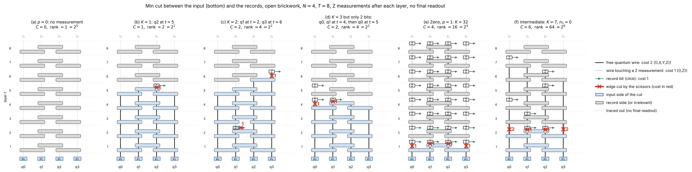

**Figure 1. Min cut drawn on the circuit, `N = 4`, `T = 8`, no final readout.**
Red crosses: cut edges, with their cost. Blue gates: input side. Each title
gives `C` and the exact Haar rank.

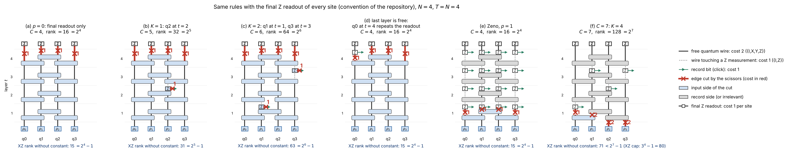

**Figure 2. Same with the final readout, `N = 4`, `T = 4`.** Under each panel:
the XZ rank without the constant.

**Figure 3. Mean min cut against `p`, `T = 2N`.** Top: no final readout.
Bottom: final readout. (a, d) `N = 4` with the record and input bounds and the
exact ranks. (b, e) `C / N` for `N = 4` to 32. (c, f) Fraction of masks where
the cut goes through every record, just after the first layer of measurements,
or inside the circuit.

**Figure 4. `S_0` of a half chain by min cut (SRN), in their geometry (a) and in
the geometry of the repository (b), against our cut (c).**

## E_circuit level by level of C

`ecircuit_data.py` computes the circuit error `E_circuit = 1 - R^2(inf)` of the
population ridge of #360 for Haar circuits, flat (isotropic) targets and 40
targets per circuit, in two settings. Setting 1: final readout, XZ inputs,
`T = N` (as in #362). Setting 2: no final readout, dense inputs, `T = 2N` (as in
#363). Sizes `N = 3, 4, 5`, with 40 circuits per `p` (16 at `N = 5`), `p` from 0
to 0.5.

**Prediction.** For an isotropic target, `E[R^2(inf)] = d / M`, where `d` is the
dimension of the span seen by the inputs, without the constant, and `M` is the
number of visible non-constant modes (`3^N - 1` in XZ, `4^N - 1` in dense). Since
`d = 2^C - 1` when the rank is `2^C`, we get
`E_circuit = 1 - (2^C - 1) / M`, and in dense `log2 R^2(inf) ≈ C - 2N`: each bit
missing from the cut halves `R^2(inf)`.

- **Dense, no final readout: the prediction holds level by level.** The mean
  over each level is within 0.005 of `1 - (2^C - 1)/(4^N - 1)` (`N = 4, 5`), with
  a spread over circuits of at most 0.006. At `N = 3` the spread reaches 0.02,
  and a few masks fall below `2^C` (rank 12 against 16, or 24 against 32).
- **XZ, final readout: the levels are sharp until the XZ truncation.** At
  `N = 4`, the levels `C = 4, 5, 6` give 0.813, 0.611 and 0.213 against 0.812,
  0.613 and 0.213 (spread at most 0.012). At `C = 7` the level splits into
  `d = 71` or 80 (`3^4 - 1`), so `E_circuit` is 0.11 or 0. At `N = 5` the split
  already starts at `C = 7` (`d = 95` or 127).
- **Mean against `p`.** In dense, the mean of `1 - (2^C - 1)/M` over the masks
  matches the mean `E_circuit(p)` within 0.003 at every `p`, so the `p`
  dependence of `E_circuit` is the distribution of `C` over the masks. In XZ,
  the gap reaches 0.07, and all of it comes from the truncated top levels,
  where the prediction gives 0 but `d = 71` gives 0.11.

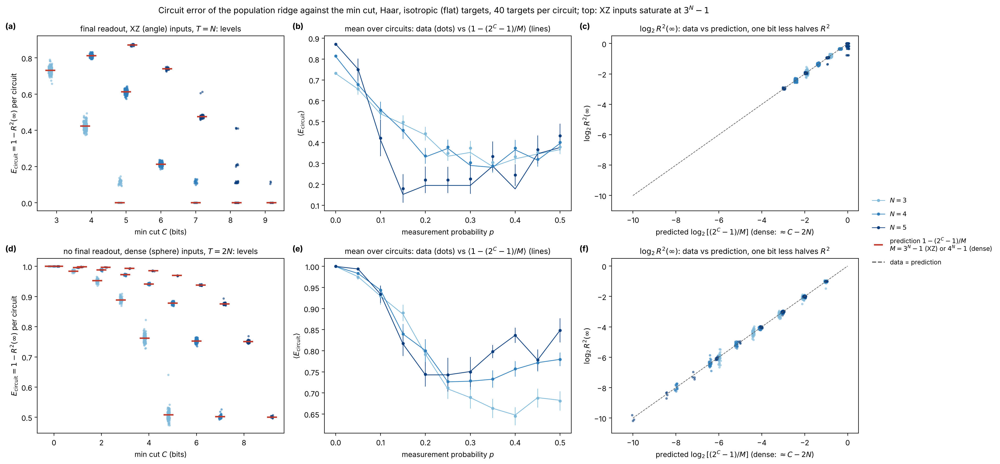

**Figure 5. E_circuit against the min cut.** Top: final readout, XZ inputs,
`T = N`. Bottom: no final readout, dense inputs, `T = 2N`. (a, d) One dot per
circuit (mean over 40 targets), with the sizes slightly shifted. Red bars:
`1 - (2^C - 1)/M`. (b, e) Mean over circuits against `p` (dots, standard error)
and mean of the prediction (lines). (c, f) `log2 R^2(inf)` against the predicted
value; dashed line: equality.

The derivation of the prediction, with its hypotheses and limits, is in
[`documentation/notes/ecircuit-coupe-minimale.md`](../../documentation/notes/ecircuit-coupe-minimale.md)
(in French).

The JSON next to the figures holds the plotted values
(`ecircuit_vs_mincut_summary.json`: count, mean, spread, prediction and
observed visible ranks per `N` and `C`).

## Two summary figures: geometry, then learning

`rank_data.py` computes the exact dense rank of Haar circuits and of Clifford
circuits on the same masks, with `C` and the two bounds. It covers `N = 3, 4, 5`,
`p = 0` to 1, 24 masks per point (10 at `N = 5`), in the two settings of
figure 5. `fig_mirror.py` draws the argument in two steps.

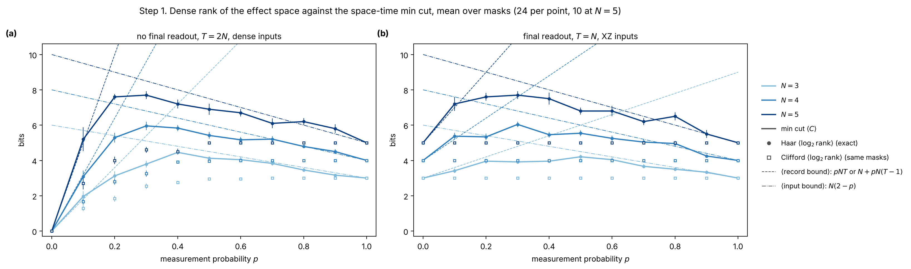

**Step 1. Dense rank against the min cut.** Solid lines: `⟨C⟩`. Dots: Haar
`⟨log2 rank⟩`. Open squares: Clifford on the same masks. Thin lines: expected
record bound (dashed) and input bound (dash-dot).
- Haar sits on `C` for 1 275 of the 1 276 circuits. The exception is one mask
  without final readout at `N = 4`.
- Clifford stays at `N` with a final readout. Without it, Clifford is at most
  `N` and below `N` at small `p`.

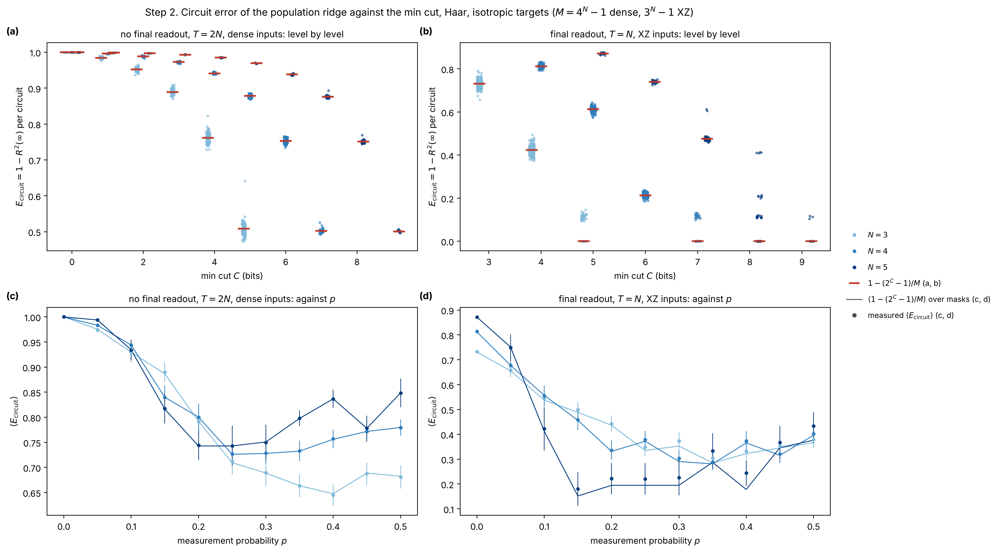

**Step 2. `E_circuit` against `C`.** Same data as figure 5: level by level (a, b)
and against `p` (c, d).

## Haar, dense inputs, no final readout, `N = 4, 5, 6`

This is the most general setting: no final readout, dense inputs, `T = 2N`,
and `p` from 0 to 1 in steps of 0.05. `haar_dense_data.py` uses 60, 40 and 30
circuits per point for `N = 4, 5, 6`, with 40 isotropic targets per circuit.
It also computes the min cut on 2 000 independent masks per point (about 10
minutes on 4 cores; the points are saved to `figures/haar_dense_data.json.parts/`
as they are done, and an interrupted run resumes from them; they are not committed).

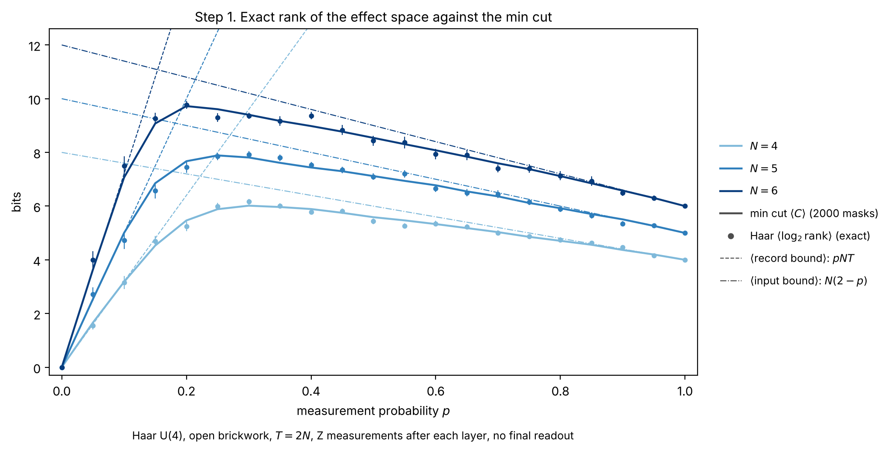

**Step 1. Exact `⟨log2 rank⟩` (dots) against `⟨C⟩` (lines, 2 000 masks) and the
two expected bounds.** The rank equals `2^C` for 1 256 of 1 260 circuits
(`N = 4`), 839 of 840 (`N = 5`) and 629 of 630 (`N = 6`).

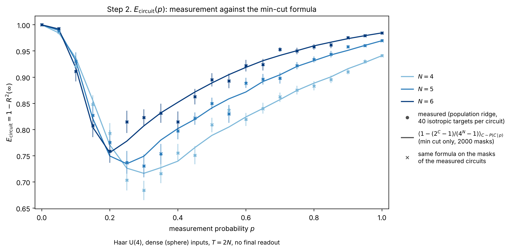

**Step 2. Measured `E_circuit(p)` (dots, standard error over circuits) against
`⟨1 - (2^C - 1)/(4^N - 1)⟩` over `P(C | p)`.** The lines use the min cut alone,
on 2 000 masks. The crosses use the same formula on the masks of the measured
circuits. The crosses lie on the dots to within 0.001 at every `p` and `N`. The
gap to the lines, at most 0.037, is the sampling of the 30 to 60 masks per
point. 4 of the 63 points lie beyond two standard errors (at most 3.5), slightly
more than Gaussian sampling gives, since the distribution of `C` over masks is
discrete and skewed. The crosses show that the formula itself holds to 0.001.

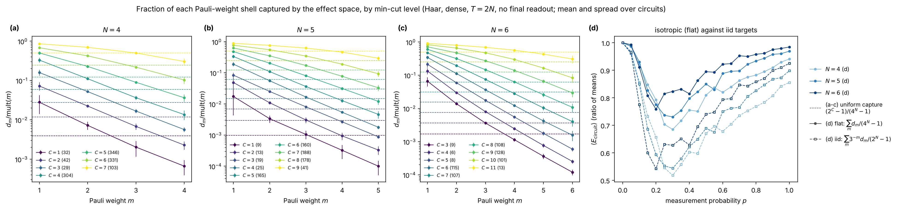

**Pauli-weight profile.** `d_m / mult(m)` is the fraction of the weight-`m`
shell that the span captures, grouped by level of `C`. The dashed lines show
uniform capture, `(2^C - 1)/(4^N - 1)`.
- At low `C` each extra unit of weight divides the fraction by 3 (ratios 0.3
  to 0.37 up to `C ≈ N`), so `d_m ∝ C(N, m)`. Measured outcomes are classical
  bits, so only one Pauli per site is effectively reached.
- As `C → 2N` the profile flattens towards uniform capture: ratios 0.7 to 0.9
  at `C = 2N - 1`.
- The span therefore favours low weights. The `iid` prior, which puts its
  variance on low weights, gives a much lower `E_circuit` than the isotropic
  one (panel d). The isotropic prediction depends on `C` alone. The `iid` one
  needs this profile.

## Which Pauli weights the `k`-bit parities reach (#388)

`E_readout(k)` compares the span `S` of the whole record with the span `S_k`
of the parities of at most `k` record bits (`parity_operator_rows`). Here `k`
counts record bits, not input Pauli weight. `sk_profile_data.py` builds `S_k`
for `k = 1, 2, 3` and `S` (`k = inf`) in whitened coordinates, with Haar gates,
dense inputs, no final readout, `T = 2N`, `p = 0.1, 0.2, 0.3, 0.5, 0.7` and 40,
30 and 20 circuits per point for `N = 4, 5, 6` (about 6 minutes on 4 cores).
Each span gives its profile `d_m^(k) = sum_{|a| = m} [Pi_k]_aa`. Then, for any
prior that depends only on the weight,
`R²(k) = Σ_m Ω(m) d_m^(k) / Σ_m Ω(m) mult(m)` and
`E_readout(k) = R²(∞) - R²(k)`.

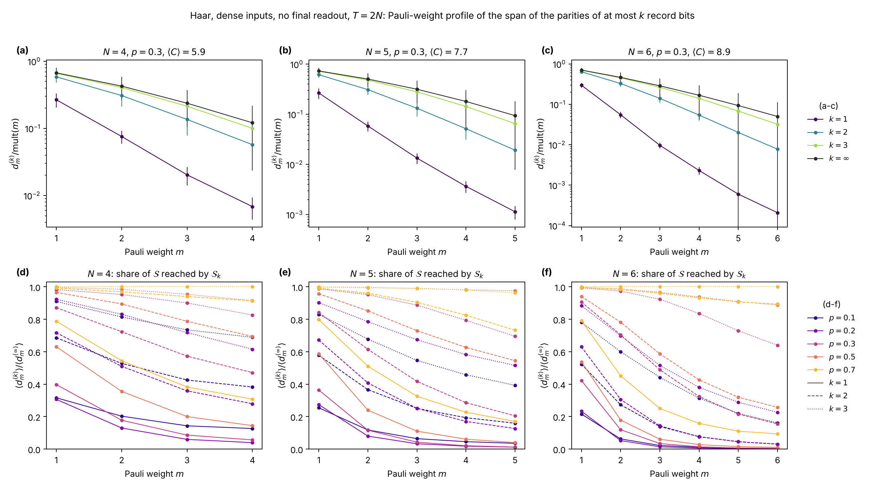

**(a-c) `d_m^(k) / mult(m)` at `p = 0.3`.** Single bits (`k = 1`) reach almost
only weight 1: the fraction drops by a factor of 3.5 (`N = 4`) to 6 (`N = 6`) per unit of weight,
against about 1.5 to 2 for the full span. Each extra bit lifts the higher
weights.

**(d-f) Share of the weight-`m` content of `S` reached by `S_k`,
`⟨d_m^(k)⟩ / ⟨d_m^(∞)⟩`.**
- The share falls with `m` at fixed `k`: rebuilding a weight-`m` operator needs
  parities of several bits, roughly `k ≥ m`. At `N = 6`, `p = 0.3`, `k = m`
  reaches 0.42, 0.70 and 0.92 of weights 1, 2 and 3, and `k = 3` reaches 0.64
  of weight 6.
- The share grows with `p`. At `p = 0.7`, `k = 2` reaches at least 0.89 of every
  weight at `N = 4` and 6 (0.73 at `N = 5`), and `k = 3` reaches 0.96 to 1. At `p = 0.1` and 0.2, few records see
  long-lived wires, and the information sits in high-order correlations of
  the bits: `k = 3` reaches only 0.78 to 0.88 of weight 1 and 0.16 to 0.23 of
  weight 6 at `N = 6`.
- For the isotropic target, `R²(k) = dim S_k / (4^N - 1)`. At `N = 6`, `p = 0.2`,
  `dim S_3 = 394` against `dim S = 933` on average, so `k = 3` loses 58 % of
  `R²(∞)`. At `p = 0.5` it loses 6 %.

## `E_circuit(p)` reduced to the projector

With infinitely many shots (exact Heisenberg spans), the full effect space
(`k = inf`) and the flat prior, the estimation and readout errors are zero and
the task drops out: `E_circuit = 1 - Tr(Pi)/M`, with `Tr(Pi) = d`.
`fig_trace_pi.py` replots `haar_dense_data.json` in this form.

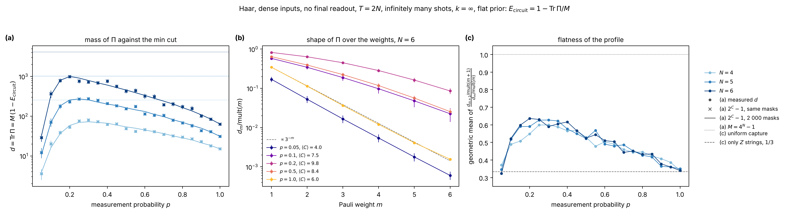

- **(a) The mass of `Pi` is the min cut.** `d(p)` lies on `2^C - 1` of the same
  masks to within 2 out of about 1 000 (`N = 6`), and on the 2 000-mask curve
  to within the sampling of the masks.
- **(b, c) The shape of `Pi` follows `C`, not `p` directly.** The ratio between
  successive weights is `1/3` at both ends: at small `p` (few records) and at
  `p = 1`, where the records of the first layer read `Z` on every site and `S`
  holds only the `Z` strings (`d_m = C(N, m)`, exactly `3^(-m)`). The profile is
  flattest, ratio about 0.6, at the top of the dome of `C` (`p ≈ 0.2` to 0.4).
  It never reaches uniform capture (ratio 1) at these sizes. The three sizes
  overlap, and nothing marks a finite `p_c`.

## Spectral overlap of the target and the circuit

For a prior that depends only on the weight, `R²(∞) = Σ_m P(m) T(m)`, with
`P(m) = Ω_m mult(m) / Σ Ω mult` the share of the target energy at weight `m`
and `T(m) = d_m / mult(m)` the share of the weight-`m` modes that the circuit
transmits (`T_k(m)` for the parities of at most `k` bits). `fig_overlap.py`
puts both on the same axes at `N = 6`.

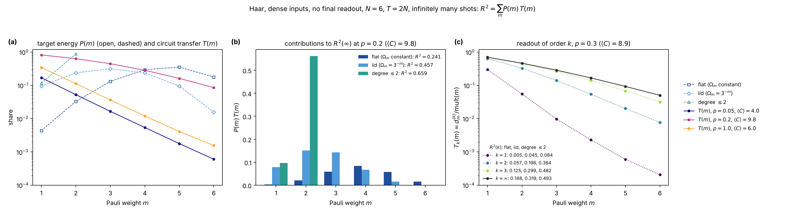

- **(a)** The flat target sits at high weight (`P(m) = mult(m)/M`, binomial of
  mean `3N/4`). The iid target is centred on `N/2`: `Ω_m mult(m) = C(N, m)`, so
  `P(m) = C(N, m)/(2^N - 1)`. It is not a low-weight target. Only the degree-2
  target lives at low weight. `T(m)` is highest and flattest at the top of the
  dome (`p = 0.2`), and steepest (`3^(-m)`) at small `C`.
- **(b)** At `p = 0.2` (`⟨C⟩ = 9.8`): `R² = 0.24` (flat), 0.46 (iid), 0.66
  (degree ≤ 2). The lower the weights of the target, the better it is served.
- **(c)** At `p = 0.3`, readout of order `k`. Per layer, `E_readout(k)` is
  `P(m) (T(m) - T_k(m))`: the vertical gap on a linear scale, weighted by
  `P(m)`. `k = 3` keeps 84 % (flat), 94 % (iid) and 98 % (degree ≤ 2) of
  `R²(∞)`; `k = 1` keeps 3 %, 14 % and 17 %.

## What the flat and iid targets look like

`flat` and `iid` are priors on the target, not encodings. The encoding (`XZ`
angles or dense) fixes the norms `w_a = E[B_a²]`. The prior fixes the
variances `v_a = E[β_a²]`: iid, `β_a ~ N(0, 1)` and energy `w_a` per mode; flat,
`β_a ~ N(0, 1/w_a)` and energy 1 per mode. `fig_priors.py` draws both from the
same Gaussian numbers, so a flat sample and an iid sample differ only by the
scale of each mode, and normalises every sample to unit variance.

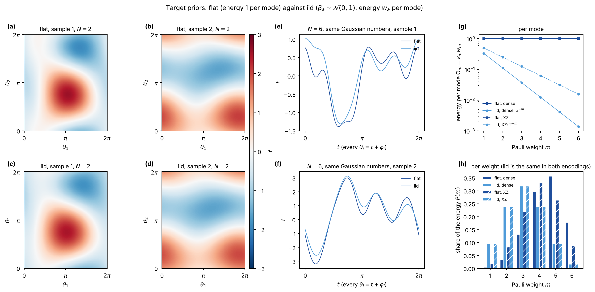

- **(a-d)** `N = 2`, `XZ`: the two priors barely differ. Flat puts half the
  energy on weight 2, iid one third.
- **(e, f)** `N = 6`, along the cut `θ_i = t + φ_i`: the flat sample carries
  more high-order products and wiggles more; the iid one is smoother.
- **(g, h)** Energy per mode and per weight at `N = 6`. Per weight, flat peaks
  at `3N/4` (dense) or `2N/3` (`XZ`), iid at `N/2` in both encodings.
