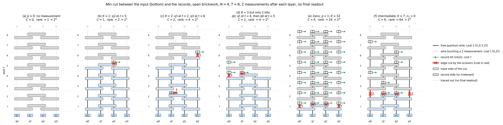
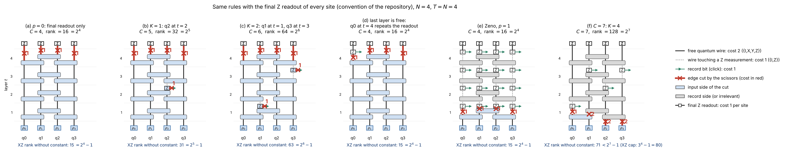
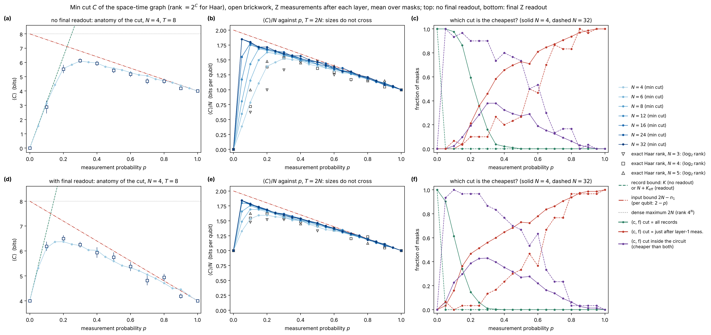
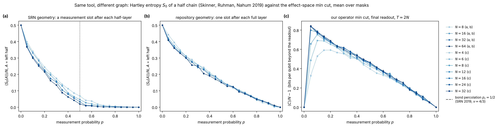
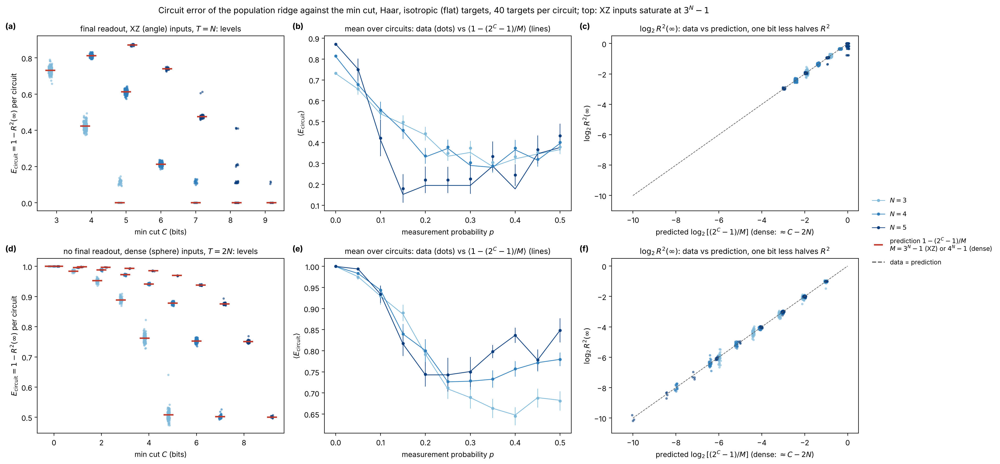

# La coupe minimale et le rang de l'espace des effets, pas à pas

*19 novembre 2026. Petites tailles seulement (rang exact jusqu'à N = 5 ou 6, coupe minimale jusqu'à N = 32, ce qui ne prend que quelques secondes). Les scripts sont dans ce dossier et utilisent la bibliothèque du dépôt (`effect_rank`, `r2_budget.effect_basis`).*

## 1. Les règles du jeu, vérifiées

On découpe le circuit avec des ciseaux pour séparer **l'entrée ρ(x)** (en bas) de **tous les records** (les clics, plus la lecture finale s'il y en a une). Le prix d'une coupe, c'est la somme des arêtes tranchées :

| Ce qu'on tranche | Prix | Pourquoi |
| --- | --- | --- |
| un fil quantique libre, entre deux portes | **2** | un opérateur sur un qubit : 4 Pauli {I, X, Y, Z} = 2 bits |
| un fil qui touche une mesure Z (juste avant, ou juste après jusqu'à la porte suivante) | **1** | la mesure ne garde que {I, Z} : 1 bit |
| le bit d'un clic (le record d'une mesure) | **1** | 1 bit classique |
| la lecture Z finale d'un site (si elle existe) | **1** | 1 bit classique |

**Le théorème :** rang(E) ≤ 2^C, où C est la coupe la moins chère. Je l'ai calculé exactement par flot maximal et comparé au rang exact (récurrence de Heisenberg du dépôt).

**Deux règles manquaient dans l'explication de départ :**

1. **Ce qui vient après la dernière mesure ne compte pas.** Sans lecture finale, les fils sont tracés à la fin. Une porte dont les sorties sont toutes tracées devient l'identité (U†IU = I) et ne transporte aucun bit. Il faut donc retirer du graphe tout ce qui n'est pas dans le passé causal d'un record. Sans cette règle, la coupe est fausse (panneau d de la figure 1).
2. **Avec lecture finale, une mesure de la dernière couche est gratuite.** Elle répète la lecture finale, donc elle n'ajoute rien (figure 2, panneau d).

## 2. Les exemples, qubit par qubit (figures 1 et 2)

**Figure 1. N = 4, T = 8, sans lecture finale** (la convention de l'explication de départ). Croix rouges : les arêtes tranchées, avec leur prix. Portes bleues : côté entrée. Rang exact d'un circuit de Haar sous chaque titre.

- **(a) Aucune mesure :** C = 0, rang 1. ✔︎ L'explication est juste.
- **(b) Une mesure (q2, t = 5) :** C = 1, rang 2. ✔︎ Vérifié pour **les 32 positions possibles**.
- **(c) Deux mesures :** C = 2, rang 4. ✔︎ Vérifié pour **les 496 paires possibles**.
- **(d) Correction : « K < 2N, donc C = K » est faux.** Ici on a 3 clics : q0 et q1 à t = 4, puis q0 à t = 5. Pourtant C = 2 et le rang vaut 4, pas 8. Le troisième clic ne voit que q0 et q1, qui viennent d'être mesurés. Il ne fait donc que recopier une information classique déjà sortie. La coupe ne passe ni par tous les records (3) ni par l'entrée (8) : elle tranche les deux fils qui entrent dans les mesures de t = 4. Sur les 4 960 triplets possibles, 14 sont dans ce cas. Ce sont exactement les motifs « deux voisins mesurés, puis l'un des deux encore mesuré ». En général, la seule chose sûre est C ≤ K.
- **(e) Zénon, p = 1 :** C = 2N − n₁ = 4, rang 16. ✔︎ Mais il faut préciser où passe la coupe : **juste après les mesures de la première couche**, pas « au ras du sol ». Au ras du sol, elle coûterait 2N = 8.
- **(f) Régime intermédiaire, la coupe qui serpente :** K = 7 et n₁ = 0, donc la coupe par les records coûte 7 et la coupe à l'entrée coûte 8. La vraie coupe passe entre les couches 2 et 3 et coûte 2 + 1 + 1 + 2 = 6. Rang exact : **64 = 2⁶**.

**Figure 2. Mêmes règles avec la lecture Z finale** (la convention de `effect_rank` et de `r2_budget`, #362), N = 4, T = 4. En bleu sous chaque panneau : le rang vu par l'encodage XZ sans la constante, c'est-à-dire le nombre de features non constantes.

- Avec la lecture finale, **C part de N et pas de 0**. À p = 0 on a C = 4 et un rang de 16 (15 sans la constante). Chaque mesure utile ajoute 1 : 31, puis 63.
- **D'où viennent les plateaux 31 et 63.** Ils viennent de ce circuit-là (avec lecture finale, T = N = 4, #362). Ici 63 = 2⁶ − 1 correspond à seulement **deux mesures utiles** (C = N + K_eff = 6). Ce n'est pas une coupe qui serpente dans le circuit sans lecture finale.
- **« 2^C ou 2^C − 1 » ?** Le rang dense vaut exactement **2^C**. 2^C − 1, c'est le même espace sans l'identité, celle que l'intercept de la ridge absorbe. Ce compte ne reste valable en XZ que tant que 2^C − 1 ≤ 3^N − 1 = 80. Pour C = 7, on trouve **71** (panneau f) ou 80, et non 127, parce que l'encodage XZ ne voit pas Y.

## 3. Le cas général (figure 3)

**Figure 3. Coupe minimale moyenne contre p, T = 2N.** En haut : sans lecture finale. En bas : avec lecture finale. Les carrés et triangles ouverts sont les rangs exacts de Haar, ⟨log₂ rang⟩, pour N = 3, 4, 5.

- **(a, d) La compétition de deux bornes.** À petit p, C suit la borne des records (vert : K, ou N + K_eff). À grand p, il suit la borne d'entrée 2N − n₁ (rouge, 2 − p bits par qubit). Entre les deux, il passe sous les deux bornes. Le pic est à p ≈ 0,3 (sans lecture finale) et à p ≈ 0,2 (avec), pour N = 4.
- **(b, e) À p fixé, les tailles se superposent.** Le pic glisse vers p → 0 quand N grandit (p* = 0,30 ; 0,15 ; 0,05 pour N = 4, 8, 32) et sa hauteur monte vers 2 bits par qubit. Il n'y a aucun croisement, donc pas de p_c fini. Cela confirme la note `transition-rang-mipt.md` (#321).
- **(c, f) Où passe la coupe la moins chère.** Courbes vertes : par tous les records. Rouges : juste après la couche 1. Violettes : à l'intérieur du circuit, moins chère que les deux bornes. À N = 4, la coupe intérieure gagne dans au plus 40 % des masques. À N = 32, elle gagne dans presque tous les masques entre p = 0,05 et 0,5. **Dans le cas général, la « coupe qui serpente » est la règle, pas l'exception.**
- **Rang exact = 2^C ?** *Avec lecture finale* : oui, dans les 440 cas de la figure, plus de 1 500 cas de mes tests (N = 3 à 6, T = N et 2N, dont tous les masques à 0, 1 et 2 mesures pour N = 4, T = 8) et les 4 386 cas déjà vérifiés dans le dépôt (#321, #362). *Sans lecture finale* : c'est presque toujours vrai, mais pas toujours. Une fois la règle 1 appliquée, il reste 3 masques sur 400 à T = 2N et 14 sur 400 à T = N (N = 4) où le rang est en dessous, et ce n'est même pas une puissance de 2 (60 au lieu de 64, 12 au lieu de 16). Exhaustivement, à N = 3 : 12 masques sur 512 (T = 3), 39 sur 4 096 (T = 4). Ces cas ont tous des mesures dans la dernière couche mesurée : le tracé final rend les portes voisines non génériques. **La borne 2^C tient toujours, l'égalité seulement presque toujours.**

## 4. Le lien avec Skinner, Ruhman et Nahum (figure 4)

*Référence : B. Skinner, J. Ruhman, A. Nahum, « Measurement-Induced Phase Transitions in the Dynamics of Entanglement », PRX 9, 031009 (2019), arXiv:1808.05953. Relu dans ta bibliothèque Zotero.*

**Ce que dit le papier.** L'entropie de Hartley S₀(A), le Rényi 0 de l'état, est exactement une coupe minimale du circuit (Sec. III, Fig. 4), à deux conditions : les portes sont génériques, et chaque mesure projective **casse le fil**, ce qui laisse passer la coupe gratuitement. Un fil non mesuré coûte 1 (log₂ q, avec q = 2). On sépare les jambes finales de A de celles de B. Le problème devient une percolation de liens : transition à **p_c = 1/2, ν = 4/3** dans leur géométrie, avec une mesure possible après chaque demi-couche. L'entropie de von Neumann a, elle, une autre transition (p_c ≈ 0,26 pour leur circuit Floquet). **S₀ est une quantité de comptage, et sa transition n'est pas la MIPT générique.**

**Le dictionnaire avec notre cas :**

| | SRN 2019 : S₀ d'un état | Notre rang : espace des effets |
| --- | --- | --- |
| Réseau | l'état, prix 1 par fil (log q) | l'opérateur, donc le circuit doublé, prix 2 par fil (log q²) |
| Effet d'une mesure | casse le fil, prix 0 | réduit le fil à 1 bit ({I, Z}) **et** envoie 1 bit vers un record |
| Ce que la coupe sépare | A et B, au temps final | l'entrée et tous les records, répartis dans tout le volume |
| Rôle des mesures | une seule : elles rendent la coupe moins chère | deux rôles opposés : moins chère près de l'entrée (Zénon), plus de puits à isoler (records) |
| Résultat | percolation, p_c = 1/2, croisement des tailles | crossover lisse, pic à p* ≈ 1,15/(T − 1) → 0, pas de croisement |

- **(a)** Mon calcul de S₀ dans leur géométrie : S₀/N tombe à zéro vers p ≈ 1/2, d'autant plus nettement que N est grand. C'est un contrôle de mon code (16 à 200 masques par point).
- **(b)** Même calcul dans la géométrie du dépôt, avec une mesure après chaque couche complète. Les liens entre la demi-couche paire et la demi-couche impaire ne sont jamais cassés, et S₀ reste en loi de volume jusqu'à p proche de 1 à ces tailles. **Les p_c de la littérature ne se transposent pas tels quels à la convention du dépôt.**
- **(c)** Notre coupe : un pic qui glisse vers p = 0, pas de croisement.

**À retenir.** Ton rang est l'analogue « Rényi 0 » de SRN pour le QELM : un objet géométrique, qui ne dépend que du masque. Comme S₀ chez SRN, il ne porte pas la MIPT générique. La MIPT doit apparaître dans les quantités pondérées par la règle de Born, par exemple `D₂` ou `S(E_mid)` de la note #319.

## 5. Ce que la coupe prédit pour E_readout, et ma question

Dans le budget `1 = E_circuit + E_readout(k) + R²(k)` (#360), la coupe fixe la dimension de l'espace engendré par **tout** le record, c'est-à-dire le projecteur Π_C. Elle prédit donc **E_circuit = 1 − R²(∞)**. #362 a déjà montré que les modes de E_circuit sont les niveaux 2^C. Pour une cible isotrope, on attend E[R²(∞)] ≈ (2^C − 1)/(4^N − 1) en dense (#363). **E_readout(k)** compare tout le record aux parités d'au plus k bits. La coupe ne le fixe pas seule, mais elle lui donne un plafond : E_readout(k) ≤ 1 − E_circuit.

## 6. E_circuit niveau par niveau de C (figure 5)

**Figure 5. E_circuit = 1 − R²(∞) contre la coupe minimale, Haar, cibles isotropes (prior `flat`), 40 cibles par circuit.** En haut : lecture finale, entrées XZ, T = N (comme #362). En bas : sans lecture finale, entrées denses, T = 2N (comme #363). N = 3, 4, 5.

- **Prédiction.** Pour une cible isotrope, E[R²(∞)] = d/M. Ici d est la dimension de l'espace vu par les entrées, sans la constante (2^C − 1 quand le rang vaut 2^C), et M le nombre de modes non constants visibles (3^N − 1 en XZ, 4^N − 1 en dense). Donc **E_circuit = 1 − (2^C − 1)/M**. En dense, log₂ R²(∞) ≈ C − 2N : **chaque bit qui manque à la coupe divise R²(∞) par 2**.
- **(a, d) Par niveau.** En dense, chaque niveau est à moins de 0,005 de la prédiction (N = 4, 5), avec une dispersion d'au plus 0,006 entre circuits. En XZ à N = 4 : 0,813 ; 0,611 ; 0,213 pour C = 4, 5, 6, contre 0,812 ; 0,613 ; 0,213 prévus. La troncature XZ coupe le niveau du haut en deux : d = 71 ou 80 à C = 7 pour N = 4, et dès C = 7 (d = 95 ou 127) pour N = 5.
- **(b, e) Contre p.** En dense, la moyenne de 1 − (2^C − 1)/M sur les masques redonne E_circuit(p) à 0,003 près pour chaque p. La dépendance en p de E_circuit est donc entièrement celle de la distribution de C. En XZ, l'écart monte jusqu'à 0,07, et il vient entièrement des niveaux du haut tronqués : la prédiction y vaut 0, alors que d = 71 donne 0,11.
- **(c, f)** log₂ R²(∞) contre la valeur prédite. Tirets : égalité.

Fichiers : figures PNG et JSON dans `figures/`. Bibliothèque : `QELM.evaluation.mincut_graph`. Scripts : `fig_circuits.py`, `data.py`, `fig_curves.py`, `draw.py`.
