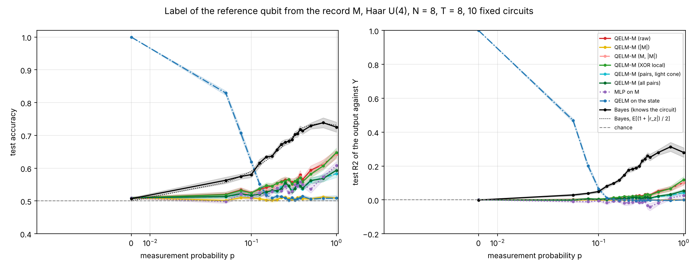
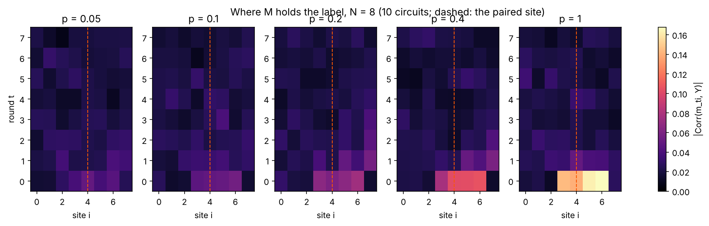
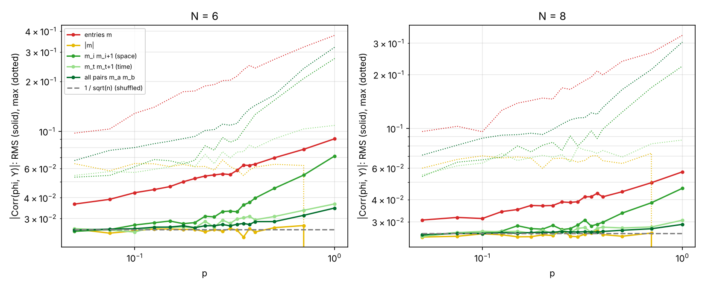
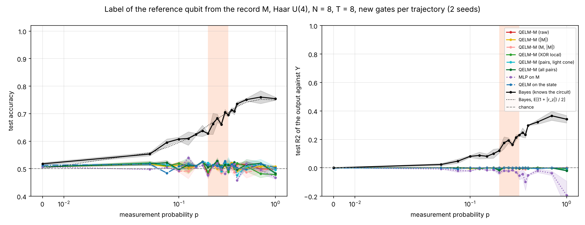
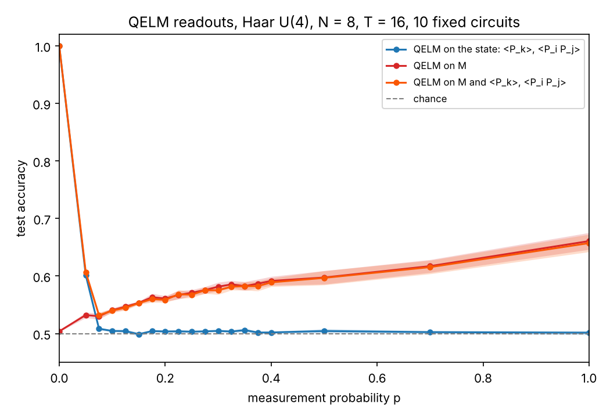

# Non-linear features of the record M (issue #269)

Follow-up of #261. Why does a linear readout of the measurement record `M`
(QELM-M) read so little, and do light non-linear maps of `M` (absolute
value, XOR of neighbours, every product `m_a m_b`) help it? The setting is
that of the open pull requests (#274, #275): **Haar U(4) gates** and the
**local encoding** (the reference qubit in a Bell pair with the middle site).

## Protocol

`nonlinear_M.py` (config `conf/nonlinear_M.yaml`), one run per circuit:

1. **Encoding.** `R` (qubit 0) in a Bell pair with the middle system site
   `N // 2`, the other system qubits in `|0>` (`AncillaBellPairEncoding`).
2. **Dynamics.** `T` rounds (`depth_rule: N`, so `T = N`, the issue's
   `T = 8` at `N = 8`). A round is one brickwork period of Haar U(4) gates on
   the open chain, then a Z measurement of each system qubit with probability
   `p`. One fixed circuit per run, drawn from the seed: with new gates for
   every trajectory everything is at chance (#261, and the control below).
3. **Label.** `Y`, the Z outcome of `R` drawn with the Born rule at the end.
   `R` never evolves, so `Y` is also the initial Z state of the middle site.
4. **Readouts**, each fitted on 70 % of the trajectories of one `p` and scored
   on the other 30 %:
   - a ridge (`RidgeCV`, alpha by leave-one-out) on each feature map
     `Phi(M)` of `QELM.features.extract_M_features`;
   - the same ridge on the QELM features of the final state, `<P_k>` and
     `<P_i P_j>` for `P = X, Y, Z` (as in `haar_readouts`);
   - an MLP on `vec(M)` (two hidden layers of 64 units), the "deep" reference;
   - **Bayes**: the sign of `r_z = <Z_R>` given the record and the circuit,
     the best possible decoder for an observer who knows the gates. Its
     expected accuracy is `E[(1 + |r_z|) / 2]`. It is not trained.
5. **Spectrum of the information.** For each group of features, the RMS and
   the max of `|Corr(phi, Y)|`, against the floor `1 / sqrt(n)` of shuffled
   labels; and the map of `|Corr(m_ti, Y)|` over space-time.

The feature maps (`src/QELM/features/measurement_features.py`). With
`m in {-1, 0, +1}`, `m**2 = |m|`, so the maps up to `xor_full` span every
polynomial of degree 2 in `M`:

| Mode | `Phi(M)` | Features at `N = T = 8` |
| --- | --- | --- |
| `raw` | `vec(M)` | 64 |
| `abs` | `\|M\|`, which qubit was measured when | 64 |
| `raw_abs` | `[M, \|M\|]`, every function of one entry | 128 |
| `xor_local` | `[M, m_ti m_t,i+1, m_ti m_t+1,i]` | 64 + 56 + 56 |
| `xor_cone` | `[M, \|M\|]` and `m_a m_b` in the light cone of the paired site | 128 + 1891 |
| `xor_full` | `[M, \|M\|]` and every `m_a m_b` | 128 + 2016 |

Local run: `N = 6, 8`, 10 circuits (seeds 42 to 51), 1500 trajectories per
`p`, 19 values of `p`. Control: `N = 8`, new gates per trajectory, 2 seeds.

## Results



Accuracy averaged over 10 circuits, `N = 8`, `T = 8` (standard error about
0.01):

| p | Bayes | raw | \|M\| | XOR local | all pairs | MLP | QELM on the state |
| --- | --- | --- | --- | --- | --- | --- | --- |
| 0.05 | 0.56 | 0.52 | 0.50 | 0.52 | 0.51 | 0.50 | **0.83** |
| 0.1 | 0.58 | 0.53 | 0.51 | 0.52 | 0.52 | 0.51 | **0.62** |
| 0.2 | **0.66** | 0.55 | 0.50 | 0.55 | 0.53 | 0.54 | 0.51 |
| 0.3 | **0.69** | 0.56 | 0.51 | 0.55 | 0.53 | 0.53 | 0.51 |
| 0.4 | **0.71** | 0.57 | 0.51 | 0.56 | 0.54 | 0.55 | 0.51 |
| 1.0 | **0.72** | 0.64 | 0.51 | 0.65 | 0.59 | 0.61 | 0.51 |

The same at `N = 6` ([figure](figures/accuracy_vs_p_N6.png)), with every
readout of `M` about 0.04 higher.

**1. The linear QELM-M is not at chance on a fixed circuit.** Contrary to the
hypothesis of the issue, `raw` rises steadily with `p`: 0.55 at `p = 0.2`,
0.64 at `p = 1` (`N = 8`). The single outcomes are not unbiased given `Y`.
For a fixed circuit, `E[m_ti | Y] != 0`: the first outcomes near the paired
site depend on its initial state. It closes about a third of the gap to the
Bayes ceiling for `0.1 < p < 0.5`, and two thirds at `p = 1`
([gain figure](figures/gain_vs_p.png), bottom row).

**2. The information sits in the first round, next to the paired site.**
The map of `|Corr(m_ti, Y)|` is bright on round 0, on sites 3 to 6 at
`N = 8` (the paired site 4 and its first light cone, one brickwork period),
with a weaker trace on round 1 and the noise level everywhere else. Later
outcomes have lost the label to the scrambling:



**3. No non-linearity of `M` helps.**
- `|M|` is at chance at every `p`. This is exact: whether a qubit is measured
  is drawn with probability `p` whatever the state, so `|M|` is independent
  of `Y`. It is a null control, not a test.
- `[M, |M|]` (every function of one entry) is equal to `raw`.
- `XOR local` is equal to `raw` within one standard error at every `p`
  (gain from -0.012 to +0.015).
- Every pair (`xor_full`, 2144 features) and the pairs in the light cone are
  **below** `raw` (by up to 0.05 at `p = 1`): with 1050 training trajectories
  the ridge pays for the extra features and finds nothing in them.
- The MLP on `vec(M)` is at or below `raw`.

The correlation spectrum says why: the RMS correlation of the entries `m`
stands above the shuffled floor from `p = 0.05`. The products of all pairs
stay on the floor at every `p` (RMS), and the nearest-neighbour products
leave it only from `p ≈ 0.15`, where the entries they contain are already
informative: they are redundant with them.



**Four times more samples.** On the circuits of seeds 42 to 45 (`N = 8`),
`PER_P = 6000` instead of 1500:

| p | PER_P | Bayes | raw | [M, \|M\|] | XOR local | all pairs |
| --- | --- | --- | --- | --- | --- | --- |
| 0.2 | 1500 | 0.66 | 0.55 | 0.53 | 0.54 | 0.52 |
| 0.2 | 6000 | 0.64 | 0.55 | 0.54 | 0.55 | 0.53 |
| 0.4 | 1500 | 0.69 | 0.56 | 0.54 | 0.56 | 0.54 |
| 0.4 | 6000 | 0.70 | 0.58 | 0.59 | 0.58 | 0.57 |
| 1.0 | 1500 | 0.71 | 0.62 | 0.62 | 0.64 | 0.59 |
| 1.0 | 6000 | 0.72 | 0.64 | 0.64 | 0.66 | 0.61 |

Every readout gains 0.01 to 0.03, `xor_full` a little more than `raw`, but
the order does not change: all pairs stay below `raw`, and `XOR local` keeps
its small edge (+0.016) only at `p = 1`, where every qubit is measured and
the products of neighbours are never zero.

So the shaded `#fa5703` zone of the issue does not appear: no feature map
gains more than 0.02 over `raw` anywhere.

**4. What is missing is the circuit, not a non-linearity.** With new gates
for every trajectory, every readout of `M` is at chance at every `p`, linear
or not, MLP included, while the Bayes decoder that knows each circuit still
reaches 0.75 at `p = 1`:



The Haar average of the first gate on the paired site forgets its initial
state, so the law of `M` alone, averaged over circuits, does not depend on
`Y` (the observer who does not know the gates of #275). No function of `M`,
of any order, can then beat chance. On a fixed circuit, the gap between
`raw` and Bayes is the price of learning the circuit-specific likelihood
`P(M | Y, U)` from about a thousand samples, not a missing parity.

**5. QELM on the state vs QELM-M.** The ridge on the final state wins at
small `p` (0.83 at `p = 0.05`) and is at chance from `p ≈ 0.15`, as in #261
and #274. The readouts of `M` take over from `p ≈ 0.14` (`N = 8`) or 0.19
(`N = 6`). The two are complementary: one reads the state that the
measurements have not yet collapsed, the other reads the collapses.

### The three QELMs at T = 2N (N = 8, 10 circuits, 8000 trajectories per p)



The ridge on the state (`<P_k>`, `<P_i P_j>`, P = X, Y, Z), on `M`, and on both
side by side (`ridge_M_quantum`), at `T = 2N = 16` and 8000 trajectories per
`p` (`figures/T16_summary.json`). With twice the depth, the state readout
collapses faster than at `T = N`: 1.00 at `p = 0`, 0.60 at `p = 0.05`, then at
chance (0.50 to 0.51) from `p = 0.075`, as `p_0 ≈ 4 / (N T)` of #274
predicts. The readout of `M` rises from 0.53 at `p = 0.05` to 0.59 at
`p = 0.4` and 0.66 at `p = 1` (standard error 0.005 to 0.015). The
combined readout follows the better of the two everywhere and never beats
it: 0.61 at `p = 0.05`, then equal to `M` within one standard error. The two
sources do not add up: at `p ≤ 0.05` the state holds the label, and from
`p = 0.075` only the record does. Bayes ceiling: 0.57 at `p = 0.05`, 0.74 at
`p = 0.4`.

```bash
OMP_NUM_THREADS=1 N_VALUES=8 SEEDS="$(seq -s ' ' 42 51)" PER_P=8000 DEPTH=2N \
  MODES=raw MLP=false SAVE_ARRAYS=false MAX_JOBS=4 \
  ./experiments/nonlinear_M/nonlinear_M.sh
```

### Synthesis

- The Dehghani et al. picture (information only in high-order parities, so a
  linear readout at exactly 1/2) holds for the charge with gates that change
  every trajectory. Here, with a fixed circuit and a local label, the
  information is in **first-order** terms: the first outcomes in the light
  cone of the paired site.
- Light non-linearities (XOR of neighbours, all pairs, an MLP) do not add to
  it at `N = 6, 8`. They do not emulate the first CNN layer in a useful way,
  because there is no parity left to find at the sizes and samples we have.
- The gap to the Bayes ceiling is a sample-complexity gap. The next steps are
  more trajectories (`PER_P = 8000` on the cluster) and larger `N`, to see
  whether the pairs start to pay off when the ridge can afford them.

## Run it

```bash
# One run (one circuit):
uv run python experiments/nonlinear_M/nonlinear_M.py N=8 seed=42

# The local sweep of this report (about 15 min on 4 cores):
OMP_NUM_THREADS=1 N_VALUES="6 8" SEEDS="$(seq -s ' ' 42 51)" PER_P=1500 \
  MAX_JOBS=4 ./experiments/nonlinear_M/nonlinear_M.sh

# The control with new gates per trajectory:
FIXED=false N_VALUES=8 SEEDS="42 43" PER_P=1500 MAX_JOBS=2 \
  ./experiments/nonlinear_M/nonlinear_M.sh

# Figures and summary.json of a sweep:
uv run python experiments/nonlinear_M/plot_nonlinear_M.py outputs/nonlinear_M/<date_time>
```

**Cluster.** The protocol of the issue (`N_c = 20` circuits, `PER_P = 8000`)
and larger sizes:

```bash
OMP_NUM_THREADS=1 OUT_ROOT=/scratch/$USER/qelm N_VALUES="8 10 12" \
  SEEDS="$(seq -s ' ' 42 61)" PER_P=8000 SAVE_ARRAYS=false MAX_JOBS=32 \
  SKIP_DONE=1 ./experiments/nonlinear_M/nonlinear_M.sh
```

Cost per trajectory (state vector of `N + 1` qubits plus the observables of
the state): about 4 ms at `N = 8` and roughly 4 times more for each `+2`
qubits. At `N = 12` with `PER_P = 8000` and 19 `p`, a run simulates for a few
hours. `xor_full` has `K (K - 1) / 2` pair features (`K = N T`): 10 296 at
`N = T = 12`, so set `MODES="raw raw_abs xor_local xor_cone"` there, or
`DEPTH=10`. `SKIP_DONE=1` resumes a stopped sweep.

The notebook `notebooks/results/10_QELM_M_nonlinear_features.ipynb` runs or
reads back a sweep and draws every figure with a table.

## Files

- `src/QELM/features/measurement_features.py`: `extract_M_features` and the
  pair, light-cone and correlation helpers.
- `nonlinear_M.py`, `nonlinear_M.sh`, `plot_nonlinear_M.py`: the run, the
  sweep, the figures.
- `figures/`: the figures above, `summary.json` (fixed circuits) and
  `random_gates_summary.json` (control).
- `tests/test_nonlinear_M.py`, `tests/test_nonlinear_M_notebook.py`.
