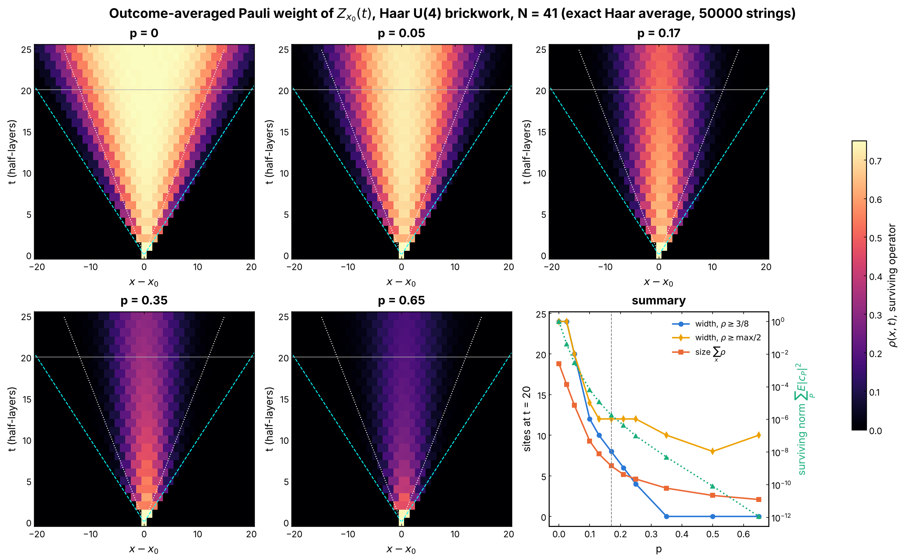
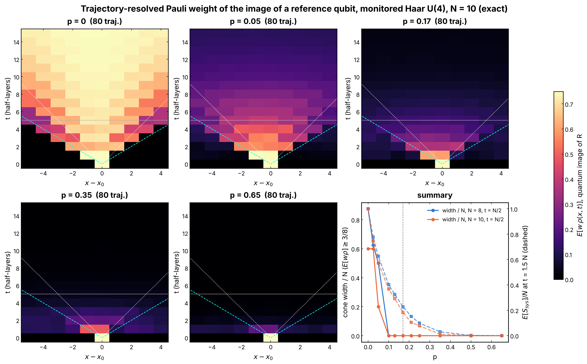
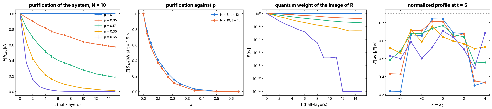
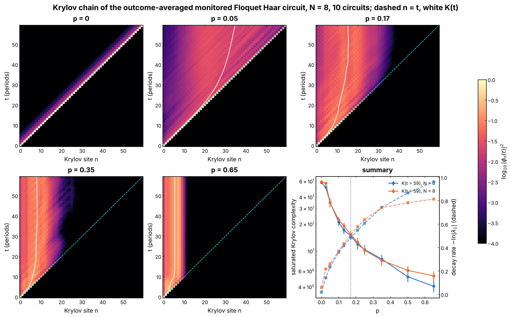
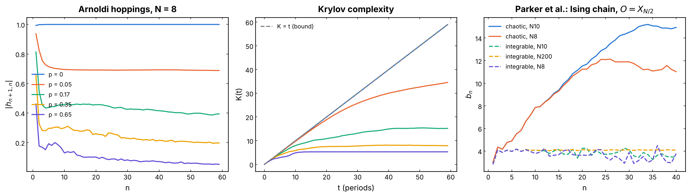

# Operator light cones of monitored Haar circuits: OTOC and Krylov

How far, and how fast, does a local operator grow in a brickwork Haar U(4)
circuit with projective measurements, and does the measurement-induced phase
transition (MIPT, `p_c ~ 0.17` for Haar qubits) show in that growth? An
external tool produced a figure of the cone `rho(x, t)` (N = 41, T = 25,
five values of `p`) and claimed a sharp collapse of the cone at `p_c`, an
"exact origin" of the exponential concentration of Xiong et al. and a
butterfly velocity `v_B ~ 0.6`. None of this was verified. This experiment
recomputes the cones in three ways, each reproducible from the code here,
and reports what the data show. Short answer: `v_B = 0.61` at `p = 0` is
reproduced; **no quantity of operator growth computed here shows a sharp
feature at `p_c`**. The outcome-averaged OTOC and the Krylov chain are
linear in the outcome-averaged dynamics (a dephasing channel) and cannot see
the MIPT by construction: their cones shrink smoothly with `p`. The
trajectory-resolved quantities do feel the measurements nonlinearly, but
at N <= 10 they cross over smoothly too.

## Experiment overview

| | |
| --- | --- |
| Script(s) | `experiments/operator_cones/operator_cones.py` (subcommands `chain`, `traj`, `krylov`, `parker`), launcher `operator_cones.sh`, figures `plot_operator_cones.py` |
| Module | `QELM.evaluation.operator_cones` |
| Physical model | open brickwork chain of Haar U(4) gates, one half-layer per time step (`v_LR = 1` site per step), each qubit measured in Z with probability `p` after every half-layer, as in Zabalo et al., PRB 101, 060301 (2020) |
| System sizes `N` | 41 (A1), 8 and 10 (A2), 6 and 8 (B), 8 and 10 (Parker reference) |
| Control parameter | `p` in {0, 0.05, 0.17, 0.35, 0.65} for the five-panel figures; grid {0, 0.025, 0.05, 0.1, 0.13, 0.17, 0.21, 0.25, 0.35, 0.5, 0.65} for the summaries |
| Initial operator | `Z` on the middle site `x0 = N // 2` (A1, B); Pauli images of a reference qubit `R` maximally entangled with `x0` (A2) |
| ML task | none: a diagnostic of the reservoir dynamics |
| Issues / PRs | #315; reuses `brickwork_bonds` of #243 (`QELM.evaluation.chaos_locality`) |

## Methodology

**A1. OTOC, outcome-averaged, N = 41, T = 25** (`pauli_weight_chain`). In
the Pauli expansion `Z_x0(t) = sum_P c_P(t) P`, the Pauli-weight density is
`rho(x, t) = sum_P |c_P|^2 [P_x != I] / sum_P |c_P|^2`; it is the
infinite-temperature OTOC with a probe on `x`, averaged over the three
probes, up to a factor 4/3. U(4) is a 2-design, so the Haar average of
`|c_P|^2` is an exact Markov chain on strings (Nahum, Vijay and Haah, PRX 8,
021014 (2018)): a gate keeps `II` and sends any other pair to one of the 15
non-identity pairs. A Z measurement averaged over its outcomes deletes the
X and Y components on the measured site; averaged over where the
measurements fall, it multiplies `|c_P|^2` by `1 - p` per X or Y site. The
chain is sampled with a population of 50 000 weighted strings, resampled
when the effective size falls below half. Outputs: `rho(x, t)` of the
surviving operator, the surviving norm `sum_P E|c_P|^2` and the size
`sum_x rho`. Cost: a few seconds.

**A2. OTOC, trajectory-resolved, exact, N = 8 and 10** (`trajectory_cones`).
The reference qubit `R` is maximally entangled with `x0` and the other sites
are maximally mixed (the Choi state of the circuit, infinite temperature as
for the OTOC). Writing `rho_SR = (1/2) sum_mu M_mu (x) sigma_mu^T`, a
trajectory (new Haar gates on every bond at every step, measured sites drawn
with probability `p`, Born outcomes) maps `M_mu -> K M_mu K^dagger`,
renormalized to `Tr M_0 = 1`. `M_0` is the conditional state of the system
and `M_a` the images of the Paulis of `R`; at `p = 0`, `M_a = U sigma_a
U^dagger / 2^N`, the usual operator spreading. With measurements, the part
of `M_a` along `M_0` is what the record learned about `R`; the connected
operators `O_a = M_a - Tr(M_a) M_0` are what is still quantum. Per trajectory:
their Pauli-weight density `rho_m(x, t)` (the fraction of `O_a` destroyed by
depolarizing site `x`), their weight `w_m = sum_a ||O_a||^2 / (3 ||M_0||^2)`
(1 at `p = 0`), and the entropy `S_sys` of `M_0`, the order parameter of the
purification transition of Gullans and Huse, PRX 10, 041020 (2020). The
cone shown is `E[w rho(x, t)]`, equal to the usual `rho(x, t)` at `p = 0`.
400 trajectories per `p` at N = 8 and 80 at N = 10, `T = 1.5 N` half-layers.
These quantities are nonlinear in the trajectory state.

**B. Krylov complexity, N = 6 and 8** (`floquet_heisenberg_channel`,
`arnoldi`, `krylov_wavefunction`). Parker et al., PRX 9, 041017 (2019)
build the Krylov chain of an operator under a time-independent Liouvillian.
A Krylov chain needs a time-independent generator, so here the circuit is
Floquet: one draw of the even and odd half-layers, repeated (10 draws per
`p`). One period of the Heisenberg dynamics, with the measurements averaged
over outcomes and locations, is the channel `Phi` (gates, then `O -> (1 - p)
O + p sum_s Pi_s O Pi_s` on every site). Arnoldi on `Phi` (60 vectors, full
re-orthogonalization, traceless sector) gives an orthonormal basis `|O_n)`,
the hoppings `h_{n+1,n}` (the `b_n` of the unitary case), the Krylov wave
function `|phi_n(t)|^2` of `O(t) = Phi^t(Z_x0)` and
`K(t) = sum_n n |phi_n(t)|^2 / sum_n |phi_n(t)|^2`. Because `O(t)` lies in
the first `t + 1` Krylov vectors, `K(t) <= t`: a discrete-time circuit has
no exponential growth of `K`, the maximally chaotic case is `K(t) = t`. For
`p > 0`, `Phi` contracts every traceless operator, `O(t)` converges to the
slowest mode of `Phi` (modulus `|lambda_1|`, from the Ritz values) and
`K(t)` saturates: this is the truncation of the Krylov chain by the
measurements. `Phi` is again the outcome-averaged dynamics, linear.

**Parker reference** (`liouvillian_lanczos`, `free_fermion_lanczos`).
Lanczos coefficients of `X_{N/2}` under the Ising chain `H = - sum Z Z -
1.05 sum X - h_z sum Z`: chaotic (`h_z = 0.5`) on the dense `4^N` operator
space, integrable (`h_z = 0`) exactly in the Majorana representation (on the
dense space the integrable `b_n` are lost after about 20 steps: rounding
errors outside the bilinear sector are amplified).

How to run it: `./experiments/operator_cones/operator_cones.sh` (about one
hour on 4 cores, most of it the N = 10 trajectories), or one subcommand at a
time as in the docstring of `operator_cones.py`.

## Results and discussion

- **Butterfly velocity.** At `p = 0` the half-maximum front of A1 moves at
  `v_B = 0.61` (0.64 between t = 15 and 25), against `(q^2 - 1)/(q^2 + 1) =
  3/5` for `q = 2`; the inside of the cone saturates at `rho = 3/4`, the
  value of a scrambled site (Figure 1). The claim `v_B ~ 0.6` is right; it
  is the known Haar value, not a new result.
- **A1, outcome-averaged cone: smooth, no transition at `p_c`.** At t = 20
  the size `sum_x rho` falls smoothly, 18.8, 16.2, 13.7, 9.3, 7.7, 6.2,
  5.2, 4.6, 3.5, 2.6, 2.1 sites for the eleven `p` of the grid; the
  half-maximum width drops from 24 to 12 sites between `p = 0` and `0.1`
  and then stays at 8 to 12; the front stops moving (velocity below 0.15)
  already for `p >= 0.1`. The surviving norm decays like `exp(-c p t)`
  (`4e-2` at `p = 0.025`, `2e-6` at `0.17`, `1e-12` at `0.65`, t = 20): the
  normalized cone describes an exponentially rare surviving operator, tilted
  towards small strings because each X or Y site costs `1 - p`. The
  crossover to a frozen cone happens at `p t ~ O(1)`, so its location moves
  with the time at which one looks; it is not a phase transition and does
  not sit at `p_c = 0.17` (Figure 1). The pasted figure's "collapse at
  `p_c`" is not reproduced.
- **A2, trajectory-resolved: the cone does not narrow, it empties.** At N =
  8, the normalized profile `E[w rho] / E[w]` at t = N/2 stays flat and
  scrambled across the chain (maximum 0.69 at `p = 0`, 0.67 at `0.17`, 0.63
  at `0.65`): the quantum part of the image of `R`, when it survives, is
  spread over the whole system. What changes with `p` is its weight, `E[w]`
  at t = N/2 = 1, 0.71, 0.31, 0.11, 0.01 for `p` = 0, 0.05, 0.17, 0.35, 0.65
  (Figures 2 and 3). The purification order parameter `S_sys / N` at
  `t = 1.5 N` falls smoothly, 1, 0.63, 0.23, 0.03, 0.00 at N = 8;
  N10_PLACEHOLDER
- **B, Krylov: the measurements truncate the Krylov chain, smoothly.** At
  `p = 0` the Floquet Haar circuit is maximally chaotic in the Krylov sense:
  `h_{n+1,n} = 1.000` and `K(t) = t` (57.8 at t = 59 for N = 6), the wave
  packet rides the light cone `n = t` of the chain. For `p > 0`, `K(t)`
  saturates and the packet stays in a band of the first `~ 2 K` sites:
  KRYLOV_PLACEHOLDER (Figure 4). The saturated `K` and the decay rate
  `-ln |lambda_1|` vary smoothly through `p_c`.
- **Parker et al. reproduced.** For the chaotic Ising chain at N = 10,
  `b_n` grows linearly, slope `alpha = 0.39` for `n = 6..25`, up to a
  finite-size plateau `b ~ 15` at `n ~ 33`; the integrable chain saturates
  at `b_n -> 2 (J + h_x) = 4.1`, with no plateau change between N = 10 and
  N = 200 (Figure 5). This validates the Lanczos code.
- **Why no MIPT in A1 and B.** Averaged over outcomes, a projective
  measurement is a dephasing channel. A1 and B are linear functionals of the
  averaged dynamics, the same at all `p` up to the strength of the
  dephasing, so they have no singularity at `p_c`. The MIPT is a transition
  of quantities nonlinear in the conditional state (entropies, purities,
  the weight `w` of A2). The narrative of the external figure, a cone that
  collapses at `p_c` in `rho(x, t)` of `Z(t)`, mixes the two. Likewise, the
  link to the concentration of Xiong et al. is an interpretation: at `p =
  0`, the cone fills with `rho = 3/4` and the operator spreads over
  exponentially many strings, but this was not tested here against the
  variance of a QELM feature.
- **Caveats.** A2 is exact but small (N <= 10, open chain, the cone reaches
  the edges at t ~ 0.6 N / 2); its crossing analysis is limited to two sizes.
  B uses a Floquet circuit (needed for a Krylov chain), whereas A1 and A2
  draw new gates at every step. A1 averages `|c_P|^2` over measurement
  locations (factor `1 - p`), B averages the channel (factor `1 - p` on the
  amplitude); both are outcome averages.

## Figures

**Figure 1. Outcome-averaged Pauli-weight cone, N = 41.** Five panels:
`rho(x, t)` of the surviving operator `Z_x0(t)` (color, 0 to 3/4) against
`x - x0` and the half-layer `t`, for `p` = 0, 0.05, 0.17, 0.35, 0.65; cyan
dashed lines: Lieb-Robinson cone `|x - x0| = t`; white dotted lines:
`|x - x0| = 3t/5` (Haar `v_B`); grey line: `t = 20`. Summary panel, at
t = 20 against `p`: width where `rho >= 3/8` (blue), width at half the
maximum of the row (purple), size `sum_x rho` (orange), surviving norm
`sum_P E|c_P|^2` (green, right log axis); vertical dashed line `p_c = 0.17`.
Exact Haar average sampled with 50 000 strings. The cone shrinks smoothly,
with no feature at `p_c`. `plot_operator_cones.py`, issue #315.

**Figure 2. Trajectory-resolved Pauli weight of the image of `R`, N = 10.**
Five panels: `E[w rho(x, t)]` (color), the Pauli-weight density of the
connected (quantum) image of the reference qubit times its weight,
averaged over 80 exact trajectories per `p`; lines as in Figure 1; grey
line `t = N/2`. At `p = 0` it is the usual OTOC cone. Summary panel, against
`p`, for N = 8 (blue) and N = 10 (orange): width of the cone at `t = N/2`
where `E[w rho] >= 3/8`, divided by N (solid), and the entropy of the
system `E[S_sys] / N` at `t = 1.5 N` (dashed, right axis); vertical dashed
line `p_c`. `plot_operator_cones.py`, issue #315.

**Figure 3. Purification and profiles of the trajectories, N = 10.** (a)
`E[S_sys] / N` against `t` for the five `p` (error bars: standard error over
trajectories). (b) `E[S_sys] / N` at `t = 1.5 N` against `p` for N = 8 and
10: a crossing of the two sizes would locate the purification transition.
(c) Weight `E[w]` of the quantum image of `R` against `t` (log scale). (d)
Normalized profile `E[w rho] / E[w]` at `t = N/2` against `x - x0` (dotted:
3/4). `plot_operator_cones.py`, issue #315.

**Figure 4. Krylov wave function of the monitored Floquet channel, N = 8.**
Five panels: `log10 |phi_n(t)|^2` (color, -4 to 0) against the Krylov site
`n` and the period `t`, averaged over 10 circuits, for the five `p`; cyan
dashed line: the bound `n = t`; white curve: `K(t)`. Summary panel, against
`p`: `K` at `t = 59` for N = 6 and 8 (solid, log axis, standard error over
circuits) and the decay rate `-ln |lambda_1|` of the slowest mode (dashed,
right axis). `plot_operator_cones.py`, issue #315.

**Figure 5. Krylov coefficients.** (a) Arnoldi hoppings `|h_{n+1,n}|`
against `n`, N = 8, mean over 10 circuits, for the five `p`. (b) `K(t)`
against `t` with the bound `K = t` (grey dashed). (c) Reference of Parker
et al.: Lanczos `b_n` of `X_{N/2}` in the Ising chain, chaotic (`h_z = 0.5`,
solid, N = 8 and 10) and integrable (`h_z = 0`, dashed, N = 8, 10, 200).
`plot_operator_cones.py`, issue #315.
