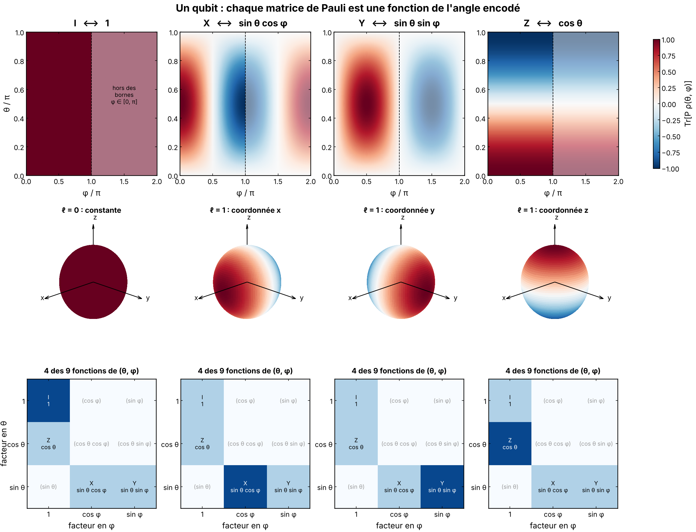
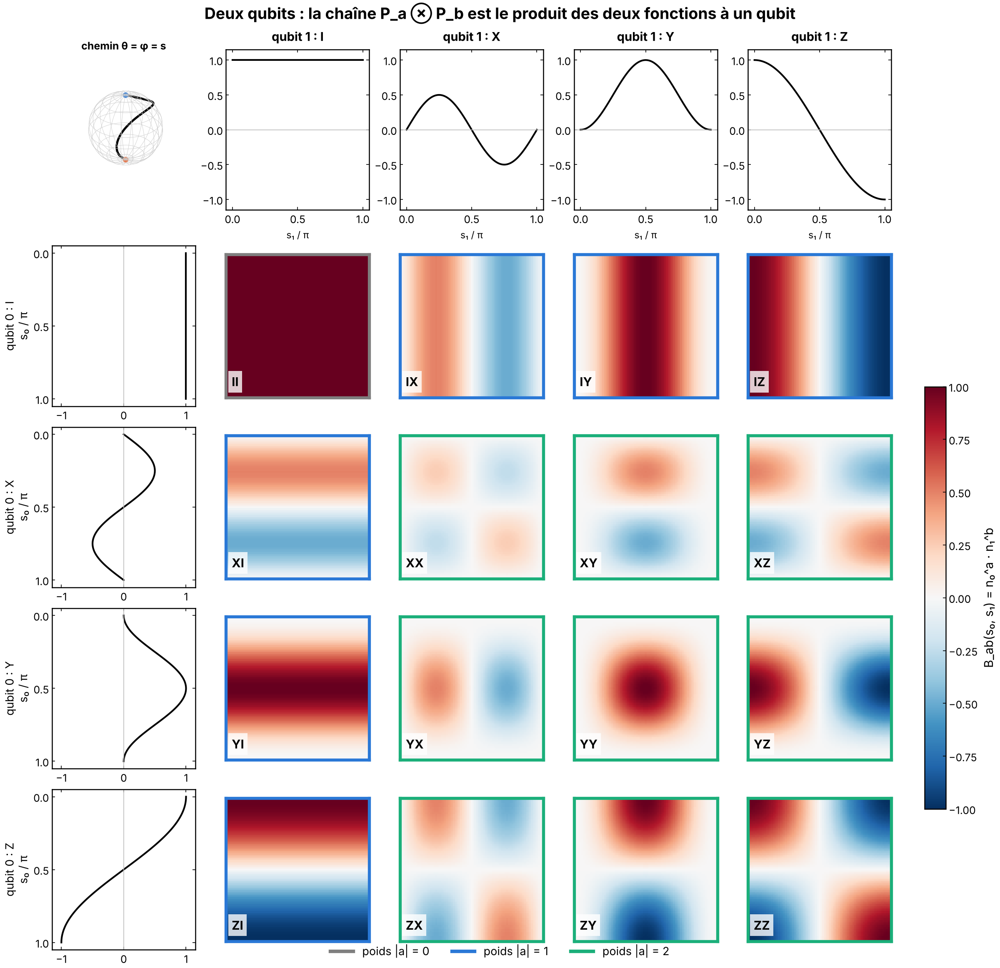
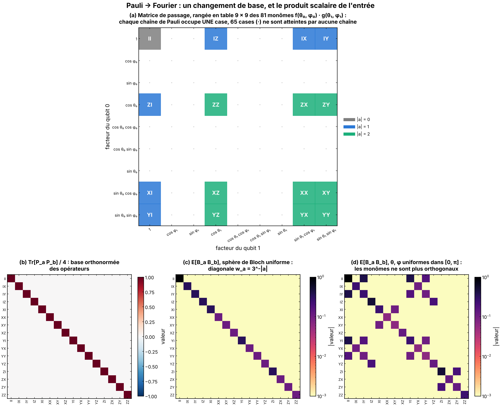
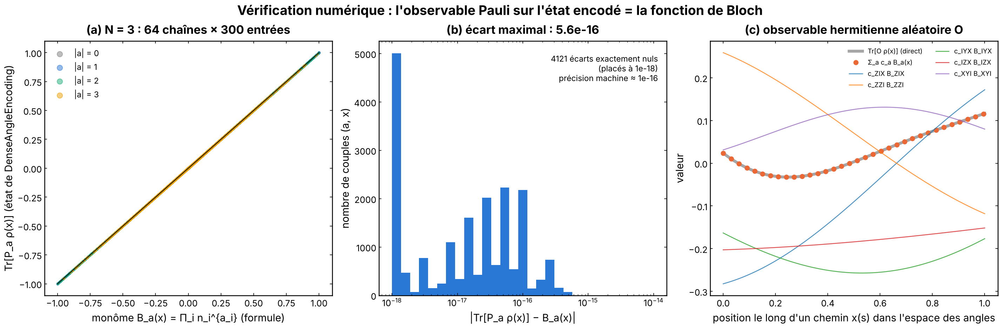
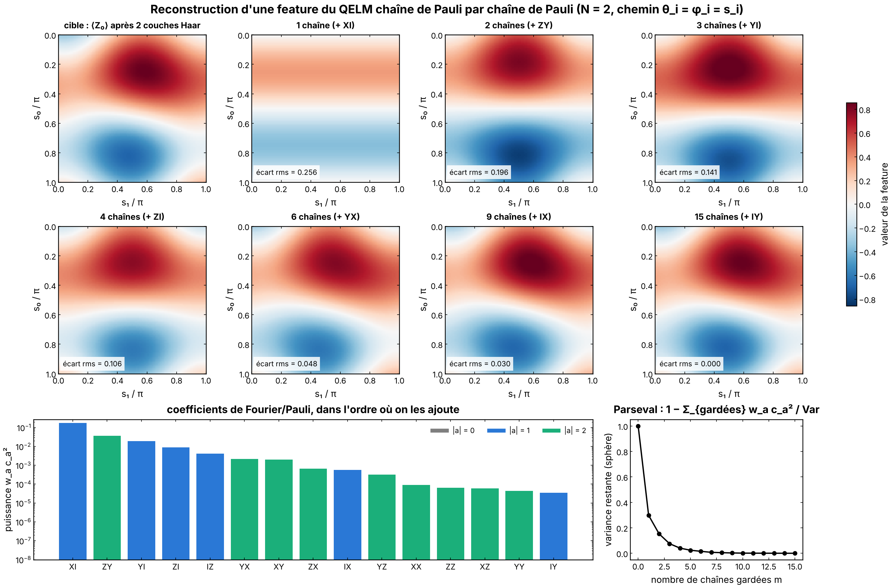
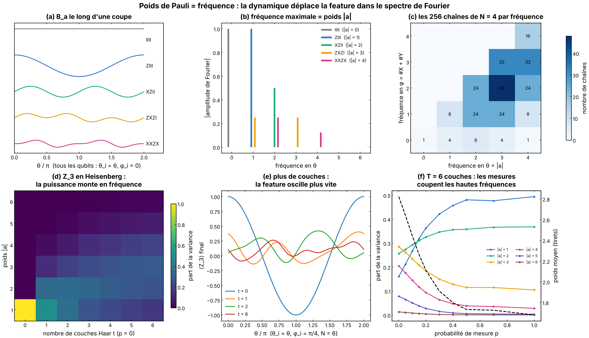
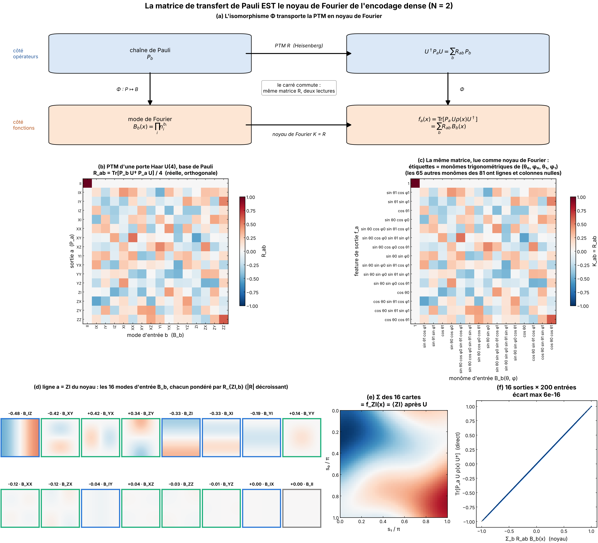
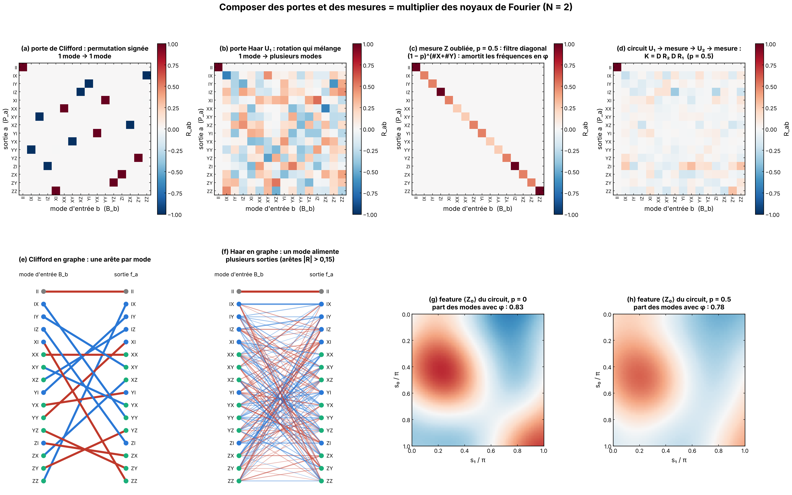

# Pauli strings as Bloch/Fourier monomials in the dense encoding (issue #364)

The Fourier framework of the QELM
([`documentation/notes/cadre-fourier-general.md`](../../documentation/notes/cadre-fourier-general.md),
#353) rests on one identity. For a product input
`rho(x) = prod_i (I + n_i . sigma) / 2` and any operator `O`,

```
Tr[O rho(x)] = sum_a c_a B_a(x),   c_a = Tr[O P_a] / 2^N,   B_a(x) = prod_i n_i^{a_i}   (n^I = 1).
```

A Pauli string `P_a` and the Bloch monomial `B_a` are the same object, seen
from the operator side and from the function side. Every feature of the QELM
(the mean of a record bit, of a final `Z_i`, of a parity) is such a
`Tr[O rho(x)]`, so the readout only ever sees combinations of the `B_a`, and the
circuit and the measurements only set the coefficients `c_a`. This folder
draws that dictionary so it can be seen, not just written. No simulation
campaign: every figure is exact and the script runs in about 15 s.

## Experiment overview

| | |
| --- | --- |
| Script(s) | `experiments/pauli_bloch/plot_pauli_bloch.py`; module `src/QELM/evaluation/pauli_bloch.py` |
| Config | none (command-line options, see `experiments/README.md`) |
| Physical model | dense encoding (`DenseAngleEncoding`): `cos(theta/2)|0> + e^{i phi} sin(theta/2)|1>` per qubit, Bloch vector `n = (sin theta cos phi, sin theta sin phi, cos theta)`; for figures 5 and 6, open Haar U(4) brickwork with Z measurements of probability `p` averaged over outcomes (Z-dephasing) |
| System sizes `N` | 1, 2, 3 (figures 1 to 5), 4 and 6 (figure 6) |
| Control parameters | number of Haar layers `t`, measurement probability `p` |
| Initial state | product state of the dense encoding |
| ML task | none: the features `E[Z_i | x]` and their Pauli/Fourier coefficients |
| Issues / PRs | #364; builds on #353 |

## Methodology

1. **Dictionary.** In the angles, `B_a` is a single product of the real
   trigonometric functions `{1, cos theta, sin theta} x {1, cos phi, sin phi}`
   of each qubit: `I -> 1`, `X -> sin theta cos phi`, `Y -> sin theta sin phi`,
   `Z -> cos theta`. The change of basis from the `4^N` strings to the `9^N`
   trigonometric monomials is a partial permutation (`passage_matrix`).
   The weight `|a|` is the total frequency in the `theta_i`, `#X + #Y` the
   total frequency in the `phi_i` (`frequencies`).
2. **Inner product.** `E[B_a B_b]` is the tensor power of the single-qubit
   moments (`gram_matrix`): `diag(1, 1/3, 1/3, 1/3)` for a Bloch vector uniform
   on the sphere, hence `w_a = 3^{-|a|}`; for `theta, phi` uniform in
   `[0, pi]^2`, the bounds of `DenseAngleEncoding` until issue #368 (the phase
   now spans `[0, 2 pi]`), the moments are not diagonal (Gauss-Legendre quadrature).
3. **Check.** `Tr[P_a rho(x)]` from `DenseAngleEncoding.rho` against the
   closed-form `B_a(x)`, and a random Hermitian `O` against `sum_a c_a B_a`.
4. **Features.** `heisenberg_z`: the Heisenberg image of `Z_i` through the
   Haar layers, each followed by a Z-dephasing of probability `p` on every
   site (the measurements, outcomes forgotten), expanded on the `4^N` strings.
   Weight profile `P_k = sum_{|a| = k} w_a c_a^2` with the sphere weights
   (Parseval: `sum_{k >= 1} P_k` is the variance of the feature on the sphere).

## Results

- The 64 strings of `N = 3` match `Tr[P_a rho(x)]` on 300 random inputs to
  `5.6e-16`; a random observable matches its Pauli expansion to `3.3e-16`.
- Of the 9 real trigonometric functions of one qubit, the dense encoding
  reaches 4: the constant and the three `ell = 1` spherical harmonics. The
  other 5 (`cos phi`, `sin theta`, `cos theta cos phi`, ...) are not a
  `Tr[O rho]` for any `O`: at `N = 2`, 16 of the 81 product monomials are
  reachable, at `N` qubits `4^N` of `9^N`.
- The Pauli strings are orthonormal for `Tr[P_a P_b] / 2^N`, and the `B_a`
  are orthogonal with weights `3^{-|a|}` on the uniform sphere; with `theta,
  phi` uniform in `[0, pi]^2` they are not (largest off-diagonal moment 0.41
  at `N = 2`, for example `E[Y] = 4 / pi^2`).
- `Z_0` after 2 Haar layers (`N = 2`, seed 0) is rebuilt from 3 strings with
  15 % of its variance left, from 4 with 4 %, exactly with all 15
  non-identity strings (`Z_0` is traceless, so `c_II = 0`).
- Haar layers push the weight of `Z_3` (`N = 6`, 20 circuits) to higher
  frequencies: mean weight 1 at `t = 0`, 2.8 at `t = 6`. Z measurements cut it
  back: at `t = 6`, mean weight 2.8 at `p = 0`, 2.1 at `p = 0.2`, 1.7 at
  `p = 1`. These are outcome-averaged features, linear in `rho`: they show
  where the weight goes, not the transition itself.

## Figures

Captions in French: `legendes.md` in the project folder `pauli-bloch-364/`.
All figures by `plot_pauli_bloch.py` (issue #364), seed 0.



**Figure 1. One qubit.** Top: `Tr[P rho(theta, phi)]` on the angle plane
(shaded: `phi > pi`, outside the bounds of the encoding). Middle: the same
function on the Bloch sphere (`ell = 0, 1` harmonics). Bottom: the 3 x 3
lattice of real trigonometric functions of `(theta, phi)`; 4 cells are
Paulis.



**Figure 2. Two qubits as a multiplication table.** Each qubit follows the
path `theta = phi = s`, `s` in `[0, pi]` (corner). Margins: the single-qubit
functions. Centre: `B_ab(s_0, s_1) = n_0^a(s_0) n_1^b(s_1)`, frame colour =
weight.



**Figure 3. Change of basis and inner products, `N = 2`.** (a) The 81
trigonometric monomials as a 9 x 9 table (factor of qubit 0 x factor of
qubit 1): each Pauli string occupies one cell. (b) `Tr[P_a P_b] / 4`.
(c) `E[B_a B_b]` on the uniform sphere. (d) `E[B_a B_b]` for `theta, phi`
uniform in `[0, pi]`.



**Figure 4. Numerical check, `N = 3`.** (a) `Tr[P_a rho(x)]` against
`B_a(x)`, colour = weight. (b) Histogram of the absolute differences.
(c) A random observable along a straight path in the angles, direct and as
`sum_a c_a B_a`, with its five largest terms.



**Figure 5. Reconstruction of a QELM feature, `N = 2`.** `<Z_0>` after two
Haar layers on the plane `(s_0, s_1)` of figure 2, then its partial sums over
the strings in order of decreasing power `w_a c_a^2`. Bottom: the powers, and
the share of the variance left (Parseval, sphere weights).



**Figure 6. Pauli weight = frequency.** (a, b) Along `theta_i = theta`,
`phi_i = 0`, `B_a` has maximal frequency `|a|` in `theta`. (c) The 256
strings of `N = 4` by `(|a|, #X + #Y)`. (d) Share of the variance of `Z_3`
(`N = 6`) per weight against the number of Haar layers, 20 circuits.
(e) The feature along a cut for a few depths, one circuit. (f) At `t = 6`,
share per weight and mean weight (dashed) against `p`.

## The Pauli transfer matrix as the Fourier kernel (issue #369)

Through `P_a <-> B_a`, the Heisenberg PTM of a gate,
`R[a, b] = Tr[P_b U^† P_a U] / 2^N`, is the matrix that maps the input
Fourier modes to the output features:

```
U^† P_a U = sum_b R_ab P_b      <=>      Tr[P_a U rho(x) U^†] = sum_b R_ab B_b(x).
```

Script `plot_ptm_kernel.py` (about 5 s); module functions `layer_unitary`,
`dephasing_ptm`, `circuit_kernel` (`K = D R_T ... D R_1`, row `Z_i` equal to
`heisenberg_z`) and `trig_kernel` (`M^T K M` on the `9^N` trigonometric
monomials).

- `N = 2`, Haar gate, seed 0: the kernel reproduces the 16 outputs on 200
  random inputs to `6e-16`; `R R^T = I` to round-off.
- A Clifford PTM has one nonzero entry per row (a signed permutation of
  modes); the Haar PTM of figure 8 has 15 of 15 non-identity entries per row.
- The Z-dephasing PTM is `diag((1 - p)^(#X + #Y))`: a filter on the `phi`
  frequencies. For the `<Z_0>` feature of a two-layer circuit, the share of
  `sum c_b^2` on modes with a `phi` frequency goes from 0.83 (`p = 0`) to 0.78
  (`p = 0.5`).



**Figure 7. The PTM is the Fourier kernel, `N = 2`.** (a) The commutative
square: conjugation by `U` on the operator side, the kernel `R` on the
function side, the isomorphism `Phi: P -> B` vertically. (b) PTM of a Haar
U(4) gate in the Pauli basis. (c) The same matrix with the trigonometric
monomials as labels. (d) Row `ZI`: the 16 input modes `B_b` on the plane
`(s_0, s_1)` (path `theta_i = phi_i = s_i`), each multiplied by `R_{ZI,b}`;
frame colour = weight. (e) Their sum, the feature `<ZI>` after `U`.
(f) Direct `Tr[P_a U rho U^†]` against the kernel, 16 outputs x 200 inputs.



**Figure 8. Composing gates and measurements multiplies kernels, `N = 2`.**
(a) Clifford PTM. (b) Haar PTM. (c) Dephasing PTM, `p = 0.5`. (d) Kernel of
`U_1`, measurement, `U_2`, measurement: `K = D R_2 D R_1`. (e, f) Clifford and
Haar PTMs as bipartite graphs from input modes to outputs (red positive, blue
negative, width = `|R|`, node colour = weight; Haar edges `|R| > 0.15`).
(g, h) The `<Z_0>` feature of the circuit at `p = 0` and `p = 0.5`.
