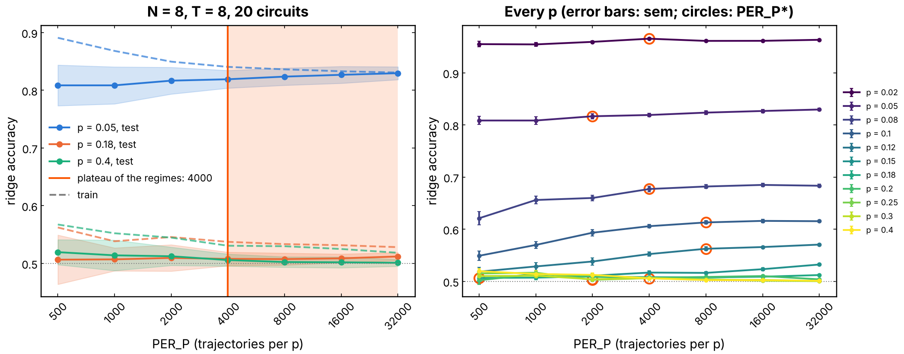
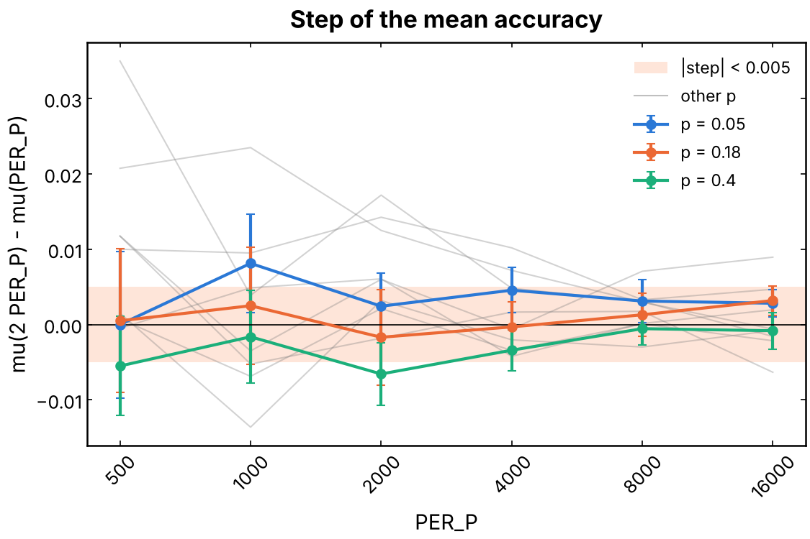
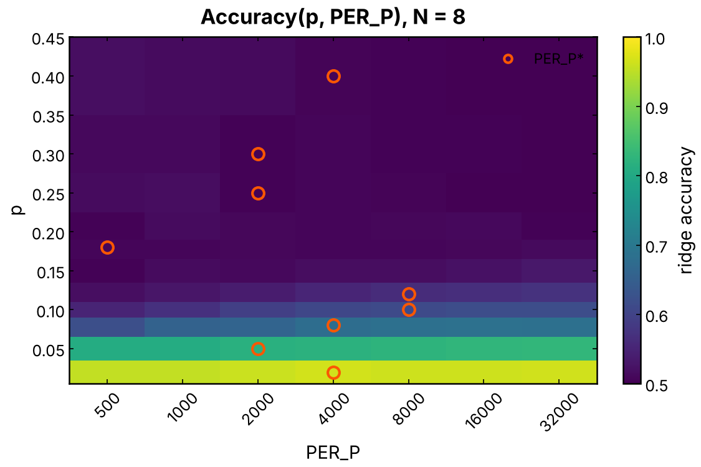
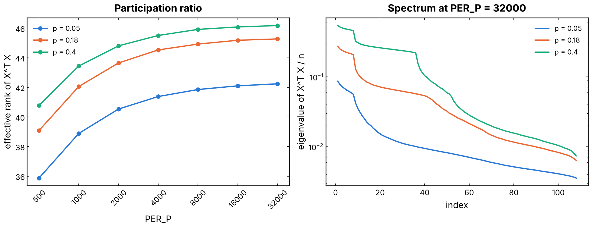
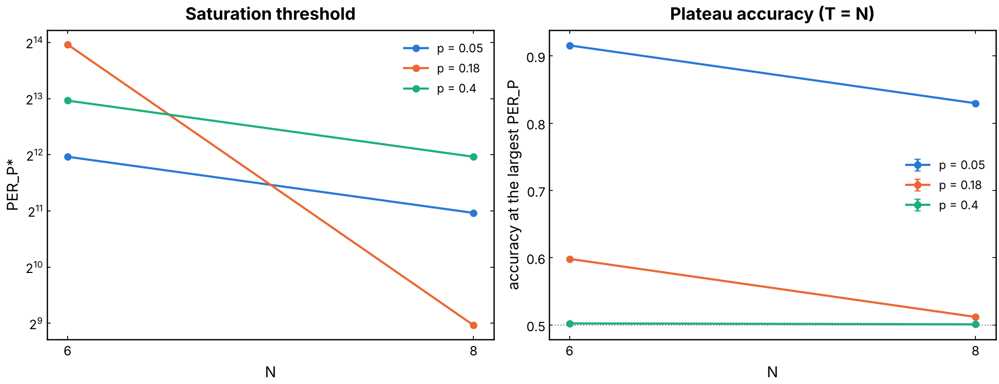

# Statistical convergence of the QELM ridge in `PER_P`

How many trajectories per measurement probability (`PER_P`) does the ridge
of the QELM need before its accuracy stops moving? PR #261
([`haar_readouts`](../haar_readouts/README.md)) reads the charge sector of
a monitored Haar brickwork from the observables of the final state, and its
benchmarks moved with `PER_P`. This experiment (issue #267) fixes the
statistics before the finite-size campaign: it maps the test accuracy over
`(p, PER_P)` at `N = 8`, averaged over 20 independent Haar circuits, finds
the threshold `PER_P*` from which it has saturated, and checks how that
threshold moves with `N`.

## Experiment overview

| | |
| --- | --- |
| Script(s) | `experiments/per_p_convergence/per_p_convergence.py`, launcher `per_p_convergence.sh`, plot `plot_per_p_convergence.py`, merge of cluster jobs `merge_per_p_convergence.py`; notebook `notebooks/results/09_per_p_convergence.ipynb` |
| Config | `conf/per_p_convergence.yaml` (`convergence`) |
| Physical model | open brickwork of Haar-random U(4) gates on the `N` system qubits; each circuit is one fixed draw of gates, the same for every `p` and trajectory; 20 circuits |
| System sizes `N` | 8 (reference), 6 at the three regimes; state vector of `N + 1` qubits |
| Control parameters | `p` in 0.02 ... 0.4 (11 values; regimes 0.05, 0.18, 0.40), `T = n_rounds = N` rounds of one brickwork period and one Z measurement of each system qubit with probability `p`, `PER_P` in 500, 1000, ..., 32 000 |
| Initial state | `(|0>_R |Q1>_S + |1>_R |Q2>_S) / sqrt(2)`, `Q1 = N / 2`, `Q2 = N / 2 - 1` |
| ML task | binary classification of the Z outcome of `R` (the charge sector) from the QELM features of the final system state, `<P_k>` and `<P_i P_j>` (`i < j`) for `P = X, Y, Z` (108 features at `N = 8`, the set `all` of `haar_readouts`); `RidgeCV` (alpha by leave-one-out over `10^-2 ... 10^4`); 80 / 20 split stratified on the label; test accuracy |
| Issues / PRs | #267, follow-up of #261 |

## Methodology

1. For each circuit `c` (generators seeded by `(seed, c)`) and each `p`,
   simulate 32 000 trajectories: the state above, `T` rounds of the gates of
   `c` followed by Z measurements with probability `p`, then `S_R`, the Born
   measurement of `R` (the label `Y = +-1`) and the 108 exact expectation
   values of the system state. All the trajectories of a fixed circuit share
   its gates, so they are simulated together as one array of state vectors
   (2000 at a time); the batched gates, measurements, entropies and
   features are checked against the single-state code of the library in
   `tests/test_per_p_convergence.py`.
2. For each `PER_P`, keep the first `PER_P` trajectories (the sets are
   nested: `PER_P` and `2 PER_P` differ only by the added trajectories), split
   them 80 / 20, fit the ridge and score its test accuracy. Also stored: the
   training accuracy, the chosen alpha, and the eigenvalues of `X^T X / n`
   of the centered training features with their effective rank (the
   participation ratio `(sum l)^2 / sum l^2`).
3. Over the 20 circuits: the mean `mu(p, PER_P)`, the spread `sigma`
   between circuits and the standard error `sigma / sqrt(20)`; the step
   `mu(2 PER_P) - mu(PER_P)` with the standard error of the paired
   difference. `PER_P*` of a `p` is the smallest `PER_P` of the grid from
   which every step is below 0.005 in absolute value.

**What `PER_P` measures here.** The features are the exact expectation
values of each trajectory state: there is no shot noise on a feature.
`PER_P` is the size of the dataset, so the convergence is that of the fit of
108 weights (training set) and of the score (test set, 20 % of `PER_P`: at
`PER_P = 500` one accuracy is known to about ±0.05). A finite number of
shots per feature would add noise on top of this, and is not simulated.

How to run it: [experiments/README.md, "Statistical convergence in `PER_P`"](../README.md#statistical-convergence-in-per_p-issue-267).
At `N = 8` the 11 values of `p` take about 25 minutes on 4 cores; `N = 10`
and more belong on the cluster (one job per circuit with `CIRCUIT_IDS`,
merged afterwards).

## Results and discussion

`N = 8`, `T = 8`, 20 circuits, seed 42 (`outputs/per_p_convergence/N8`):

| `p` | `S_R` | `mu` at 500 | 2000 | 8000 | 32 000 | `sigma` at 32 000 | `PER_P*` |
| --- | --- | --- | --- | --- | --- | --- | --- |
| 0.02 | 0.98 | 0.955 | 0.959 | 0.961 | 0.963 | 0.004 | 4000 |
| 0.05 | 0.95 | 0.808 | 0.817 | 0.824 | 0.830 | 0.011 | 2000 |
| 0.08 | 0.92 | 0.621 | 0.660 | 0.682 | 0.683 | 0.013 | 4000 |
| 0.10 | 0.89 | 0.549 | 0.593 | 0.613 | 0.615 | 0.011 | 8000 |
| 0.12 | 0.85 | 0.518 | 0.538 | 0.562 | 0.570 | 0.009 | 8000 |
| 0.15 | 0.80 | 0.502 | 0.511 | 0.516 | 0.532 | 0.009 | none |
| 0.18 | 0.73 | 0.506 | 0.509 | 0.508 | 0.512 | 0.007 | 500 |
| 0.20 | 0.69 | 0.502 | 0.508 | 0.508 | 0.504 | 0.008 | none |
| 0.25 – 0.40 | 0.57 – 0.25 | ≈ 0.51 | ≈ 0.505 | ≈ 0.503 | 0.500 – 0.501 | ≤ 0.006 | 2000 – 4000 |

- **No universal `PER_P*` inside the grid, for two different reasons.**
  At `p = 0.15` the accuracy is still rising at 32 000 (+0.009 ± 0.002 on
  the last doubling, a 4 σ step): a weak but real signal that more data keeps
  resolving. At `p = 0.20` the last step, −0.006 ± 0.003, is noise around
  chance. Excluding those two, the largest threshold is 8000.
- **The three regimes of the issue do not behave as expected.** With
  `T = N = 8` rounds, the QELM loses the charge at `p ≈ 1/T ≈ 0.12`
  (PR #261: `p* x rounds ≈ 1`), well below `p_c ≈ 0.18`. So `p = 0.18` and
  `p = 0.40` are both at chance (0.512 and 0.501 at 32 000), and their
  `PER_P*` (500 and 4000) only says when the noise of the score falls below
  0.005, not that a signal has converged. Only `p = 0.05` has a plateau
  with content: 0.817 at 2000, 0.830 at 32 000.
- **The convergence is slow where the signal is weak, not where the
  scrambling is strong.** The volume-law side (`p = 0.02, 0.05`) converges
  first (`PER_P* = 2000 – 4000`); the slow points are those where the
  accuracy is just above chance, `p = 0.08 – 0.15`, the edge where the
  information leaves the final state. There, the training accuracy is close
  to the test accuracy (0.55 against 0.53 at `p = 0.15`, `PER_P = 32 000`)
  and the ridge picks large alphas (300 – 10^4): the limit is the size of the
  difference between the two sectors, not an overfit of the 108 weights.
- **Even the converged points creep up.** At `p = 0.05` every doubling
  adds 0.003 (below the tolerance), and the accuracy gains 0.013 from 2000 to
  32 000. The criterion on single doublings accepts a slow logarithmic rise;
  the total drift is the number to watch for a comparison between sizes.
- **Conditioning.** The effective rank of `X^T X` grows from 36 – 41 at
  500 to 42 – 46 at 32 000 and has stopped moving (±1) from 8000. It is
  lower at small `p` (42 at `p = 0.05`) than at large `p` (46 at `p = 0.4`):
  measurements leave the final state closer to a product state, whose 108
  correlators are less redundant. The plateau of the accuracy at small `p`
  comes with that of the rank; at large `p` the rank saturates while the
  accuracy stays at chance (the features vary, but not with the label).
- **Spread between circuits.** `sigma` at 32 000 is 0.004 – 0.013,
  largest at the intermediate `p` where the signal depends on the circuit;
  20 circuits give a standard error of 0.001 – 0.003 on `mu`.
- **`N = 6` (`T = 6`), three regimes.** `PER_P* = 4000, 16 000, 8000` at
  `p = 0.05, 0.18, 0.40`, with plateaus 0.916, 0.598, 0.502. At `N = 6`,
  `p = 0.18 ≈ 1/T` is the weak-signal edge, and it is the slowest point
  again (+0.0076 ± 0.0025 from 8000 to 16 000).
- **Projection to larger `N`: not an exponential law.** `PER_P*` is not
  set by `2**N` but by where `p` sits relative to `1/T`: it goes from 16 000
  (`N = 6`) to 500 (`N = 8`) at `p = 0.18` because that point goes from the
  weak-signal edge to chance, and falls from 4000 to 2000 at `p = 0.05`. A
  fit of `log2 PER_P*` against two sizes (`projection_law`, in the notebook)
  would extrapolate a change of regime. What carries over: with `T = N`,
  the slow zone moves to `p ≈ 1/N` (0.10 at `N = 10`, 0.08 at `N = 12`), and
  needs at least 16 000 – 32 000 trajectories at `N = 8`; `N = 10` has to be
  measured (on the cluster) before a law is fitted.

**Decision for `N = 8`.** `PER_P = 16 000` keeps every mean accuracy within
0.01 of its value at 32 000 (within 0.005 except at `p = 0.15`), with a
standard error of 0.002 over 20 circuits. 8000 is enough away from the edge
(`p <= 0.05` and `p >= 0.2`). For the scaling campaign at `T = N`, keep
16 000 – 32 000 around `p ≈ 1/N`, where the accuracy is still converging,
and report the drift between the two largest `PER_P` with each point.

## Figures

**Figure 1. Convergence profile, `N = 8`, `T = 8`, 20 circuits.** Left: test
accuracy of the ridge against `PER_P` (log2 axis) at `p = 0.05` (volume
law), 0.18 (near `p_c`) and 0.40 (area law), mean over the circuits with a
band of ±1 σ (spread between circuits); dashed, the training accuracy. The
zone shaded in `#fa5703` starts at the largest `PER_P*` of the three regimes
(4000); there is no universal `PER_P*` over every `p`. Right: every `p` of
the run, error bars the standard error over the circuits, circles at
`PER_P*`. The gap between train and test closes as `PER_P` grows; at
`p >= 0.18` both are at chance. Produced by `plot_per_p_convergence.py`
(issue #267).

**Figure 2. Step of the mean accuracy from `PER_P` to `2 PER_P`.** The
three regimes with the standard error of the paired difference over the
circuits, the other `p` in gray, the tolerance band ±0.005 in `#fa5703`.
Below 2000 the steps of the intermediate `p` (gray) reach 0.02 – 0.035; from
8000 everything is in the band but `p = 0.15` (+0.007, +0.009).

**Figure 3. Mean accuracy over `(PER_P, p)`, `N = 8`.** Color scale from
0.5 (chance) to 1; circles at the `PER_P*` of each `p`. The rows
`p = 0.08 – 0.12` brighten from left to right: that is where the data
matter. Above `p ≈ 0.15` the map stays at chance at every `PER_P`.

**Figure 4. Conditioning of the features, `N = 8`.** Left: effective rank
(participation ratio) of `X^T X / n` of the training features against
`PER_P`, mean over the circuits. Right: its eigenvalues at `PER_P = 32 000`,
mean over the circuits, in decreasing order. The rank saturates from about
8000; the leading eigenvalues (about 8 at `p = 0.05`, 36 at `p = 0.4`) are
the directions that the measurements fix.

**Figure 5. Threshold and plateau against `N`, with `T = N`.** Left:
`PER_P*` of the three regimes at `N = 6` and 8 (log2 axis). Right: mean
accuracy at `PER_P = 32 000`, with its standard error. `p = 0.18` drops
from 0.60 to chance between `N = 6` and 8, because `T = N` moves the edge
`p ≈ 1/T` below it; its `PER_P*` drops with it. Two sizes: no law is fitted.
