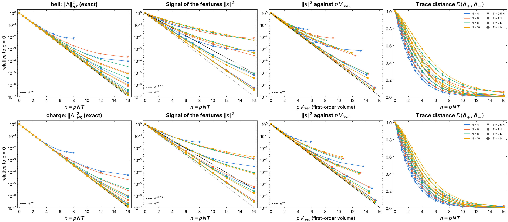
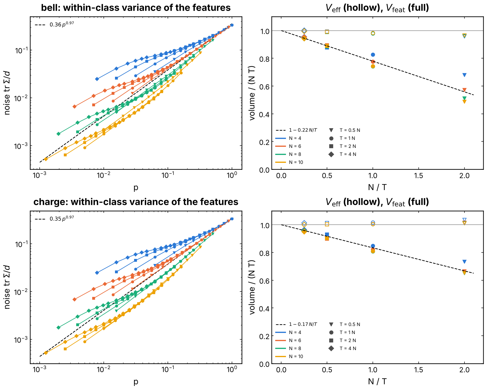
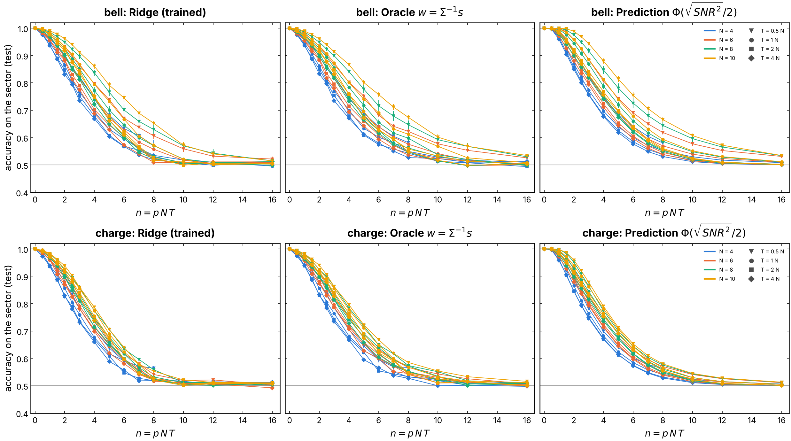
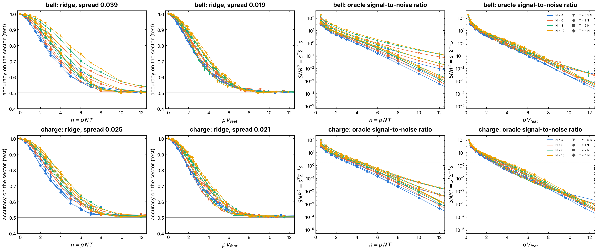
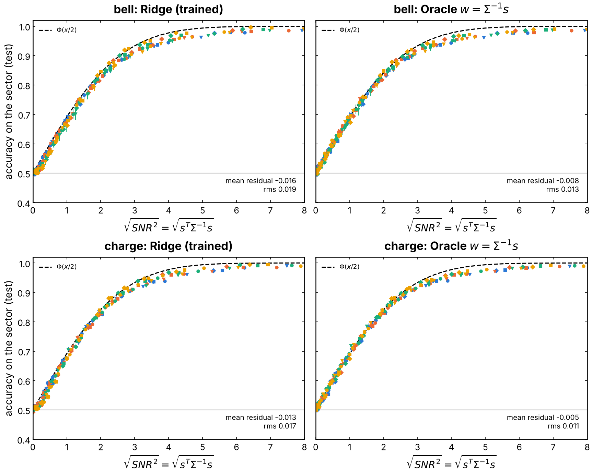
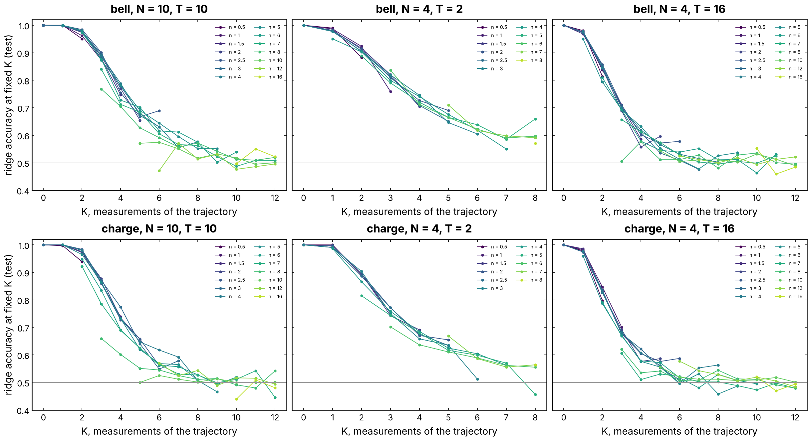
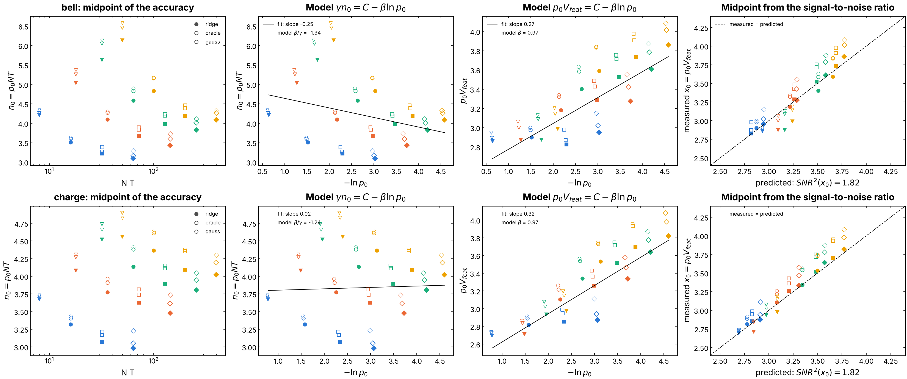

# Why the QELM state readout decays with `p N T`

On a fixed monitored Haar circuit, the QELM ridge on the final-state
features `<P_k>`, `<P_i P_j>` reads the sector of the reference qubit `R`
only while few measurements have hit the chain: its accuracy falls to 1/2
around `n = p N T ≈ 4`, whatever `N` and `T` (#274, #285). This experiment
explains that number. A linear readout sees two things of the feature
distribution, the class means and the within-class covariance, so the
accuracy is set by a signal-to-noise ratio. We compute the signal exactly
from the record-averaged channel, sample the noise, and show that

1. the accuracy is the Gaussian prediction `Phi(sqrt(SNR^2) / 2)` of a
   linear readout, with no free parameter;
2. `SNR^2` is a function of one number, `x = p V_feat`, the expected number
   of measurements inside the backward light cone of the features; `V_feat`
   is computed exactly at `p = 0` and is close to `N T` once `T >= 2 N`;
3. hence the midpoint of the accuracy sits at `p_0 V_feat ≈ 3.2`, where
   `SNR^2` crosses `(2 Phi^-1(0.75))^2 = 1.82`, for all `N, T` and both
   encodings, up to a slow drift with `N`.

The decay with `p N T` is therefore a statement about the averaged state:
each measurement that lands in the light cone dephases the difference of the
two sectors on that site, `||s||^2` shrinks by `e^{-1}` per such measurement,
and the trajectory noise does not shrink with it. It is not a property of
the MIPT: the averaged channel is the same on both sides of `p_c`.

## Experiment overview

| | |
| --- | --- |
| Script(s) | `experiments/pnt_decay/pnt_decay.py` (one run), launcher `pnt_decay.sh`, figures `plot_pnt_decay.py`, notebook `notebooks/results/11_pnt_decay.ipynb` |
| Config | `conf/pnt_decay.yaml` (`Nr = 1`, `haar_circuit.fixed_instance = true`, block `pnt_task`) |
| Physical model | open chain of `N` system qubits plus `R`, brickwork of Haar U(4) gates, one fixed circuit per seed; after each of the `T` rounds (one full brickwork period), Z measurement of each site with probability `p` |
| System sizes `N` | 4, 6, 8, 10 (`N = 12` on the cluster, see below) |
| Control parameters | `p` on a grid in `n = p N T` (0 to 16), depth `T = N/2, N, 2N, 4N` |
| Initial state | `(|0>_R |a> + |1>_R |b>) / sqrt 2`, encodings `charge` and `bell` of #278 |
| ML task | label `Y` = Z outcome of `R`; features `<P_k>`, `<P_i P_j>` of the final state of the chain; readouts: ridge (`RidgeCV`), oracle linear readout `w = Sigma^-1 s`, Gaussian prediction; test accuracy (30 % held out) |
| Statistics | 8 circuits (seeds 42 to 49), 3000 trajectories per `p` |
| Issues / PRs | #305, after #268 (PR #274) and #285 (PR #302) |

## Methodology

For one circuit, at each `p` of the grid:

1. **Signal, exact.** The class means of the features are `Tr(O rho_+-)`,
   with `rho_+-` the final state of the chain averaged over the records
   given the sector. `R` never evolves, so `rho_+-` is the averaged channel
   applied to the sector state: each round, the gates, then the Z-dephasing
   of probability `p` on every site, `rho -> rho ∘ (1 - p)^hamming`. The
   `2^N x 2^N` density matrix is evolved without sampling. Outputs:
   `s = Tr(O (rho_+ - rho_-))`, its norm `||s||^2`, the Hilbert-Schmidt norm
   `||Delta||_HS^2` of `Delta = rho_+ - rho_-` and the trace distance.
2. **Volumes, exact.** Dephasing site `k` multiplies by `1 - p` the Pauli
   components of `Delta` with `X` or `Y` on `k`. To first order in `p`,
   `||Delta||_HS^2 = exp(-p V_eff)` with `V_eff = sum_t sum_k 2 w_k(t)` and
   `w_k(t)` the weight of those components after round `t` (`V_eff = N T`
   for a scrambled `Delta`). The same rate for the signal of the features,
   `||s||^2 = exp(-p V_feat)`, is computed from `s` at `p = 10^-4`. In the
   Heisenberg picture `V_feat` counts the space-time points inside the
   backward light cone of the 1- and 2-site observables, so `V_feat < N T`,
   with a deficit of order `N^2` from the last rounds.
3. **Noise, sampled.** 3000 trajectories (the code of
   `experiments/nonlinear_M`), split 70 / 30. On the training part, the
   within-class covariance `Sigma` (Ledoit-Wolf, features centered on the
   exact means) and the ridge. On the test part: the ridge; the oracle
   `w = Sigma^-1 s` with the exact means, the best linear readout; the
   Gaussian prediction `Phi(sqrt(SNR^2) / 2)` with `SNR^2 = s^T Sigma^-1 s`;
   and the ridge restricted to the trajectories with `K` measurements.
4. **Sweep.** The runs are averaged over the 8 circuits (standard error as
   error bars). Each accuracy curve is fitted by a sigmoid in `p`, whose
   midpoint `p_0` (accuracy 0.75) gives `n_0 = p_0 N T`.

How to run it, and the cluster settings: see
[`experiments/README.md`](../README.md#run-why-the-qelm-state-readout-decays-with-p-n-t-issue-305).

## Results and discussion

Campaign: encodings `charge` and `bell`, `N = 4, 6, 8, 10`, `T = N/2, N, 2N,
4N`, 8 circuits (seeds 42 to 49), 3000 trajectories per `p`, 16 values of
`p N T` from 0 to 16 (256 runs, 4 cores, about 5 hours), then the exact part
alone (`SAMPLE=0`) for `V_feat`. Numbers from
[`figures/pnt_summary.json`](figures/pnt_summary.json).

**1. The averaged state forgets the sector at one e-fold per measurement.**
`V_eff / (N T)` is 0.96 to 1.03 for every `(N, T)`, and `||Delta||_HS^2`
follows `e^{-p N T}` down to `10^-5` (Figure 1, left). This is exact
(no sampling): the record-averaged channel is a product of dephasings, and
a scrambled `Delta` has half of its weight on `X, Y` of every site.

**2. The features see only the measurements inside their light cone.**
`V_feat / (N T)` depends on `N / T` alone for `T >= N`, and follows
`1 - c N / T` with `c = 0.17` (charge) and `0.22` (bell) (Figure 2, right):

| `T / N` | 1/2 | 1 | 2 | 4 |
| --- | --- | --- | --- | --- |
| `V_feat / (N T)`, charge | 0.65 to 0.73 | 0.81 to 0.85 | 0.90 to 0.93 | 0.95 to 0.96 |
| `V_feat / (N T)`, bell | 0.49 to 0.68 | 0.74 to 0.83 | 0.88 to 0.90 | 0.94 to 0.96 |

The deficit `c N^2` is the part of space-time, near the end of the circuit,
outside the backward light cone of the 1- and 2-site observables: a
measurement there changes the state but not `<P_k>`, `<P_i P_j>`. At
`T = N / 2` the cone never covers the chain and `V_feat / (N T)` drops
further, more for bell (whose information sits near the middle site). The
`Z`-diagonal features (`V_Zfeat`) have a slightly smaller volume than the
others (`V_XYfeat`).

**3. The accuracy is the Gaussian prediction of a linear readout.** Over the
512 points `(encoding, N, T, p)`, the oracle `w = Sigma^-1 s` lies on
`Phi(sqrt(SNR^2) / 2)` with an rms residual of 0.011 (charge) and 0.013
(bell), and the trained ridge 0.017 and 0.019, 0.01 to 0.02 below it (it
estimates the means from 2100 trajectories) (Figure 5). Nothing else of the
feature distribution matters: the readout fails when `SNR^2` falls below
about 2.

**4. `SNR^2` is a function of `p V_feat`.** Against `p N T` the curves of
`SNR^2` fan out by a factor 10 at `n = 8`; against `x = p V_feat` they fall
on one line, `SNR^2 ≈ 34 e^{-0.9 x}` for both encodings (Figure 4, right).
The noise itself is not universal: `tr Sigma / d` at fixed `p` falls with
`N` by more than a decade from `N = 4` to `10` and grows as `p^{0.97}` only
globally (Figure 2, left); it cancels in `SNR^2` with the `N` dependence of
the signal.

**5. The midpoint is where `SNR^2` crosses 1.82.** The sigmoid midpoint of
the ridge, in units of measurements in the light cone, is
`x_0 = p_0 V_feat = 3.19 ± 0.36` (charge) and `3.23 ± 0.34` (bell), against
`n_0 = p_0 N T = 3.84 ± 0.46` and `4.22 ± 0.82`. Predicting `x_0` for each
`(N, T)` from its own `SNR^2` curve, as the `x` where the fit
`A e^{-kappa x}` reaches `(2 Phi^-1(0.75))^2 = 1.82`, gives the measured
ridge midpoint with an rms error of 0.06 (charge) and 0.12 (bell), over
`x_0` from 2.7 to 3.9 (Figure 7, right). The oracle and Gaussian midpoints
lie 0.1 to 0.2 above, as their accuracies lie above the ridge.

**6. The readout counts the measurements of the trajectory, not `p`.** At a
fixed number `K` of measurements, the ridge accuracy is the same for every
`p` (Figure 6): about 0.7 at `K = 3` for `N = 4, T = 16`, and 0.75 at
`K = 4` for `N = 10, T = 10`. Since `K` is Poisson of mean `p N T`, the decay in
`p N T` is the decay in `K`.

**What remains.**

- The light cone removes the depth dependence: the short circuits
  (`T = N / 2`), which sat at `n_0 = 4.5` to `6.1`, move to `x_0 = 2.7` to
  `3.2`, and the spread of the accuracy curves drops from 0.039 to 0.019
  (bell) and from 0.025 to 0.021 (charge) (Figure 4, titles).
- A slow drift with `N` stays: at `T = 4 N`, `x_0` goes from 2.9 (`N = 4`)
  to 3.8 (`N = 10`). It comes from `SNR^2`, not from the volume: the rate
  `kappa` falls from 0.92 to 0.78 at long `T`, probably because the tail of
  `||s||^2` decays slower than its first order (Figure 1, third panel). In `-ln p_0` it reads
  `x_0 ≈ C + 0.3 (-ln p_0)` (Figure 7, third panel), much weaker than the
  slope `beta = 0.97` that a noise `c p^beta` independent of `N` would give,
  so the simple model `gamma n_0 = C - beta ln p_0` is ruled out.
- The power law of #285 is recovered for the ridge: `p_0 ∝ N^{-0.62} T^{-1.08}`
  (charge), `N^{-0.48} T^{-1.18}` (bell). These exponents are consistent with `V_feat`
  (which grows faster than `T` at `T ≲ N`) combined with the drift above.
- `N = 12` (16 times the exact cost of `N = 10`) would test whether the drift
  of `x_0` saturates: see the cluster command in
  [`experiments/README.md`](../README.md#run-why-the-qelm-state-readout-decays-with-p-n-t-issue-305).
- The averaged channel has no transition: the decay is the same on both
  sides of the MIPT (`p_c ≈ 0.17` for Haar U(4)), and the state readout of a
  linear QELM cannot probe it.

## Figures

**Figure 1. The exact signal.** Per encoding (rows), against `n = p N T`:
`||Delta||_HS^2` relative to `p = 0` with `e^{-n}` (dashed); `||s||^2` of the
features relative to `p = 0`, with the global fit `e^{-gamma n}`; the same
against `p V_feat`, with `e^{-x}`; the trace distance of `rho_+-`. Color: `N`;
marker: `T / N`; error bars: standard error over 8 circuits. The averaged
state forgets the sector at exactly one e-fold per expected measurement; the
features forget it more slowly at short `T`, where part of the measurements
fall outside their light cone. `plot_pnt_decay.py` (#305).

**Figure 2. Noise and volumes.** Left: the mean within-class variance
`tr Sigma / d` of the features against `p` (log-log), with the fit
`c p^beta`. Right: `V_eff / (N T)` (hollow) and `V_feat / (N T)` (full)
against `N / T`, with the light-cone line `1 - c N / T`. The noise depends
on `N` and grows sublinearly with `p`: it is not a function of `n`, unlike
the signal-to-noise ratio. `plot_pnt_decay.py` (#305).

**Figure 3. Accuracy against `n = p N T`.** The trained ridge, the oracle
linear readout and the Gaussian prediction, against `n`, for every `(N, T)`.
The three agree within 0.02; the curves of short depth (`T = N / 2`, down
triangles) lie to the right. `plot_pnt_decay.py` (#305).

**Figure 4. The collapse.** The ridge accuracy, then the oracle `SNR^2`
(log scale), against `p N T` and against `p V_feat`; the title gives the
spread of the accuracy curves (mean standard deviation across `(N, T)` on
`[0, 8]`), the dashed line `SNR^2 = 1.82`, where the Gaussian prediction is
0.75. In `p V_feat` both quantities fall on one curve, `SNR^2 ≈ A e^{-kappa x}`.
`plot_pnt_decay.py` (#305).

**Figure 5. Accuracy against `sqrt(SNR^2)`.** The ridge and the oracle, every
`(N, T, p)`, with `Phi(x / 2)` (dashed), the accuracy of a linear readout on
Gaussian classes with these means and covariance. The text gives the mean
and rms residual. The accuracy is set by the signal-to-noise ratio alone.
`plot_pnt_decay.py` (#305).

**Figure 6. Accuracy at a fixed number of measurements `K`.** The ridge on
the test trajectories with exactly `K` measurements, against `K`, one curve
per `n`, for three `(N, T)`. The curves for different `p` overlap: what
destroys the readout is the number of measurements a trajectory received,
not `p` itself. `plot_pnt_decay.py` (#305).

**Figure 7. Midpoints.** `n_0 = p_0 N T` of the three accuracies against
`N T`; against `-ln p_0`, with the fit and the slope `beta / gamma` of the
model `gamma n_0 = C - beta ln p_0`; `p_0 V_feat` against `-ln p_0`; and
`p_0 V_feat` against its prediction from the `SNR^2` curve of the same
`(N, T)` (dashed: equality).
Filled: ridge; hollow: oracle and Gaussian. `plot_pnt_decay.py` (#305).
