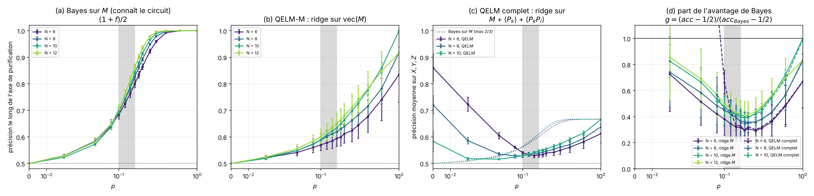
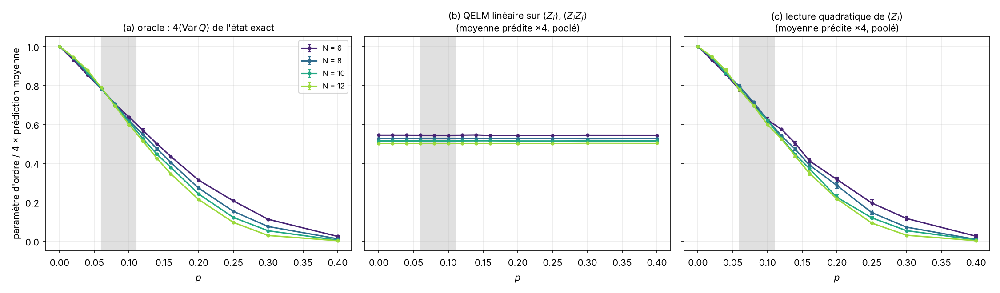
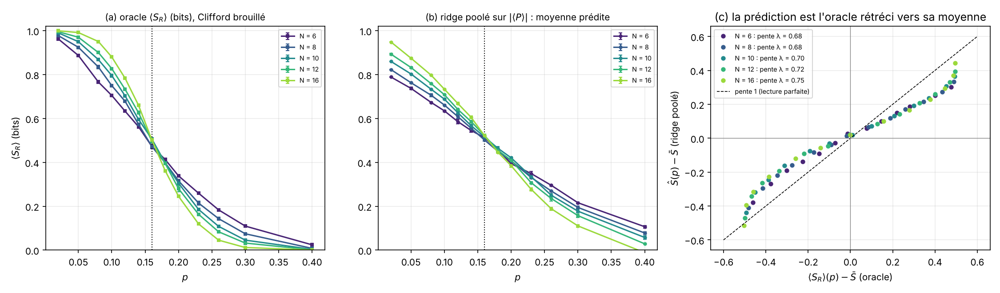
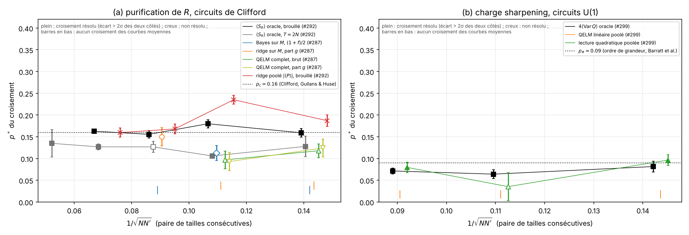
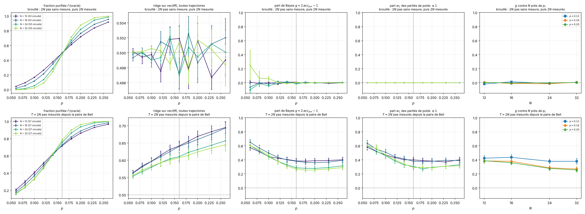

# Can the QELM see the MIPT? One criterion applied to every result (issue #303)

Does the QELM readout (a ridge on the record `M` and on the final-state
features `<P_k>`, `<P_k P_l>`) show the measurement-induced phase transition?
This folder runs no simulation. It reads the summaries of earlier experiments
and applies **one** finite-size criterion to all of them, for the readouts and
for the oracle on the same data. It also draws the four figures of the French
note [`documentation/notes/qelm-voit-il-la-mipt.md`](../../documentation/notes/qelm-voit-il-la-mipt.md),
which holds the argument map (proven, measured, conjectured), the verdict per
case and the computations still missing.

## Experiment overview

| | |
| --- | --- |
| Script(s) | `experiments/qelm_verdict/plot_verdict.py` (no launcher, no simulation) |
| Config | none (command-line option `--out`) |
| Physical model | the models of the source experiments: Clifford brickwork (#287, #292), random U(1) brickwork (#299) |
| System sizes `N` | 6 to 12 (#287), 6 to 16 (#292, scrambled), 6 to 20 (#292, `T = 2N`), 6 to 12 (#299) |
| Control parameters | measurement probability `p` |
| Initial state | that of each source experiment |
| ML task | none trained here; the readouts are those of the sources (ridge on `M`, full QELM `M + <P_k> + <P_k P_l>`, pooled ridges on the state) |
| Issues / PRs | #303; data from #287 (PR #289), #292 (PR #295), #299 (PR #300) |

## Methodology

1. **Inputs.** `experiments/dehghani_decoder/figures/summary.json` (on `main`)
   and three figure-data files from the project folder, copied into `sources/`:
   - `clifford_state_readout_{scrambled,T2N}_order_parameter.json` (#292): the
     oracle `<S_R>` and the pooled readouts;
   - `charge_variance_order_parameter.json` (#299): the oracle `4 <Var Q>`
     and the pooled linear and quadratic readouts.

   Each curve is a mean over circuits or seeds, with its standard error.
2. **Crossings.** For every pair of consecutive sizes, the script finds the
   zeros of the difference of the mean curves for `0.03 <= p <= 0.6`, by
   linear interpolation. A crossing is **resolved** if the difference is below
   `-2` combined standard errors at one `p` and above `+2` at a larger `p` (or
   the reverse). The error of `p*` is the standard deviation over 2000
   Gaussian redraws of the points.
3. **Bayes share.** `g = (acc - 1/2) / (acc_Bayes - 1/2)` on the same
   trajectories. It is left undefined where Bayes is within 0.01 of chance.
   For the ridge on `M` (case 1 of #287) it equals `2 acc_pure - 1`.
4. **Shrinkage.** For a pooled readout, the script fits `yhat - ybar` against
   `y - ybar`, one point per `p`, where `ybar` is the mean of the oracle over
   `p` (each `p` has the same number of trajectories).

How to run it:
[Draw the QELM verdict figures](../README.md#draw-the-qelm-verdict-figures-issue-303).

## Results and discussion

- **No QELM readout has a resolved crossing on the Clifford record data of
  #287. The oracle has none either** (`f` and Bayes, 6 circuits per size). That
  data set cannot decide either way.
- **The share of Bayes recovered by the QELM does not fall with `N`.** At
  `p = 0.16`, the ridge on `M` has `g` = 0.30, 0.36, 0.39, 0.40 for
  `N = 6, 8, 10, 12`, and the full QELM has 0.33, 0.35, 0.42 for
  `N = 6, 8, 10`. If this holds at larger `N`, the QELM accuracy inherits the
  transition of the purified fraction `f` without seeing it itself. This is
  the open question; the note proposes the run that settles it.
- **The scrambled `S_R` oracle crosses at 0.159, 0.180, 0.156, 0.163**, all
  resolved. The pooled ridge on `|
|` crosses too (0.187, 0.235, 0.168,
  0.160), but its prediction is the oracle shrunk toward its mean, with slope
  `λ` = 0.68, 0.68, 0.70, 0.72, 0.75 (`N = 6` to 16). Since the oracle equals
  its mean near `p_c`, the crossing is inherited and is not a measurement of
  `S_R` (Figure 3).
- **U(1) charge variance.** The oracle crosses at 0.081, 0.064, 0.071, all
  resolved. The pooled quadratic readout crosses at 0.096 and 0.080 (resolved)
  and has an unresolved crossing at 0.027 for `N = 8/10`. The pooled linear
  readout never crosses: it is flat, as the note proves.

## Figures

**Figure 1. Clifford: the same circuits read by Bayes, by the ridge on `M`
and by the full QELM, and the Bayes share `g`.** Data of #287, `T = 2N`,
6 circuits. The axes, curves and error bars are described in the caption of
Figure 1 of the note. Produced by `plot_verdict.py` (#303).

**Figure 2. U(1): the oracle `4 <Var Q>`, and the pooled linear and quadratic
readouts of the same states.** Data of #299. The linear readout is flat, and
the quadratic one follows the oracle. Produced by `plot_verdict.py` (#303).

**Figure 3. Scrambled Clifford: the oracle `<S_R>`, the pooled ridge on
`|
|`, and the shrinkage of its prediction toward the mean.** Data of #292.
Produced by `plot_verdict.py` (#303).

**Figure 4. Crossing position `p*` against `1/sqrt(N N')` for every
quantity.** Filled markers: resolved crossing. Hollow markers: a crossing of
the means that is not resolved. Bottom ticks: no crossing of the means.
Produced by `plot_verdict.py` (#303).

### Clifford run to `N = 32` (calcul 6.A)

`clifford_fss.py` reruns case 1 of #287 (ridge on `M`, Bayes, purified
fraction, weight-1 parities) for `N = 12, 16, 24, 32` in two regimes:
scrambled (`2N` unmeasured steps, then `2N` measured; 20 circuits, 6000
trajectories per `p`) and `T = 2N` (27 circuits, 10 000 trajectories per `p`).
`plot_clifford_fss.py` draws `figures/clifford_fss.png` and writes
`figures/clifford_fss_summary.json`.

- **Scrambled.** The oracle `f` crosses at 0.160, 0.168, 0.159 (resolved). The
  ridge is at chance: `g = 0 ± 0.02` and `w1 = 0`.
- **`T = 2N`.** `g(p = 0.16)` = 0.385, 0.380, 0.287, 0.270 (±0.03) and tracks
  `w1`. The ridge curves decrease with `N` and do not cross.

**Figure 5. The QELM-M against the oracle up to `N = 32`.** Top: scrambled;
bottom: `T = 2N`. Columns: purified fraction `f`, ridge accuracy over all
trajectories, Bayes share `g`, share `w1` of weight-1 parities, and `g` against
`N` at `p = 0.12, 0.16, 0.20`. Error bars: standard error over circuits.
Produced by `plot_clifford_fss.py` (#303).

`fss_state_features.png` and `fss_ridge_bayes.png` (Figures 5 and 6 of the
note) are copies of PNGs from a project-folder run of the code on the branch
of #291 (N = 6, 8, 10). That code is not on `main`, and their data were not
saved. `figures/verdict_summary.json` holds every crossing, share and fit.
