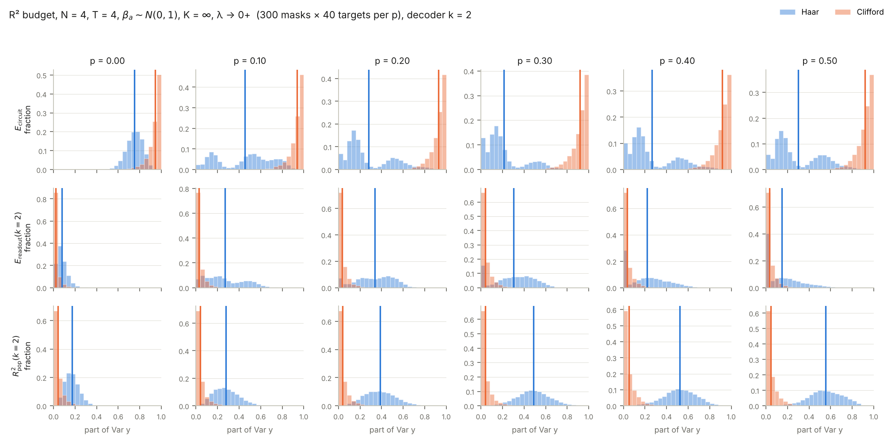
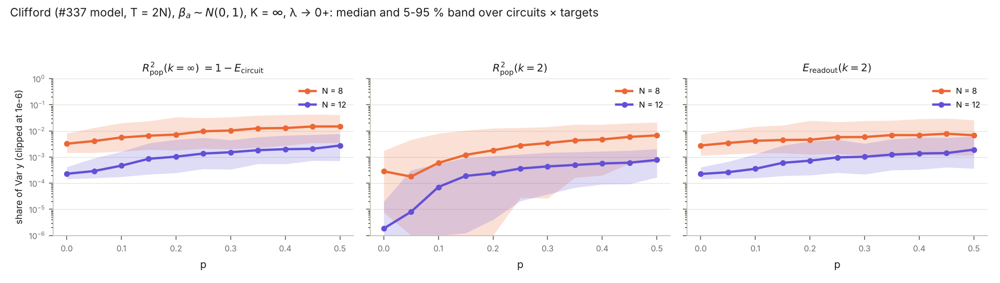
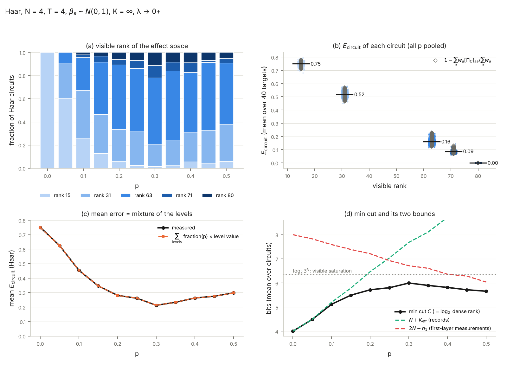
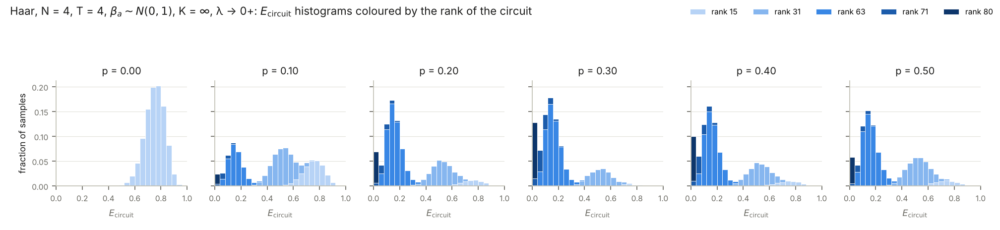
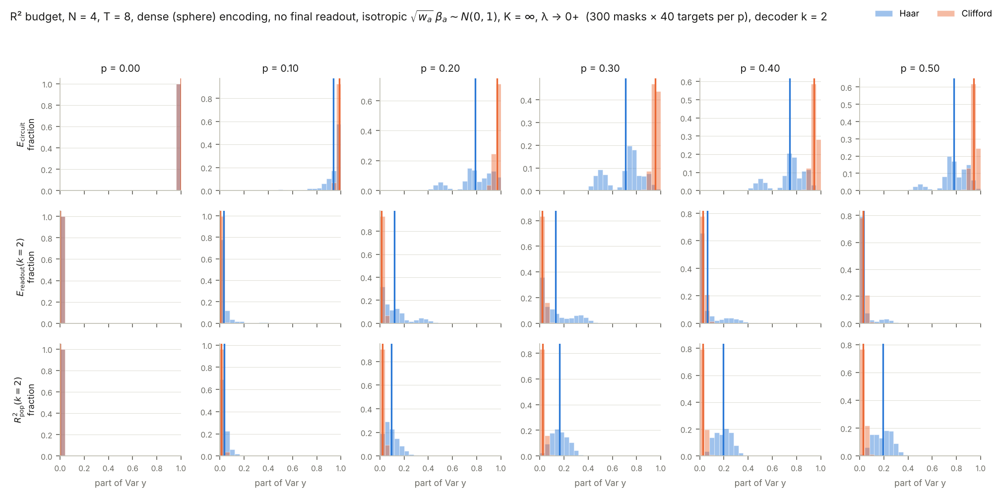
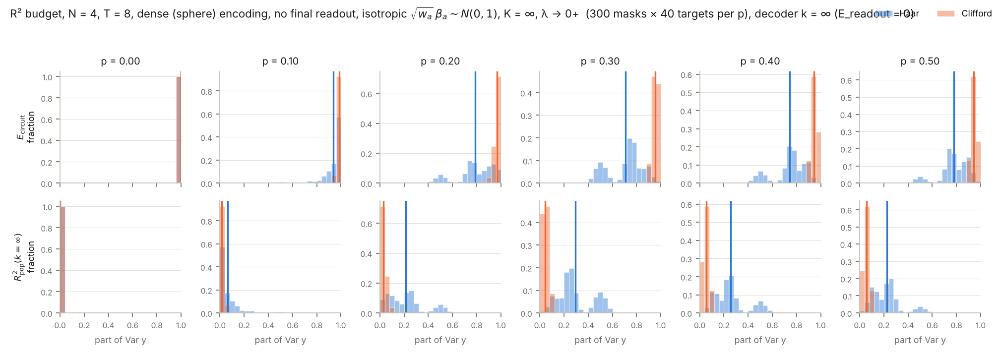

# R² budget of random dense targets against p, Clifford and Haar (issue #360)

For each measurement rate `p`, the distribution over circuits and targets of the
population error budget

    1 = E_circuit + E_readout(k) + R²_pop(k)

in the limit `K = ∞` shots, infinite training set, `λ → 0+`
(`E_estimation = 0`), for targets built on the Bloch monomials
(`E_encoding = 0`). The French legends of the figures are in
[`legendes.md`](legendes.md).

## Experiment overview

| | |
| --- | --- |
| Scripts | `run.py` (subcommands `dense`, `clifford`), `plot.py`, launcher `run.sh` |
| Library | `QELM.evaluation.r2_budget` (uses `fourier_framework` #353 and `clifford_ridge` #337) |
| Targets | `y = Σ_{a ≠ I} β_a B_a(x)` on the `3^N − 1` Y-free strings, XZ inputs, `w_a = 2^{-|a|}`. Prior `iid`: `β_a ~ N(0, 1)` (main). Prior `flat`: `√w_a β_a ~ N(0, 1)` (equal power per string) |
| Decoders | `k = 1, 2` (parities of at most `k` record bits), `k = ∞` (every parity, `E_readout = 0`). Clifford route also `k = 3` |
| Dense route | `N = 4`, open brickwork of #353, `T = N`, final `Z` readout. Each mask is used with Haar and with Clifford gates and the same targets. 300 masks × 40 targets per `p`, 11 values of `p` in `[0, 0.5]`. Masks with more than 16 bits are redrawn (at most 2 of 300, at `p = 0.5`) |
| Clifford route | `N = 8` (200 circuits) and `N = 12` (100 circuits), periodic brickwork of #337, `T = 2N`, 40 targets per circuit |
| Cost | about 1 h on 4 cores (`run.sh`) |

## Methodology

**Population ridge = W-orthogonal projection.** In whitened coordinates
`g = W^{1/2} β`, the ridge on features `C` at `λ → 0+` is the orthogonal
projector on the row space of `C W^{1/2}` (`a ≠ I`, free intercept). The
dense route builds an orthonormal basis of that space by SVD for the full
record (`Π_C`) and for the parities of at most `k` bits (`Π_C^(k)`, from
`fourier_framework.parity_features`), and returns the three squared norms
and the cross term `2⟨(1 − Π_C)g, (Π_C − Π_C^(k))g⟩` explicitly.

**Clifford by counting.** The features span the Pauli strings of the effect
group `G` (all parities) and of the parity dictionary `D_k`. Distinct Pauli
monomials are W-orthogonal, so a projection keeps the coefficients on its
strings: `E_circuit = Σ_{a ∉ G} w_a β_a² / Var y` and
`E_readout(k) = Σ_{a ∈ G \ D_k} w_a β_a² / Var y`. `D_k ⊂ G` is checked
for each circuit.

**What is random.** Gates, mask and target. At `K = ∞` the features are the
record probabilities, so measurement outcomes are averaged, not sampled.

## Tests (`tests/test_r2_budget.py`)

- dense budget sums to one, cross term `< 1e-12`, terms in `[0, 1]`, `E_readout`
  decreasing in `k` (Haar and Clifford, `N = 3`);
- dense `E_circuit` equals `population_error`, dense `E_readout(1)` equals
  `two_filter_split`; `k` = number of bits gives `E_readout = 0`;
- the counting route equals the `λ = 0` ridge fitted on all `4^N` product
  inputs (`N = 4`, Clifford), term by term;
- target priors, string indexing, seed reproducibility, smoke test of
  `run.py` and `plot.py`.

## Run

    experiments/r2_budget/run.sh
    uv run python experiments/r2_budget/plot.py --data outputs/r2_budget

`figures/` holds the PNG and the JSON summaries (per-`p` histograms on 40 bins,
means, quantiles, largest cross term). The per-sample `.npz` files are not in
the repository (about 20 MB).

## Results

- **Exact identity.** Over every sample, `|E_circuit + E_readout + R² − 1|`
  and the cross term are at most `3.8e-10` (largest at 16 bits, from the SVD
  cut-off of two separately computed bases; `< 1e-14` below 12 bits).
- **Clifford, `N = 4`.** `E_circuit ≈ 0.93` at every `p` (0.94 at `p = 0`,
  0.92 at `p = 0.5`); `E_readout(2) ≈ 0.03`, `R²(2) ≈ 0.04`. The histogram of
  `E_circuit` is a narrow peak near 1 that does not move with `p`.
- **Haar, `N = 4`.** `E_circuit` drops from 0.75 (`p = 0`) to a minimum 0.21
  at `p = 0.3`, then rises to 0.30 at `p = 0.5` (`iid`). Its histogram is
  multi-modal: each mode is one value of the rank of the span of the effects
  (15, 31, 63, 71 or 80 = all visible strings, observed at `p = 0.3`).
  `E_readout(2)` peaks at 0.34 near `p = 0.2`; `R²(2)` rises from 0.17 to
  0.55 and `R²(∞) = 1 − E_circuit` reaches 0.79 at `p = 0.3`.
- **Clifford, larger `N`.** `R²(∞) = 1 − E_circuit` falls with `N`
  (`iid`: 0.4 % → 1.8 % at `N = 8`, 0.02 % → 0.33 % at `N = 12`, from
  `p = 0` to `0.5`). With the `flat` prior it equals the visible fraction of
  `G`, at most `(2^N − 1)/(3^N − 1)`. It increases smoothly with `p`, with no
  feature at `p_c = 0.161`.
- **Priors.** `flat` gives the same picture with larger Haar `E_circuit`
  (0.81 at `p = 0`, 0.26 at `p = 0.3`); Clifford is unchanged at `N = 4`.

## Rank structure of the Haar modes (issue #362)

`rank_structure.py` replays the circuits of `run.py dense` (same seeds and
order of draws; the first circuit of each `p` is recomputed from scratch and
matches the stored samples) and computes `r2_budget.rank_profile` for each:
dense rank (backward recursion of `effect_rank`, no record listed), visible
rank (rows of `span_basis`), min cut `C` (`effect_rank.mincut_bits`, #321),
`K_eff` (mid-circuit measurements before the last layer), `n_1`
(first-layer measurements), and `mean_r2 = Σ_a w_a [Π_C]_aa / Σ_a w_a`.
`plot_rank_structure.py` draws the figures.

    uv run python experiments/r2_budget/rank_structure.py --prior iid   # about 10 min
    uv run python experiments/r2_budget/plot_rank_structure.py

- **Exact.** The Haar dense rank is `2^C` for all 3300 circuits (as in
  #321). The visible rank takes five values only: `C = 4, 5, 6` give
  `15, 31, 63` (`= 2^C − 1`), `C = 7` gives `71` (155 circuits) or `80`
  (179 circuits), `80 = 3^4 − 1` being every visible string.
- **The modes are the rank levels.** `E_circuit` is set by the rank level
  to within a spread of 0.02 (std over circuits): 0.75, 0.52, 0.16, 0.09
  and 0 for ranks 15, 31, 63, 71 and 80 (`iid`). The mean `E_circuit(p)` is
  the level fractions times these five values, to within 0.002 at every `p`.
- **What moves the levels.** The rank is `2^C`, and `C` is bounded by the
  records, `N + K_eff`, and by the first-layer measurements, `2N − n_1`.
  `min(N + K_eff, 2N − n_1)` equals `C` for 100 % of circuits at
  `p ≤ 0.05` and 67–77 % at `p ≥ 0.2`; the full min cut is needed beyond.
  Mean `C` rises from 4 (`p = 0`) to a maximum of 6.0 at `p = 0.3`, then
  falls to 5.66 at `p = 0.5` as the first-layer bound takes over.
- **The optimum at `p = 0.3` is not a saturation.** Rank 63 is the most
  common level from `p = 0.15` on (57 % at `p = 0.3`); the full rank 80 is
  reached by at most 11 % of circuits (at `p = 0.3`). The minimum of the mean
  `E_circuit` is where the level fractions are shifted furthest up.
- **Clifford** (same masks): the visible rank is the number of visible
  strings of `G`, from 0 to 15, broadly spread at every `p`
  (`clifford.levels` in the JSON).

## No final readout, `T = 2N`, isotropic target in dense encoding (issue #363)

Same budget, now with the record made of the mid-circuit measurements only,
`T = 2N = 8`, the dense encoding (six Pauli eigenstates per site, weights
`w_a = 3^{-|a|}` on all `4^N` strings) and an isotropic target
(`√w_a β_a ~ N(0, 1)` on the 255 non-identity strings: every mode carries the
same variance). 300 masks × 40 targets per `p`, Haar and Clifford on the
same masks and targets.

At `T = 2N` a record can hold 30 bits, too many to list. `recursive_budget`
does not list records: `Π_C` comes from `effect_basis` (the backward
recursion of #317, started from the identity alone when there is no final
readout) and `Π_C^(k)` from `parity_operator_rows`, which evolves each parity
operator `O_S` backwards (`E[(-1)^{m_S} | ρ] = Tr[ρ O_S]`; a measured bit maps
`O → P_0 O P_0 ± P_1 O P_1`). Both are tested against record listing
(`N = 3`, with and without final readout, XZ and sphere, Haar and Clifford).

    uv run python experiments/r2_budget/run.py dense --n 4 --depth 8 --no-final \
        --ensemble sphere --method recursive --prior flat   # about 16 min

- Identity exact to `2.1e-11` over every sample.
- `p = 0`: no bit at all, `E_circuit = 1` for both.
- **Haar.** `R²(∞) = 1 − E_circuit` rises to 0.29 at `p = 0.3`, then falls
  to 0.22 at `p = 0.5`. With `k = 2`, `R²(2)` goes up to 0.19 and stays
  there, while `E_readout(2)` peaks at 0.14 near `p = 0.25` and drops to 0.03
  at `p = 0.5`. `E_circuit` is bimodal from `p = 0.2` on (one mode near
  0.5, one near 0.8): rank levels again.
- **Clifford.** `R²(∞)` grows slowly to 0.056 at `p = 0.5`; `E_circuit`
  stays above 0.94 at every `p`.
- For an isotropic target, `E[R²(∞)] ≈ dim / 255` with `dim` the rank of the
  span (minus the identity): the budget is the rank seen as a fraction of
  all modes.
