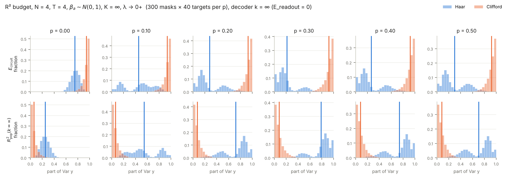
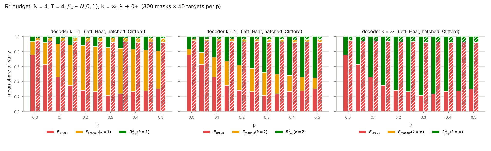

# R² budget of random dense targets against p, Clifford and Haar (issue #360)

For each measurement rate `p`, the distribution over circuits and targets of the
population error budget

    1 = E_circuit + E_readout(k) + R²_pop(k)

in the limit `K = ∞` shots, infinite training set, `λ → 0+`
(`E_estimation = 0`), for targets built on the Bloch monomials
(`E_encoding = 0`). The French legends of the figures are in
[`legendes.md`](legendes.md).

## Experiment overview

| | |
| --- | --- |
| Scripts | `run.py` (subcommands `dense`, `clifford`), `plot.py`, launcher `run.sh` |
| Library | `QELM.evaluation.r2_budget` (uses `fourier_framework` #353 and `clifford_ridge` #337) |
| Targets | `y = Σ_{a ≠ I} β_a B_a(x)` on the `3^N − 1` Y-free strings, XZ inputs, `w_a = 2^{-|a|}`. Prior `iid`: `β_a ~ N(0, 1)` (main). Prior `flat`: `√w_a β_a ~ N(0, 1)` (equal power per string) |
| Decoders | `k = 1, 2` (parities of at most `k` record bits), `k = ∞` (every parity, `E_readout = 0`). Clifford route also `k = 3` |
| Dense route | `N = 4`, open brickwork of #353, `T = N`, final `Z` readout. Each mask is used with Haar and with Clifford gates and the same targets. 300 masks × 40 targets per `p`, 11 values of `p` in `[0, 0.5]`. Masks with more than 16 bits are redrawn (at most 2 of 300, at `p = 0.5`) |
| Clifford route | `N = 8` (200 circuits) and `N = 12` (100 circuits), periodic brickwork of #337, `T = 2N`, 40 targets per circuit |
| Cost | about 1 h on 4 cores (`run.sh`) |

## Methodology

**Population ridge = W-orthogonal projection.** In whitened coordinates
`g = W^{1/2} β`, the ridge on features `C` at `λ → 0+` is the orthogonal
projector on the row space of `C W^{1/2}` (`a ≠ I`, free intercept). The
dense route builds an orthonormal basis of that space by SVD for the full
record (`Π_C`) and for the parities of at most `k` bits (`Π_C^(k)`, from
`fourier_framework.parity_features`), and returns the three squared norms
and the cross term `2⟨(1 − Π_C)g, (Π_C − Π_C^(k))g⟩` explicitly.

**Clifford by counting.** The features span the Pauli strings of the effect
group `G` (all parities) and of the parity dictionary `D_k`. Distinct Pauli
monomials are W-orthogonal, so a projection keeps the coefficients on its
strings: `E_circuit = Σ_{a ∉ G} w_a β_a² / Var y` and
`E_readout(k) = Σ_{a ∈ G \ D_k} w_a β_a² / Var y`. `D_k ⊂ G` is checked
for each circuit.

**What is random.** Gates, mask and target. At `K = ∞` the features are the
record probabilities, so measurement outcomes are averaged, not sampled.

## Tests (`tests/test_r2_budget.py`)

- dense budget sums to one, cross term `< 1e-12`, terms in `[0, 1]`, `E_readout`
  decreasing in `k` (Haar and Clifford, `N = 3`);
- dense `E_circuit` equals `population_error`, dense `E_readout(1)` equals
  `two_filter_split`; `k` = number of bits gives `E_readout = 0`;
- the counting route equals the `λ = 0` ridge fitted on all `4^N` product
  inputs (`N = 4`, Clifford), term by term;
- target priors, string indexing, seed reproducibility, smoke test of
  `run.py` and `plot.py`.

## Run

    experiments/r2_budget/run.sh
    uv run python experiments/r2_budget/plot.py --data outputs/r2_budget

`figures/` holds the PNG and the JSON summaries (per-`p` histograms on 40 bins,
means, quantiles, largest cross term). The per-sample `.npz` files are not in
the repository (about 20 MB).

## Results

- **Exact identity.** Over every sample, `|E_circuit + E_readout + R² − 1|`
  and the cross term are at most `3.8e-10` (largest at 16 bits, from the SVD
  cut-off of two separately computed bases; `< 1e-14` below 12 bits).
- **Clifford, `N = 4`.** `E_circuit ≈ 0.93` at every `p` (0.94 at `p = 0`,
  0.92 at `p = 0.5`); `E_readout(2) ≈ 0.03`, `R²(2) ≈ 0.04`. The histogram of
  `E_circuit` is a narrow peak near 1 that does not move with `p`.
- **Haar, `N = 4`.** `E_circuit` drops from 0.75 (`p = 0`) to a minimum 0.21
  at `p = 0.3`, then rises to 0.30 at `p = 0.5` (`iid`). Its histogram is
  multi-modal: each mode is one value of the rank of the span of the effects
  (15, 31, 63, 71 or 80 = all visible strings, observed at `p = 0.3`).
  `E_readout(2)` peaks at 0.34 near `p = 0.2`; `R²(2)` rises from 0.17 to
  0.55 and `R²(∞) = 1 − E_circuit` reaches 0.79 at `p = 0.3`.
- **Clifford, larger `N`.** `R²(∞) = 1 − E_circuit` falls with `N`
  (`iid`: 0.4 % → 1.8 % at `N = 8`, 0.02 % → 0.33 % at `N = 12`, from
  `p = 0` to `0.5`). With the `flat` prior it equals the visible fraction of
  `G`, at most `(2^N − 1)/(3^N − 1)`. It increases smoothly with `p`, with no
  feature at `p_c = 0.161`.
- **Priors.** `flat` gives the same picture with larger Haar `E_circuit`
  (0.81 at `p = 0`, 0.26 at `p = 0.3`); Clifford is unchanged at `N = 4`.
