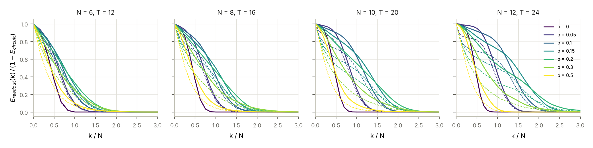
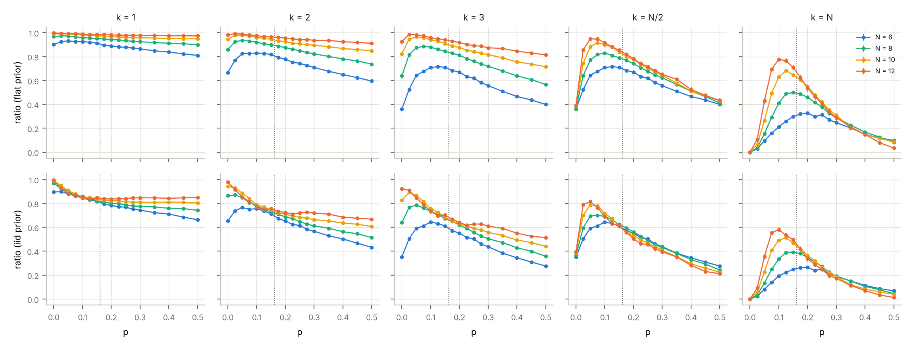
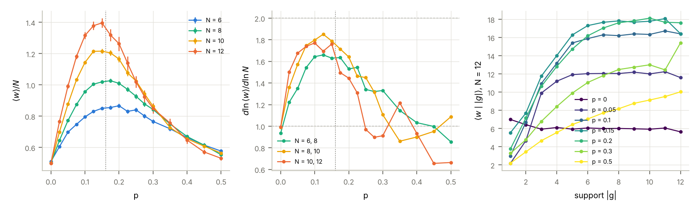
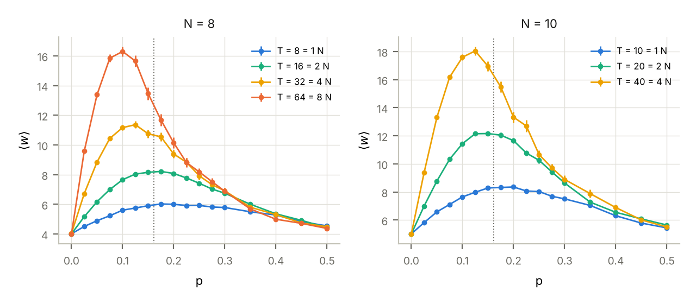
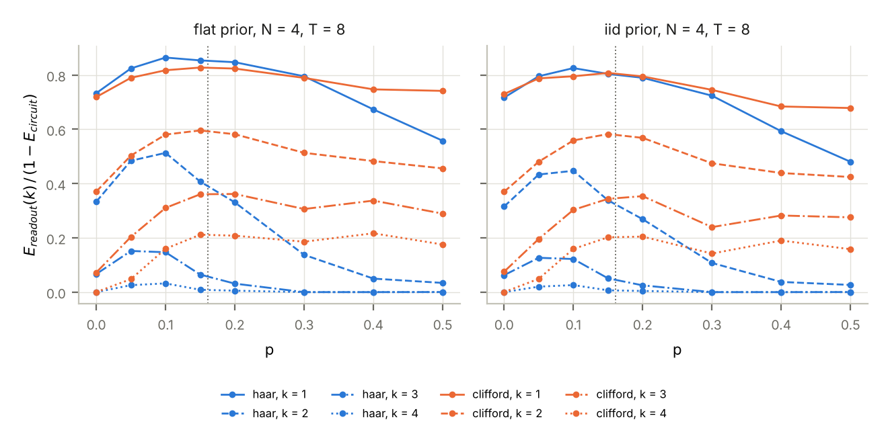

# Locality of the readout: `E_readout(k)` against `p` and `k` (issue #386)

The population budget of #360 is `1 = E_circuit + E_readout(k) + R²_pop(k)`
(`K = ∞`, `λ → 0+`). `E_readout(k) = ‖(Π_C − Π_C^(k)) β‖²_W / ‖β‖²_W` is the
part of the target that the circuit transmits but that a ridge on the parities
of at most `k` record bits cannot read. For dense random targets it is crushed
by `E_circuit` (below 0.003 for Clifford at `N = 12`, #360). This study
therefore uses the **relative readout error**

    ε(k) = E_readout(k) / (1 − E_circuit) = 1 − R²(k) / R²(∞),

the fraction of the transmitted information that the k-local decoder misses,
for every `k`. The French legends of the figures are in
[`legendes.md`](legendes.md).

## Experiment overview

| | |
| --- | --- |
| Library | `QELM.evaluation.readout_locality` (new), uses `clifford_ridge` (#337) |
| Scripts | `run.py` (Clifford, exact `w(g)`), `haar.py` (Haar and Clifford, `N = 4`), `plot.py`, launcher `run.sh` |
| Clifford | Periodic brickwork of #337, final `Z` readout, `T = 2N`. N = 6 and 8: 400 circuits; N = 10: 300; N = 12: 100. 17 values of `p` in `[0, 0.5]`. Gates and mask numbers `u` are drawn once per circuit, with nested masks `u < p` |
| Depth control | `N = 8`: `T = N, 4N, 8N`; `N = 10`: `T = N, 4N`. 200 circuits each |
| Haar | Open brickwork of `fourier_framework`, `N = 4`, `T = 8`, XZ inputs. 48 circuits, 8 values of `p`, `k = 1 .. 4`. Haar and Clifford gates on the same masks |
| Priors | flat (equal power per visible string) and iid (`w_a = 2^{-|a|}`), as in #360 |
| Cost | Clifford about 1 h 15 on 4 cores (`N = 12` dominates, about 5 s per circuit and `p`); Haar about 1 h |

## Method: the minimal parity weight `w(g)`

In the Clifford QELM, the mean of the parity `∏_{j∈S} (−1)^{m_j}` is
`Tr[ρ O_S]`, where `O_S` is one Pauli string or zero. Two facts make this
**linear over GF(2)** in the indicator vector of `S`, and the tests check both
against `parity_strings`:

- Without dephasing, the back-propagated string of `S` is the sum `B S` of the
  strings of its bits.
- `O_S` survives iff, at every mid-circuit measurement `(t, k)`, the string of
  the later bits of `S` commutes with `Z_k`. That is one linear constraint
  per measurement, written `A S = 0`.

So the effect group is `G = B ker A`. Each `g ∈ G` has a minimal parity weight
`w(g) = min{|S| : A S = 0, B S = g}`, and `g` is read by the `k`-parity ridge
iff `w(g) ≤ k`. Hence:

- flat prior: `ε(k)` is the fraction of the visible strings of `G` with `w > k`;
- iid prior: the same fraction, with each string weighted by `2^{-|g|}`.

`min_parity_weights` computes `w` exactly for all `4^N` strings by dynamic
programming backwards in time. The table `D[o]` holds the fewest bits of an
alive set of later bits whose string is `o`. The steps are:

- the final readout seeds `D[z] = |z|`;
- a measurement drops the strings with `x_k = 1`, then relaxes
  `D[o] ← min(D[o], D[o Z_k] + 1)`;
- a gate permutes the table.

The cost is `O((n_mid + NT) 4^N)`, with no record or set listed. Brute force
over `ker A` (`N = 4, 6`) and `r2_budget.clifford_masks` (`k ≤ 3`) agree
exactly.

For Haar there is no `w`. `haar.py` uses traces instead: for an isotropic
target, `E[ε(k)] = (rank Π_C − rank Π_C^(k)) / rank Π_C`. For the iid prior,
it uses `Σ_a w_a [·]_aa` in place of the ranks.

## Results

- **`p = 0`.** `w(g)` is the number of `Z` factors of the preimage of `g`,
  binomial with mean `N/2`. The profile `ε(k)` is a sharp step at `k ≈ N/2`.
- **`ε(k)` at fixed small `k` is close to 1 and rises with `N` at every `p`**
  (flat, `k = 3`: 0.40 at `N = 6` and 0.81 at `N = 12`, `p = 0.5`). A decoder
  with fixed `k` reads a vanishing share of `G`. The relevant scale is
  `k ∝ N` or more.
- **The mean weight `⟨w⟩` is non-monotonic in `p`, with a maximum near
  `p_c`.** Peak of `⟨w⟩` at `T = 2N` (bootstrap over circuits):

  | N | p_max | ⟨w⟩ at max | ⟨w⟩/N |
  | --- | --- | --- | --- |
  | 6 | 0.18 ± 0.05 | 5.14 | 0.86 |
  | 8 | 0.165 ± 0.006 | 8.21 | 1.03 |
  | 10 | 0.152 ± 0.005 | 12.2 | 1.22 |
  | 12 | 0.141 ± 0.007 | 16.6 | 1.39 |

  The peak height grows faster than `N`: the local exponent
  `d ln⟨w⟩ / d ln N` is between 1.6 and 1.85 for `0.07 ≤ p ≤ 0.17`, and
  between 0.7 and 1 at `p ≥ 0.35`. `p_max` drifts down with `N`. At these
  sizes it is not a converged estimate of `p_c`.
- **The two phases differ in how `w` depends on the support and on the
  depth.**
  - At `p ≤ 0.2`, `⟨w | |g|⟩` saturates at `|g| ≈ 4` to a value set by the
    system: a string of support 4 costs as many bits as one of support `N`.
    `⟨w⟩` grows with `T` at fixed `N` (`N = 8`, `p = 0.1`: 5.6, 7.7, 11.2 and
    16.3 for `T = N, 2N, 4N, 8N`). Reading an input operator requires
    cancelling the dephasing of the measurements along its history, so the
    cost scales with the number of mid-circuit bits on the way.
  - At `p ≥ 0.3`, `⟨w | |g|⟩` grows steadily with `|g|` (local reading).
    `⟨w⟩` does not depend on `T` (`N = 8`, `p = 0.3`: 6.7, 6.9 and 6.9 for
    `T = 2N, 4N, 8N`): the information is read from the early bits near each
    site.

  The peak at fixed `T = 2N` sits between the two regimes. Its downward
  drift with `N` is consistent with `T = 2N` growing with `N`: the `T`
  dependence is strongest at small `p`.
- **Fluctuations over circuits.** The standard deviation of `⟨w⟩/N` over
  circuits is largest at `p = 0.35, 0.3, 0.275, 0.2` for `N = 6, 8, 10, 12`.
  It moves towards `p_c` as `N` grows.
- **Crossings.** Some `ε(k = αN)` curves cross between consecutive `N`, but
  the crossings drift and have not converged. For example, iid prior,
  `k = N`: 0.30 (6/8), 0.24 (8/10), 0.18 (10/12). No (`p_c`, `ν`) is claimed
  from them.
- **Haar, `N = 4`.** The Haar span saturates fast in `k`: `ε(3) ≤ 0.15` and
  `ε(4) ≤ 0.03` at every `p`. Clifford on the same masks has
  `ε(3)` between 0.2 and 0.36.
  One Haar parity spans many Pauli modes, while one Clifford parity is one
  string. `ε(1)` and `ε(2)` are non-monotonic for both, with a maximum at
  `p ≈ 0.1–0.15`. For Haar, `ε(2)` falls from 0.51 (`p = 0.1`) to 0.03
  (`p = 0.5`).

**Reading.** `E_readout(k)` is not small because the circuit hides
information, but because the information it transmits is non-local in the
record. In the volume-law phase, `w` grows with the system and with the
depth: about `N^{1.7}` at `T = 2N`. In the area-law phase it is set by the
support of the target and does not depend on `T`. The order needed by a
linear decoder, `k_{1/2} ≈ median w`, is thus a readout-side signature of the
transition. It needs larger `N`, or a `T`-independent definition (for
example `∂⟨w⟩/∂T`), before an FSS estimate of `p_c` can be made.

## Tests (`tests/test_readout_locality.py`)

- `A`, `B` reproduce `parity_strings` (aliveness and string) on 2000 random
  sets.
- The DP equals brute force over `ker A` (`N = 4, 6`).
- `G` and `D_k` from the DP equal `clifford_masks` for `k = 1, 2, 3`.
- `relative_readout` equals `E_readout / (1 − E_circuit)` from
  `counting_budget` (flat and iid).
- At `p = 0` the weights are binomial.
- `nullspace_gf2` is checked.
- `run.py` is reproducible with the seed, and `haar.py` passes a smoke test.

## Run

    experiments/readout_locality/run.sh
    uv run python experiments/readout_locality/haar.py --n 4 --circuits 48 --k-max 4 \
        --p 0 0.05 0.1 0.15 0.2 0.3 0.4 0.5
    uv run python experiments/readout_locality/plot.py

`figures/summary.json` holds every curve drawn. The `.npz` files are in
`outputs/`, which is not tracked.
