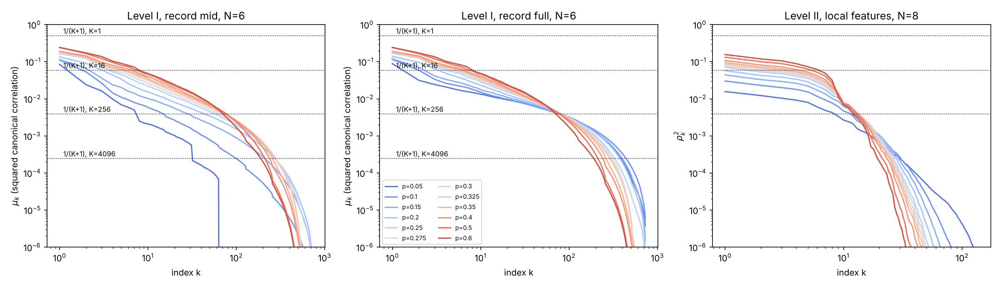
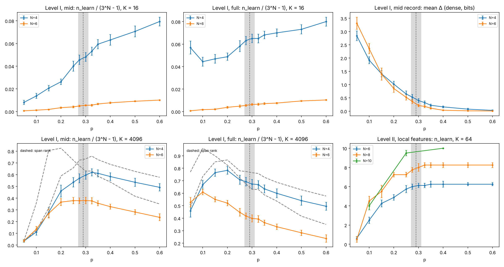
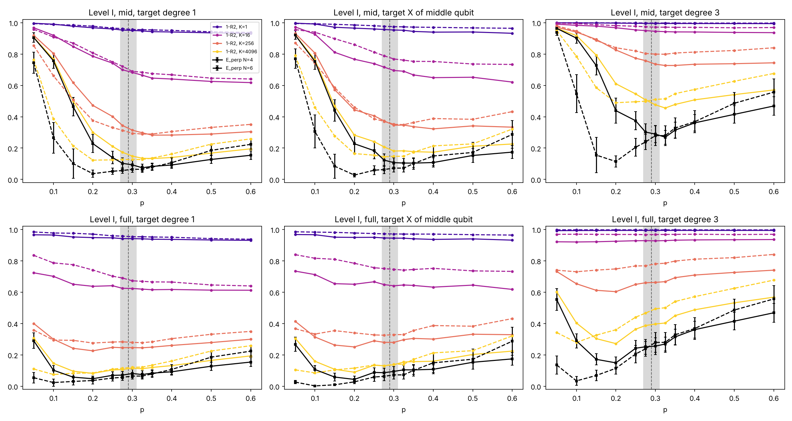
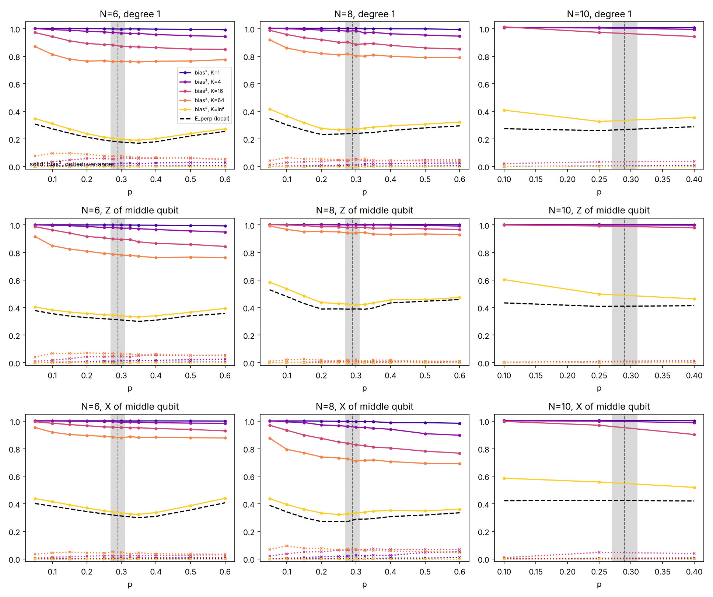
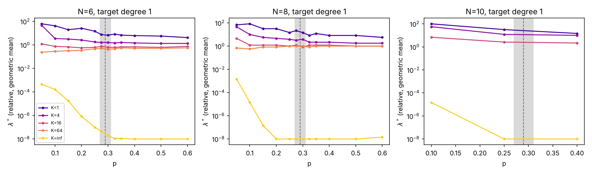
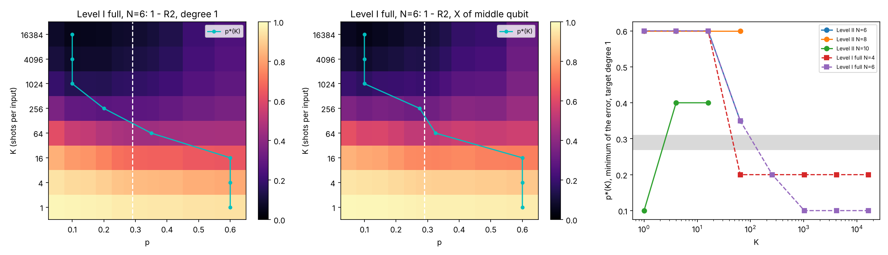

# Spectrum of the effects and ridge bias/variance across the MIPT

Does the measurement-induced transition (MIPT) set the conditioning of the
ridge readout of the QELM (hypothesis A)? Is it a bias/variance transition
of that readout, with an incompressible bias below `p_c` and `p ≈ p_c` as
the optimal trade-off (hypothesis B)? This folder tests both on the same
Haar circuits (issue #334). Two levels are measured: the full measurement
record, which is the limit any readout of the record can reach, and the
local features of the actual QELM, read by a ridge regression.

## Experiment overview

| | |
| --- | --- |
| Script(s) | `experiments/ridge_spectrum/ridge_spectrum.py` (subcommands `level1`, `level2`), launcher `ridge_spectrum.sh`, figures `plot_ridge_spectrum.py` |
| Library | `QELM.evaluation.ridge_spectrum` |
| Physical model | open brickwork of Haar gates, convention of `experiments/effect_mipt`: one layer = even bonds, odd bonds, then a `Z` measurement of each site with probability `p`; depth `T = 2N`; `p_c = 0.29 ± 0.02` in this convention (#322) |
| Circuits | gates of `effect_mipt.py` (`seed, N, 0`); level I uses the fixed nested mask `u < p` of `effect_rank.py`; level II draws a fresh mask for every shot |
| Records | `mid`: mid-circuit outcomes only (effects of rank `2^Delta`); `full`: plus the final `Z` readout of every site (rank-one effects, the standard QELM) |
| Inputs | angle encoding `prod_i (I + sin t_i X_i + cos t_i Z_i) / 2`, angles uniform on the **full circle**, so the Bloch monomials are orthogonal, `E[B_a B_b] = 2^{-abs(a)} delta_ab` |
| Targets | `k1`, `k2`, `k3`: Gaussian weights on the monomials of degree 1, 2, 3; `x_mid`, `z_mid`: `sqrt(2) sin` and `sqrt(2) cos` of the middle input angle; all of unit variance |
| Sizes and samples | Level I: `N = 4` (20 seeds, 5000 records per point), `N = 6` (8 seeds, 6000 records). Level II: `N = 6` (8 seeds) and `N = 8` (4 seeds), 256 shots per input, 1000 / 500 / 500 train / validation / test inputs; `N = 10` (4 seeds, `p` = 0.1, 0.25, 0.4, 32 shots, 600 / 200 / 200 inputs) |
| Control parameters | `p` = 0.05, 0.1, ..., 0.25, 0.275, 0.3, 0.325, 0.35, 0.4, 0.5, 0.6; shots per input `K` |
| Issues / PRs | #334; builds on #313 / #321 (rank), #322 / #325 (`Delta`), #309 (local features) |

## Methodology

**Why not the condition number of `X^T X`.** Two points of the original
formulation are corrected. For product inputs, the covariance of the record
probabilities is `C_mm' = sum_a w_a c_a(m) c_a(m')`, with `w_a = 2^{-abs(a)}`
for the angle encoding. It is not proportional to `Tr(E_m E_m')`. Its raw
condition number is also infinite at every `p`: `sum_m Pr(m | x) = 1`, and
there are more records than the rank. What matters is the signal spectrum
against the shot-noise floor.

**Level I (full record).**

1. Draw a record with the Born rule of the mixed input. This input is the
   mean of the input ensemble, so `Pr(m) = c_0(m)`. Take its effect `E_m`,
   with or without the final readout.
2. The conditional mean of the orthonormal input function `f_a = B_a / sqrt(w_a)`
   given the record is `v_a(m) = sqrt(w_a) c_a(m) / c_0(m)`.
3. `F = E_m[v v^T]` is estimated from 6000 records (`N = 6`). Its
   eigenvalues `mu_k` lie in `[0, 1]`: they are the squared canonical
   correlations between one shot of the record and the input. With `K`
   shots of the same input, the best linear readout of the record histogram
   reaches `R2_k(K) = K mu_k / (1 + (K - 1) mu_k)` on direction `k`.
   `n_learn(K) = #{mu_k > 1 / (K + 1)}` counts the directions with
   `R2_k > 1/2`.
4. Population error of each target: `1 - R2(K) = 1 - sum_k z_k^2 R2_k(K)`.
   The limit `K -> inf` is `E_perp`, the weight of the target outside the
   span of the effects. `E_perp` is computed exactly by the backward
   recursion of `effect_rank` (`effect_span`); the sampled estimate
   agrees with it within 0.004 at every point. This is the only incompressible bias:
   no number of shots or inputs removes it.

**Level II (local features of the QELM).**

1. The features are `M_{t,i}` (`±1` if measured, `0` otherwise) and the
   final `Z_i`, `T N + N` of them, as in `fourier_tasks`. Each input gets
   256 shots (batched Born sampler `sample_shots`). The disjoint groups of
   `K` shots give `256 / K` independent repetitions of the `K`-shot mean
   (capped at 16).
2. A ridge with an unpenalised intercept is fitted for each relative
   `lambda` in `10^-8 ... 10^2` (in units of the mean eigenvalue of the
   training covariance). `lambda*` minimises the validation error.
3. At `lambda*`: the test error, the squared bias of the mean prediction
   over repetitions, and the variance over repetitions, all in units of the
   test variance of the target (`1 - R2`). `K = inf` uses the exact mean
   features `C(p) B(theta)`.
4. The population quantities come from `C(p)`: the local `E_perp`, and the
   canonical correlations `rho_k^2` of one shot of the local features
   (`generalized_spectrum`).

Decision criteria, fixed in #334 before running:

- A holds if `n_learn` at finite `K` jumps or crosses between sizes at
  `p_c ± 0.03` while the rank does not.
- B ("incompressible bias") holds if `E_perp` dominates below `p_c` and does
  not decrease with `K`.
- B ("optimal trade-off") holds if the minimum `p*(K)` stays within
  `p_c ± 0.05` for `K = 4` to 256.

How to run it: [`experiments/README.md`](../README.md#run-the-effect-spectrum-and-ridge-biasvariance-issue-334).

## Results and discussion

**Verdict.**

- A holds only in a weak, smooth form.
- B as stated is refuted. The incompressible bias is on the measured side
  (`p > p_c`), not below `p_c`.
- The optimum `p*(K)` moves across `p_c` as the number of shots grows; it
  is not pinned there.
- The mechanism is a pivot of the spectrum of `F` (Figure 1): raising `p`
  lifts the top of the spectrum and cuts its tail.

**Figure 1. Spectrum of `F`, mean over seeds, one curve per `p` (blue to
red).** Dotted lines: the floors `1 / (K + 1)`; a direction above the floor
is learnable with `K` shots.

- **Left and centre: level I, `N = 6`, mid and full record.** No direction
  is learnable from one shot at any `p` (all `mu_k < 0.25`).
  - Raising `p` lifts the top of the spectrum: `Tr F` goes from 1.14 at
    `p = 0.05` to 1.74 at 0.3 and 2.06 at 0.6 for the full record.
  - It also cuts the tail: the rank of the span goes from 700 (`p = 0.1`) to
    460 (0.3) and 256 (0.6), out of 729.
  - For the full record the curves pivot near `k ≈ 70`, `mu ≈ 4 × 10^-3`,
    that is `K ≈ 250` shots. Below that budget the measured side is better
    conditioned; above it, the scrambled side has more directions.
- **Right: level II, `N = 8`, local features.** The same pivot appears at
  `k ≈ 12` and `rho^2 ≈ 4 × 10^-3`.

**Figure 2. Learnable directions.**

- **Top left and centre: `n_learn / (3^N - 1)` at `K = 16`, level I.**
  - It rises monotonically and smoothly with `p` for both records and both
    sizes (`N = 6`, full record: 0.5 directions at `p = 0.05`, 4.6 at 0.3,
    7.5 at 0.6).
  - There is no jump at `p_c`. The two sizes do not cross: normalised by
    `3^N - 1` they differ by a factor of about 8.
- **Bottom: same at `K = 4096`, with the span rank (dashed).** At large
  budgets `n_learn` follows the rank and peaks at small `p` (full record:
  `p = 0.1` for `N = 6`, 0.2 for `N = 4`). This is the min-cut behaviour of
  #321, with no feature at `p_c`.
- **Top right: mean dense `Delta` of the mid record.** It falls from 3.3
  bits (`p = 0.05`) to 0.2 bit at `p = 0.3`, `N = 6`, as in #325. It follows
  the top of the spectrum, not the bias.
- **Bottom right: level II, `n_learn` at `K = 64`.** It rises with `p` and
  saturates at `p ≈ 0.3` (8.2 directions at `N = 8`, 6.2 at `N = 6`). This
  saturation is the only feature near `p_c` in the conditioning, and it is a
  plateau, not a jump.

**Figure 3. Level I, population error `1 - R2(K)` against `p`.** Black:
`E_perp`. Colours: `K = 1, 16, 256, 4096`. Solid line: `N = 4`; dashed:
`N = 6`. Top row: mid record; bottom row: full record. Targets: degree 1,
`X` of the middle qubit, degree 3.

- **Full record: `E_perp` is smallest below `p_c` and grows through it.**
  For `N = 6`, degree 1: 0.023 at `p = 0.1`, 0.065 at 0.3, 0.22 at 0.6.
  Degree 3: 0.034, 0.28, 0.56. The incompressible bias is on the measured
  side: early measurements project the input on `Z` and the span shrinks.
- **Below `p_c` the error is noise-limited, not bias-limited.** For
  `N = 6`, degree 1, `p = 0.1`, the error goes 0.98, 0.79, 0.29, 0.075
  for `K = 1, 16, 256, 4096` and tends to `E_perp = 0.023`. It is removed by
  shots, so it is not incompressible.
- **Mid record (the setting of the hidden logical qubits).** `Delta > 0`
  does not create the bias. At `p = 0.15`–0.2, `Delta` = 1.4–0.85 bits,
  yet `E_perp` = 0.03–0.10 for degree 1. `E_perp` is large only at
  `p ≤ 0.1` (0.27–0.75), where too few measurements are made (span rank 28
  at `p = 0.05`).

**Figure 4. Level II, squared bias (solid) and variance (dotted) at
`lambda*`, against `p`.** Colours: `K = 1, 4, 16, 64, inf`. Dashed black:
local `E_perp`. Columns: `N = 6, 8, 10` (`N = 10`: three values of `p`, `K ≤ 16`). Rows: degree 1, `Z` and `X` of the
middle qubit.

- **The variance stays below 0.1 at every `p` and `K`.** The validation
  choice of `lambda` turns the shot noise into shrinkage bias, which
  dominates (0.8 to 1.0 for `K ≤ 64`). The variance does not diverge below
  `p_c`; regularisation absorbs it.
- **At finite `K` the error falls monotonically with `p`.** For degree 1,
  `N = 8`, `K = 64`: 0.95 at `p = 0.05`, 0.84 at 0.3, 0.82 at 0.6.
- **The local `E_perp` has its minimum in the critical region:** 0.23
  at `p = 0.2`–0.25 (`N = 8`) and 0.17 at 0.35 (`N = 6`) for degree 1,
  against 0.35 / 0.31 at `p = 0.05` and 0.29 / 0.26 at 0.6. This is the
  one observation close to "optimum near `p_c`". It concerns only the bias
  at infinite shots of a linear readout of local features, and at `N = 8`
  the minimum sits on the low side of `p_c`.

**Figure 5. `lambda*` against `p`, degree-1 target, geometric mean over
seeds.**

- At `K ≤ 4`, `lambda*` falls by one to two decades from `p = 0.05` to 0.6.
  For example, `N = 6`, `K = 1`: 60 to 4. This supports A's "strong
  regularisation below `p_c`", but smoothly.
- At `K ≥ 16` it is flat (0.6 to 1).
- At `K = inf` it falls to the floor `10^-8` above `p ≈ 0.2`.

**Figure 6. Where is the best `p`?**

- **Left and centre: level I, full record, `N = 6`, error map in
  `(p, K)`** for degree 1 and `X` of the middle qubit. Cyan: `p*(K)`.
- **Right: `p*(K)` for the degree-1 target**, level I (`N = 4, 6`) and
  level II (`N = 6, 8`). Grey band: `p_c`.
- **`p*(K)` drifts with the budget.** It is at the edge `p = 0.6` for
  `K ≤ 16`, then 0.35 (`K = 64`), 0.2 (`K = 256`), and 0.1 for
  `K ≥ 1024` (level I, `N = 6`). It crosses `p_c` near `K ≈ 100`, where the
  spectra pivot (Figure 1).
- Level II stays at `p = 0.6` up to `K = 64`, the largest budget run.

**Caveats.**

- **Small sizes.** Level I is exact in its span but uses Born sampling for
  `F`. At `N = 6` (728 directions, 6000 records), the smallest `mu_k` and
  the `K ≥ 4096` columns are the least accurate. With half the records,
  `n_learn` changes by at most 6 % (where `n_learn ≥ 20`), and the sampled
  `1 - R2(inf)` matches the exact `E_perp` within 0.004.
- **`N = 10` is reduced.** Level II at `N = 10` has three values of `p`
  and `K ≤ 16`: the exact transfer matrix `C(p)` takes about 25 minutes
  per point at this size. It agrees with `N = 6, 8`: the local `E_perp` of
  the degree-1 target is 0.27, 0.26, 0.29 at `p` = 0.1, 0.25, 0.4, and at
  `K = 16` the error falls with `p` (1.02, 0.99, 0.96). `N = 12` was not
  run. The learning
  curves in `S` (inputs) of the plan were not run.
- **Masks.** Level I uses one fixed mask per seed; level II draws a fresh
  one for every shot.
