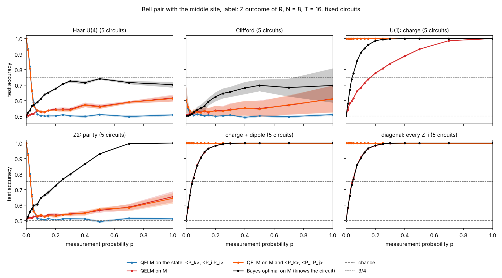
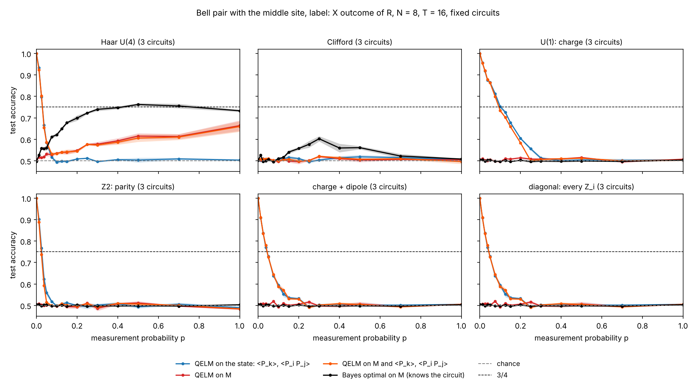
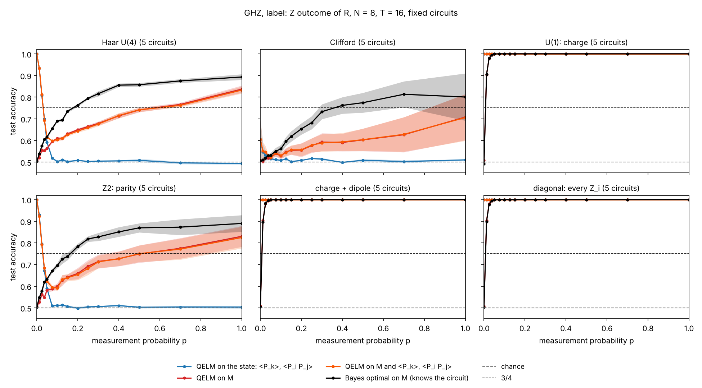
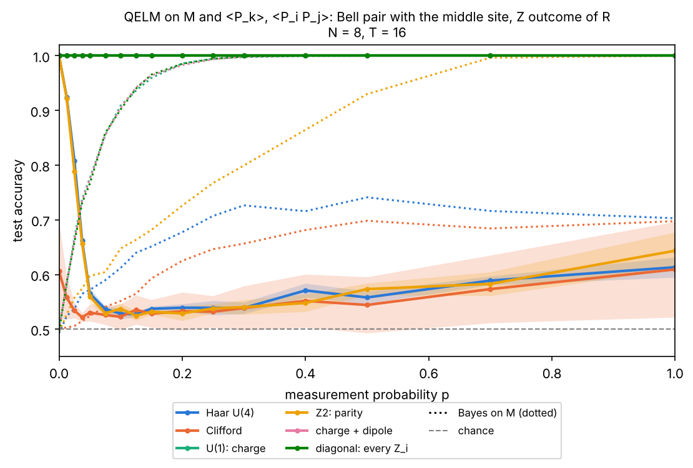
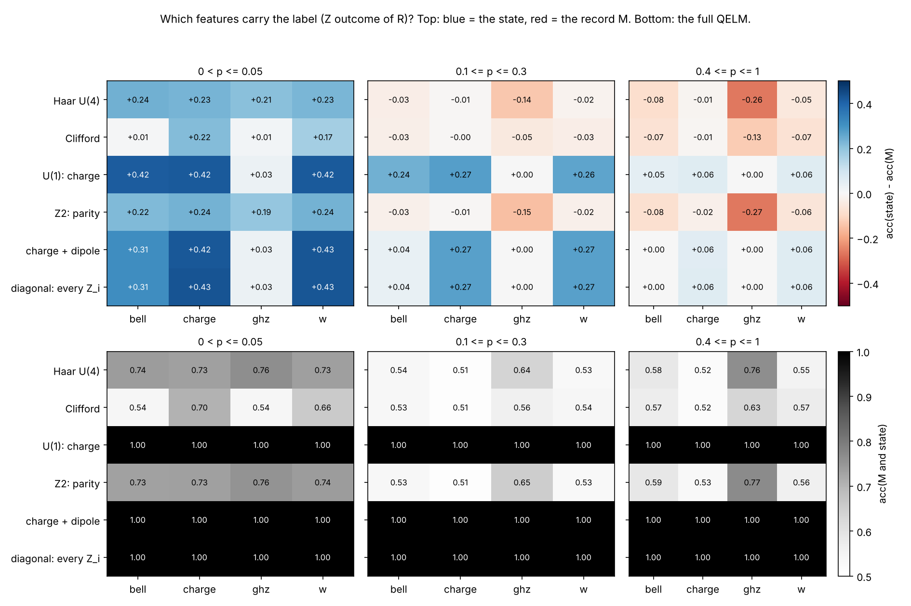
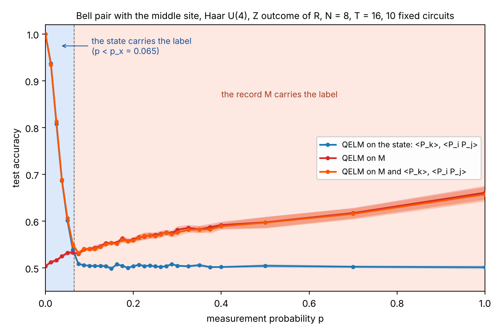
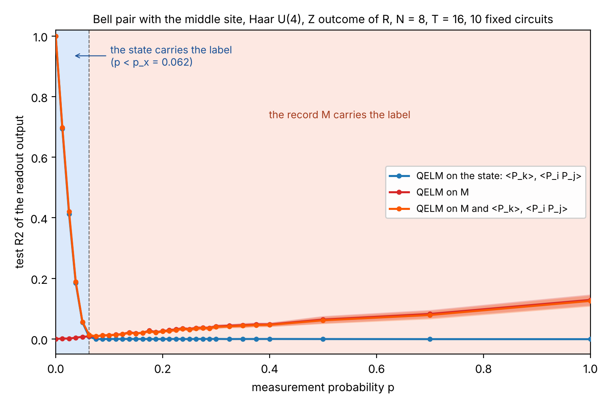

# State or record: which tasks make the QELM read one or the other (issue #311)

The comparison figure of [`nonlinear_M/`](../nonlinear_M/README.md) (Bell
pair with the middle site, Haar U(4), `N = 8`, `T = 16`) shows two readouts
that take turns: the QELM on the final state (`<P_k>`, `<P_i P_j>`) reads the
label of the reference qubit `R` only at small `p`, and the QELM on the record
`M` takes over at larger `p`. This experiment draws that figure for six gate
families, four encodings and two labels, to find **tasks (encoding + target)
where one feature set carries the label and the other carries little or
nothing**.

## Experiment overview

| | |
| --- | --- |
| Script(s) | `experiments/nonlinear_M/nonlinear_M.py` (options `nonlinear_task.circuit`, `nonlinear_task.target`), launcher `symmetry_regimes.sh`, figures `plot_symmetry_regimes.py` |
| Config | `conf/nonlinear_M.yaml` |
| Physical model | brickwork of two-qubit gates on an open chain, one fixed circuit per seed, Z measurement of each system qubit with probability `p` after each round. Gate families: `haar` (Haar U(4)), `clifford`, `u1` (charge `sum Z_i` conserved), `z2` (parity `prod Z_i`), `dipole` (charge and dipole, four-site gates), `diagonal` (every `Z_i`) |
| System sizes `N` | 8 system qubits plus `R` (state vector) |
| Control parameters | `p` (16 values from 0 to 1, dense below 0.1), `T = 2N = 16` rounds |
| Initial state | `(|0>_R |a> + |1>_R |b>) / sqrt 2` with the four encodings of `nonlinear_M`: `bell` (`b` = middle site flipped), `charge` (sectors `N/2`, `N/2 - 1`), `ghz` (`|0...0>`, `|1...1>`), `w` (`|0...0>`, the W state) |
| ML task | binary classification of the outcome `Y` of `R`, measured at the end along Z (`target=z`) or X (`target=x`); ridge on the state, on `vec(M)`, on both; Bayes decoder of `M` (knows the circuit) |
| Issues / PRs | #311; builds on #269 (`nonlinear_M`), #288 (symmetric circuits), #285 / #305 (the state readout at small `p`) |

## Methodology

1. One trajectory: `T` rounds of the fixed circuit of the seed, each followed
   by a Z measurement of each system qubit with probability `p` (record `M`,
   +-1, 0 if not measured). At the end, `R` is measured along the target axis:
   `Y = +-1`. For `target=x`, `R` is rotated by a Hadamard before a Z
   measurement.
2. Features: `vec(M)` (128), the QELM features of the final chain state after
   `R` is measured (`<P_k>`, `<P_i P_j>`, `P` in `X, Y, Z`, 108), and both
   side by side.
3. Readout: `RidgeCV` (alpha by leave-one-out over `10^-2 .. 10^4`), 70 / 30
   split of the 3000 trajectories of each `p`; test accuracy of the sign.
4. Bayes on `M`: the sign of `<Z_R>` (or `<X_R>`) given the record and the
   circuit, the best decoder of an observer who knows the gates.
5. Seeds: 5 circuits (42 to 46) for the Z target, 3 (42 to 44) for the X
   target. The curves show the mean over circuits and the standard error.
6. Regime map: in three bands of `p` (`p <= 0.05`, `0.1 <= p <= 0.3`,
   `p >= 0.4`), `acc(state) - acc(M)` (positive: the state carries the
   label) and `acc(M and state)`.

How to run it: [Find the state and record regimes across gate
symmetries](../README.md#find-the-state-and-record-regimes-across-gate-symmetries-issue-311).

## Results and discussion

Accuracy at a few `p` (mean over circuits, standard error about 0.01 for the
state, 0.01 to 0.03 for `M`):

| Task (circuit, encoding, target) | readout | p = 0.0125 | 0.05 | 0.1 | 0.3 | 1 |
| --- | --- | --- | --- | --- | --- | --- |
| U(1), bell, Z | state | 1.00 | 1.00 | 1.00 | 1.00 | 1.00 |
| | M | 0.54 | 0.62 | 0.68 | 0.84 | 1.00 |
| | Bayes on M | 0.58 | 0.78 | 0.91 | 1.00 | 1.00 |
| U(1), bell, X | state | 0.96 | 0.87 | 0.75 | 0.51 | 0.50 |
| | M | 0.51 | 0.50 | 0.50 | 0.51 | 0.51 |
| | Bayes on M | 0.50 | 0.50 | 0.50 | 0.50 | 0.50 |
| Haar, GHZ, Z | state | 0.93 | 0.59 | 0.50 | 0.50 | 0.49 |
| | M | 0.52 | 0.56 | 0.61 | 0.68 | 0.84 |
| | Bayes on M | 0.54 | 0.62 | 0.69 | 0.82 | 0.89 |
| Z2, bell, Z | state | 0.93 | 0.57 | 0.51 | 0.51 | 0.51 |
| | M | 0.52 | 0.53 | 0.53 | 0.54 | 0.65 |
| | Bayes on M | 0.53 | 0.60 | 0.65 | 0.80 | 1.00 |

Four regimes come out of the grid.

- **The state carries the label at every `p`, `M` adds nothing: a conserved
  charge and a Z label.** With U(1), dipole or diagonal gates and the `bell`,
  `charge` or `w` encodings, the QELM on the state is at 1.00 at every `p`:
  once `R` is measured, the chain sits in one charge sector, and `sum_k <Z_k>`
  is that charge. The QELM on `M` starts at chance and catches up only at
  `p ~ 0.7` (U(1)); with dipole and diagonal gates it follows Bayes, because
  the middle site keeps its `Z_i` and is read as soon as it is measured. The
  full QELM is the state readout.
- **Only the state carries the label, `M` holds none of it: a conserved
  charge and an X label.** With the same gates and encodings, the X outcome
  of `R` depends on the phase between two charge sectors. Gates and Z
  measurements never mix the sectors, so the law of `M` does not depend on
  that phase: Bayes on `M` is exactly 1/2 at every `p` (checked by a test:
  `<X_R> = 0` given any record). The state still holds the coherence for a
  while: the QELM on the state reads 0.96 at `p = 0.0125`, 0.75 at `p = 0.1`
  and reaches chance at `p ~ 0.3`, four times later than with Haar gates
  (`p ~ 0.075`). This is the cleanest "Z only" task: `M` is useless by
  symmetry, not by lack of samples.
- **`M` carries the label, the state carries none of it: no conservation and
  a label copied on every site.** With Haar or Z2 gates and the GHZ encoding,
  the state readout is at chance from `p ~ 0.075`, and the QELM on `M` rises
  from 0.61 at `p = 0.1` to 0.84 at `p = 1`, 87 % of the way from chance to Bayes (0.89).
  For the GHZ label the Z2 parity of the two branches is the same (`N` even),
  so Z2 acts like Haar here. The same holds, weaker, for Haar or Clifford with
  the charge or W encodings and the X label (`M` 0.65 to 0.70 at `p = 1`).
- **`M` carries the label but not linearly: Z2 and Clifford.** With Z2 gates
  and the `bell`, `charge` or `w` encodings, the two branches have opposite
  parity. Bayes on `M` reaches 1 at `p = 1` (the last full round gives the
  parity), but the parity is a product of `N` outcomes, which a ridge on
  `vec(M)` does not see: the QELM on `M` stays at 0.54 to 0.65. Clifford
  gates give a similar gap (Bayes 0.70, `M` 0.61 at `p = 1`, `bell`).

In every task the full QELM equals the better of the two readouts within the
error bars, and is sometimes a little below it (U(1), `bell`, X at
`p = 0.1`: 0.73 against 0.75): the two feature sets do not combine, they take
turns. Trivial tasks: with GHZ and any gate family that conserves the charge,
`|0...0>` and `|1...1>` are untouched and both readouts are at 1.00 (Z
target) or 1/2 (X target).

Limits: `N = 8` only, 3 to 5 circuits per task; the state features are read
after `R` is measured, as in `nonlinear_M`, so the charge imprinted on the
chain by that measurement is what the state readout reads in the first two
regimes.

## Figures

**Figure 1. Bell encoding, Z label, one panel per gate family.** Test
accuracy against `p` of the QELM on the state (blue), on `M` (red), on both
(orange) and of the Bayes decoder of `M` (black), `N = 8`, `T = 16`, 5 fixed
circuits, 3000 trajectories per `p`; gray: chance; dashed: 3/4. The Haar
panel is the figure of `nonlinear_M`. Produced by
`experiments/symmetry_regimes/plot_symmetry_regimes.py`.

**Figure 2. Bell encoding, X label.** As Figure 1, 3 circuits. With U(1),
dipole and diagonal gates, Bayes on `M` is at 1/2 at every `p` and only the
state reads the label.

**Figure 3. GHZ encoding, Z label.** As Figure 1. Haar and Z2: the state is
at chance from `p ~ 0.075` and `M` carries the label up to 0.84.

**Figure 4. The full QELM of every gate family on one axis.** QELM on `M`
and the state (solid) and Bayes on `M` (dotted, same color), Bell encoding,
Z label. The other encodings and the X label: `full_overlay_<encoding>_<target>.png`.

**Figure 5. Regime map, Z label.** Top: `acc(state) - acc(M)` averaged over
three bands of `p`, per gate family (rows) and encoding (columns); blue: the
state carries the label, red: the record does. Bottom: accuracy of the full
QELM. The X label: [`regime_map_x.png`](figures/regime_map_x.png).

**Figure 6. The two regimes of the starting task.** Haar U(4), Bell pair with
the middle site, Z label, `N = 8`, `T = 16`, 10 fixed circuits, 8000
trajectories per `p` (the run of `nonlinear_M`, `bell_T16_summary.json`). Test
accuracy (top) and test R2 of the readout output (bottom) of the QELM on the
state (blue), on `M` (red) and on both (orange). Background: blue for
`p < p_x`, red for `p > p_x`, where `p_x` is the crossing of the state and `M`
curves (0.065 for the accuracy, 0.062 for the R2). Below `p_x` the label is
still in the final state and the record holds almost nothing (`R2(M) < 0.01`);
above it the state is at chance (`R2 = 0`) and only the record reads the label,
slowly (accuracy 0.54 at `p = 0.1`, 0.66 at `p = 1`; R2 0.012 and 0.13). The
full QELM follows the better of the two. Produced by
`experiments/symmetry_regimes/plot_two_regimes.py`.

The other panels (`qelm_by_symmetry_<encoding>_<target>.png`) and the data
(`summary.json`: every curve, and the band means of the regime maps) are in
`figures/`.
